# 人大802宏观知识导图与拓扑

本稿与本地练习室共用一份知识底稿。导图看结构，拓扑看前置、推导、对照、条件变化、机制和方法类比；应用路径逐问对应当前训练。

编者知识点底稿：既有学习资料概括、条件推导和方法类比分别标注；卡片和审校稿均不是教材逐字原文。每条关系受所列条件约束，不以共现代替推出。

知识点129个；关系129条；知识卡64张；120道题、408个分问。

## 怎样使用

1. 从专题问题进入分支，独立解释节点的定义、条件与推导。
2. 沿关系句复述“为什么成立”，将条件变化后的分支另作检查。
3. 先做对应小问，再核对其实际调用节点和关系；认识概念、解释联系、独立解题分别自评。

来源说明：知识卡、已有专题、专项审校与编者综合题分别标注。摘录可回查当前资料，但不自动视为教材逐字引文。

## 从资本积累到黄金律：先分水平，再分增长

怎样把资本积累的口径、稳态水平与长期增长机制分开判断？

从有效人均和时间制进入积累；稳态消费配置与技术知识机制分别说明水平、增长和转轨。

### 分支导图

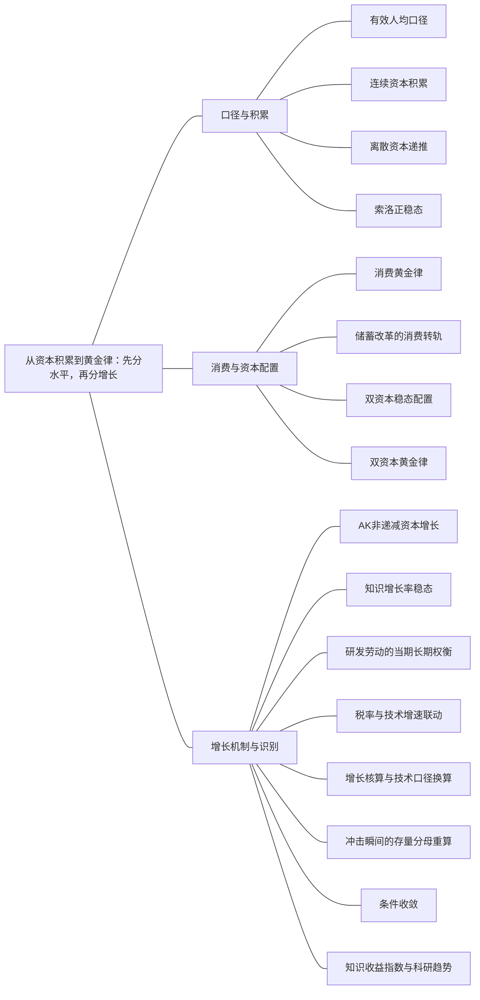

### 本专题知识联系

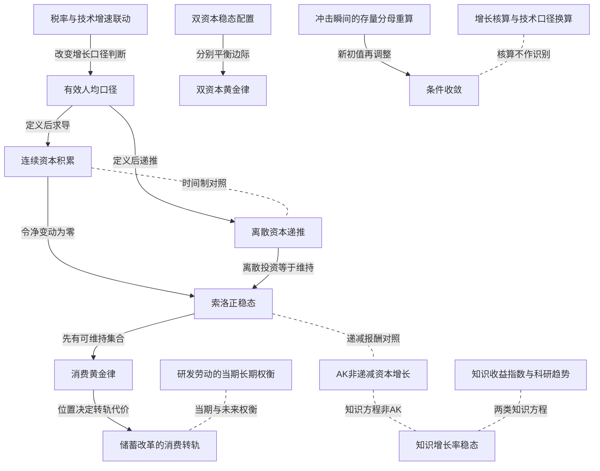

关系图中的箭头表示有方向的联系；虚线表示对照或类比。图中只画本专题主归属节点；跨专题关系在逐条命题中列明，可在练习室逐点追踪。具体成立条件以逐条说明为准。

### KMA001 有效人均口径

身份：既有资料概括

还用于：从数据到机制比较：论述怎样有证据地落地

**定义与对象**

有效人均量把总量除以技术效率与劳动数量的乘积，是识别增长稳态的变量口径。

**何时调用**

题给技术、人口同时增长，或问普通人均与总量增长。

**适用条件**

劳动增进技术写作$Y=K^\alpha(AN)^{1-\alpha}$；不得把中性TFP直接当作A。

**核心公式与机制**

$k=\frac{K}{AN},y=\frac{Y}{AN}$；有效人均静止不等于Y或Y/N静止。

**推导与理由**

固定k、y时，总产出与AN同比增长，普通人均产出仍随A增长。

**边界与易错**

先核分母及技术形式；人口、效率和价格不是可互换的除数。

**整理依据**

- card CK01：总量、人均量、有效人均量不是同一变量；有技术进步时有效人均稳态可以对应总产出持续增长。离散模型先写下一期分母，连续模型先对定义求导。名义和实际量同口径比较，价格水平与通胀率也要分开。
- card FA09：**符号与前提。** $Y=K^\alpha(AN)^{1-\alpha}$，$0<\alpha<1$，$\dot K=sY-\delta K$，$\frac{\dot{N}}{N} = n$、$\frac{\dot{A}}{A} = g$，$0<s\leq1$、$n+g+\delta>0$。定义$k = \frac{K}{A N}$、$y = \frac{Y}{A N} = k^\alpha$。

### KMA002 连续资本积累

身份：既有资料概括

**定义与对象**

连续积累由净投资与有效劳动稀释共同决定资本比率的瞬时变化。

**何时调用**

题式有点号并给连续人口、技术增长。

**适用条件**

$\dot K=sY-\delta K$；n、g为连续增长率，储蓄进入同一资本。

**核心公式与机制**

$\dot k=sf(k)-(n+g+\delta)k$。

**推导与理由**

对K/(AN)求导，投资增加分子，折旧与分母增长均降低比率。

**边界与易错**

不能在连续式中另加离散交叉项ng，也不能漏掉人口与技术稀释。

**整理依据**

- card FA09：**解题步骤。** 从总量方程对比率求导，保留分母增长造成的稀释，再令$\dot k=0$求正稳态。资本、消费和产出分别计算，最后报告普通人均与总量增长率。稳态上$g_{Y/N}=g$、$g_Y=g_K=n+g$，有效人均量零增长。

### KMA003 离散资本递推

身份：既有资料概括

**定义与对象**

离散积累按本期生产和下一期分母确定下一期有效人均资本。

**何时调用**

题给年度t+1递推或要求精确增长因子。

**适用条件**

投资和折旧按所给期内时序发生；人口与技术均在下一期分母。

**核心公式与机制**

$k_{t+1}=\frac{(1-\delta)k_t+sf(k_t)}{(1+n)(1+g)}$。

**推导与理由**

先写下一期总资本，再除以A与N各自下一期量；ng来自分母乘积。

**边界与易错**

离散差分不是将连续点号改成减号；不同投资入账时序须重推。

**整理依据**

- card FA10：**符号与前提。** 题目明确$K_{t+1}=(1-\delta)K_t+sY_t$，$N_{t+1}=(1+n)N_t$，$A_{t+1}=(1+g)A_t$。本模板不能用来替代“投资在期末另计技术”之类不同时间安排。

### KMA004 索洛正稳态

身份：既有资料概括

还用于：从数据到机制比较：论述怎样有证据地落地

**定义与对象**

正稳态使实际投资恰好维持既有有效人均资本。

**何时调用**

已知储蓄与维持系数，求资本、产出、消费水平。

**适用条件**

本节点限定本库柯布道格拉斯f(k)=k^α、0<α<1，正储蓄与正维持系数；零资本根另列。

**核心公式与机制**

连续式$sf(k^*)=(n+g+\delta)k^*$；离散维持系数改为$n+g+ng+\delta$。

**推导与理由**

递减平均产出使投资与维持线在正资本相交，继而用生产与消费份额求水平。

**边界与易错**

正稳态、边界稳态、增长率和参数可行性分别报告。

**整理依据**

- card FA09：**解题步骤。** 从总量方程对比率求导，保留分母增长造成的稀释，再令$\dot k=0$求正稳态。资本、消费和产出分别计算，最后报告普通人均与总量增长率。稳态上$g_{Y/N}=g$、$g_Y=g_K=n+g$，有效人均量零增长。
- card AC03：索洛模型以资本积累、人口和技术解释长期收入。储蓄形成投资，折旧消耗资本，新增人口和劳动效率提高要求更多资本才能维持有效人均资本。资本边际报酬递减使标准模型存在向正稳态收敛的力量。提高储蓄率改变稳态收入水平并加快过渡期增长，但长期普通人均增长仍取决于外生技术进步。

### KMA005 消费黄金律

身份：既有资料概括

**定义与对象**

黄金律在可维持的稳态中选择消费最高的资本，不是选择最大产出或贴现效用。

**何时调用**

问储蓄最优、过度积累或资本收益与维持成本比较。

**适用条件**

连续维持系数$q=n+g+\delta>0$且生产凹；离散按其精确系数替换q。

**核心公式与机制**

$c=f(k)-qk$，内点条件$f^{\prime}(k_G)=q$；柯布道格拉斯下$s_G=\alpha$。

**推导与理由**

稳态多持有资本带来边际产出，同时占用额外维持投资；两者相等时净消费达到峰值。

**边界与易错**

黄金律不含社会时间偏好，不能代替家庭跨期最优。

**整理依据**

- card FA11：**符号与前提。** 连续索洛中令$q=n+g+\delta$，可持续有效人均消费$c=f(k)-qk$。比较不同储蓄率维持的稳态，不直接求一代人的贴现最优。

### KMA006 储蓄改革的消费转轨

身份：既有资料概括

**定义与对象**

储蓄变化先改变既定产出的消费分配，再经资本积累改变未来产出与消费。

**何时调用**

已知资本相对黄金律的位置，解释瞬时、过渡和长期消费。

**适用条件**

从原正稳态向消费黄金律调整，改变储蓄但不越过黄金律；资本和技术在瞬间不能跳变，新储蓄率可持续。

**核心公式与机制**

瞬时$c^+=(1-s^+)f(k^-)$；后续资本沿新积累式调整。

**推导与理由**

资本不足时提高储蓄先减少消费以支持积累；过度积累时降低储蓄可同时提高即时和最终消费。

**边界与易错**

只报新稳态会漏掉代际代价；不能把任意减税等同于纠正过度积累。

**整理依据**

- card FA11：**解题步骤。** 用数据算$MPK$与真实折旧率，再和$q$比较：$MPK>q$说明资本低于黄金律，反之为过度积累。求新资本后用$s = \frac{q k}{y}$反推储蓄率，最后区分冲击瞬间、过渡与终点。资本不足时提高$s$，当期$K,Y$不跳、投资升、消费降；长期消费上升。
- card AC03：黄金律选择可持续消费最高的稳态，而非产出最高或储蓄最多的稳态。资本不足时提高储蓄会先减少当前消费，之后才提高长期消费；过度积累时降低储蓄可以同时改善当前与长期消费。黄金律不含社会时间偏好，不能自动等同于最大化贴现终身效用的资本选择。

### KMA007 双资本稳态配置

身份：既有资料概括

**定义与对象**

两类资本分别满足维持投资条件，产出由二者联合形成。

**何时调用**

物质与人力资本分别有储蓄率和折旧率。

**适用条件**

$y=k^\alpha h^\beta,\alpha,\beta>0,\alpha+\beta<1$，连续时间qK=n+δK>0、qH=n+δH>0，sK,sH>0且和小于1；本节点公式使用该连续口径。

**核心公式与机制**

$q_Kk=s_Ky,q_Hh=s_Hy$，代回可得$y^*=[(\frac{s_K}{q_K})^\alpha(\frac{s_H}{q_H})^\beta]^{\frac{1}{1-\alpha-\beta}}$。

**推导与理由**

先以y表示两资本，再从生产函数消去k、h，避免误套一资本指数。

**边界与易错**

两资本分母和时序须一致；指数和等于1时上述有限稳态式失效。

**整理依据**

- card FA12：**解题步骤。** 两种稳态投资等于各自维持量，代回生产函数联立；先解$y$可减少指数整理错误。黄金律最大化$c=k^\alpha h^\beta-q_Kk-q_Hh$，故$\frac{\alpha y}{k} = q_K$、$\frac{\beta y}{h} = q_H$，推出$s_K^{GR}=\alpha$、$s_H^{GR}=\beta$。

### KMA008 双资本黄金律

身份：既有资料概括

**定义与对象**

消费最优要求每类资本的边际产出分别等于其维持成本。

**何时调用**

在两资本之间和消费之间重新分配总投资。

**适用条件**

本CD生产指数α,β>0且和<1，两类资本可独立调节；连续qK=n+δK、qH=n+δH均正，储蓄率正且和<1。

**核心公式与机制**

$\frac{\alpha y}{k}=q_K,\frac{\beta y}{h}=q_H$；相应$s_K=\alpha,s_H=\beta$。

**推导与理由**

对k、h分别求偏导；只使一个边际条件成立仍可能在另一资本上错配。

**边界与易错**

总储蓄更高不必更优；固定总额也须检查两类资本比例。

**整理依据**

- card FA12：**解题步骤。** 两种稳态投资等于各自维持量，代回生产函数联立；先解$y$可减少指数整理错误。黄金律最大化$c=k^\alpha h^\beta-q_Kk-q_Hh$，故$\frac{\alpha y}{k} = q_K$、$\frac{\beta y}{h} = q_H$，推出$s_K^{GR}=\alpha$、$s_H^{GR}=\beta$。

### KMA009 AK非递减资本增长

身份：既有资料概括

还用于：从数据到机制比较：论述怎样有证据地落地

**定义与对象**

AK把可积累广义资本设为线性产出来源，使储蓄可以改变持续增长。

**何时调用**

生产对K线性，或比较索洛与内生增长。

**适用条件**

连续$Y=BK,B>0$；人口增速n，折旧δ，B不是劳动增进技术。

**核心公式与机制**

$g_{Y/N}=sB-\delta-n$；离散则保留总回报因子并除人口因子。

**推导与理由**

资本增加不降低平均产出，因此投资与资本维持可按固定比例形成长期增长而非凹形正稳态。

**边界与易错**

须分正、零、负增长；不能把所有知识模型叫AK。

**整理依据**

- card FA15：**解题步骤。** AK直接除以$K$，比较$sB$与$\delta+n$，正、零、负增长分别讨论，不求凹形索洛的唯一有限稳态。研发劳动模型则固定$u$求有效人均稳态，普通人均长期增长为$g(u)$；储蓄仍主要影响水平，研究劳动可能影响增长。

### KMA010 知识增长率稳态

身份：既有资料概括

**定义与对象**

知识积累模型可能以增长率而非资本技术水平为稳态对象。

**何时调用**

知识运动由产出幂驱动，要求资本和技术增长率恒定。

**适用条件**

特指$Y=K^\alpha(AN)^{1-\alpha},0<\alpha<1$、$\dot A=Y^\varphi,\dot K=sY,0<\varphi<1$且s>0、无折旧的分支；n>0才有所列正指数路径。

**核心公式与机制**

$g_K=g_Y=\frac{n}{1-\varphi},g_A=\frac{\varphi n}{1-\varphi}$。

**推导与理由**

对gK与gA再取对数导数，令两增长率变化为零后联立；储蓄影响水平但不进入该路径的长期增长率。

**边界与易错**

n=0下增长率趋零不表示A停止变化；不得擅加折旧而冒称同一模型。

**整理依据**

- card FA13：**解题步骤。** 对两增长率再取对数导数，令其为零：
- card FA13：正增长路径且$n>0$时，$g_K = g_Y = \frac{n}{1 - \varphi}$，$g_A = g_{Y / N} = \frac{\varphi n}{1 - \varphi}$。储蓄率影响水平与过渡，不出现在这组长期增长率中。

### KMA011 研发劳动的当期长期权衡

身份：既有资料概括

**定义与对象**

研发劳动配置把劳动在当期生产与知识创造之间分配。

**何时调用**

制造与研究部门共享劳动，或问一次增研究人数与持续增加的区别。

**适用条件**

制造劳动比例1−u，技术增长g(u)；知识方程和人口趋势须另给。

**核心公式与机制**

$\dot k=sF(k,1-u)-[n+g(u)+\delta]k$。

**推导与理由**

提高u减少当期制造投入，同时改变技术增长及有效资本维持量；长期增益要同过渡消费比较。

**边界与易错**

更快技术增长不保证所有代福利都升；知识收益递减时一次劳动增加未必维持常正增长。

**整理依据**

- card FA15：**条件检查。** 提高$u$把劳动从当期生产转去研究，同时提高有效劳动增长的维持投资；两条曲线都可能改变，当期产出和消费可能下降。不能只因长期技术增长更快就断言每代福利都增加。AK、2019知识模型及研发劳动模型对储蓄的长期作用不同，须写方程后作比较。

### KMA012 税率与技术增速联动

身份：既有资料概括

**定义与对象**

税率对当期生产率与技术增长的不同入口可以相互抵消或强化。

**何时调用**

同题先固定技术增长，后又给税率决定g的方程。

**适用条件**

卡片分支$Y=(1-\tau)K^\alpha(AN)^{1-\alpha},g=b(1-\tau)^{1/\alpha}$，n=δ=0且税收不形成资本。

**核心公式与机制**

该分支$k^*\propto(1-\tau)^{-1/\alpha}$，税后有效人均$y^*$税率项抵消，但普通人均长期增长g仍变化。

**推导与理由**

代入g之前减税提高有效产出水平；代入联动后须将分子生产效应与分母稀释效应共同化简。

**边界与易错**

加正折旧或公共投资会破坏抵消；有效人均资本下降不等于普通生活水平下降。

**整理依据**

- card FA14：**解题步骤。** 固定$g$时减税提高$k^*,y^*$。第三问另代入$b>0$及$g = b (1 - \tau)^{\frac{1}{\alpha}}$，得
- card FA14：**条件检查。** 资本、税前技术产出、税后产出与普通/有效人均不能混用。若另加正折旧$\delta$，维持项是$g+\delta$，税率不再完全抵消；该分支应标“扩展”。政府把税收用于生产资本、研发或公共品时，还需增加其投资方程，不能继续固定所有生产条件。

### KMA013 增长核算与技术口径换算

身份：既有资料概括

**定义与对象**

增长核算将产出增长分为投入贡献和余值，余值与劳动增进技术增长不是同一个量。

**何时调用**

给资本劳动增长和份额，或将中性技术改写成劳动增进技术。

**适用条件**

用收入份额作弹性需竞争与规模条件；连续对数增长或说明近似。

**核心公式与机制**

$g_Y=\alpha g_K+(1-\alpha)g_N+g_B$，若$B=A^{1-\alpha}$则$g_B=(1-\alpha)g_A$。

**推导与理由**

对生产函数取对数导数，再以产出增长扣投入贡献；剩余项由所采用的生产及计量口径决定。

**边界与易错**

余值还含利用率、质量与误差，不能全叫技术发明或因果政策效应。

**整理依据**

- card FA17：**符号与前提。** 中性技术$Y=BK^\alpha N^{1-\alpha}$，用收入份额作弹性需规模报酬及竞争等条件。劳动增进写法$Y=K^\alpha(AN)^{1-\alpha}$对应$B=A^{1-\alpha}$。
- card FA17：**条件检查。** TFP不是劳动生产率，也不是劳动增进$A$本身。余值含技术以外的利用率、质量和测量因素，不能全部归为发明。负的初始收入—增长关系需要数据和控制条件才能成为经验结论，示意散点不构成因果证据。穷可能来自低技术或低稳态，不能仅凭收入低就预测追赶。

### KMA014 冲击瞬间的存量分母重算

身份：既有资料概括

**定义与对象**

冲击瞬间先确定K、技术与人数各自是否跳变，再重算人均变量的新初值。

**何时调用**

灾难毁资本或人口、一次技术跃升。

**适用条件**

政策瞬时与年度变化分开；资本和劳动是否同时受损以题给为准。

**核心公式与机制**

$\frac{k^+}{k^-}=\frac{K^+/K^-}{(A^+/A^-)(N^+/N^-)}$。

**推导与理由**

比率分子分母可能同时变，先核新初值才可判断朝哪个稳态方向调整。

**边界与易错**

人均资本增加不等于总财富或福利增加；一次水平跃升与技术增速改变不同。

**整理依据**

- card FA16：**解题步骤。** 先用存量比率定位新初值，再看曲线是否变。一次灾难若不改$s,n,g,\delta$及技术，原稳态曲线不变；资本相对损失更多使$k$降，人口相对损失更多可能使$k$升。技术增速永久提高则抬高维持线，降低有效人均稳态，同时提高长期普通人均增长。

### KMA015 条件收敛

身份：既有资料概括

**定义与对象**

追赶取决于相对各自稳态的位置，低收入本身不能决定增长快慢。

**何时调用**

比较灾后恢复、穷国追赶或不同经济长期收入差异。

**适用条件**

索洛递减报酬且技术、储蓄、人口及折旧等结构条件适当固定。

**核心公式与机制**

$g_k=sk^{\alpha-1}-(n+g+\delta)$说明共同稳态下较低资本可较快增长。

**推导与理由**

资本稀缺时平均产出较高，给定储蓄可形成较快比率积累；不同参数同时移动稳态则不能只比较初始收入。

**边界与易错**

理论条件收敛不是观察散点即可识别的因果结论。

**整理依据**

- card FA17：**解题步骤。** 先把投入增长乘对应份额，再以总增长减去投入贡献求余值。若资本份额$.3$、资本增长1%、劳动增长2%、TFP增长1.2%，总增长为2.9%。收敛题固定技术与结构参数后比较相对稳态的资本缺口；参数不同则比较各自稳态，不要求最终收入相同。
- card AC03：索洛模型以资本积累、人口和技术解释长期收入。储蓄形成投资，折旧消耗资本，新增人口和劳动效率提高要求更多资本才能维持有效人均资本。资本边际报酬递减使标准模型存在向正稳态收敛的力量。提高储蓄率改变稳态收入水平并加快过渡期增长，但长期普通人均增长仍取决于外生技术进步。

### KMA031 知识收益指数与科研趋势

身份：编者推导

**定义与对象**

知识对自身存量的收益指数决定固定科研劳动能否维持常正增长。

**何时调用**

题给dotA=ηA^φLR，比较φ=1与小于1，或改变科研劳动水平和增长趋势。

**适用条件**

$A>0,\eta>0$；固定$L_R>0$的分支与另设$g_{L_R}=n_R>0$的分支独立。

**核心公式与机制**

$g_A=\eta L_RA^{\phi-1}$；φ=1固定科研劳动给常增长，0<φ<1固定劳动给增长率趋零；若科研劳动持续增长，常正路径$g_A=\frac{n_R}{1-\phi}$。

**推导与理由**

除以知识存量求增长率；收益递减时对A的幂积分，若劳动有趋势则对增长率再取对数导数求平衡。

**边界与易错**

水平持续增长不等于增长率常正；增加一次科研劳动与提高其持续增速不是同一实验。

**整理依据**

- review MA009：将知识生产式除以正的知识存量，得
- review MA009：积分得到 $A_t^{1-\phi}=A_0^{1-\phi}+(1-\phi)\eta L_Rt$。所以知识水平持续增长，但相对增量 $g_A$ 趋零。一次提高固定科研劳动改变水平及过渡路径，不产生常正的极限增长率。
- review MA009：故 $g_A=\frac{n_R}{1-\phi}$。这以持续增加的科研资源和就业可行性为条件；科研劳动水平一次提高与其增长率持续提高属于不同政策实验。

### 关系命题与条件

#### EMA001 有效人均口径 → 连续资本积累

前置；既有资料概括

先定义有效人均资本，才能把总量资本运动换算为连续比率积累。

适用条件：劳动增进生产且使用连续时间。

理由：分母效率和人数的增长形成稀释项。

依据：card FA09「**解题步骤。** 从总量方程对比率求导，保留分母增长造成的稀释，再令$\dot k=0$求正稳态。资本、消费和产出分别计算，最后报告普通人均与总量增长率。稳态上$g_{Y/N}=g$、$g_Y=g_K=n+g$，有效人均量零增长。」

#### EMA002 有效人均口径 → 离散资本递推

前置；既有资料概括

先规定下一期有效劳动分母，才能得到精确离散资本递推。

适用条件：按题定t到t+1时序。

理由：人口和技术增长因子相乘而非直接相加。

依据：card FA10「**解题步骤。** 先写出下一期资本除以下一期有效劳动，再化简，不能直接把连续式中点号换成差分号。柯布道格拉斯时，$k^* = [\frac{s}{n + g + n g + \delta}]^{\frac{1}{1 - \alpha}}$。检查正稳态存在后计算」

#### EMA003 连续资本积累 → 离散资本递推

对照；既有资料概括

连续维持率与离散维持系数不同，不能仅替换点号。

适用条件：两式使用各自一致的时间口径。

理由：离散式的ng交叉项来自精确分母，连续导数没有该项。

依据：card FA10「**解题步骤。** 先写出下一期资本除以下一期有效劳动，再化简，不能直接把连续式中点号换成差分号。柯布道格拉斯时，$k^* = [\frac{s}{n + g + n g + \delta}]^{\frac{1}{1 - \alpha}}$。检查正稳态存在后计算」

#### EMA004 连续资本积累 → 索洛正稳态

推导；既有资料概括

连续资本积累的正固定点由投资等于稀释折旧求得。

适用条件：目标节点已限定的CD生产f(k)=k^α、0<α<1，且正储蓄、正维持率；不将一般凹性当作正交点充分条件。

理由：在固定点资本比率不变，故净投资恰补全部维持需要。

依据：card FA09「**解题步骤。** 从总量方程对比率求导，保留分母增长造成的稀释，再令$\dot k=0$求正稳态。资本、消费和产出分别计算，最后报告普通人均与总量增长率。稳态上$g_{Y/N}=g$、$g_Y=g_K=n+g$，有效人均量零增长。」

#### EMA005 索洛正稳态 → 消费黄金律

前置；既有资料概括

先描述不同资本可维持的稳态，才在其中比较长期消费。

适用条件：黄金律目标为可持续消费。

理由：最优不是对任意瞬间资本生产量求最大。

依据：card FA11「**符号与前提。** 连续索洛中令$q=n+g+\delta$，可持续有效人均消费$c=f(k)-qk$。比较不同储蓄率维持的稳态，不直接求一代人的贴现最优。」

#### EMA006 消费黄金律 → 储蓄改革的消费转轨

条件变化；既有资料概括

资本低于或高于黄金律时，储蓄改革的即时和最终消费权衡不同。

适用条件：从原正稳态朝黄金律改变储蓄且不越过；瞬时资本固定。

理由：消费份额先变、资本路径后变；过度积累减少维持负担。

依据：card AC03「黄金律选择可持续消费最高的稳态，而非产出最高或储蓄最多的稳态。资本不足时提高储蓄会先减少当前消费，之后才提高长期消费；过度积累时降低储蓄可以同时改善当前与长期消费。黄金律不含社会时间偏好，不能自动等同于最大化贴现终身效用的资本选择。」

#### EMA007 双资本稳态配置 → 双资本黄金律

推导；既有资料概括

双资本稳态消费最优要求分别匹配两资本边际收益与维持成本。

适用条件：两维资本可独立配置，生产严格凹。

理由：任一资本边际净收益未平衡都可通过重配改善消费。

依据：card FA12「**解题步骤。** 两种稳态投资等于各自维持量，代回生产函数联立；先解$y$可减少指数整理错误。黄金律最大化$c=k^\alpha h^\beta-q_Kk-q_Hh$，故$\frac{\alpha y}{k} = q_K$、$\frac{\beta y}{h} = q_H$，推出$s_K^{GR}=\alpha$、$s_H^{GR}=\beta$。」

#### EMA008 索洛正稳态 → AK非递减资本增长

对照；既有资料概括

索洛储蓄主要改变水平，AK在给定技术系数下可改变长期人均增长。

适用条件：必须比较各自明确的积累式和资本报酬假设。

理由：可积累资本边际报酬递减是否存在决定稳态或持续增长结构。

依据：card AC03「内生增长不是一条万能公式。AK通过广义资本不递减报酬使储蓄影响长期增长；研发模型通过知识创造解释技术；不同知识积累方程可能使长期增长由人口增长或研发投入决定。遇到“内生技术进步”应先读运动方程，不能一律写提高储蓄永久提高增长。增长核算则是对产出增长的投入贡献和余值进行分解，它不单独识别技术政策的因果效果。」

#### EMA009 AK非递减资本增长 → 知识增长率稳态

对照；既有资料概括

知识由产出幂积累的模型不能直接沿用AK的储蓄增长结论。

适用条件：特指FA13的知识方程及正增长分支。

理由：技术增速还受人口与知识收益指数约束，储蓄项可在长期增长式消失。

依据：card FA15「**条件检查。** 提高$u$把劳动从当期生产转去研究，同时提高有效劳动增长的维持投资；两条曲线都可能改变，当期产出和消费可能下降。不能只因长期技术增长更快就断言每代福利都增加。AK、2019知识模型及研发劳动模型对储蓄的长期作用不同，须写方程后作比较。」

#### EMA010 研发劳动的当期长期权衡 → 储蓄改革的消费转轨

方法类比；编者类比

研发劳动和资本储蓄都可能牺牲当期消费换取未来能力，但作用方程不同。

适用条件：只作跨期资源取舍的方法类比，不声称同一最优条件。

理由：前者改变劳动和技术增长，后者直接改变资本投资份额。

依据：card FA15「**条件检查。** 提高$u$把劳动从当期生产转去研究，同时提高有效劳动增长的维持投资；两条曲线都可能改变，当期产出和消费可能下降。不能只因长期技术增长更快就断言每代福利都增加。AK、2019知识模型及研发劳动模型对储蓄的长期作用不同，须写方程后作比较。」

#### EMA011 税率与技术增速联动 → 有效人均口径

条件变化；既有资料概括

税率使有效人均资本下降时，普通人均增长仍可能提高。

适用条件：税率同时改变生产和技术增速的特定分支。

理由：有效劳动分母增长更快会降低资本比率，却可提高普通人均技术趋势。

依据：card FA14「税后有效人均产出的税率项抵消；通常人均$\frac{Y}{N} = A y^*$的长期增长率$g$却因减税提高。减税后有效人均资本下降，也不能直接说普通人均生活水平下降。」

#### EMA012 冲击瞬间的存量分母重算 → 条件收敛

机制；既有资料概括

不改结构参数的资本灾难改变资本初值而不改变原稳态，因此可出现重建式追赶。

适用条件：灾难没有永久改变技术、储蓄、人口趋势或折旧。

理由：较低初值与原稳态的差距形成较快积累，不是灾难提高长期能力。

依据：card FA16「**解题步骤。** 先用存量比率定位新初值，再看曲线是否变。一次灾难若不改$s,n,g,\delta$及技术，原稳态曲线不变；资本相对损失更多使$k$降，人口相对损失更多可能使$k$升。技术增速永久提高则抬高维持线，降低有效人均稳态，同时提高长期普通人均增长。」

#### EMA013 增长核算与技术口径换算 → 条件收敛

对照；既有资料概括

增长余值分解和条件收敛是不同分析，核算本身不证明穷国追赶或技术政策因果。

适用条件：数据与生产口径一致但仍需识别结构和初值。

理由：会计贡献与机制比较需要额外控制条件才可连接经验结论。

依据：card FA17「**条件检查。** TFP不是劳动生产率，也不是劳动增进$A$本身。余值含技术以外的利用率、质量和测量因素，不能全部归为发明。负的初始收入—增长关系需要数据和控制条件才能成为经验结论，示意散点不构成因果证据。穷可能来自低技术或低稳态，不能仅凭收入低就预测追赶。」

#### EMA026 知识收益指数与科研趋势 → 知识增长率稳态

对照；编者推导

自身知识幂与产出幂两种技术积累不能互套长期增长式。

适用条件：各自生产、资本积累与科研资源趋势须保持。

理由：前者增长受φ和科研劳动趋势约束，后者增长率系统还联结资本与人口。

依据：review MA009「故 $g_A=\frac{n_R}{1-\phi}$。这以持续增加的科研资源和就业可行性为条件；科研劳动水平一次提高与其增长率持续提高属于不同政策实验。」；card FA13「**题干触发。** 题目给$\dot A=Y^\varphi$，要求资本和知识增长率恒定，讨论储蓄能否改变长期增长。它不是AK。」

#### EMA127 离散资本递推 → 索洛正稳态

推导；既有资料概括

精确离散资本递推的正固定点也由投资等于维持需要确定，但维持系数含ng。

适用条件：本CD生产0<α<1、正储蓄和正维持系数；按原年度时序。

理由：令下一期资本比率等于本期，乘回人口技术因子，保留全部离散稀释项。

依据：card FA10「$$ sf(k^*)=(n+g+ng+\delta)k^*. $$」

### 对应题目分问路径

#### MA001

平衡增长口径下由资本比率进入收益、储蓄与黄金律转轨。

**第1问**

本问任务：资本产出比为3时，资本边际产出是多少？

题给竞争资本报酬和K/Y=3，先按边际产量定价求MPK；平衡增长并不令总产出静止。

调用：KMA070 竞争性边际产量定价；KMA001 有效人均口径

联系：本问直接使用“竞争性边际产量定价、有效人均口径”所列定义、模型或既有结论核算，不将本问共同出现的知识点强行画成逻辑推出。

**第2问**

本问任务：维持该路径所需的储蓄率是多少？

人口固定、技术带动总量增长，维持路径所需投资须同时补折旧及趋势增长，再反求储蓄份额。

调用：KMA002 连续资本积累；KMA004 索洛正稳态；KMA001 有效人均口径

联系：EMA001、EMA004

**第3问**

本问任务：黄金律要求的资本边际产出是多少？

消费黄金律比较资本边际产出与有效资本维持成本，不将3%总量增长直接当资本收益。

调用：KMA005 消费黄金律；KMA001 有效人均口径

联系：本问直接使用“消费黄金律、有效人均口径”所列定义、模型或既有结论核算，不将本问共同出现的知识点强行画成逻辑推出。

**第4问**

本问任务：黄金律储蓄率是多少？补充说明从当前状态向黄金律转轨时消费怎样变化。

先求消费最优储蓄，再按当前资本相对黄金律的位置说明即时份额和以后资本调整，不能只报长期终点。

调用：KMA005 消费黄金律；KMA006 储蓄改革的消费转轨；KMA002 连续资本积累

联系：EMA006

#### MA002

离散人口分母必须在索洛与AK两个分支中统一。

**第1问**

本问任务：求人均稳态产出及人均增长率。

K的年度积累先除下一期人口，按正固定点求普通人均水平和长期增长，零边界另辨。

调用：KMA001 有效人均口径；KMA003 离散资本递推；KMA004 索洛正稳态

联系：EMA002、EMA127

**第2问**

本问任务：储蓄率上升如何影响长期人均产出和增长率？

储蓄上升改变索洛人均稳态水平；技术固定时不能把过渡增长当永久增长。

调用：KMA004 索洛正稳态；KMA001 有效人均口径

联系：本问直接使用“索洛正稳态、有效人均口径”所列定义、模型或既有结论核算，不将本问共同出现的知识点强行画成逻辑推出。

**第3问**

本问任务：若改为$Y_t=zK_t$，讨论人均稳态、增长率及储蓄变化。

改成线性Y=zK后保留年度净资本因子与人口因子，分别判断正零负人均增长和固定点。

调用：KMA009 AK非递减资本增长；KMA003 离散资本递推；KMA001 有效人均口径

联系：EMA002

**第4问**

本问任务：解释两种模型结果为何不同。

对照可积累资本报酬递减与线性平均产出，解释储蓄为何在两模型中有不同长期作用。

调用：KMA004 索洛正稳态；KMA009 AK非递减资本增长

联系：EMA008

#### MA003

两资本各自维持投资与双重消费最优必须同时满足。

**第1问**

本问任务：写稳态条件并求人均产出。

人数固定且两资本年度折旧各自给定，稳态均有sY=δK；先以y消元，不误用一资本指数。

调用：KMA007 双资本稳态配置；KMA001 有效人均口径

联系：本问直接使用“双资本稳态配置、有效人均口径”所列定义、模型或既有结论核算，不将本问共同出现的知识点强行画成逻辑推出。

**第2问**

本问任务：最大化稳态人均消费，求两种最优储蓄率和对应人均产出。

在给定α+β<1的两维可行集合最大化稳态消费，分别平衡两个边际产出与折旧，回代两最优储蓄份额。

调用：KMA007 双资本稳态配置；KMA008 双资本黄金律

联系：EMA007

#### MA004

同时增长的人口技术要求精确离散维持系数。

**第1问**

本问任务：推导有效人均资本递推，求正稳态的$k,y,c$。

下一期有效劳动含1.02×1.03，先推精确递推再求正资本、产出和消费。

调用：KMA003 离散资本递推；KMA001 有效人均口径；KMA004 索洛正稳态

联系：EMA002、EMA127

**第2问**

本问任务：求稳态普通人均产出的精确增长率和总产出增长率。

普通人均随技术因子增长，总量随人口技术乘积增长，增长倍率不可直接相加。

调用：KMA001 有效人均口径；KMA003 离散资本递推；KMA126 有限变动与局部比较静态

联系：EMA002

**第3问**

本问任务：推导消费黄金律储蓄率，并说明增加储蓄的转轨代价。

黄金律以精确离散维持系数求边际条件，再将增加储蓄的即时消费代价同长期效果分开。

调用：KMA005 消费黄金律；KMA003 离散资本递推；KMA006 储蓄改革的消费转轨

联系：EMA006

#### MA005

税收用途改变进入资本积累的份额，不能只看税率。

**第1问**

本问任务：求稳态人均资本、私人消费、公共消费。

税后储蓄进入私人投资，政府税用于当期消费；按有效私人投资份额求稳态并分私人公共消费。

调用：KMA003 离散资本递推；KMA004 索洛正稳态；KMA090 私人政府与国民储蓄

联系：EMA127

**第2问**

本问任务：若税收全部转为同效率公共投资且资本可合并，求新稳态。

当税收改成可合并同效率资本投资时，总投资份额增加，须重写积累而不是只改消费分配。

调用：KMA003 离散资本递推；KMA004 索洛正稳态；KMA098 税收的需求供给双渠道

联系：EMA127

**第3问**

本问任务：解释为何仅给“税率提高”不足以判断增长后果。

比较公共消费和公共投资两闭合；技术人口不变下稳态水平变化不意味着永久人均增长改变。

调用：KMA098 税收的需求供给双渠道；KMA001 有效人均口径；KMA004 索洛正稳态

联系：本问直接使用“税收的需求供给双渠道、有效人均口径、索洛正稳态”所列定义、模型或既有结论核算，不将本问共同出现的知识点强行画成逻辑推出。

#### MA006

灾难改变资本初值，结构参数未变时稳态不变。

**第1问**

本问任务：求灾难后立即的$k,y,c$及资本增长率。

毁掉四分之三资本后先核新k，再由生产消费和净投资求即时水平及资本增长率。

调用：KMA014 冲击瞬间的存量分母重算；KMA002 连续资本积累；KMA004 索洛正稳态

联系：EMA004

**第2问**

本问任务：说明后续路径并求局部收敛速度。

沿原积累式判断回归方向，在正稳态求局部导数，明确连续指数衰减只近似附近路径。

调用：KMA015 条件收敛；KMA061 固定点与局部稳定；KMA002 连续资本积累

联系：本问直接使用“条件收敛、固定点与局部稳定、连续资本积累”所列定义、模型或既有结论核算，不将本问共同出现的知识点强行画成逻辑推出。

**第3问**

本问任务：另一个经济若稳态较低，能否仅凭贫穷断言它增长更快？

另一个国家可能有更低稳态，贫穷不能单独识别共同参数的条件追赶。

调用：KMA015 条件收敛；KMA122 机制一致与因果识别

联系：本问直接使用“条件收敛、机制一致与因果识别”所列定义、模型或既有结论核算，不将本问共同出现的知识点强行画成逻辑推出。

#### MA007

竞争平衡路径上的比例和报酬增长均需同一技术口径。

**第1问**

本问任务：证明并解释资本产出比$\frac{K}{Y}$为何保持不变。

有效人均资本固定时K与Y共享AN趋势，从定义证明资本产出比恒定。

调用：KMA001 有效人均口径

联系：本问直接使用“有效人均口径”所列定义、模型或既有结论核算，不将本问共同出现的知识点强行画成逻辑推出。

**第2问**

本问任务：证明并解释竞争性资本与劳动收入份额为何保持不变。

在竞争与CRS的CD技术下，将两边际产量乘各自投入，证明份额分别为技术指数。

调用：KMA070 竞争性边际产量定价

联系：本问直接使用“竞争性边际产量定价”所列定义、模型或既有结论核算，不将本问共同出现的知识点强行画成逻辑推出。

**第3问**

本问任务：实际工资与单位资本租金的增长率分别如何。

工资按普通劳动的边际产出计随A增长，单位资本租金则由不变资本产出比决定，不能混有效劳动工资。

调用：KMA001 有效人均口径；KMA070 竞争性边际产量定价

联系：本问直接使用“有效人均口径、竞争性边际产量定价”所列定义、模型或既有结论核算，不将本问共同出现的知识点强行画成逻辑推出。

**第4问**

本问任务：这些结论依赖哪些假设？

逐项列竞争、CRS、固定指数和有效资本不变等条件，不能从工资与租金结果推出任意经济份额都不变。

调用：KMA070 竞争性边际产量定价；KMA001 有效人均口径

联系：本问直接使用“竞争性边际产量定价、有效人均口径”所列定义、模型或既有结论核算，不将本问共同出现的知识点强行画成逻辑推出。

#### MA008

投入核算余值与劳动增进技术增长须换口径。

**第1问**

本问任务：求全要素生产率增长及劳动生产率增长的来源。

将资本和就业增长分别乘给定份额，从总产出增长扣除投入贡献，再分解劳动生产率来源。

调用：KMA013 增长核算与技术口径换算

联系：本问直接使用“增长核算与技术口径换算”所列定义、模型或既有结论核算，不将本问共同出现的知识点强行画成逻辑推出。

**第2问**

本问任务：若改写为劳动增进技术$Y=K^{0.4}(BL)^{0.6}$，求$B$增长率。

由中性A与劳动增进B的指数对应换算技术增速，不把TFP率直接当劳动增进率。

调用：KMA013 增长核算与技术口径换算；KMA001 有效人均口径

联系：本问直接使用“增长核算与技术口径换算、有效人均口径”所列定义、模型或既有结论核算，不将本问共同出现的知识点强行画成逻辑推出。

**第3问**

本问任务：能否把余值全部称作技术发明？

余值还可包含利用率质量误差，核算相容不证明它全部来自发明。

调用：KMA013 增长核算与技术口径换算；KMA122 机制一致与因果识别

联系：本问直接使用“增长核算与技术口径换算、机制一致与因果识别”所列定义、模型或既有结论核算，不将本问共同出现的知识点强行画成逻辑推出。

#### MA009

按知识自身收益而非另一知识方程比较科研水平与趋势。

**第1问**

本问任务：写$A$增长率及其变化。

先将知识运动除以A，分别用φ=1和0<φ<1求知识增长率的状态依赖。

调用：KMA031 知识收益指数与科研趋势

联系：本问直接使用“知识收益指数与科研趋势”所列定义、模型或既有结论核算，不将本问共同出现的知识点强行画成逻辑推出。

**第2问**

本问任务：说明长期常正知识增长能否维持。

固定科研劳动时，线性知识收益与递减知识收益的长期增长率不同；A继续上升不等于常正增速。

调用：KMA031 知识收益指数与科研趋势

联系：本问直接使用“知识收益指数与科研趋势”所列定义、模型或既有结论核算，不将本问共同出现的知识点强行画成逻辑推出。

**第3问**

本问任务：增加一次科研劳动与持续提高科研劳动增长率有何不同？

一次科研劳动水平增加与永久提高科研劳动增速是不同实验，后者的平衡率须保留就业资源可行性。

调用：KMA031 知识收益指数与科研趋势

联系：本问直接使用“知识收益指数与科研趋势”所列定义、模型或既有结论核算，不将本问共同出现的知识点强行画成逻辑推出。

#### MA010

储蓄改革的福利判断先以消费黄金律为准，而非任意财政类推。

**第1问**

本问任务：求正稳态与消费。

在给定人口和折旧率下求原正稳态，再以1−s乘产出核消费。

调用：KMA002 连续资本积累；KMA004 索洛正稳态

联系：EMA004

**第2问**

本问任务：求黄金律，判断是否过度积累。

将原资本与消费最大化的黄金律比较，再判断是否过度积累，不能预设高储蓄一定好。

调用：KMA005 消费黄金律；KMA004 索洛正稳态

联系：EMA005

**第3问**

本问任务：若立即把储蓄率降至黄金律水平，说明即时和长期消费变化。

政策瞬间资本不跳，消费先因储蓄份额改变，再随资本向黄金律调整；须同时报即时与长期。

调用：KMA005 消费黄金律；KMA006 储蓄改革的消费转轨

联系：EMA006

**第4问**

本问任务：是否因此证明任意减税都提高福利？

储蓄率调整不是任意减税的完整资源实验，税用途、融资及激励未给时不能宣称普遍增福利。

调用：KMA098 税收的需求供给双渠道；KMA122 机制一致与因果识别

联系：本问直接使用“税收的需求供给双渠道、机制一致与因果识别”所列定义、模型或既有结论核算，不将本问共同出现的知识点强行画成逻辑推出。

#### CMA01

同一连续经济从原稳态进入消费改革，再独立恢复基准研究灾后调整。

**第1问**

本问任务：推导人均运动方程并求原稳态资本、产出与消费；说明正稳态与零资本状态的区别。

固定劳动下将总积累转成人均式，筛出原正稳态并区别零资本边界。

调用：KMA002 连续资本积累；KMA004 索洛正稳态；KMA001 有效人均口径

联系：EMA001、EMA004

**第2问**

本问任务：以可持续人均消费为目标推导黄金律；将储蓄率永久改为黄金律水平，求改革瞬间和长期消费，并说明路径。

先以可持续消费选择黄金律，再由资本瞬时固定求跳跃消费和后续资本方向；改革不与灾难叠加。

调用：KMA005 消费黄金律；KMA006 储蓄改革的消费转轨；KMA002 连续资本积累

联系：EMA006

**第3问**

本问任务：仍处于改革后的正稳态，竞争市场按边际产出支付资本。求资本产出比、资本收入份额和单位资本净报酬；解释高资本存量不等于高可持续消费。

在改革后资本点按MPK算资本比、份额和扣折旧报酬，说明产出增加与净可消费资源不同。

调用：KMA070 竞争性边际产量定价；KMA005 消费黄金律；KMA026 资本使用成本

联系：本问直接使用“竞争性边际产量定价、消费黄金律、资本使用成本”所列定义、模型或既有结论核算，不将本问共同出现的知识点强行画成逻辑推出。

**第4问**

本问任务：恢复原储蓄率和第1问原稳态。灾难瞬间毁掉四分之三资本而劳动不变，求灾后立即的资本、产出、消费与资本增长率；能否由贫穷本身推断跨国追赶？

第4问先恢复原储蓄与原稳态，灾后从新资本初值重建；跨国追赶还需共同参数。

调用：KMA014 冲击瞬间的存量分母重算；KMA002 连续资本积累；KMA015 条件收敛

联系：EMA012

**第5问**

本问任务：分别线性化原储蓄率下正稳态附近和改革后稳态附近的资本运动，比较局部收敛速度，解释不能把它当作全路径所需年数。

两种储蓄下分别对资本运动求导，比较局部连续收敛速度，不能把线性速度当精确抵达年数。

调用：KMA061 固定点与局部稳定；KMA002 连续资本积累

联系：本问直接使用“固定点与局部稳定、连续资本积累”所列定义、模型或既有结论核算，不将本问共同出现的知识点强行画成逻辑推出。

#### CMA02

双资本配置先优化比例和总储蓄，再跟踪一次技术水平变化。

**第1问**

本问任务：推导任意给定两储蓄率的正稳态产出及两资本；求原配置的产出、消费并解释资本比例。

两资本有各自维持条件，在相同折旧与固定人口下先解y，再核资本比例和原消费。

调用：KMA007 双资本稳态配置；KMA001 有效人均口径

联系：本问直接使用“双资本稳态配置、有效人均口径”所列定义、模型或既有结论核算，不将本问共同出现的知识点强行画成逻辑推出。

**第2问**

本问任务：在允许同时改变两储蓄率时最大化稳态消费，求最优配置及对应资本产出消费；说明为什么只提高总储蓄不足以保证改善。

允许同时调两储蓄率，先在固定总率下调配比，再优化总量，避免把总投资更多当消费更优。

调用：KMA008 双资本黄金律；KMA007 双资本稳态配置；KMA005 消费黄金律

联系：EMA007

**第3问**

本问任务：用两资本边际产出检验第2问最优点，并将其与仅最大化稳态产出的选择区分。

两种资本的边际产出分别同折旧比较；最大产出推向的边界不是最大消费的内点。

调用：KMA008 双资本黄金律

联系：本问直接使用“双资本黄金律”所列定义、模型或既有结论核算，不将本问共同出现的知识点强行画成逻辑推出。

**第4问**

本问任务：第2问稳态上A永久升至2。求冲击当期产出、消费和两资本的下一期数值，再求新正稳态；比较一次技术水平跳升与持续技术增长。

技术A瞬间变而资本不跳，先求当期和下一期，再解新的双资本稳态，不能把一次水平提高当持续增速。

调用：KMA014 冲击瞬间的存量分母重算；KMA003 离散资本递推；KMA007 双资本稳态配置；KMA001 有效人均口径

联系：EMA002

**第5问**

本问任务：在A=2的新稳态，用增长核算解释过渡期产出变化来源，并说明为什么不能把所有实测余值都叫技术发明。

对同一双资本技术取对数分解，区分冲击瞬间的A贡献和后续资本积累，经验余值仍需识别。

调用：KMA013 增长核算与技术口径换算；KMA126 有限变动与局部比较静态

联系：本问直接使用“增长核算与技术口径换算、有限变动与局部比较静态”所列定义、模型或既有结论核算，不将本问共同出现的知识点强行画成逻辑推出。

## 从现值预算到消费与投资：约束决定分支

为什么同一利率或收入冲击会因融资约束和投资机会而产生不同消费反应？

先确定现值资源与可行分支，再区分风险、收入持久性、投资价值和实际存量调整。

### 分支导图

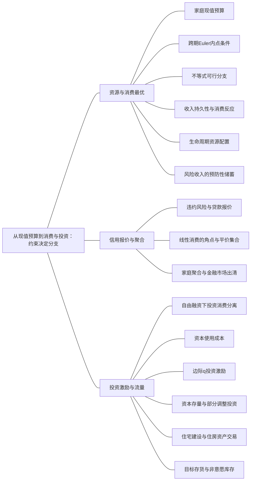

### 本专题知识联系

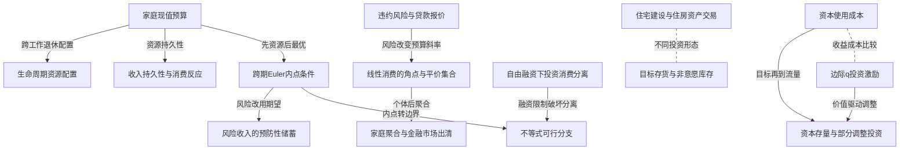

关系图中的箭头表示有方向的联系；虚线表示对照或类比。图中只画本专题主归属节点；跨专题关系在逐条命题中列明，可在练习室逐点追踪。具体成立条件以逐条说明为准。

### KMA016 家庭现值预算

身份：既有资料概括

还用于：从政府预算到债务可持续：先算账，再谈政策

**定义与对象**

现值预算把不同期可支配收入和消费按同一回报换成一期资源。

**何时调用**

两期消费、税收时点、借贷或投资后的消费配置。

**适用条件**

相关毛回报R>0；收入税负和遗产边界明确，确定收入基准。

**核心公式与机制**

$c_1+\frac{c_2}{R}=y_1+\frac{y_2}{R}$；财富是净现值而非当期现金。

**推导与理由**

将第二期预算除以R并同第一期合并，借贷本金相抵但未来偿还不能消失。

**边界与易错**

负金融储蓄可行不等于负消费可行；未来收入现值随R变动。

**整理依据**

- card FA36：**符号与前提。** 毛回报$R=1+r>0$，收入$y_1,y_2$，可自由借贷，严格凹可微偏好$u(c_1)+\beta u(c_2)$。总现值财富$W = y_1 + \frac{y_2}{R}$，暂不含违约、利差与遗产。
- card AC07：消费选择取决于可用的一生资源、各期消费相对价格、偏好和融资约束。自由借贷使家庭在不同收入时期之间平滑消费；不能借款或借贷利率不同会产生折点与角点。利率变化既有替代效应，也改变净储蓄者和借款者的财富，故不能无条件写利率提高必然增加储蓄。

### KMA017 跨期Euler内点条件

身份：既有资料概括

还用于：从政府预算到债务可持续：先算账，再谈政策

**定义与对象**

Euler条件使内点消费平移一单位资源的边际效用损益相等。

**何时调用**

严格凹偏好下求跨期消费比例或判断约束的方向。

**适用条件**

消费正、可微凹偏好且同一利率下内点借贷。

**核心公式与机制**

$u^{\prime}(c_1)=\beta R u^{\prime}(c_2)$；对数偏好给$c_2=\beta R c_1$。

**推导与理由**

减少一期消费可将R单位资源转到二期，最优时边际效用损失等于折现收益。

**边界与易错**

有借款约束应改用不等式；线性偏好不自动给平滑内点。

**整理依据**

- card FA36：$$ \begin{gathered} c_1+\frac{c_2}{R}=W, \\ u'(c_1)=\beta R u'(c_2). \end{gathered} $$
- card FA36：**条件检查。** Euler等式只用于内点；风险下应写$u'(c_t)=\beta E_t[R_{t+1}u'(c_{t+1})]$。固定工资的局部利率效应与一般均衡中工资、利率同时变化不同。不能仅求家庭最优就说求出了全经济均衡。

### KMA018 不等式可行分支

身份：既有资料概括

还用于：从两个市场到信用反馈：政策效果怎样算出来；从政府预算到债务可持续：先算账，再谈政策；从数据到机制比较：论述怎样有证据地落地

**定义与对象**

一阶条件产生候选点，经济解还须满足消费、借款、投资和利率等边界。

**何时调用**

出现不许借款、非负投资、利率下限或平价阈值。

**适用条件**

每个分段内先求条件，再核边界、角点和可行域。

**核心公式与机制**

约束绑定时可用边界最优及单侧方向判断，不强求内点等式。

**推导与理由**

删去不可行分支并比较保留的内点与端点；等号处可能出现一整段最优。

**边界与易错**

形式负货币、负投资或不允许借款不是可执行解。

**整理依据**

- card CK04：线性效用先比较预算段斜率；有借贷利差时先找不借不贷点。有不等式、利率下限或非负量时，方程解只是候选。以利率、回报因子作阈值时，等号边界必须单独列出。
- card FA37：**解题步骤。** 凹偏好先分别求两段内点，再比较禀赋和端点；禁止借款时删去借款段。若效用确为$c_1+c_2$，每段斜率分别是$1-R_s$和$1-R_L$，不使用消费平滑的对数解。

### KMA019 违约风险与贷款报价

身份：既有资料概括

**定义与对象**

竞争贷款报价补偿银行预期回收与资金成本的差，而不直接给家庭违约规则。

**何时调用**

偿付比例、存贷款总回报及风险冲击。

**适用条件**

无回收、无运营成本、风险中性；合同借款人按完整因子还款。

**核心公式与机制**

$\alpha R_L=R_s$，故$R_L=\frac{R_s}{\alpha}$；财政保障时须另列补贴。

**推导与理由**

每单位贷款的预期回收必须覆盖同单位资金的总回报，风险通过分母进入报价。

**边界与易错**

偿付比例用于银行不能再无说明折扣家庭合同预算；零利润不等于资源市场已出清。

**整理依据**

- card FA37：**符号与前提。** 存款毛回报$R_s>0$、贷款毛偿付$R_L\geq R_s$。银行无其他成本、无回收、偿还比例$\alpha\in(0,1)$时，竞争零利润为$\alpha R_L=R_s$。家庭按合同承担还款约束；违约家庭的实际支付规则要另给。
- card FA23：**条件检查。** 资产价格损失按比例放大净值损失，流动性贷款并不自动修复净值。挤兑可能迫使原本有偿付能力的机构折价出售，造成额外损失。无回收且风险中性时，违约概率$p$满足$(1-p)(1+i_b)=1+i_s$；利差含$p$和分母，不能直接等同违约概率。有风险厌恶、抵押回收和资本成本时需补项。$D_f\leq0$不能继续称普通稳定乘数“更大”。

### KMA020 线性消费的角点与平价集合

身份：既有资料概括

**定义与对象**

线性效用沿预算段是线性的，选择端点或斜率为零的一整段。

**何时调用**

效用明确为c1+c2且有存贷款利差。

**适用条件**

消费非负、Rs≤RL；有折现时阈值须改为1/β。

**核心公式与机制**

储蓄段效用斜率$1-R_s$，借款段为$1-R_L$，平价段存在无差异最优集合。

**推导与理由**

比较可行段斜率即可确定要少存、多借还是留在禀赋；不能用对数解替代。

**边界与易错**

风险变化不保证所有人的一期消费下降，未跨阈值者可能不变。

**整理依据**

- card FA37：**解题步骤。** 凹偏好先分别求两段内点，再比较禀赋和端点；禁止借款时删去借款段。若效用确为$c_1+c_2$，每段斜率分别是$1-R_s$和$1-R_L$，不使用消费平滑的对数解。
- card FA37：**角点分类。** $R_s>1$时$c_1=0$；$R_s<1<R_L$时$c_1=y_1$；$R_L<1$时$c_1 = y_1 + \frac{y_2}{R_L}$、$c_2=0$。等于1的段斜率为零，存在一段无差异最优集合；若效用另有折现$\beta$，阈值改为$\frac{1}{\beta}$。

### KMA021 家庭聚合与金融市场出清

身份：既有资料概括

还用于：从政府预算到债务可持续：先算账，再谈政策

**定义与对象**

家庭最优的加总需要类型权重与资源约束，内生回报还须满足市场出清。

**何时调用**

从代表家庭推总消费、给固定类型人数或求均衡利率。

**适用条件**

区分外生回报的局部需求与封闭经济的资金供求；违约资源另给。

**核心公式与机制**

$C_1=\sum_j n_jc_1^j$；内生R时还需$\sum_jc_1^j=\sum_jy_1^j$等完整资源式。

**推导与理由**

个人同向或异向反应经权重加总；若R也变，家庭规则和市场条件须一起解。

**边界与易错**

银行报价、家庭最优与全经济均衡是三层，不能任意替换。

**整理依据**

- card FA36：**内生利率分支。** 若题目直接给家庭规则$c_1^j = a_j (y_1^j + \frac{y_2^j}{R})$，还须用$\sum_jc_1^j=\sum_jy_1^j$求
- card FA37：**条件检查。** 风险上升降低$\alpha$、提高$R_L$，不保证每个家庭$c_1$下降：原本储蓄、无交易或在线性平坦段时可能不变。由一个按合同还款的家庭推至总消费，还需家庭比例、禀赋、违约后的资源和追偿安排。银行零利润只给定贷款报价，不自动补全违约家庭的效用与预算。

### KMA022 收入持久性与消费反应

身份：既有资料概括

还用于：从数据到机制比较：论述怎样有证据地落地

**定义与对象**

消费对收入变化的反应取决于它给未来资源增加多少，而非只看当期金额。

**何时调用**

临时奖金、持续加薪或加权永久收入。

**适用条件**

均摊公式限确定性、各期相同严格凹效用、无时间折现且零利率、无借贷约束；其他回报偏好须用对应Euler重算。

**核心公式与机制**

零利率T期中，一次资源增量$\Delta W$均摊为$\frac{\Delta W}{T}$；持续H期增收为$\frac{H\Delta y}{T}$。

**推导与理由**

永久冲击增加多期资源，给定当期增加额时通常带来更大的消费调整。

**边界与易错**

借款约束可能使当前现金决定消费；不同冲击必须从同一基准独立比较。

**整理依据**

- card FA38：**解题步骤。** 先合计剩余资源再按消费期数分配，收入与财富分轴说明。工作40年、寿命60年、年收入2、零初始财富时，$C = \frac{4}{3}$，退休财富为$\frac{80}{3}$。一次性收入增加$\Delta W$使每年消费增$\frac{\Delta W}{T}$；持续劳动收入增加$\Delta y$使消费增$\frac{H \Delta y}{T}$。
- card AC07：生命周期理论强调工作与退休的可预测收入模式，永久收入理论强调收入变化的持续性。一次性收入通常分摊到未来，持续收入变化的当期消费效应较大；流动性约束则提高当期现金收入的重要性。理性预期意味着已知信息已反映到当前选择，特定条件下消费变化由新信息驱动，但不是任何效用下消费都严格随机游走。

### KMA023 生命周期资源配置

身份：既有资料概括

**定义与对象**

生命周期模型把工作、退休和初始财富放进剩余寿命资源预算。

**何时调用**

给工作年数、剩余寿命、年收入及退休财富。

**适用条件**

确定性、各期相同严格凹效用且无时间折现、零利率、无遗产和借贷约束；年龄和期数以题设计。

**核心公式与机制**

$C=\frac{W_0+Hy}{T}$；工作与退休期储蓄为消费资源的时点搬移。

**推导与理由**

先合并未来工作收入，再在剩余消费期分配，退休资产来自此前积累。

**边界与易错**

人口老龄化的总储蓄不能仅由一位退休者规则推出，还受遗产医疗与群体构成影响。

**整理依据**

- card FA38：**符号与前提。** 生命周期基本式取零利率、剩余寿命$T$、剩余工作年数$H\leq T$、年劳动收入$y$、初始财富$W_0$、无遗产且可平滑消费。

### KMA024 风险收入的预防性储蓄

身份：既有资料概括

**定义与对象**

无充分保险时，坏收入状态的边际效用权重可增加提前留存资源的动机。

**何时调用**

同均值确定收入与随机未来收入比较，且不可借款。

**适用条件**

风险偏好和分布明确；凹效用本身不足以推出所有风险比较的统一符号，需边际效用凸性等条件。

**核心公式与机制**

$u^{\prime}(c_1)=\beta E[R u^{\prime}(c_2)]$用于可行内点；边界另检。

**推导与理由**

对数等审慎偏好中，坏状态的较高边际效用使储蓄的期望收益相对确定均值提高。

**边界与易错**

期望的边际效用不等于均值收入处的边际效用；风险与借款约束不能混作一个机制。

**整理依据**

- card FA36：**条件检查。** Euler等式只用于内点；风险下应写$u'(c_t)=\beta E_t[R_{t+1}u'(c_{t+1})]$。固定工资的局部利率效应与一般均衡中工资、利率同时变化不同。不能仅求家庭最优就说求出了全经济均衡。
- card FA38：**条件检查。** 随机游走$E_tC_{t+1}=C_t$还需二次效用、适当恒定回报和$\beta R=1$等特定条件；风险厌恶和不确定性可带来预防性储蓄。相对收入理论另强调参照群体和过去收入高点，消费对收入下降可能有棘轮效应，不应把它和永久收入现值模型当同一公式。老龄化的国民储蓄影响还取决于退休、遗产、医疗风险与家庭构成。
- review MA020：确定未来收入10时，目标为 $\ln(10-s)+\ln(10+s)$，其导数在正储蓄时为负，最优为边界 $s=0$。风险情形与其平均未来收入相同，但边际效用 $\frac1{c_2}$ 对消费凸，低收入状态带来的边际效用增加超过高收入状态的下降，故未来期望边际收益提高，诱发正预防性储蓄。该比较以给定偏好、无保险和借贷约束为条件。

### KMA025 自由融资下投资消费分离

身份：既有资料概括

**定义与对象**

同一市场回报下先最大化项目净现值，再由偏好配置消费。

**何时调用**

企业主家庭既投项目又跨期借贷。

**适用条件**

无融资约束、相同利率、给定风险折现及可交易资源；项目技术与消费不直接互补。

**核心公式与机制**

投资内点$F^{\prime}(I)=R$；消费以最大化后的现值财富为预算。

**推导与理由**

金融交易将投资的时间结构与家庭所需消费结构分开，偏好不必改变最优项目规模。

**边界与易错**

禁止借贷时投资占用当期消费，分离不再自动成立。

**整理依据**

- case CMA03：现值财富$W=10-I+6\sqrt I$。一阶条件$-1+\frac{3}{\sqrt I}=0$，得$I=9$，二阶导数负，且W=19。家庭现值预算$c_1+c_2=19$，对数偏好给$c_1=c_2=9.5$。第一期金融储蓄$a=10-I-c_1=-8.5$，即借8.5，第二期18减偿债8.5得到9.5。投资条件只比较技术边际产出和市场回报，消费偏好决定最大财富怎样分期配置，二者分离依赖统一利率与自由借贷。

### KMA026 资本使用成本

身份：既有资料概括

还用于：从资本积累到黄金律：先分水平，再分增长

**定义与对象**

使用成本把融资、折旧与资本品预期利得换算为持有一单位资本服务的成本。

**何时调用**

购置价、折旧、利率与资本价预期，求期望资本。

**适用条件**

连续或小变化近似；企业竞争且接受产品与要素价格，无资本融资边界并取正内点；产品单位、资本价格与风险一致。

**核心公式与机制**

$uc=\frac{P_K}{P}(i+\delta-\pi_K^e)$；最优资本满足$MPK=uc$。

**推导与理由**

放弃购资本可赚利息，持有资本承受折旧却可能有资本利得；净持有成本同边际产出比较。

**边界与易错**

资本品名义价不变并不等于相对价不变；不能无条件将i换成r。

**整理依据**

- card FA39：**解题步骤。** 利息机会成本加折旧，减预期资本利得，再换成产品单位；与递减$MPK$联立。若$Y=BK^\alpha N^{1-\alpha}$，可求$K^* = [\frac{\alpha B N^{1 - \alpha}}{u c}]^{\frac{1}{1 - \alpha}}$。现金流题另写$N P V = - P_{K 0} + \sum_t \frac{E (R_t)}{(1 + r)^t} + \frac{E (V_T)}{(1 + r)^T}$，按题定风险折现。
- card AC08：企业投资既比较资本的当期边际收益与持有成本，也取决于未来盈利、安装成本和融资约束。资本实际租价是资本服务的收益，资金利率是融资价格；折旧、资本品价格变化和税制把二者连接起来。托宾$q$把金融市场估值与实物投资激励相联系，较高估值通常鼓励增加资本，但信用约束与调整成本使资本逐步到位。

### KMA027 边际q投资激励

身份：既有资料概括

**定义与对象**

边际q衡量再增加一单位已安装资本的价值相对新增成本，平均q未必等于该边际量。

**何时调用**

股票估值、二次调整成本或非负投资率。

**适用条件**

资本同质、规模与调整成本等条件决定平均q能否代表边际激励。

**核心公式与机制**

投资由边际收益扣购置及调整成本的最优条件决定；非负约束下可出现零投资角点。

**推导与理由**

更高边际价值提高增加资本的收益，凸调整成本使投资不是无限大。

**边界与易错**

q=1可净投资为0而总投资仍补折旧；股票总市值上升不唯一识别边际q。

**整理依据**

- card FA40：**符号与前提。** $q$为已安装资本市场价值相对重置成本的比率；平均$q$能代表边际激励还需同质资本、适当规模和调整成本条件。$K_t^*$是理想存量，$\lambda_K\in(0,1]$为调整比例。
- card FA40：**条件检查。** $q>1$是投资激励，不保证无融资约束、没有安装成本或投资无限大；$q=1$可使净投资为零而总投资为$\delta K$。存货预期销售下降会降低目标库存，实际销量突然不足却可能先造成非意愿库存增加。住房资产价格变化可能是沿需求移动，财富、人口和按揭利率变化才是需求移动条件，须明确横纵轴。

### KMA028 资本存量与部分调整投资

身份：既有资料概括

**定义与对象**

目标资本是存量，投资是改变存量的流量，安装速度与折旧使二者不同。

**何时调用**

理想资本、调整比例、加速数或总净投资。

**适用条件**

资本积累时点一致，部分调整比例在0与1之间，折旧另计。

**核心公式与机制**

$I_t^g=\lambda_K(K_t^*-K_{t-1})+\delta K_{t-1}$，$K_t=(1-\delta)K_{t-1}+I_t^g$。

**推导与理由**

先求想增加的净资本，再按调整速度转成净投资，最后加入替换折旧。

**边界与易错**

K*=νY只是目标比率；若Y随K内生，须联立技术不能当外生。

**整理依据**

- card FA40：**解题步骤。** 先求目标资本再求净投资，最后加折旧得到总投资。柯布道格拉斯可用$M P K = \frac{\alpha Y}{K} = u c$写$K^* = \frac{\alpha Y}{u c}$；若$Y$随$K$内生，仍需联立技术，不能把右侧$Y$擅作外生。固定资本产出比$K^*=\nu Y$且立即调整时，净投资约为$\nu\Delta Y$，这是加速原理而非投资等于产出水平。
- card AC08：住宅投资是新住房建设，旧房转手本身不是当期新增产出。存货既包括企业有意持有的缓冲，也包括销量偏离预期形成的非意愿变化。分析经济波动时，应同时辨认资本存量、净投资和补偿折旧的总投资，不能把期望资本增加直接当当期资本跳升。

### KMA029 住宅建设与住房资产交易

身份：既有资料概括

**定义与对象**

住宅投资是新增住房建设，旧住房交易主要转移既有资产所有权。

**何时调用**

问房价、按揭、人口或住房支出是否计入投资。

**适用条件**

区分新建与转手、资产价格与服务流量，交易中的新增服务另计。

**核心公式与机制**

住房价格变化可沿既有需求曲线移动；财富、人口和融资条件才可改变需求。

**推导与理由**

同一住宅的资产交易不重新生产该住宅，建设才增加资本存量，交易服务是当期产出。

**边界与易错**

不能将旧房成交总价都作GDP或将房价涨等同住宅投资量同幅增长。

**整理依据**

- card AC08：住宅投资是新住房建设，旧房转手本身不是当期新增产出。存货既包括企业有意持有的缓冲，也包括销量偏离预期形成的非意愿变化。分析经济波动时，应同时辨认资本存量、净投资和补偿折旧的总投资，不能把期望资本增加直接当当期资本跳升。
- card FA40：**条件检查。** $q>1$是投资激励，不保证无融资约束、没有安装成本或投资无限大；$q=1$可使净投资为零而总投资为$\delta K$。存货预期销售下降会降低目标库存，实际销量突然不足却可能先造成非意愿库存增加。住房资产价格变化可能是沿需求移动，财富、人口和按揭利率变化才是需求移动条件，须明确横纵轴。

### KMA030 目标存货与非意愿库存

身份：既有资料概括

还用于：从两个市场到信用反馈：政策效果怎样算出来；从数据到机制比较：论述怎样有证据地落地

**定义与对象**

库存投资既有为预期销售准备的计划变化，也有销量偏离计划后的非意愿变化。

**何时调用**

计划支出与产出不等、销售预测或去库存。

**适用条件**

计划时点和实现时点分开；事后投资口径包含实际库存变化。

**核心公式与机制**

非意愿存货$IU=Y-PE$；预期销售下降可降低目标库存，而实际销量意外不足可先提高库存。

**推导与理由**

卖不出的当前产出仍被记为库存投资，使会计恒等式成立，却给下一期减产压力。

**边界与易错**

库存增加不总表示企业乐观或投资意愿增强。

**整理依据**

- card FA40：**条件检查。** $q>1$是投资激励，不保证无融资约束、没有安装成本或投资无限大；$q=1$可使净投资为零而总投资为$\delta K$。存货预期销售下降会降低目标库存，实际销量突然不足却可能先造成非意愿库存增加。住房资产价格变化可能是沿需求移动，财富、人口和按揭利率变化才是需求移动条件，须明确横纵轴。
- card FA01：**解题步骤。** 先按最终用途归类，进出口分别记号；用总额算储蓄，再把已知变动代入$\Delta S_p+\Delta S_g-\Delta I=\Delta NX$。计划支出为$PE$时，非意愿存货为$IU=Y-PE$；$IU>0$说明企业卖不完，生产有收缩压力。事后实际投资含这笔存货，因此事后恒等式仍成立。

### 关系命题与条件

#### EMA014 家庭现值预算 → 跨期Euler内点条件

前置；既有资料概括

现值预算规定可行消费组合，Euler条件才在其内点比较最优配置。

适用条件：凹可微效用与自由同利率借贷。

理由：边际效用等式必须依附真实资源约束。

依据：card FA36「**解题步骤。** 预算与Euler联立后再查消费正性。退休题$y_1=w,y_2=0$，设$h = \beta^{\frac{1}{\theta}} R^{\frac{1}{\theta} - 1}$，储蓄$s = \frac{w h}{1 + h}$；$w$固定时$\frac{d s}{d r}$与$\frac{1}{\theta} - 1$同号，故$0<\theta<1$为正、$\theta>1$为负。$\theta=1$取对数极限，储蓄为$\frac{\beta w}{1 + \beta}$而不随$r$变。」

#### EMA015 跨期Euler内点条件 → 不等式可行分支

条件变化；既有资料概括

借款约束可使自由Euler解不可行，须改检验边界。

适用条件：所求消费超出当期可用资源且禁止借款。

理由：可行方向被截断时两边边际效用不必相等。

依据：card FA36「**条件检查。** Euler等式只用于内点；风险下应写$u'(c_t)=\beta E_t[R_{t+1}u'(c_{t+1})]$。固定工资的局部利率效应与一般均衡中工资、利率同时变化不同。不能仅求家庭最优就说求出了全经济均衡。」

#### EMA016 违约风险与贷款报价 → 线性消费的角点与平价集合

机制；既有资料概括

偿付比例下降可提高贷款因子，进而改变线性效用借款段斜率。

适用条件：资金成本固定、零利润分支且家庭按合同偿还。

理由：报价经未来还款量改变一单位当期消费的代价，但未必跨过角点阈值。

依据：card FA37「**条件检查。** 风险上升降低$\alpha$、提高$R_L$，不保证每个家庭$c_1$下降：原本储蓄、无交易或在线性平坦段时可能不变。由一个按合同还款的家庭推至总消费，还需家庭比例、禀赋、违约后的资源和追偿安排。银行零利润只给定贷款报价，不自动补全违约家庭的效用与预算。」

#### EMA017 线性消费的角点与平价集合 → 家庭聚合与金融市场出清

前置；既有资料概括

先求各类家庭的可行角点或最优集合，再用权重与资源条件加总。

适用条件：类型、禀赋和金融可用资金已给。

理由：平价家庭无唯一选择时总消费也可能仅能给区间。

依据：card FA37「**条件检查。** 风险上升降低$\alpha$、提高$R_L$，不保证每个家庭$c_1$下降：原本储蓄、无交易或在线性平坦段时可能不变。由一个按合同还款的家庭推至总消费，还需家庭比例、禀赋、违约后的资源和追偿安排。银行零利润只给定贷款报价，不自动补全违约家庭的效用与预算。」

#### EMA018 家庭现值预算 → 收入持久性与消费反应

推导；既有资料概括

同额当期收入变化在持续期不同下增加的终身现值不同，因此消费反应不同。

适用条件：消费可平滑且其他偏好回报不变。

理由：临时收入只增加一期资源，永久收入增加多期资源。

依据：card FA38「**解题步骤。** 先合计剩余资源再按消费期数分配，收入与财富分轴说明。工作40年、寿命60年、年收入2、零初始财富时，$C = \frac{4}{3}$，退休财富为$\frac{80}{3}$。一次性收入增加$\Delta W$使每年消费增$\frac{\Delta W}{T}$；持续劳动收入增加$\Delta y$使消费增$\frac{H \Delta y}{T}$。」

#### EMA019 家庭现值预算 → 生命周期资源配置

推导；既有资料概括

生命周期消费是把初始财富与工作期收入合并后分配到剩余寿命。

适用条件：确定性、各期相同严格凹效用且无时间折现、零利率、无遗产和借贷约束；期数按题设。

理由：退休没有工资的时期仍需靠前期资产平移资源。

依据：card FA38「**解题步骤。** 先合计剩余资源再按消费期数分配，收入与财富分轴说明。工作40年、寿命60年、年收入2、零初始财富时，$C = \frac{4}{3}$，退休财富为$\frac{80}{3}$。一次性收入增加$\Delta W$使每年消费增$\frac{\Delta W}{T}$；持续劳动收入增加$\Delta y$使消费增$\frac{H \Delta y}{T}$。」

#### EMA020 跨期Euler内点条件 → 风险收入的预防性储蓄

条件变化；既有资料概括

风险下Euler比较的是期望边际效用，不能把未来收入直接换成确定均值。

适用条件：给定分布和偏好，借贷边界另检。

理由：非线性边际效用对坏状态赋予不同权重。

依据：card FA36「**条件检查。** Euler等式只用于内点；风险下应写$u'(c_t)=\beta E_t[R_{t+1}u'(c_{t+1})]$。固定工资的局部利率效应与一般均衡中工资、利率同时变化不同。不能仅求家庭最优就说求出了全经济均衡。」

#### EMA021 自由融资下投资消费分离 → 不等式可行分支

条件变化；既有资料概括

禁止借贷使投资必须同当期消费共同使用现金，需联合优化。

适用条件：没有其他外部融资渠道。

理由：项目的净现值最优可能要求家庭无法承担的当前支出。

依据：case CMA03「约束$c_1=10-I,c_2=6\sqrt I$，可行域$0<I<10$。目标$\ln(10-I)+\ln6+\frac12\ln I$，一阶条件$-\frac{1}{10-I}+\frac{1}{2I}=0$，得$I=\frac{10}{3}$。二阶导数为$-\frac{1}{(10-I)^2}-\frac{1}{2I^2}<0$，两端效用趋负无穷，故唯一最优。消费$c_1=\frac{20}{3},c_2=6\sqrt{\frac{10}{3}}$。投资比9低，现金约束使投资必须挤占当期消费，投资与消费不再分离。不能继续用$F'(I)=1$忽视家庭约束。」

#### EMA022 资本使用成本 → 边际q投资激励

方法类比；编者类比

使用成本与边际q都比较新增资本的收益和成本，但一个是持有服务成本、一个是资产边际价值。

适用条件：只作投资判据的方法类比，不把平均q等同MPK。

理由：二者均需价格、风险和调整条件，不能按同名收益直接互代。

依据：card AC08「企业投资既比较资本的当期边际收益与持有成本，也取决于未来盈利、安装成本和融资约束。资本实际租价是资本服务的收益，资金利率是融资价格；折旧、资本品价格变化和税制把二者连接起来。托宾$q$把金融市场估值与实物投资激励相联系，较高估值通常鼓励增加资本，但信用约束与调整成本使资本逐步到位。」

#### EMA023 资本使用成本 → 资本存量与部分调整投资

前置；既有资料概括

由使用成本求期望资本之后，还须用调整与折旧关系求当期投资。

适用条件：资本不能无成本瞬时全部到位。

理由：资本目标和投资支付是存量与流量。

依据：card FA40「**解题步骤。** 先求目标资本再求净投资，最后加折旧得到总投资。柯布道格拉斯可用$M P K = \frac{\alpha Y}{K} = u c$写$K^* = \frac{\alpha Y}{u c}$；若$Y$随$K$内生，仍需联立技术，不能把右侧$Y$擅作外生。固定资本产出比$K^*=\nu Y$且立即调整时，净投资约为$\nu\Delta Y$，这是加速原理而非投资等于产出水平。」

#### EMA024 边际q投资激励 → 资本存量与部分调整投资

机制；既有资料概括

较高边际q可促进净投资，而资本只按可实现的投资逐期增加。

适用条件：凸安装成本或部分调整，融资可行。

理由：估值改变激励不消除实物调整时间。

依据：card AC08「企业投资既比较资本的当期边际收益与持有成本，也取决于未来盈利、安装成本和融资约束。资本实际租价是资本服务的收益，资金利率是融资价格；折旧、资本品价格变化和税制把二者连接起来。托宾$q$把金融市场估值与实物投资激励相联系，较高估值通常鼓励增加资本，但信用约束与调整成本使资本逐步到位。」

#### EMA025 住宅建设与住房资产交易 → 目标存货与非意愿库存

对照；既有资料概括

住宅建设与库存变化都可列投资，但前者是建筑资本形成，后者还可由销量意外被动产生。

适用条件：国民账户的当期生产与存量变化口径。

理由：不能以同属投资认定相同动机或传导。

依据：card AC08「住宅投资是新住房建设，旧房转手本身不是当期新增产出。存货既包括企业有意持有的缓冲，也包括销量偏离预期形成的非意愿变化。分析经济波动时，应同时辨认资本存量、净投资和补偿折旧的总投资，不能把期望资本增加直接当当期资本跳升。」

#### EMA027 目标存货与非意愿库存 → 计划支出与收入乘数

机制；既有资料概括

计划支出不足先形成非意愿库存，再给企业减产压力，使产出朝支出均衡调整。

适用条件：价格利率固定、企业按存货偏差调整生产的凯恩斯交叉。

理由：事后库存补足会计投资，却不消除计划与产出失衡。

依据：card FA01「**解题步骤。** 先按最终用途归类，进出口分别记号；用总额算储蓄，再把已知变动代入$\Delta S_p+\Delta S_g-\Delta I=\Delta NX$。计划支出为$PE$时，非意愿存货为$IU=Y-PE$；$IU>0$说明企业卖不完，生产有收缩压力。事后实际投资含这笔存货，因此事后恒等式仍成立。」；card AC04「凯恩斯交叉在价格和利率给定时，通过计划支出和非意愿存货解释短期产出。自主支出先增加收入，收入又带动消费，形成乘数反馈；比例税、进口等漏出减弱反馈。IS—LM进一步加入利率和货币市场：财政扩张提高交易需求并推高利率，部分挤出投资；货币扩张增加实际余额、降低利率并刺激支出。政策乘数必须依附于央行的操作方式和经济是否受到利率下限约束。」

#### EMA089 家庭现值预算 → 融资时点的李嘉图等价

前置；既有资料概括

把政府对应未来税负计入家庭现值预算，才能判断减税是否增加财富。

适用条件：家庭确实承担相应税负，利率与视野条件成立。

理由：当前现金增加不等于终身可消费资源增加。

依据：card FA42「**解题步骤。** 先写政府支出现值不变的预算，再把未来税负放入家庭现值资源，说明当前可支配收入增加为何不等于财富增加。减税额储蓄用于将来还税，私人和政府储蓄相抵；不把政府债券与对应税负分别当两份净资源。」

#### EMA112 目标存货与非意愿库存 → 国民支出核算与计划均衡

推导；既有资料概括

非意愿库存进入实际投资可使支出恒等式成立，但仍可有计划失衡。

适用条件：区分计划PE与事后实际I。

理由：卖不出不代表未生产，核算与企业计划调整分别记录。

依据：card FA01「**解题步骤。** 先按最终用途归类，进出口分别记号；用总额算储蓄，再把已知变动代入$\Delta S_p+\Delta S_g-\Delta I=\Delta NX$。计划支出为$PE$时，非意愿存货为$IU=Y-PE$；$IU>0$说明企业卖不完，生产有收缩压力。事后实际投资含这笔存货，因此事后恒等式仍成立。」

### 对应题目分问路径

#### MA011

零利润风险报价与家庭角点分开，再讨论总消费缺项。

**第1问**

本问任务：求银行零利润贷款因子。

无回收和运营成本时以预期偿付覆盖存款总回报，求的是贷款合同因子而非家庭实际支付规则。

调用：KMA019 违约风险与贷款报价

联系：本问直接使用“违约风险与贷款报价”所列定义、模型或既有结论核算，不将本问共同出现的知识点强行画成逻辑推出。

**第2问**

本问任务：对按合同承担偿还约束的家庭，求最优消费，说明平价边界。

按存款与借款两段预算比较线性效用斜率，分别列角点和等价边界的最优集合。

调用：KMA016 家庭现值预算；KMA020 线性消费的角点与平价集合；KMA018 不等式可行分支

联系：本问直接使用“家庭现值预算、线性消费的角点与平价集合、不等式可行分支”所列定义、模型或既有结论核算，不将本问共同出现的知识点强行画成逻辑推出。

**第3问**

本问任务：金融危机使$\alpha$下降，第一期消费和总消费如何变化？说明总量结论还缺哪些设定。

α下降先改变贷款报价，再看家庭是否跨过原角点阈值；总量须补类型权重、资源和违约安排。

调用：KMA019 违约风险与贷款报价；KMA020 线性消费的角点与平价集合；KMA021 家庭聚合与金融市场出清

联系：EMA016、EMA017

#### MA012

同一对数家庭分别检验自由借贷、借款约束与题定净转移。

**第1问**

本问任务：无约束最优消费与借款是多少？

R=1下先合并两期收入，再用对数内点条件求消费并从一期资源差算借款。

调用：KMA016 家庭现值预算；KMA017 跨期Euler内点条件

联系：EMA014

**第2问**

本问任务：禁止借款时求解并解释Euler不等式。

无约束解若需借款，禁止借款后转到可行边界，Euler应读为单侧不等式。

调用：KMA018 不等式可行分支；KMA017 跨期Euler内点条件；KMA016 家庭现值预算

联系：EMA014、EMA015

**第3问**

本问任务：第二期一次税收减少2并在第一期给同现值转移2，约束家庭第一期消费如何变？

本问确为第二期减税并在第一期转移，不擅改成未来增税；先核两期新增资源，再检一期现金约束。

调用：KMA016 家庭现值预算；KMA018 不等式可行分支

联系：本问直接使用“家庭现值预算、不等式可行分支”所列定义、模型或既有结论核算，不将本问共同出现的知识点强行画成逻辑推出。

#### MA013

收入持久性先改变终身资源，借款约束再改变当期反应。

**第1问**

本问任务：分别求原消费及两种冲击下第一期消费、储蓄变化，解释持久性差异。

零利率对数三期可平滑，分别将临时6和每期6加进总资源，比较第一期消费与收入减消费的储蓄。

调用：KMA022 收入持久性与消费反应；KMA016 家庭现值预算；KMA017 跨期Euler内点条件

联系：EMA014、EMA018

**第2问**

本问任务：另将原收入改为$(1,13,13)$且第一期不能借款，比较两冲击下最优消费，检验借款约束。

改成低首期收入后，先检平滑解是否要求借款；两个冲击各从新基准独立求受限消费，不能沿用自由借贷增量。

调用：KMA022 收入持久性与消费反应；KMA018 不等式可行分支；KMA016 家庭现值预算

联系：EMA018

#### MA014

利率比较须按禀赋和净金融头寸重新解预算最优。

**第1问**

本问任务：比较R=1与R=2时消费和储蓄，解释第一期消费变化。

收入10和10时R由1到2同时改变未来收入现值和消费相对价格，由预算Euler共同求一期消费储蓄。

调用：KMA016 家庭现值预算；KMA017 跨期Euler内点条件

联系：EMA014

**第2问**

本问任务：独立将收入改为$(0,20)$，比较同样两种R时的最优消费和借贷。

改为0和20后重新解同两种R，不能沿用前一禀赋下储蓄者的方向。

调用：KMA016 家庭现值预算；KMA017 跨期Euler内点条件

联系：EMA014

**第3问**

本问任务：根据两类收入的比较，说明为什么不能只凭利率提高推断一般家庭消费方向。

利率的替代和财富影响须依偏好禀赋判断，两个条件解不能扩大为所有家庭同向的经验结论。

调用：KMA016 家庭现值预算；KMA017 跨期Euler内点条件；KMA122 机制一致与因果识别

联系：EMA014

#### MA015

固定类型的聚合消费依赖合同利差与线性角点。

**第1问**

本问任务：求两情形贷款因子及存款者最优消费。

分别按两种α求RL，存款者仍以既定R和自身可行域比较线性效用。

调用：KMA019 违约风险与贷款报价；KMA020 线性消费的角点与平价集合

联系：EMA016

**第2问**

本问任务：求危机前后借款者最优消费，检验角点及贷款额度。

借款者只允许借不允许存，比较不借与未来收入可支持的最大额度，不套对数内点。

调用：KMA020 线性消费的角点与平价集合；KMA019 违约风险与贷款报价；KMA018 不等式可行分支

联系：EMA016

**第3问**

本问任务：加总第一期消费，并说明总量结论依赖哪些题定条件。

将60户和40户的各自最优一期消费加总，说明类型不互换及资金环境是该数值的条件。

调用：KMA021 家庭聚合与金融市场出清；KMA020 线性消费的角点与平价集合

联系：EMA017

#### MA016

金融市场能否分离投资与消费是同一家庭的关键闭合。

**第1问**

本问任务：求最优投资。

自由同回报借贷下先最大化项目净现值，以边际产出等于R求投资。

调用：KMA025 自由融资下投资消费分离

联系：本问直接使用“自由融资下投资消费分离”所列定义、模型或既有结论核算，不将本问共同出现的知识点强行画成逻辑推出。

**第2问**

本问任务：求总现值财富、消费及金融头寸。

把最优项目净现值并入家庭财富，再由对数Euler求消费和借贷头寸，逐期预算相容。

调用：KMA025 自由融资下投资消费分离；KMA016 家庭现值预算；KMA017 跨期Euler内点条件

联系：EMA014

**第3问**

本问任务：禁止金融借贷时，求投资消费并比较；解释分离定理的条件。

禁止金融交易后投资直接挤占一期消费，联合优化并检可行域；比较两金融环境而不是只截掉原借款。

调用：KMA025 自由融资下投资消费分离；KMA018 不等式可行分支；KMA016 家庭现值预算

联系：EMA021

#### MA017

资本收益与持有成本须按同一购置价格和预期条件比较。

**第1问**

本问任务：求资本使用成本及期望资本。

企业竞争且无调整成本，利息折旧合成使用成本，再由递减MPK求期望资本。

调用：KMA026 资本使用成本；KMA070 竞争性边际产量定价

联系：本问直接使用“资本使用成本、竞争性边际产量定价”所列定义、模型或既有结论核算，不将本问共同出现的知识点强行画成逻辑推出。

**第2问**

本问任务：若投资补贴只使购置价格降为0.8、未来转售价格也同比例下降，求新资本。

购置和未来转售价格同比下降意味着相对资本价格改变，重新计uc再求资本，不能只减一次成本金额。

调用：KMA026 资本使用成本；KMA070 竞争性边际产量定价

联系：本问直接使用“资本使用成本、竞争性边际产量定价”所列定义、模型或既有结论核算，不将本问共同出现的知识点强行画成逻辑推出。

**第3问**

本问任务：若只知市场股票价格上升，能否断言同样的资本变化？

股票市值变化不唯一确定资本边际价值或未来成本，缺盈利预期与重置成本时不能套同样资本增量。

调用：KMA027 边际q投资激励；KMA026 资本使用成本；KMA122 机制一致与因果识别

联系：EMA022

#### MA018

边际q激励须受凸调整成本和非负投资约束。

**第1问**

本问任务：推导最优投资率及边界。

对题给净收益求内点投资率，再同x=0边界比较，说明q阈值的等号情形。

调用：KMA027 边际q投资激励；KMA018 不等式可行分支

联系：本问直接使用“边际q投资激励、不等式可行分支”所列定义、模型或既有结论核算，不将本问共同出现的知识点强行画成逻辑推出。

**第2问**

本问任务：求$q=0.8,1,1.8$时投资和净资本增长率。

各q代入可行投资率，净资本增长还须扣0.1折旧；零新增投资不等于资本不减少。

调用：KMA027 边际q投资激励；KMA028 资本存量与部分调整投资

联系：EMA024

**第3问**

本问任务：解释平均q为何不必等于此处边际q。

这里q为外生边际激励，平均估值是否代表它还需同质规模和调整条件，不能因名称相同就替换。

调用：KMA027 边际q投资激励

联系：本问直接使用“边际q投资激励”所列定义、模型或既有结论核算，不将本问共同出现的知识点强行画成逻辑推出。

#### MA019

融资等价家庭与现金受限家庭分别给首轮消费，再接需求反馈。

**第1问**

本问任务：求本期总消费直接变化和私人储蓄变化。

按40%受限与60%等价类型分配本期减税，先求直接消费和私人储蓄，政府购买不变。

调用：KMA094 融资时点的李嘉图等价；KMA018 不等式可行分支；KMA021 家庭聚合与金融市场出清；KMA090 私人政府与国民储蓄

联系：EMA090

**第2问**

本问任务：若无挤出、封闭经济边际消费倾向为0.5，计算乘数后的产出变化。

只把首轮消费增量作为自主需求冲击，再用给定0.5收入反馈求产出，不把减税总额直接乘需求乘数。

调用：KMA032 计划支出与收入乘数；KMA021 家庭聚合与金融市场出清

联系：本问直接使用“计划支出与收入乘数、家庭聚合与金融市场出清”所列定义、模型或既有结论核算，不将本问共同出现的知识点强行画成逻辑推出。

**第3问**

本问任务：解释为何这些结果不能只由减税额度确定。

未来同现值增税、家庭类型与无挤出闭合缺一都会改变结果，不能从减税100单独确定宏观量。

调用：KMA094 融资时点的李嘉图等价；KMA021 家庭聚合与金融市场出清

联系：本问直接使用“融资时点的李嘉图等价、家庭聚合与金融市场出清”所列定义、模型或既有结论核算，不将本问共同出现的知识点强行画成逻辑推出。

#### MA020

保留随机状态求期望边际效用，再检根和同均值对照。

**第1问**

本问任务：建立消费预算并写最优储蓄条件。

先列两未来状态消费和正消费域，风险不能在求导前换成均值收入。

调用：KMA024 风险收入的预防性储蓄；KMA017 跨期Euler内点条件；KMA016 家庭现值预算

联系：EMA014、EMA020

**第2问**

本问任务：求储蓄并检验根的可行性与最优性。

由期望边际条件解储蓄方程，舍弃负或越界根，用目标凹性与边界判断唯一最优。

调用：KMA024 风险收入的预防性储蓄；KMA018 不等式可行分支

联系：本问直接使用“风险收入的预防性储蓄、不等式可行分支”所列定义、模型或既有结论核算，不将本问共同出现的知识点强行画成逻辑推出。

**第3问**

本问任务：独立将第二期收入确定为10，比较储蓄并解释风险作用。

确定收入10和风险情形同均值；对数边际效用凸性产生预防动机，确定分支还要检s=0角点。

调用：KMA024 风险收入的预防性储蓄；KMA018 不等式可行分支

联系：本问直接使用“风险收入的预防性储蓄、不等式可行分支”所列定义、模型或既有结论核算，不将本问共同出现的知识点强行画成逻辑推出。

#### CMA03

投资分离、现金约束、净转移和利率变化均围绕同一项目家庭递进。

**第1问**

本问任务：自由金融市场下先求使现值财富最大的投资，再求两期消费和净金融储蓄，解释投资与偏好如何分开。

自由R=1下先求项目净现值最优，再配消费和金融头寸，区分生产机会与偏好。

调用：KMA025 自由融资下投资消费分离；KMA016 家庭现值预算；KMA017 跨期Euler内点条件

联系：EMA014

**第2问**

本问任务：若企业单纯按“当期收入减投资”安排消费，会错在哪里？用两期预算核第1问资源，并说明借款并未创造净财富。

逐期列借款流入与未来偿还核资源，借款改变时点而不额外造出现值财富。

调用：KMA016 家庭现值预算

联系：本问直接使用“家庭现值预算”所列定义、模型或既有结论核算，不将本问共同出现的知识点强行画成逻辑推出。

**第3问**

本问任务：禁止全部金融借贷，联立求最优投资与消费，并与自由市场比较。

禁止金融交易时c1等于10减投资，投资消费联合优化并检查0<I<10与目标凹性。

调用：KMA025 自由融资下投资消费分离；KMA018 不等式可行分支；KMA017 跨期Euler内点条件

联系：EMA015、EMA021

**第4问**

本问任务：在禁止借贷时给予第一期转移2，求投资和消费变化。是否可将转移全视为当期消费刺激？

在约束模型增加一期净资源2，分解投资和消费增量；本问没有未来追税，不套融资等价。

调用：KMA018 不等式可行分支；KMA025 自由融资下投资消费分离；KMA016 家庭现值预算

联系：EMA021

**第5问**

本问任务：恢复自由借贷并令R=2，求投资、消费和金融头寸；说明利率提高同时作用于投资机会和跨期配置。

先撤转移并恢复自由市场再改R=2，投资条件和消费相对价格同时改变，金融头寸须重新核账。

调用：KMA025 自由融资下投资消费分离；KMA016 家庭现值预算；KMA017 跨期Euler内点条件

联系：EMA014

#### CMA04

在同一信用市场比较风险、平价保障和限额补贴，保持局部聚合边界。

**第1问**

本问任务：由银行零利润求贷款因子，并分别写两类家庭预算，说明合同偿还与银行预期回收不能混用。

零利润用预期回收，家庭用完整合同因子安排未来支出；银行外部筹资使本题不强求100户内部资金出清。

调用：KMA019 违约风险与贷款报价；KMA016 家庭现值预算

联系：本问直接使用“违约风险与贷款报价、家庭现值预算”所列定义、模型或既有结论核算，不将本问共同出现的知识点强行画成逻辑推出。

**第2问**

本问任务：求基准下两类最优消费与第一期总消费，说明线性偏好的角点机制。

给定两类线性偏好与交易限制求角点，再按60和40权重加总，不套消费平滑。

调用：KMA020 线性消费的角点与平价集合；KMA018 不等式可行分支；KMA021 家庭聚合与金融市场出清

联系：EMA017

**第3问**

本问任务：危机后重算贷款因子和总消费。再独立把存款R改为0.6、恢复α=0.75，比较借款者最优及总消费；解释为什么信用变紧不能无条件推出本期消费下降。

危机只改α，另一个利率反事实先恢复α；比较是否跨平价阈值，不能先断消费必降。

调用：KMA019 违约风险与贷款报价；KMA020 线性消费的角点与平价集合；KMA021 家庭聚合与金融市场出清

联系：EMA016、EMA017

**第4问**

本问任务：危机中财政希望银行将合同因子降至1，求每单位贷款所需补贴；求借款家庭最优集合和第一期总消费范围，解释为什么不能给唯一总量。

补贴进入银行零利润后将因子推到1，家庭整段无差异最优，故总消费只能给区间。

调用：KMA019 违约风险与贷款报价；KMA020 线性消费的角点与平价集合；KMA021 家庭聚合与金融市场出清

联系：EMA016、EMA017

**第5问**

本问任务：另在同一危机状态把合同因子设为0.8，并将每户贷款上限设为6。求补贴、消费、总贷款和财政支出；评价该局部消费增加是否等于净社会收益。

另设低因子和贷款上限，先求借款角点再算总贷和期末补贴；财政来源未给，不能把消费增加当净社会收益。

调用：KMA019 违约风险与贷款报价；KMA018 不等式可行分支；KMA021 家庭聚合与金融市场出清；KMA089 政府预算与初级余额

联系：本问直接使用“违约风险与贷款报价、不等式可行分支、家庭聚合与金融市场出清、政府预算与初级余额”所列定义、模型或既有结论核算，不将本问共同出现的知识点强行画成逻辑推出。

## 从两个市场到信用反馈：政策效果怎样算出来

财政货币效果为什么必须同时写清商品、货币和信用三类闭合？

从计划支出进入IS LM联立，明确央行工具和税后交易需求，再区分静态比较、动态残差与金融反馈。

### 分支导图

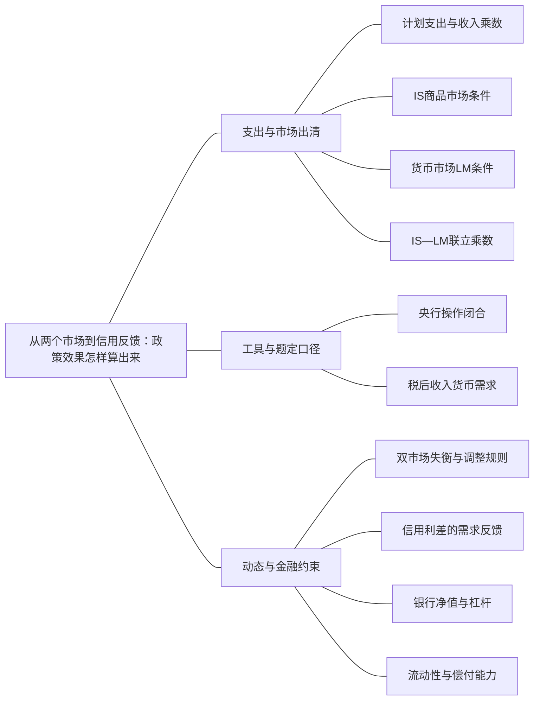

### 本专题知识联系

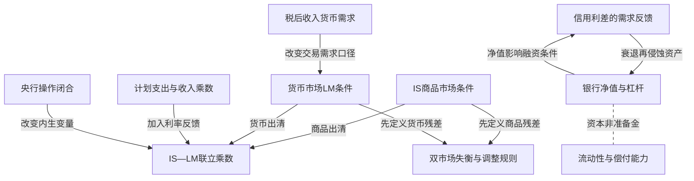

关系图中的箭头表示有方向的联系；虚线表示对照或类比。图中只画本专题主归属节点；跨专题关系在逐条命题中列明，可在练习室逐点追踪。具体成立条件以逐条说明为准。

### KMA032 计划支出与收入乘数

身份：既有资料概括

还用于：从现值预算到消费与投资：约束决定分支；从政府预算到债务可持续：先算账，再谈政策；从储蓄投资到汇率：制度决定调整变量；从数据到机制比较：论述怎样有证据地落地

**定义与对象**

短期计划支出经收入和消费反馈形成均衡乘数，漏出决定反馈强度。

**何时调用**

固定价格利率，给消费、比例税、转移和进口倾向。

**适用条件**

有闲置产能的支出决定基准，边际消费倾向介于0和1，均衡分母正。

**核心公式与机制**

$a=1-c(1-\tau)+m_y>0$，$Y=\frac{C_0-cT_0+cTR+I_0+G+X_0}{a}$。

**推导与理由**

首轮自主支出增加收入，收入的一部分再消费；税收和进口使每轮留在国内的需求减少。

**边界与易错**

均衡是计划支出等于产出，不是靠事后含库存恒等式直接证明；乘数不免除融资供给约束。

**整理依据**

- card FA19：**符号与前提。** $C=C_0+c(Y-T_0-\tau Y+TR)$，$0<c<1$，$NX=X_0-m_yY$，$m_y\geq0$，利率价格固定，投资$I_0$外生。定义$a=1-c(1-\tau)+m_y>0$。
- card AC04：凯恩斯交叉在价格和利率给定时，通过计划支出和非意愿存货解释短期产出。自主支出先增加收入，收入又带动消费，形成乘数反馈；比例税、进口等漏出减弱反馈。IS—LM进一步加入利率和货币市场：财政扩张提高交易需求并推高利率，部分挤出投资；货币扩张增加实际余额、降低利率并刺激支出。政策乘数必须依附于央行的操作方式和经济是否受到利率下限约束。

### KMA033 IS商品市场条件

身份：既有资料概括

还用于：从IS—LM到AD—AS：把价格与目标接进来；从政府预算到债务可持续：先算账，再谈政策；从储蓄投资到汇率：制度决定调整变量；从数据到机制比较：论述怎样有证据地落地

**定义与对象**

IS描述给定其他条件下商品计划支出与产出相等的收入利率组合。

**何时调用**

投资受利率影响，需将消费税收和自主需求合并。

**适用条件**

价格与预期通胀给定，投资利率敏感系数正；纵轴通常为名义利率。

**核心公式与机制**

$aY+bi=A_0+b\pi^e$，其中投资看$i-\pi^e$。

**推导与理由**

利率提高降低投资，在其他条件不变下需较低收入消费才能出清商品。

**边界与易错**

IS移动与沿线移动不同；预期通胀变化不能无说明当名义利率同量变化。

**整理依据**

- card FA20：$$ \begin{gathered} aY+bi=A_0+b\pi^e, \\ k_mY-hi=m. \end{gathered} $$

### KMA034 货币市场LM条件

身份：既有资料概括

还用于：从IS—LM到AD—AS：把价格与目标接进来；从预期时间戳到通胀路径：每一期怎样接下一期；从工具操作到政策可信度：承诺为什么改变结果；从政府预算到债务可持续：先算账，再谈政策；从储蓄投资到汇率：制度决定调整变量；从数据到机制比较：论述怎样有证据地落地

**定义与对象**

数量型LM使给定实际货币余额等于货币需求。

**何时调用**

求收入利率，或区别名义M与实际余额。

**适用条件**

标准$L=k_mY-hi,k_m,h>0$，m=M/P外生；下限、净收入或政策供给反馈需改式。

**核心公式与机制**

$k_mY-hi=m$，固定m下利率随交易收入提高而上升。

**推导与理由**

收入提高增加交易需求，较高持币机会成本降低需求，二者在同一实际余额下平衡。

**边界与易错**

不能把贷款额当货币需求或资本金；投资实际利率与货币名义机会成本要分开。

**整理依据**

- card FA20：$$ \begin{gathered} aY+bi=A_0+b\pi^e, \\ k_mY-hi=m. \end{gathered} $$
- card FA20：**条件检查。** 投资取决于实际利率，货币机会成本通常是名义利率；只有预期通胀固定时可以把名义纵轴变化直接映射为实际融资成本。货币供给若为名义量，先除价格。利率按“百分数数值”还是“小数”进入方程由系数约定决定；不能把$i=2$无说明改为$.02$。检查$I,L$和政策量的可行范围。

### KMA035 IS—LM联立乘数

身份：既有资料概括

还用于：从IS—LM到AD—AS：把价格与目标接进来；从政府预算到债务可持续：先算账，再谈政策；从储蓄投资到汇率：制度决定调整变量

**定义与对象**

双市场联立同时决定数量和利率，货币反馈改变单市场乘数。

**何时调用**

固定货币下求财政货币冲击、投资挤出或参数极限。

**适用条件**

标准$a,b,k_m,h>0$且预期通胀固定，$D=a+\frac{bk_m}{h}>0$。

**核心公式与机制**

$Y=\frac{A_0+b\pi^e+(b/h)m}{D}$；自主需求乘数$\frac1D$、货币乘数$\frac{b/h}{D}$。

**推导与理由**

从货币式消去利率再代商品式；财政带动交易需求和利率，抵消一部分初始需求。

**边界与易错**

极限b→0、h很大或h→0要分别取，不把边界参数直接当完整现实制度。

**整理依据**

- card FA20：**解题步骤。** 先解$Y$再代$i$，最后回到家庭与企业函数求$C,I$。财政与货币乘数为$\frac{1}{D}$和$\frac{\frac{b}{h}}{D}$；税收与转移为$- \frac{c}{D} , \frac{c}{D}$。在$(Y,i)$平面，IS斜率$- \frac{a}{b}$，LM斜率$\frac{k_m}{h}$。进口或比例税增加漏出使IS更陡、固定利率乘数更小。

### KMA036 央行操作闭合

身份：既有资料概括

还用于：从预期时间戳到通胀路径：每一期怎样接下一期；从工具操作到政策可信度：承诺为什么改变结果；从政府预算到债务可持续：先算账，再谈政策；从储蓄投资到汇率：制度决定调整变量

**定义与对象**

固定货币与固定政策利率是不同的内生外生安排，不能同时任意指定。

**何时调用**

题问保持原利率、货币配合或利率型政策。

**适用条件**

指定央行工具，货币需求与价格给定；政策利率若为实际量须同时设名义利率与预期。

**核心公式与机制**

固定i时m随Y和其他货币需求变量内生；固定m时i随市场出清变化。

**推导与理由**

同一货币需求把m、Y、i联系起来，固定两者就限制第三者，不能再要求任意均衡变化。

**边界与易错**

固定名义利率和固定实际利率在预期通胀变化时不等价。

**整理依据**

- card AC04：布兰查德的短期框架强调央行设定政策利率，并内生调整货币量；传统数量型LM则把货币量视为外生。两者可以作为不同闭合方式使用，但不能同时固定利率、固定货币并要求任意收入变化仍满足同一货币需求。企业支出对应的是借款实际利率，政策利率下降可能被风险溢价上升抵消。
- card FA22：**符号与前提。** 标准模型先用A20；若保持$\pi^e$不变、目标$\Delta i=0$，商品和货币两式给$\Delta A_0=a\Delta Y$、$\Delta m=k_m\Delta Y$。只固定利率的央行内生提供所需货币，不再沿旧数量型LM比较。

### KMA037 税后收入货币需求

身份：既有资料概括

还用于：从政府预算到债务可持续：先算账，再谈政策

**定义与对象**

货币需求若取决于可支配收入，税收除消费渠道外还直接改变交易余额需求。

**何时调用**

货币需求写L(i,Y−T)，比较减税和货币挤出。

**适用条件**

必须保持题给净收入口径；财政和货币闭合明确。

**核心公式与机制**

固定m时$\theta di+\zeta(dY-dT)=0$，θ<0、ζ>0，税变直接进入货币出清。

**推导与理由**

减税提高当期可支配收入和货币需求，利率反馈可抵消部分消费刺激；不能套只含Y的税乘数。

**边界与易错**

T0与含自动税的总T不同；开放制度下固定汇率和浮动汇率还会给不同税响应。

**整理依据**

- card FA22：**特殊起式。** 若$L_i=\theta<0,L_{Y-T}=\zeta>0,C'=c,I'=k_I<0$，固定$\frac{M}{P}$时不能套标准定额税乘数：
- card FA22：**条件检查。** 常规正分母分支下，增税扩张条件为$\frac{k_I \zeta}{\theta} > c$，因为税收降低交易余额需求、降息促进投资可能超过消费损失。浮动汇率、资本完全流动、$i=i^*$且$\frac{M}{P}$固定时，货币市场固定$Y-T$，故$\frac{d Y}{d T} = 1$；固定汇率、$i^*,G,NX$给定时，$\frac{d Y}{d T} = - \frac{c}{1 - c}$，货币量内生调整。S16原解析的利率微分负号、参数条件及固定汇率下降幅度不能直接沿用。

### KMA038 双市场失衡与调整规则

身份：既有资料概括

还用于：从预期时间戳到通胀路径：每一期怎样接下一期

**定义与对象**

图上非均衡点的两个市场残差分别给数量和利率的局部调整方向。

**何时调用**

IS LM交点外的A点、局部箭头或轨迹问题。

**适用条件**

商品随超额需求调整，利率随超额货币需求调整；速度参数需另给。

**核心公式与机制**

$\dot Y=\lambda R_G,\dot i=\mu R_M$，λ、μ正；IS上方商品供给过剩，LM上方货币供给过剩。

**推导与理由**

同一Y比较实际利率与各条曲线的出清利率，再按两残差合成方向。

**边界与易错**

当下需求不足不能因后续降息改称当下过剩；静态线条不唯一决定整条轨迹。

**整理依据**

- card FA21：**符号与前提。** 数量型IS—LM，商品按需求调整、利率随超额货币需求调整。定义商品残差$R_G=A_0+b\pi^e-aY-bi$，货币残差$R_M=k_mY-hi-m$。
- card FA21：**解题步骤。** 对同一$Y$比较实际$i$与各曲线所需利率。IS上方利率过高，投资少、计划支出不足，产出向左；IS下方向右。LM上方货币需求低于供给，公众买债券使利率向下；LM下方向上。两个残差分别定横向和竖向箭头，再讨论金融市场是否更快。

### KMA039 信用利差的需求反馈

身份：编者推导

还用于：从IS—LM到AD—AS：把价格与目标接进来；从储蓄投资到汇率：制度决定调整变量；从数据到机制比较：论述怎样有证据地落地

**定义与对象**

产出下降若提高信用利差，会通过借款成本再压低支出。

**何时调用**

投资取决于政策实际利率加风险利差，或冻结利差作反事实。

**适用条件**

一般商品式$aY=A-bi-\beta\omega$、m=kY−hi，所有a,b,β,k,h正，ω=ω0−γY且γ≥0；可行Y>0、ω≥0。

**核心公式与机制**

联立系数$D_f=a+\frac{bk}{h}-\beta\gamma$；常规正分母分支中内生利差放大同一自主需求冲击。

**推导与理由**

把利差变化代回商品式后，它是收入反馈而非新的外生货币量；需同冻结利差的同基准反事实比较。

**边界与易错**

Df≤0时须重检存在性、可行性及另给的动态，不能继续称普通稳定乘数更大。

**整理依据**

- card FA23：**解题步骤。** 风险先进入融资成本而非凭直觉直接改$M$。若$D_f>0$，衰退提高利差的反馈放大自主需求冲击；再求银行损失后净值及恢复杠杆所需资产规模。资产100、债务80、净值20时杠杆5；资产降至90后净值10、杠杆9，若按账面价缩表并维持净值10，恢复杠杆5需资产降至50、偿债40。
- card AC04：布兰查德的短期框架强调央行设定政策利率，并内生调整货币量；传统数量型LM则把货币量视为外生。两者可以作为不同闭合方式使用，但不能同时固定利率、固定货币并要求任意收入变化仍满足同一货币需求。企业支出对应的是借款实际利率，政策利率下降可能被风险溢价上升抵消。

### KMA040 银行净值与杠杆

身份：既有资料概括

还用于：从工具操作到政策可信度：承诺为什么改变结果

**定义与对象**

银行资本是资产减债务的净值，杠杆为资产相对净值而非准备金率。

**何时调用**

资产损失、资本比率约束或金融加速器。

**适用条件**

净值正；融资负债与资产估价口径一致，处置价格及新增资本是否存在需说明。

**核心公式与机制**

$E_b=A_b-D_b,\ell=\frac{A_b}{E_b}$；固定负债下资产损失按更大比例侵蚀净值。

**推导与理由**

资产下降而债务未同步缩小时净值先吸收损失，恢复杠杆可迫使缩资产还债。

**边界与易错**

准备金是资产项目，不能当资本；出售折价时不能仍假设净值不变。

**整理依据**

- card FA23：**符号与前提。** 借款实际利率$r_b=i-\pi^e+\omega$；投资$I=I_0-b(r+\omega)$。银行资产$A_b$、债务$D_b$、净值$E_b=A_b-D_b$，杠杆$\ell = \frac{A_b}{E_b}$，不能把准备金等同资本。
- card AC04：金融中介的资本缓冲和流动性决定了它能否把资金传到实体。资产损失减少净值并提高杠杆，银行为恢复资本比率可能减少贷款，抛售又压低资产价格，形成金融加速反馈。流动性支持帮助应对短期融资压力，资本补充承担损失，两者不能互相替代。

### KMA041 流动性与偿付能力

身份：既有资料概括

还用于：从工具操作到政策可信度：承诺为什么改变结果

**定义与对象**

到期现金不足和资产不足以覆盖负债是不同约束，政策工具不能互相替代。

**何时调用**

挤兑、短借长投、央行流动性支持或资本补充。

**适用条件**

核资产真实价值、负债到期和可变现性；信息与处置制度明确。

**核心公式与机制**

短期融资可缓解到期支付，却不自动增加净值；资本补充承担损失但仍需支付流动性。

**推导与理由**

有偿付能力机构也可被迫折价出售，流动性困难可变成净值损失并传播。

**边界与易错**

无限续借不是消除已有损失；只看准备金增加不足以判贷款恢复。

**整理依据**

- card AC04：金融中介的资本缓冲和流动性决定了它能否把资金传到实体。资产损失减少净值并提高杠杆，银行为恢复资本比率可能减少贷款，抛售又压低资产价格，形成金融加速反馈。流动性支持帮助应对短期融资压力，资本补充承担损失，两者不能互相替代。
- card FA23：**条件检查。** 资产价格损失按比例放大净值损失，流动性贷款并不自动修复净值。挤兑可能迫使原本有偿付能力的机构折价出售，造成额外损失。无回收且风险中性时，违约概率$p$满足$(1-p)(1+i_b)=1+i_s$；利差含$p$和分母，不能直接等同违约概率。有风险厌恶、抵押回收和资本成本时需补项。$D_f\leq0$不能继续称普通稳定乘数“更大”。

### 关系命题与条件

#### EMA028 IS商品市场条件 → IS—LM联立乘数

前置；既有资料概括

IS商品市场条件是双市场联立的一个独立约束。

适用条件：数量型货币闭合与给定预期通胀。

理由：单独商品条件不能唯一确定Y与i。

依据：card FA20「$$ \begin{gathered} aY+bi=A_0+b\pi^e, \\ k_mY-hi=m. \end{gathered} $$」

#### EMA029 货币市场LM条件 → IS—LM联立乘数

前置；既有资料概括

LM货币条件与商品条件联立，才能得到利率反馈后的政策乘数。

适用条件：标准正参数且分母非零。

理由：交易需求把收入变化传给利率，改变投资。

依据：card FA20「**解题步骤。** 先解$Y$再代$i$，最后回到家庭与企业函数求$C,I$。财政与货币乘数为$\frac{1}{D}$和$\frac{\frac{b}{h}}{D}$；税收与转移为$- \frac{c}{D} , \frac{c}{D}$。在$(Y,i)$平面，IS斜率$- \frac{a}{b}$，LM斜率$\frac{k_m}{h}$。进口或比例税增加漏出使IS更陡、固定利率乘数更小。」

#### EMA030 计划支出与收入乘数 → IS—LM联立乘数

条件变化；既有资料概括

固定货币的联立财政乘数较同参数固定利率乘数小。

适用条件：b,k,h正、相同商品漏出a，其他条件不变。

理由：D=a+bk/h大于a，增加的项来自交易需求与投资挤出。

依据：card FA20「**解题步骤。** 先解$Y$再代$i$，最后回到家庭与企业函数求$C,I$。财政与货币乘数为$\frac{1}{D}$和$\frac{\frac{b}{h}}{D}$；税收与转移为$- \frac{c}{D} , \frac{c}{D}$。在$(Y,i)$平面，IS斜率$- \frac{a}{b}$，LM斜率$\frac{k_m}{h}$。进口或比例税增加漏出使IS更陡、固定利率乘数更小。」

#### EMA031 央行操作闭合 → IS—LM联立乘数

条件变化；既有资料概括

改为固定利率后货币量内生，不能沿原固定货币LM读取财政效应。

适用条件：央行确实履行利率目标且供币可行。

理由：原联立中决定利率的调整转为央行满足交易需求的操作。

依据：card FA22「**符号与前提。** 标准模型先用A20；若保持$\pi^e$不变、目标$\Delta i=0$，商品和货币两式给$\Delta A_0=a\Delta Y$、$\Delta m=k_m\Delta Y$。只固定利率的央行内生提供所需货币，不再沿旧数量型LM比较。」

#### EMA032 税后收入货币需求 → 货币市场LM条件

条件变化；既有资料概括

加入税后收入项会让税收直接移动货币需求约束，必须重算LM及乘数。

适用条件：题面明确L(i,Y−T)。

理由：税负变化同时影响商品消费与货币交易，不仅改变自主消费。

依据：card FA22「**条件检查。** 常规正分母分支下，增税扩张条件为$\frac{k_I \zeta}{\theta} > c$，因为税收降低交易余额需求、降息促进投资可能超过消费损失。浮动汇率、资本完全流动、$i=i^*$且$\frac{M}{P}$固定时，货币市场固定$Y-T$，故$\frac{d Y}{d T} = 1$；固定汇率、$i^*,G,NX$给定时，$\frac{d Y}{d T} = - \frac{c}{1 - c}$，货币量内生调整。S16原解析的利率微分负号、参数条件及固定汇率下降幅度不能直接沿用。」

#### EMA033 IS商品市场条件 → 双市场失衡与调整规则

前置；既有资料概括

用IS所代表的计划出清作为参照，才能判定非均衡点商品残差。

适用条件：同一Y下比较实际与IS出清利率。

理由：高于IS的利率压低投资，使计划支出不足。

依据：card FA21「**解题步骤。** 对同一$Y$比较实际$i$与各曲线所需利率。IS上方利率过高，投资少、计划支出不足，产出向左；IS下方向右。LM上方货币需求低于供给，公众买债券使利率向下；LM下方向上。两个残差分别定横向和竖向箭头，再讨论金融市场是否更快。」

#### EMA034 货币市场LM条件 → 双市场失衡与调整规则

前置；既有资料概括

用LM所代表的货币出清作为参照，才能判定利率局部调整。

适用条件：利率随超额货币需求上升的指定规则。

理由：高于LM时货币需求低，买债使利率向下。

依据：card FA21「**解题步骤。** 对同一$Y$比较实际$i$与各曲线所需利率。IS上方利率过高，投资少、计划支出不足，产出向左；IS下方向右。LM上方货币需求低于供给，公众买债券使利率向下；LM下方向上。两个残差分别定横向和竖向箭头，再讨论金融市场是否更快。」

#### EMA035 银行净值与杠杆 → 信用利差的需求反馈

机制；既有资料概括

净值受损与去杠杆可收缩银行信贷、提高借款利差，放大需求下降。

适用条件：资本或风险约束实际绑定，贷款需求及市场结构需具体判断。

理由：银行承受风险的缓冲减少后可能削减贷款而非按政策利率无限供给。

依据：card AC04「金融中介的资本缓冲和流动性决定了它能否把资金传到实体。资产损失减少净值并提高杠杆，银行为恢复资本比率可能减少贷款，抛售又压低资产价格，形成金融加速反馈。流动性支持帮助应对短期融资压力，资本补充承担损失，两者不能互相替代。」

#### EMA036 信用利差的需求反馈 → 银行净值与杠杆

机制；既有资料概括

信用收缩造成的需求下降可再压低资产价格与贷款质量，强化净值损失。

适用条件：存在共同资产、违约或抵押品价格对景气敏感的渠道。

理由：实体收缩与金融估值可互相反馈，此环不是学习前置环。

依据：card AC04「金融中介的资本缓冲和流动性决定了它能否把资金传到实体。资产损失减少净值并提高杠杆，银行为恢复资本比率可能减少贷款，抛售又压低资产价格，形成金融加速反馈。流动性支持帮助应对短期融资压力，资本补充承担损失，两者不能互相替代。」

#### EMA037 银行净值与杠杆 → 流动性与偿付能力

对照；既有资料概括

资本不足需确认损失并补净值，准备金与短期借款主要处理支付能力。

适用条件：区分账面与真实净值，机构可能同时有两类约束。

理由：给现金不等于消除资产损失，资本和流动性工具作用对象不同。

依据：card FA23「**条件检查。** 资产价格损失按比例放大净值损失，流动性贷款并不自动修复净值。挤兑可能迫使原本有偿付能力的机构折价出售，造成额外损失。无回收且风险中性时，违约概率$p$满足$(1-p)(1+i_b)=1+i_s$；利差含$p$和分母，不能直接等同违约概率。有风险厌恶、抵押回收和资本成本时需补项。$D_f\leq0$不能继续称普通稳定乘数“更大”。」

#### EMA038 IS—LM联立乘数 → 固定名义货币的总需求

推导；既有资料概括

固定名义M时将不同P代入IS LM联立，可推出传统AD。

适用条件：货币需求与预期条件不变且P正。

理由：实际余额M/P随价格变动，均衡产出由双市场而非单条消费函数决定。

依据：card FA25「**符号与前提。** 沿A20消元，$D = a + \frac{b k_m}{h} > 0$，名义货币$M$给定。将AD写成$Y = d_0 + \frac{d_1 M}{P}$，$d_1>0$；短期供给为$Y=\bar Y+\alpha_s(P-P^e)$，$\alpha_s>0$。」

#### EMA047 IS商品市场条件 → 中性政策实际利率

推导；既有资料概括

在给定风险的需求式中令Y=Yn，可得到实现该水平的中性实际利率。

适用条件：商品需求参数与Yn当期给定。

理由：这是按需求反求支持供给基准的价格，并非由央行任意宣布。

依据：card FA47「**解题步骤。** 先用政策利率与风险求短期$Y$，再用PC求通胀偏离；中期要求产出回到当期自然水平，并求对应政策利率。风险溢价升2个百分点而其他条件不变时，若可行，政策实际利率降2个百分点可抵消借款成本变化。政府增支或消费信心改善，在$Y_n$不变时提高中性政策利率。」

#### EMA048 信用利差的需求反馈 → 中性政策实际利率

条件变化；既有资料概括

风险溢价提高会降低维持同一自然产出的所需政策实际利率。

适用条件：同一A0、a、b与Yn，利率工具可行。

理由：政策利率需抵消借款成本中增加的风险项。

依据：card FA47「**解题步骤。** 先用政策利率与风险求短期$Y$，再用PC求通胀偏离；中期要求产出回到当期自然水平，并求对应政策利率。风险溢价升2个百分点而其他条件不变时，若可行，政策实际利率降2个百分点可抵消借款成本变化。政府增支或消费信心改善，在$Y_n$不变时提高中性政策利率。」

#### EMA075 流动性与偿付能力 → QE的组合与信用传导

条件变化；既有资料概括

若资本损失或贷款需求绑定，增加准备金未必扩张信贷。

适用条件：银行承险和借款需求受限。

理由：流动性工具处理的不是全部信贷决策约束。

依据：review MA066「长期国债流通供给减少可能降低期限溢价；持有人再平衡资产组合可推高其他资产价格；银行资产约束改善也可能支持信贷。传导仍取决于资本约束、贷款需求、风险和准备金收益等条件，故准备金增加不保证固定倍数的支出。政府采购100直接进入产品需求G，而QE首先交换金融资产，二者不能按金额相同而混同。」

#### EMA083 银行净值与杠杆 → 共同风险与宏观审慎

机制；既有资料概括

多家机构为资本约束共同售资产时，可把单体调整变成系统价格反馈。

适用条件：共同敞口与价格影响存在。

理由：资产折价使其他净值再受损，单体风险管理未内化全部后果。

依据：card FA45「**审慎检查。** 微观审慎关注单个机构稳健，宏观审慎关注共同风险、杠杆顺周期、关联敞口与抛售外部性。资本缓冲、流动性要求与借款约束可改变金融传导，不能用简单降息代替全部监管修复。财政空间、利率下限、央行承诺、资本流动和汇率制度也会限制工具选择。供给冲击存在稳产出与稳价格权衡，不能承诺无代价同时解决。」

#### EMA118 信用利差的需求反馈 → 债务通缩与信用需求反馈

机制；既有资料概括

信用收缩若压低支出和价格，可反过来提高固定名义债务的真实负担。

适用条件：需求对信贷敏感且价格可下降的环境。

理由：构成机制反馈环而非概念学习前置。

依据：review MA096「通缩提高借款者实际负担，降低净值并增加违约；银行损失和抵押品贬值压缩资本及授信，利差可能上升，使未违约企业也削减投资。支出下降又压需求和价格，反过来加重真实债务，形成放大反馈。债权人真实资产同时上升，但双方支出倾向、破产成本和融资约束不同，财富转移不必总量中性。完整强度仍须额外行为与市场出清关系识别。」

#### EMA128 双市场失衡与调整规则 → 固定点与局部稳定

推导；既有资料概括

指定双市场残差调整与速度后，才可用Jacobian判断该局部动态的稳定。

适用条件：两维连续动态明确；严格负实部给线性化充分稳定，临界另核。

理由：静态曲线位置不能替代动态特征根或完整轨迹。

依据：card FA21「**条件检查。** 位于两曲线上方时，初始同时有商品供给过剩与货币供给过剩，不能因为后续降息刺激投资就改称当下需求过剩。标准线性调整的雅可比迹为$-(\lambda a+\mu h)<0$，行列式为$\lambda\mu(ah+bk_m)>0$；这说明该动态设定的局部稳定，不意味着静态图唯一决定路径形状或调整先后。」

### 对应题目分问路径

#### MA021

两个市场残差分别定局部箭头，不先想象整条回归轨迹。

**第1问**

本问任务：A处产品市场供需如何，为什么？

固定A点的Y看其利率相对IS高低，判断计划支出和产出差，不能用后来降息改变当下判断。

调用：KMA033 IS商品市场条件；KMA038 双市场失衡与调整规则

联系：EMA033

**第2问**

本问任务：货币市场供需如何，为什么？

仍在同一A点，以LM出清利率为参照判断货币超额供求，区分它同商品残差。

调用：KMA034 货币市场LM条件；KMA038 双市场失衡与调整规则

联系：EMA034

**第3问**

本问任务：画从A向B调整的局部方向，说明画整条路径还需什么条件。

合成局部Y与i方向；整条路径还需速度、调整方程和稳定条件，静态图不能唯一给出。

调用：KMA038 双市场失衡与调整规则；KMA061 固定点与局部稳定

联系：EMA128

#### MA022

特殊供币的YP反馈须完整保留，不能暗加标准收入货币需求。

**第1问**

本问任务：分别在$\phi>0$与$\phi<0$时推导LM和AD，比较形状。

固定P先由仅含利率的货币需求推LM，再同商品式推AD；φ正负分别讨论并同固定M模型对照。

调用：KMA051 数量供给反馈与反常AD；KMA042 固定名义货币的总需求

联系：EMA046

**第2问**

本问任务：出口需求下降时，产出变化和政策反应有何差异？写明均衡可行性条件。

出口下降进入自主需求，反应还受H、D0、正Y和非负供币约束；分母异常时不延用常规乘数判断。

调用：KMA051 数量供给反馈与反常AD；KMA018 不等式可行分支

联系：本问直接使用“数量供给反馈与反常AD、不等式可行分支”所列定义、模型或既有结论核算，不将本问共同出现的知识点强行画成逻辑推出。

#### MA023

固定货币和保持利率两种财政配合不能混为一种路径。

**第1问**

本问任务：求均衡。

基准商品和货币两市场联立求Y、i，各参数均按题给单位。

调用：KMA033 IS商品市场条件；KMA034 货币市场LM条件；KMA035 IS—LM联立乘数

联系：EMA028、EMA029

**第2问**

本问任务：自主支出增20，货币不变，求新均衡并分解挤出。

自主支出增20时仍固定m，利率反馈挤出部分投资，需将首轮与挤出后的净产出分开。

调用：KMA035 IS—LM联立乘数

联系：本问直接使用“IS—LM联立乘数”所列定义、模型或既有结论核算，不将本问共同出现的知识点强行画成逻辑推出。

**第3问**

本问任务：若要求利率保持初值，需增加多少实际货币？画出两种调整的IS LM图。

目标改为保持原i，先从新IS求Y，再由货币需求反求m；作图要区分旧数量LM与配套移动。

调用：KMA036 央行操作闭合；KMA049 按目标反推工具；KMA035 IS—LM联立乘数

联系：EMA031

#### MA024

比例税下自主税和总税额必须分清。

**第1问**

本问任务：求均衡。

先把0.25Y带入可支配收入整理消费反馈，再联立货币市场求基准。

调用：KMA035 IS—LM联立乘数；KMA096 比例税和自动稳定器

联系：本问直接使用“IS—LM联立乘数、比例税和自动稳定器”所列定义、模型或既有结论核算，不将本问共同出现的知识点强行画成逻辑推出。

**第2问**

本问任务：分别求G增加10、T0增加10的产出变化。

分别改变G与T0，其他工具固定，不能把自动税收增量当新主动税工具。

调用：KMA035 IS—LM联立乘数；KMA096 比例税和自动稳定器

联系：本问直接使用“IS—LM联立乘数、比例税和自动稳定器”所列定义、模型或既有结论核算，不将本问共同出现的知识点强行画成逻辑推出。

**第3问**

本问任务：若G和T0同时增加10，求平衡预算乘数，并解释其为何不等于1。

G与T0各增10是自主税等额实验，不是总税恰等额；解释乘数及为何本闭合不同于简单固定利率无比例税情形。

调用：KMA097 自主税与总预算平衡；KMA035 IS—LM联立乘数

联系：本问直接使用“自主税与总预算平衡、IS—LM联立乘数”所列定义、模型或既有结论核算，不将本问共同出现的知识点强行画成逻辑推出。

#### MA025

内生利差须同无风险利率一起求，不只看政策降息方向。

**第1问**

本问任务：求均衡并检查利差。

将ω=3−0.01Y代入商品式并同货币式联立，求后还要检查利差非负。

调用：KMA039 信用利差的需求反馈；KMA033 IS商品市场条件；KMA034 货币市场LM条件

联系：本问直接使用“信用利差的需求反馈、IS商品市场条件、货币市场LM条件”所列定义、模型或既有结论核算，不将本问共同出现的知识点强行画成逻辑推出。

**第2问**

本问任务：若自主支出下降11.5，求产出、利率、利差变化。

自主支出下降带来收入和利差的反向变动，利率与融资成本不能混作一项。

调用：KMA039 信用利差的需求反馈；KMA035 IS—LM联立乘数

联系：本问直接使用“信用利差的需求反馈、IS—LM联立乘数”所列定义、模型或既有结论核算，不将本问共同出现的知识点强行画成逻辑推出。

**第3问**

本问任务：若利差改为外生等于初始值，比较同一冲击；解释反馈机制。

冻结在同一初始利差作反事实，比较同额冲击的产出响应，说明内生信用如何放大而非另设外生M冲击。

调用：KMA039 信用利差的需求反馈

联系：本问直接使用“信用利差的需求反馈”所列定义、模型或既有结论核算，不将本问共同出现的知识点强行画成逻辑推出。

#### MA026

比较静态分母、经济可行和动态稳定分层审查。

**第1问**

本问任务：推导Y与A的比较静态。

消去货币利率和利差后求A的产出响应，保留金融反馈对分母的影响。

调用：KMA039 信用利差的需求反馈；KMA035 IS—LM联立乘数

联系：本问直接使用“信用利差的需求反馈、IS—LM联立乘数”所列定义、模型或既有结论核算，不将本问共同出现的知识点强行画成逻辑推出。

**第2问**

本问任务：讨论分母为正、零、负分别意味着什么。

分母正零负先判方程存在唯一和可行Y、ω，不把负代数产出保留为经济解。

调用：KMA039 信用利差的需求反馈；KMA018 不等式可行分支

联系：本问直接使用“信用利差的需求反馈、不等式可行分支”所列定义、模型或既有结论核算，不将本问共同出现的知识点强行画成逻辑推出。

**第3问**

本问任务：为什么“乘数为负”不能单独证明动态不稳定？提出还需给出的动态方程与经济可行条件。

另给产出、利率及信用调整规则才可判断特征根；静态负乘数本身不是任意动态不稳定的证明。

调用：KMA038 双市场失衡与调整规则；KMA061 固定点与局部稳定；KMA018 不等式可行分支

联系：EMA128

#### MA027

本题已给双市场动态，因此可核Jacobian而非猜路径。

**第1问**

本问任务：求稳态。

两运动率同时置零，求共同静止点，不能只求其中一条零运动线。

调用：KMA038 双市场失衡与调整规则

联系：本问直接使用“双市场失衡与调整规则”所列定义、模型或既有结论核算，不将本问共同出现的知识点强行画成逻辑推出。

**第2问**

本问任务：由Jacobian判断局部稳定。

由明示二维连续系统求Jacobian、迹和行列式，判断该局部动态类型。

调用：KMA038 双市场失衡与调整规则；KMA061 固定点与局部稳定

联系：EMA128

**第3问**

本问任务：在点$(Y,i)=(100,4)$画局部箭头。

将给定100和4分别代两残差，得到局部横纵箭头而非完整轨迹。

调用：KMA038 双市场失衡与调整规则

联系：本问直接使用“双市场失衡与调整规则”所列定义、模型或既有结论核算，不将本问共同出现的知识点强行画成逻辑推出。

**第4问**

本问任务：解释原题只给IS LM图时为何不能唯一画整条轨迹。

说明此处能判稳定是因为方程已给；单独IS LM图缺速度与调整规则，不能唯一回推出路径。

调用：KMA038 双市场失衡与调整规则；KMA061 固定点与局部稳定

联系：EMA128

#### MA028

利率下限改变常规货币传导，预期仍可改变实际成本。

**第1问**

本问任务：求初始产出及G增加10后的产出。

i固定0时由商品支出求初始与增G后的产出，不沿不存在的内点降息通道计算。

调用：KMA065 名义利率下限的分段闭合；KMA032 计划支出与收入乘数

联系：本问直接使用“名义利率下限的分段闭合、计划支出与收入乘数”所列定义、模型或既有结论核算，不将本问共同出现的知识点强行画成逻辑推出。

**第2问**

本问任务：为什么基础货币增加不必增加投资？

公众愿意持新增货币使货币出清可为不等式，扩基础货币不必再降i或增投资。

调用：KMA065 名义利率下限的分段闭合；KMA036 央行操作闭合

联系：EMA059

**第3问**

本问任务：若可信承诺使预期通胀从−2%升为0，名义利率仍0，实际利率每下降1个百分点，投资增加3，求额外产出；说明预期承诺的边界。

先把预期通胀从−2到0转为实际率下降，再按题定投资响应求额外需求；可信和供给边界仍须说明。

调用：KMA055 事前与事后实际回报；KMA065 名义利率下限的分段闭合

联系：EMA060

#### MA029

税后收入货币需求使减税兼有消费和交易余额渠道。

**第1问**

本问任务：求均衡。

基准产品式和L(i,Y−T)同时求解，不能将净税项漏掉。

调用：KMA037 税后收入货币需求；KMA033 IS商品市场条件

联系：本问直接使用“税后收入货币需求、IS商品市场条件”所列定义、模型或既有结论核算，不将本问共同出现的知识点强行画成逻辑推出。

**第2问**

本问任务：一次总付税减少8、货币固定，求Y和i变化。

总付税减8且m固定，税后收入提高交易需求，须同消费反馈一起求Y与i。

调用：KMA037 税后收入货币需求；KMA036 央行操作闭合

联系：本问直接使用“税后收入货币需求、央行操作闭合”所列定义、模型或既有结论核算，不将本问共同出现的知识点强行画成逻辑推出。

**第3问**

本问任务：若误写货币需求为$0.5Y-5i$，减税结论怎样偏离？解释。

把货币需求误写成只含Y属于换模型，比较同额减税增量并指出遗漏的税收货币渠道。

调用：KMA037 税后收入货币需求；KMA034 货币市场LM条件

联系：EMA032

#### MA030

政策乘数的极限必须回到原参数化和闭合。

**第1问**

本问任务：求财政自主支出乘数与货币乘数。

联立一般商品与货币出清，分别对自主需求和实际货币求响应，利率内生。

调用：KMA033 IS商品市场条件；KMA034 货币市场LM条件；KMA035 IS—LM联立乘数

联系：EMA028、EMA029

**第2问**

本问任务：分别讨论b接近0、h很大、h接近0的极限；说明图形斜率与政策传导的关系。

b趋0、h很大和h趋0分别改变投资或货币需求敏感性，逐项取极限并解释曲线斜率。

调用：KMA035 IS—LM联立乘数

联系：本问直接使用“IS—LM联立乘数”所列定义、模型或既有结论核算，不将本问共同出现的知识点强行画成逻辑推出。

**第3问**

本问任务：哪些极限不宜机械视为现实精确状态？

极限只是该方程族的条件结论，现实下限、资产替代或工具变化不能无说明当作精确参数边界。

调用：KMA035 IS—LM联立乘数；KMA018 不等式可行分支；KMA036 央行操作闭合

联系：EMA031

#### CMA05

同一信用闭合贯穿冲击、恢复工具、动态与临界分支。

**第1问**

本问任务：消元求一般均衡，计算基准Y、i、ω，并列本模型的非负利差可行条件。

先解三市场并核正产出和非负利差，一般D不为零只是代数候选条件。

调用：KMA039 信用利差的需求反馈；KMA033 IS商品市场条件；KMA034 货币市场LM条件；KMA018 不等式可行分支

联系：本问直接使用“信用利差的需求反馈、IS商品市场条件、货币市场LM条件、不等式可行分支”所列定义、模型或既有结论核算，不将本问共同出现的知识点强行画成逻辑推出。

**第2问**

本问任务：自主支出永久下降11.5，货币固定，求均衡变化；将信用利差冻结在原值作独立反事实，比较产出变化并解释差异。

自主支出下降与冻结利差从同一基准比较，收入降导致利差升的反馈要计入。

调用：KMA039 信用利差的需求反馈；KMA035 IS—LM联立乘数

联系：本问直接使用“信用利差的需求反馈、IS—LM联立乘数”所列定义、模型或既有结论核算，不将本问共同出现的知识点强行画成逻辑推出。

**第3问**

本问任务：在第2问内生信用情形，央行用增加m恢复原产出。求所需货币增量、最终i与ω，并评价恢复Y是否恢复了所有金融条件。

为恢复原Y反求m和最终i，若负名义利率则工具受限，恢复总量也不恢复原支出构成。

调用：KMA049 按目标反推工具；KMA036 央行操作闭合；KMA039 信用利差的需求反馈；KMA065 名义利率下限的分段闭合

联系：EMA059

**第4问**

本问任务：为讨论稳定，另明确动态：$\dot Y=A-4i-5(3-0.01Y)-Y$，$\dot i=0.5Y-10i-m$。固定A、m，判断基准均衡局部稳定，并解释为何比较静态分母不是完整动态证据。

本问明给产出和利率动态，才可用具体Jacobian判稳定，不能由上一问分母直接替代。

调用：KMA038 双市场失衡与调整规则；KMA061 固定点与局部稳定

联系：EMA128

**第5问**

本问任务：恢复A=100、m=20，独立将γ升至0.24，讨论是否存在均衡；若γ略高于0.24，求代数解并检验经济可行性；现有信息能否判断动态稳定？

恢复原A,m后改变γ，在临界系数分别检无解或负产出可行性，动态结论仍依规则而非代数符号。

调用：KMA039 信用利差的需求反馈；KMA018 不等式可行分支；KMA061 固定点与局部稳定

联系：本问直接使用“信用利差的需求反馈、不等式可行分支、固定点与局部稳定”所列定义、模型或既有结论核算，不将本问共同出现的知识点强行画成逻辑推出。

#### CMA06

同一税后货币需求下分别比较财政工具与严格总税平衡。

**第1问**

本问任务：推导两市场联立式，求初始Y、i和总税收；解释货币需求为何应保留税后收入项。

将T0+0.2Y在消费和货币需求两处同时代入，求基准与总税，防止只在商品式扣税。

调用：KMA037 税后收入货币需求；KMA033 IS商品市场条件；KMA096 比例税和自动稳定器

联系：本问直接使用“税后收入货币需求、IS商品市场条件、比例税和自动稳定器”所列定义、模型或既有结论核算，不将本问共同出现的知识点强行画成逻辑推出。

**第2问**

本问任务：政府购买增加7而T0不变、货币固定，求产出利率和总税收变化；将总税变化与初级赤字变化分开。

G增7但T0不变，产出变化自动提高税收；初级赤字变化需用总税回流核算。

调用：KMA037 税后收入货币需求；KMA096 比例税和自动稳定器；KMA090 私人政府与国民储蓄

联系：本问直接使用“税后收入货币需求、比例税和自动稳定器、私人政府与国民储蓄”所列定义、模型或既有结论核算，不将本问共同出现的知识点强行画成逻辑推出。

**第3问**

本问任务：只将T0减少7，求产出和利率变化；若误把货币需求写成0.5Y−5i，给出同一减税的产出变化并解释误差渠道。

减T0提高消费又提高交易余额需求；误式只含Y是不同基准模型，只比较各自同额政策增量。

调用：KMA037 税后收入货币需求；KMA034 货币市场LM条件

联系：EMA032

**第4问**

本问任务：要求G增加7且总税收也增加7，货币仍固定。求所需ΔT0、ΔY、Δi，并检验总预算平衡；为什么不能直接令ΔT0=7？

严格要求ΔG=ΔT时，联立ΔT0+τΔY和两市场反求工具，不能直接设自主税同额。

调用：KMA097 自主税与总预算平衡；KMA037 税后收入货币需求；KMA049 按目标反推工具

联系：EMA093

**第5问**

本问任务：若经济已触及名义利率下限，原固定货币LM能否继续无条件使用？说明须补何种闭合，及比较财政工具时应保留哪些制度条件。

若触及名义下限须另设分段货币闭合和可行需求，不能保留全部原等式只把负利率截为0。

调用：KMA065 名义利率下限的分段闭合；KMA036 央行操作闭合；KMA018 不等式可行分支

联系：EMA059

## 从IS—LM到AD—AS：把价格与目标接进来

价格、预期和潜在产出接入后，恢复产出与稳定价格为什么不再是同一目标？

从固定货币AD和三种供给摩擦进入联立，区分潜在基准、政策反推与特殊供币规则。

### 分支导图

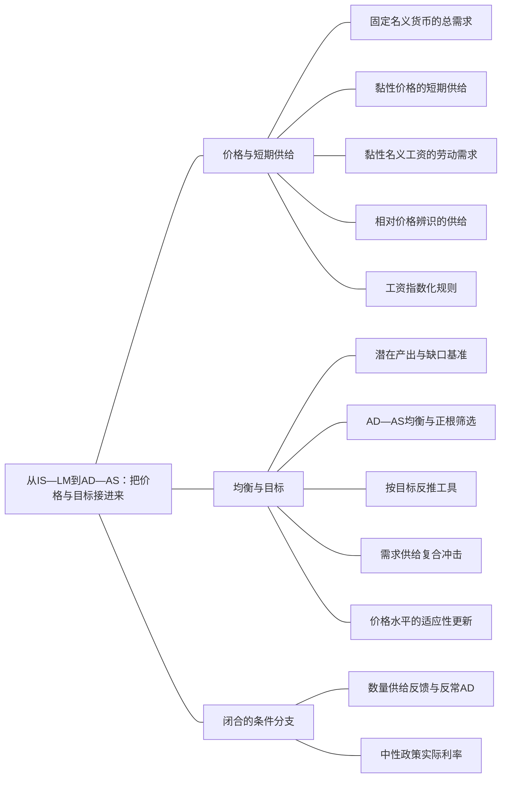

### 本专题知识联系

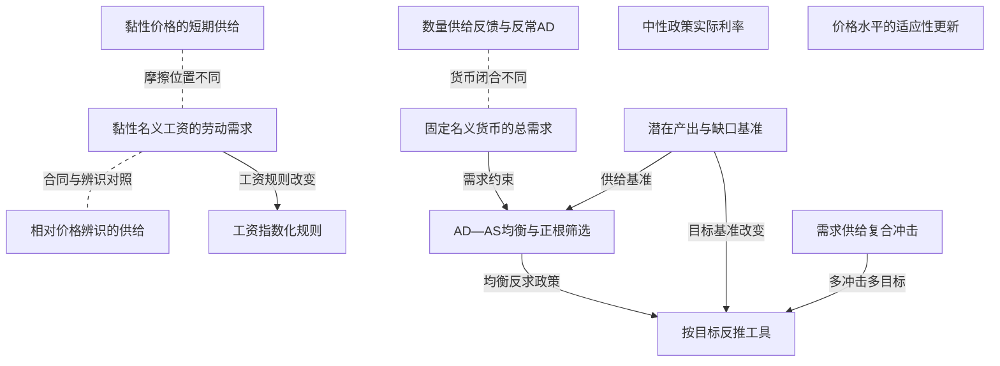

关系图中的箭头表示有方向的联系；虚线表示对照或类比。图中只画本专题主归属节点；跨专题关系在逐条命题中列明，可在练习室逐点追踪。具体成立条件以逐条说明为准。

### KMA042 固定名义货币的总需求

身份：既有资料概括

还用于：从两个市场到信用反馈：政策效果怎样算出来

**定义与对象**

传统AD是不同价格水平下商品与资产市场同时均衡的产出组合。

**何时调用**

IS LM给定名义M、价格可变，或问AD斜率。

**适用条件**

数量型货币闭合、正参数、预期通胀等需求条件给定，P>0。

**核心公式与机制**

消元常得$Y=d_0+\frac{d_1M}{P},d_1>0$；固定M时价格升降低实际余额。

**推导与理由**

价格上升先压实际货币，再通过利率和投资使均衡需求下降。

**边界与易错**

价格水平P不是通胀π；若央行规则或货币需求改写，AD方向须重推。

**整理依据**

- card FA25：**符号与前提。** 沿A20消元，$D = a + \frac{b k_m}{h} > 0$，名义货币$M$给定。将AD写成$Y = d_0 + \frac{d_1 M}{P}$，$d_1>0$；短期供给为$Y=\bar Y+\alpha_s(P-P^e)$，$\alpha_s>0$。
- card AC05：传统AD描述商品与资产市场均衡下价格水平和产出的组合。名义货币给定时，价格上升减少实际余额，利率上升并压低投资需求。短期AS则通过名义工资契约、企业提前定价或相对价格辨识解释产出对价格意外的响应。需求扩张通常使短期产出与价格同升，不利供给冲击使产出降而价格升；多重冲击下价格方向未必确定。

### KMA043 黏性价格的短期供给

身份：既有资料概括

还用于：从数据到机制比较：论述怎样有证据地落地

**定义与对象**

部分企业预先定价，使总需求变化不能全部由当期价格吸收。

**何时调用**

比较三种AS或给不能调价企业比例。

**适用条件**

黏价比例$s_p\in(0,1)$、灵活企业合意价$P+\eta(Y-\bar Y),\eta>0$；局部约化。

**核心公式与机制**

$Y-\bar Y=\frac{s_p}{(1-s_p)\eta}(P-P^e)$。

**推导与理由**

将预定价与可调企业价格加权后移项，意外总体价格对应额外需求与产出。

**边界与易错**

sp=1需回原固定价关系，不能除以0；灵活价格极限也须检查。

**整理依据**

- card FA26：**符号与前提。** 黏性价格企业比例$s_p\in(0,1)$，灵活企业合意价格$P+\eta(Y-\bar Y)$、$\eta>0$。黏性工资模型另给生产$Y=BK^\alpha N^\beta$、$0<\beta<1$、固定$K$与工资规则$W = W_0 (\frac{P}{P_0})^j$。
- card FA26：$$ P=s_pP^e+(1-s_p)[P+\eta(Y-\bar Y)]\Rightarrow Y-\bar Y=\frac{s_p}{(1-s_p)\eta}(P-P^e). $$

### KMA044 黏性名义工资的劳动需求

身份：既有资料概括

还用于：从人口身份到失业滞后：分母、流量与自然率；从数据到机制比较：论述怎样有证据地落地

**定义与对象**

名义工资期内固定时，总价格意外改变实际劳动成本和劳动需求。

**何时调用**

给W固定、价格偏离预期并问就业产出。

**适用条件**

企业接受价格、固定资本、劳动边际产出递减；就业由可行劳动供求共同约束。

**核心公式与机制**

$MPN=\frac{W}{P}$；W固定而P上升使实际工资下降，可沿劳动需求扩大用工。

**推导与理由**

劳动成本的变化先改变企业最优用工，再由技术映射为产出。

**边界与易错**

劳动需求变化不保证总就业同幅变；合同期限与劳动供给需另核。

**整理依据**

- card FA26：**解题步骤。** 黏性工资从企业$M P N = \frac{W}{P}$求需求与产出；黏性价格从两类企业加权求AS；不完全信息从生产者把一般价格意外误认相对价格变化解释正斜率。若$j=1$，实际工资固定，纯价格变化不再沿原劳动需求扩大就业；$j=0$才是完全固定名义工资。供给成本冲击还要改变对应成本关系。
- card FA03：**解题步骤。** 先求偏导，再代供给或工资条件。若$K$固定、名义工资受约束为$\bar W$，劳动需求为$N^d = [\frac{(1 - \alpha) B K^\alpha P}{\bar{W}}]^{\frac{1}{\alpha}}$；再查$N^d$是否超过可用劳动。工资下限无约束时使用出清就业；有约束时由较小的劳动需求确定就业，失业量为供给减需求。

### KMA045 相对价格辨识的供给

身份：既有资料概括

还用于：从数据到机制比较：论述怎样有证据地落地

**定义与对象**

生产者将未识别的总体价格变化误当自身相对价格变化，短期调整生产。

**何时调用**

可预见与意外名义冲击、信息披露或货币周期。

**适用条件**

总体价格信息不充分，生产者依据局部价格；不是名义合同同一机制。

**核心公式与机制**

局部约化可写$Y-\bar Y=\alpha_s(P-P^e)$，信息澄清后意外项消退。

**推导与理由**

相对收益误判改变劳动生产激励；获知总体价格后原相对收益信号被修正。

**边界与易错**

不能因为约化AS相同就说工资黏性与信息误判相同；可预见政策结论受信息假设限制。

**整理依据**

- card FA26：**解题步骤。** 黏性工资从企业$M P N = \frac{W}{P}$求需求与产出；黏性价格从两类企业加权求AS；不完全信息从生产者把一般价格意外误认相对价格变化解释正斜率。若$j=1$，实际工资固定，纯价格变化不再沿原劳动需求扩大就业；$j=0$才是完全固定名义工资。供给成本冲击还要改变对应成本关系。
- card FA44：**可直接背诵。** 货币主义重视货币对名义支出和通胀的作用，强调自然率与政策时滞，不主张靠持续意外通胀永久降低失业。新古典模型强调理性预期与市场出清，某些价格错觉设定下可预见名义政策不产生同等实际作用。新凯恩斯也可以采用理性预期，但加入名义刚性、不完全竞争和金融摩擦，预期到的政策仍可能改变短期实际配置。

### KMA046 工资指数化规则

身份：既有资料概括

**定义与对象**

工资随价格调整的程度改变意外价格对实际工资和劳动需求的传导。

**何时调用**

比较固定W、部分指数化和完全指数化。

**适用条件**

生产$Y=BK^\alpha N^\beta,0<\beta<1$，固定K、劳动需求可实现；$W=W_0(P/P_0)^j$。

**核心公式与机制**

$\frac{d\ln Y}{d\ln P}=\frac{\beta(1-j)}{1-\beta}$；j=1消除纯价格变化的实际工资渠道。

**推导与理由**

把工资规则代入MPN=W/P，再对劳动与产出取对数变化。

**边界与易错**

指数化消除该价格意外机制，不代表所有供给冲击或失业都自动消失。

**整理依据**

- card FA26：**解题步骤。** 黏性工资从企业$M P N = \frac{W}{P}$求需求与产出；黏性价格从两类企业加权求AS；不完全信息从生产者把一般价格意外误认相对价格变化解释正斜率。若$j=1$，实际工资固定，纯价格变化不再沿原劳动需求扩大就业；$j=0$才是完全固定名义工资。供给成本冲击还要改变对应成本关系。
- card FA26：**条件检查。** 所有企业都黏性定价$s_p=1$时价格固定，不能继续除以$1-s_p$；完全灵活极限要回原式。工资完全指数化会改变需求政策和供给冲击传导，不能无条件宣称自动调整更快。供给冲击永久改变自然产出时，应移动长期基准。

### KMA047 潜在产出与缺口基准

身份：既有资料概括

还用于：从人口身份到失业滞后：分母、流量与自然率；从数据到机制比较：论述怎样有证据地落地

**定义与对象**

产出缺口以当期潜在或自然产出为基准，原观测产出并不自动等于该基准。

**何时调用**

灾难、结构变化、恢复旧产出或消除缺口。

**适用条件**

潜在产出是模型特定供给条件下的基准，可能随技术制度冲击改变。

**核心公式与机制**

绝对缺口$Y-\bar Y$与比例缺口$\frac{Y-\bar Y}{\bar Y}$不能混用。

**推导与理由**

供给能力下降会移动基准，因此实际产出比旧值低仍可能高于新潜在水平。

**边界与易错**

恢复旧Y不等于修复产能；百分比和百分点系数须同奥肯或AS口径匹配。

**整理依据**

- card FA25：**条件检查。** 初始产出300与AS中的潜在产出100不同；不能把下标零误读为上划线后宣称政策不可行。恢复产出并不恢复原价格，也不提高自然产能。若算出负价格、负货币或落到供给约束之外，应解释可行性，而非保留一个形式根。
- card FA47：**条件检查。** 油价上升可提高加成、使PS下移并降低$Y_n$，不能总画暂时AS上移后回旧潜在产出。若其他需求参数不变，较低$Y_n$要求更高中性利率来压低需求；若油价同时削弱需求，方向须联立。利率下限使“央行总能恢复潜在产出”失效，通缩与实际利率上升可能形成螺旋。

### KMA048 AD—AS均衡与正根筛选

身份：既有资料概括

还用于：从政府预算到债务可持续：先算账，再谈政策；从数据到机制比较：论述怎样有证据地落地

**定义与对象**

同时满足总需求、短期供给及价格可行域的组合才是宏观均衡。

**何时调用**

价格可变、多项式价格解或预期价格冲击。

**适用条件**

先明确货币闭合、供给形式和P>0，所有联立方程同一时期。

**核心公式与机制**

由AD和AS消元求价格候选，筛选正价格，再回代产出和利率。

**推导与理由**

价格既改变实际余额又沿AS改变产出，不能仅用一条曲线做数量结论。

**边界与易错**

旧价格不能用于新名义货币目标；负根不因满足代数式就可保留。

**整理依据**

- card FA25：**解题步骤。** 先导AD再联立AS，解价格的多项式并筛选$P>0$；回求$Y,i$后逐式代回。政策恢复题先把目标产出代AS求目标价格，再代IS求利率，最后求$M=PL(i,Y)$，不能用旧价格乘新实际余额。

### KMA049 按目标反推工具

身份：既有资料概括

还用于：从两个市场到信用反馈：政策效果怎样算出来；从预期时间戳到通胀路径：每一期怎样接下一期；从工具操作到政策可信度：承诺为什么改变结果；从政府预算到债务可持续：先算账，再谈政策；从数据到机制比较：论述怎样有证据地落地

**定义与对象**

政策工具由所选目标和全部约束反推，而不是把原产出、潜在产出与稳价目标互换。

**何时调用**

要求恢复某个Y、i、P或债务率。

**适用条件**

目标、工具可控性及非负预算制度边界明确；多目标需足够独立工具。

**核心公式与机制**

将目标代供给与市场条件，依次反求价格、利率、货币或财政参数并验可行性。

**推导与理由**

约束将目标映射为所需工具，但解出来后仍可能超过利率下限或财政能力。

**边界与易错**

代数有解不保证可实施；一个工具不能一般精确命中两个独立目标。

**整理依据**

- card CK03：政策题先圈出目标是原产出、潜在产出、价格还是债务率。把目标代进约束，求实现它需要的政策变量，最后检查非负、预算、参数和制度约束。形式上解出一个负货币量不等于可执行政策。
- card FA25：**解题步骤。** 先导AD再联立AS，解价格的多项式并筛选$P>0$；回求$Y,i$后逐式代回。政策恢复题先把目标产出代AS求目标价格，再代IS求利率，最后求$M=PL(i,Y)$，不能用旧价格乘新实际余额。

### KMA050 需求供给复合冲击

身份：既有资料概括

还用于：从政府预算到债务可持续：先算账，再谈政策；从数据到机制比较：论述怎样有证据地落地

**定义与对象**

需求收缩和不利供给可同时压低产出，对价格却有相反作用。

**何时调用**

题给需求下降、成本上升和预期改变并存。

**适用条件**

明确每项冲击进入AD、成本或价格预期，不将“预期差”当同一变量。

**核心公式与机制**

产出和价格需联立各变化式；价格方向由冲击强度与曲线斜率共同决定。

**推导与理由**

需求弱下压价格，供给成本上推价格，相加后的符号不是凭一个关键词决定。

**边界与易错**

价格水平一次变化只表示通胀压力，不自动给持续通胀路径。

**整理依据**

- card AC05：传统AD描述商品与资产市场均衡下价格水平和产出的组合。名义货币给定时，价格上升减少实际余额，利率上升并压低投资需求。短期AS则通过名义工资契约、企业提前定价或相对价格辨识解释产出对价格意外的响应。需求扩张通常使短期产出与价格同升，不利供给冲击使产出降而价格升；多重冲击下价格方向未必确定。
- review MA035：价格方向取决于供给上推与需求下压的相对强度：当 $2s>d$ 上升，相等时不变，小于时下降。取d为3、s为2，有产出下降3.5、价格上升0.25。此处静态价格变化表示通胀压力方向，不能单凭一次均衡比较断言持续通胀率。

### KMA051 数量供给反馈与反常AD

身份：既有资料概括

还用于：从两个市场到信用反馈：政策效果怎样算出来

**定义与对象**

特殊供币规则若含产出与价格反馈，可改变LM和AD方向。

**何时调用**

实际供给Mbar+φYP、货币需求仅有利率项的题。

**适用条件**

严格保留$m^s=\bar M+\varphi YP,m^d=\alpha-\beta i$及商品闭合$aY+bi=A_0$，a,b,α,β,Mbar正；常规分支H>0、D0>0且供币非负。

**核心公式与机制**

$D_0=A_0-\frac{b(\alpha-\bar M)}{\beta}$，$H(P)=a-\frac{b\varphi P}{\beta}$，$Y=\frac{D_0}{H(P)}$；正分支下φ>0可使AD向上。

**推导与理由**

在该实际供币规则中，φ正时提高P或Y会增加实际供给并压低利率；这是与固定名义M模型不同的闭合，不叠加旧余额渠道。

**边界与易错**

不能给货币需求暗加收入项；H零或负时需另检交点与动态，不宣布普遍AD失效。

**整理依据**

- card FA24：**符号与前提。** 保留题式$\frac{M^s}{P} = \bar{M} + \varphi Y P$、$\frac{M^d}{P} = \alpha - \beta i$、$\alpha,\beta,\bar M>0$。另设商品式$aY+bi=A_0$、$a,b>0$，不擅自给货币需求加$k_mY$。
- card FA24：**解题步骤。** 先在固定$P$下看LM斜率，再联立商品市场得到AD。常规正产出且$H>0$时，顺周期$\varphi>0$令LM下降、AD上升，出口下降的乘数大于$\varphi=0$基准$\frac{1}{a}$；逆周期$\varphi<0$令LM上升、AD下降，缓冲同一冲击。

### KMA052 中性政策实际利率

身份：既有资料概括

还用于：从两个市场到信用反馈：政策效果怎样算出来；从预期时间戳到通胀路径：每一期怎样接下一期；从工具操作到政策可信度：承诺为什么改变结果；从数据到机制比较：论述怎样有证据地落地

**定义与对象**

给定需求、风险与自然产出时，使产出恰等于自然水平的政策实际利率。

**何时调用**

央行设实际利率，风险、信心或自然产出改变。

**适用条件**

商品式$aY=A_0-b(r+\omega)$、a,b>0，Yn由供给基准确定。

**核心公式与机制**

$r_n=\frac{A_0-aY_n}{b}-\omega$。

**推导与理由**

把自然产出代入需求反求r；同一借款成本也可能由不同政策利率与风险组合构成。

**边界与易错**

自然率不是永恒常数；利率下限和通胀预期会限制实施，油价同时改需求时须联立。

**整理依据**

- card FA47：$$ \begin{gathered} r_n=\frac{A_0-aY_n}{b}-\omega, \\ Y=Y_n\Rightarrow r=r_n. \end{gathered} $$
- card FA47：**解题步骤。** 先用政策利率与风险求短期$Y$，再用PC求通胀偏离；中期要求产出回到当期自然水平，并求对应政策利率。风险溢价升2个百分点而其他条件不变时，若可行，政策实际利率降2个百分点可抵消借款成本变化。政府增支或消费信心改善，在$Y_n$不变时提高中性政策利率。

### KMA129 价格水平的适应性更新

身份：编者推导

还用于：从预期时间戳到通胀路径：每一期怎样接下一期；从数据到机制比较：论述怎样有证据地落地

**定义与对象**

价格预期按已实现价格误差更新，状态是价格水平而不是通胀率。

**何时调用**

给Pe下一期更新、计算价格缺口路径并检稳定。

**适用条件**

先由当期AD AS在既定Pe下解P，再更新Pe；不能把π预期公式无说明套给价格水平。

**核心公式与机制**

$P^e_{t+1}=P^e_t+\lambda(P_t-P^e_t)$；若$P=P(P^e)$，更新映射导数为$1-\lambda+\lambda P^{\prime}(P^e)$。

**推导与理由**

先求当期市场交点产生预测误差，误差的一部分成为下一期预期修正；均衡固定点要同两条市场约束相容。

**边界与易错**

仿射模型可按系数判断；非线性临界模1要查高阶，价格持续调整不表示固定通胀率。

**整理依据**

- case CMA08：预期递推$P^e_{t+1}=(1-\frac{\lambda}{2})P^e_t+5\lambda$，λ=.5时为$.75P^e_t+2.5$。故Pe1=4、Pe2=5.5；P1=7、X1=3，P2=7.75、X2=2.25。每期重新签W=10Pe，故$w_1=\frac{40}{7}$，$N_1=100-\frac{80}{7}=\frac{620}{7}$；$w_2=\frac{55}{\frac{31}{4}}=\frac{220}{31}$，$N_2=100-\frac{440}{31}=\frac{2660}{31}$。价格持续上升但意外逐步变小，实际工资向10回升，合同就业的意外增量收敛；不能错误地让W在跨期始终20。
- case CMA08：固定点Pe=10，P=10，X=0；合同W=100、w=10、N=80，信息部门YI=50。偏离按系数$1-\frac{\lambda}{2}$运动，严格渐近稳定须$|1-\frac{\lambda}{2}|<1$即0<λ<4，常用0<λ≤1只是其子集。黏性价格强调部分企业不能即时调价，黏性工资强调既定合同实际成本变化，信息模型强调总体与相对价格混淆；共同约化的正向短期供给不能证明同一微观机制。识别还需合同与调价频率、工资实际变化和信息修订等证据。

### 关系命题与条件

#### EMA039 黏性价格的短期供给 → 黏性名义工资的劳动需求

对照；既有资料概括

黏价与黏工资都可产生上斜AS，但一个是企业定价受限，一个是劳动成本合同受限。

适用条件：比较同一价格意外且各自微观条件成立。

理由：共同约化关系不表示共同微观原因。

依据：card FA26「**解题步骤。** 黏性工资从企业$M P N = \frac{W}{P}$求需求与产出；黏性价格从两类企业加权求AS；不完全信息从生产者把一般价格意外误认相对价格变化解释正斜率。若$j=1$，实际工资固定，纯价格变化不再沿原劳动需求扩大就业；$j=0$才是完全固定名义工资。供给成本冲击还要改变对应成本关系。」

#### EMA040 黏性名义工资的劳动需求 → 相对价格辨识的供给

对照；既有资料概括

工资合同改变实际成本，信息模型改变生产者对相对价格的判断。

适用条件：需把工资约束与信息约束分别保持。

理由：指数化和信息澄清针对不同摩擦，不能互当证明。

依据：card FA26「**解题步骤。** 黏性工资从企业$M P N = \frac{W}{P}$求需求与产出；黏性价格从两类企业加权求AS；不完全信息从生产者把一般价格意外误认相对价格变化解释正斜率。若$j=1$，实际工资固定，纯价格变化不再沿原劳动需求扩大就业；$j=0$才是完全固定名义工资。供给成本冲击还要改变对应成本关系。」

#### EMA041 黏性名义工资的劳动需求 → 工资指数化规则

条件变化；既有资料概括

工资完全随价格同比调整时，固定名义工资的就业扩张渠道不再保留。

适用条件：j=1且只比较纯价格变化。

理由：W/P不变使劳动需求不因该价格变化移动。

依据：card FA26「**解题步骤。** 黏性工资从企业$M P N = \frac{W}{P}$求需求与产出；黏性价格从两类企业加权求AS；不完全信息从生产者把一般价格意外误认相对价格变化解释正斜率。若$j=1$，实际工资固定，纯价格变化不再沿原劳动需求扩大就业；$j=0$才是完全固定名义工资。供给成本冲击还要改变对应成本关系。」

#### EMA042 固定名义货币的总需求 → AD—AS均衡与正根筛选

前置；既有资料概括

AD规定需求均衡，需同相应供给关系联立才可求均衡价格产出。

适用条件：传统价格水平坐标且各曲线同时点。

理由：单独需求不能同时确定P与Y。

依据：card FA25「**解题步骤。** 先导AD再联立AS，解价格的多项式并筛选$P>0$；回求$Y,i$后逐式代回。政策恢复题先把目标产出代AS求目标价格，再代IS求利率，最后求$M=PL(i,Y)$，不能用旧价格乘新实际余额。」

#### EMA043 潜在产出与缺口基准 → AD—AS均衡与正根筛选

前置；既有资料概括

联立AS前要明确它使用的新潜在产出，避免把旧观测值替代自然基准。

适用条件：供给冲击可能永久改变Yn。

理由：同一Y在不同基准下可有相反缺口解释。

依据：card FA25「**条件检查。** 初始产出300与AS中的潜在产出100不同；不能把下标零误读为上划线后宣称政策不可行。恢复产出并不恢复原价格，也不提高自然产能。若算出负价格、负货币或落到供给约束之外，应解释可行性，而非保留一个形式根。」

#### EMA044 AD—AS均衡与正根筛选 → 按目标反推工具

推导；既有资料概括

将明确目标代入同一AD AS系统，可反求使其实现的货币或需求工具。

适用条件：目标可行且价格、政策量为正。

理由：先由供给求目标价格，再由商品和货币条件反求工具。

依据：card FA25「**解题步骤。** 先导AD再联立AS，解价格的多项式并筛选$P>0$；回求$Y,i$后逐式代回。政策恢复题先把目标产出代AS求目标价格，再代IS求利率，最后求$M=PL(i,Y)$，不能用旧价格乘新实际余额。」

#### EMA045 潜在产出与缺口基准 → 按目标反推工具

条件变化；既有资料概括

恢复旧产出与恢复新潜在产出会要求不同工具与价格代价。

适用条件：自然产能已变且短期价格预期给定。

理由：目标不同意味着AS上的目标点不同。

依据：review MA040「恢复旧产出100时，对新潜在水平的缺口是正10，因此需求恢复旧总量不等于消除缺口或修复生产能力。图上灾害使短期AS与长期潜在产出线均改变；货币财政扩张可将实际点移至更高价格，却不能自行把长期线移回100。基础设施、劳动技能和技术等真实供给修复才可能提高潜在产出，持续用需求维持旧值还可能推高预期。」

#### EMA046 数量供给反馈与反常AD → 固定名义货币的总需求

对照；既有资料概括

反常AD源于特殊反馈供币规则，不能用于否定固定名义M的通常AD。

适用条件：保留各自原供给与货币需求式。

理由：AD斜率是联立闭合的结果，不能脱离规则背方向。

依据：card FA24「**条件检查。** 正产出、正分母分支同时要求$D_0>0$。标准双市场调整的迹为负、行列式与$\beta H$同号；$H=0,D_0\ne0$无交点，二者都零则不唯一，$H<0$不能沿用本分支稳定和冲击判断。还要查$\bar M+\varphi YP\geq0$及利率等原题约束。反常AD来自这道特殊规则，不是否定传统固定货币AD。」

#### EMA049 需求供给复合冲击 → 按目标反推工具

条件变化；既有资料概括

复合需求供给冲击使稳定产出和价格可能需要不同工具组合并面对权衡。

适用条件：需求与成本确有独立变化，工具数量与传导独立性有限。

理由：扩需求可托产出却推价格，供给修复作用于成本和能力。

依据：card FA45「**解题步骤。** 先识别需求、供给、金融或制度冲击，写核心传导，再比较本期与未来效果。一个工具不一定能同时精确实现两个独立目标；两个工具的影响矩阵还须有足够独立性。给定$k_j$时逐期反推目标政策，不把总乘数$\sum_jk_j$当全部即时到位。」

#### EMA121 黏性价格的短期供给 → 可预见名义政策的条件效果

机制；既有资料概括

价格调整受限可使已被预期的名义需求政策仍改变短期产出。

适用条件：既存合同或调整成本实际约束，政策工具可行。

理由：知道政策不等于所有企业立即改价格。

依据：card FA44「**可直接背诵。** 货币主义重视货币对名义支出和通胀的作用，强调自然率与政策时滞，不主张靠持续意外通胀永久降低失业。新古典模型强调理性预期与市场出清，某些价格错觉设定下可预见名义政策不产生同等实际作用。新凯恩斯也可以采用理性预期，但加入名义刚性、不完全竞争和金融摩擦，预期到的政策仍可能改变短期实际配置。」

#### EMA122 相对价格辨识的供给 → 可预见名义政策的条件效果

条件变化；既有资料概括

纯信息误判模型中可预见与意外名义冲击的数量效应可不同。

适用条件：完整信息情形没有新增真实冲击。

理由：总体价格预期修正消除相对收益误判，而非一般取消所有刚性。

依据：review MA095「两类理论都可采用跨期优化、均衡与明确预期，但对名义调整和信息条件有不同假设。若同一冲击只是纯名义需求下降，在灵活价格、充分信息并已被预期、真实技术禀赋不变的基准下，价格下降吸收名义变化，实际产出和就业维持原真实均衡。若需求下降来自偏好、政府购买、税楔等真实因素，则真实配置也变，不能一般声称中性。若冲击意外且信息不充分，生产者还可误认真实回报下降，暂时减少劳动和产出，之后随信息澄清恢复。」

#### EMA129 价格水平的适应性更新 → 固定点与局部稳定

推导；编者推导

价格预期更新的稳定性来自当期价格对预期的完整反馈，而不是只看更新权重。

适用条件：当期P(Pe)已联立求出；严格线性化条件及临界边界分开。

理由：误差更新既有旧预期直接项，也有市场价格间接响应。

依据：case CMA08「固定点Pe=10，P=10，X=0；合同W=100、w=10、N=80，信息部门YI=50。偏离按系数$1-\frac{\lambda}{2}$运动，严格渐近稳定须$|1-\frac{\lambda}{2}|<1$即0<λ<4，常用0<λ≤1只是其子集。黏性价格强调部分企业不能即时调价，黏性工资强调既定合同实际成本变化，信息模型强调总体与相对价格混淆；共同约化的正向短期供给不能证明同一微观机制。识别还需合同与调价频率、工资实际变化和信息修订等证据。」

### 对应题目分问路径

#### MA031

将价格预期变化接回商品货币联立，恢复原Y不等于潜在Y。

**第1问**

本问任务：初始$P_e=2$，求AD和初始均衡。

先从IS LM消去i推价格AD，再按初始Pe联立AS筛正价格，回求Y与利率。

调用：KMA035 IS—LM联立乘数；KMA042 固定名义货币的总需求；KMA048 AD—AS均衡与正根筛选

联系：EMA038、EMA042

**第2问**

本问任务：若$P_e=5.6$，求新均衡并解释变化。

只改变预期价格而名义M固定，重新联立量价；AS中的自然基准不是初始观测Y。

调用：KMA048 AD—AS均衡与正根筛选；KMA047 潜在产出与缺口基准

联系：EMA043

**第3问**

本问任务：保持冲击后预期价格不变，通过货币政策使产出回到第一问初始产出，需要多少货币？评价代价。

目标是第一问初始产出而非AS的100，先求新预期下目标P，再由实际余额求名义M并评价价格代价。

调用：KMA049 按目标反推工具；KMA048 AD—AS均衡与正根筛选；KMA047 潜在产出与缺口基准

联系：EMA043、EMA044、EMA045

#### MA032

三重压力须分别找需求、供给和预期的入口后再合并。

**第1问**

本问任务：分别说明其在AD AS中的机制，分析同时发生时通胀和失业的方向。

需求弱压AD，供给恶化抬成本，预期转弱要分盈利需求与价格预期及实际利率入口，量价不能只凭一个词断向。

调用：KMA050 需求供给复合冲击；KMA042 固定名义货币的总需求；KMA055 事前与事后实际回报

联系：本问直接使用“需求供给复合冲击、固定名义货币的总需求、事前与事后实际回报”所列定义、模型或既有结论核算，不将本问共同出现的知识点强行画成逻辑推出。

**第2问**

本问任务：提出货币、财政及其他政策，并说明每种措施解决哪条传导链、有什么限制。

各财政货币与供给措施需对应具体链条，说明目标权衡、融资及实施限制，不只列工具。

调用：KMA127 分层政策传导与退出证据；KMA050 需求供给复合冲击；KMA049 按目标反推工具

联系：EMA049

#### MA033

永久货币水平变化的短期和长期需分清预期。

**第1问**

本问任务：求初始均衡。

按题给线性AD与初始M和Pe联立求基准，确认题定自然产出，不改成另一M除P需求式。

调用：KMA048 AD—AS均衡与正根筛选；KMA047 潜在产出与缺口基准

联系：EMA043

**第2问**

本问任务：M永久提高20，预期短期不变，求短期均衡。

短期Pe不变而M增加，直接按题给线性AD同原短期AS求新交点。

调用：KMA048 AD—AS均衡与正根筛选；KMA047 潜在产出与缺口基准

联系：EMA043

**第3问**

本问任务：若长期预期调整且Y回到100，求长期P、$P^e$。

长期Y回自然水平且Pe实现，用新需求反求价格水平；一次价格调整不是永久同幅通胀。

调用：KMA047 潜在产出与缺口基准；KMA048 AD—AS均衡与正根筛选；KMA053 价格水平与通胀率

联系：EMA043

**第4问**

本问任务：说明货币中性的条件。

长期中性需要预期和价格调整、自然供给不变，不能把它当短期需求无数量作用。

调用：KMA125 可预见名义政策的条件效果；KMA047 潜在产出与缺口基准

联系：本问直接使用“可预见名义政策的条件效果、潜在产出与缺口基准”所列定义、模型或既有结论核算，不将本问共同出现的知识点强行画成逻辑推出。

#### MA034

同一次成本冲击分别反推稳产出和稳价格目标。

**第1问**

本问任务：无政策时求x、P。

成本v变而需求a不变，联立供给需求求x和P，不能只沿一条曲线判断。

调用：KMA048 AD—AS均衡与正根筛选；KMA050 需求供给复合冲击

联系：本问直接使用“AD—AS均衡与正根筛选、需求供给复合冲击”所列定义、模型或既有结论核算，不将本问共同出现的知识点强行画成逻辑推出。

**第2问**

本问任务：财政或货币使a调整以恢复x=0，需多少a和P？

先令x=0，再由供给求P及需求参数a，恢复的是新设定下的缺口目标。

调用：KMA049 按目标反推工具；KMA048 AD—AS均衡与正根筛选；KMA047 潜在产出与缺口基准

联系：EMA043、EMA044、EMA045

**第3问**

本问任务：若目标改为恢复P=2，需要多少a和x？比较两种目标。

独立改稳P目标，反求a和x并同稳产出比较，说明单工具下两个目标并不自动相容。

调用：KMA049 按目标反推工具；KMA048 AD—AS均衡与正根筛选；KMA050 需求供给复合冲击

联系：EMA044、EMA049

#### MA035

有限线性冲击也需同时联立需求收缩与成本上推。

**第1问**

本问任务：求产出和价格变化。

把Δa负与Δv正代入两条变化式，求共同量价变化而非只看供给符号。

调用：KMA050 需求供给复合冲击；KMA048 AD—AS均衡与正根筛选

联系：本问直接使用“需求供给复合冲击、AD—AS均衡与正根筛选”所列定义、模型或既有结论核算，不将本问共同出现的知识点强行画成逻辑推出。

**第2问**

本问任务：何时通胀压力上升、下降或不变？

由净价格表达式比较需求与供给强度，列上升下降不变阈值，价格压力不等于永续通胀。

调用：KMA050 需求供给复合冲击

联系：本问直接使用“需求供给复合冲击”所列定义、模型或既有结论核算，不将本问共同出现的知识点强行画成逻辑推出。

**第3问**

本问任务：取d=3、s=2计算，并提出分别针对需求和供给的政策。

代给定d和s后，分别指出需求支持与供给修复的作用，量价取舍及实施限制不能省略。

调用：KMA050 需求供给复合冲击；KMA127 分层政策传导与退出证据

联系：本问直接使用“需求供给复合冲击、分层政策传导与退出证据”所列定义、模型或既有结论核算，不将本问共同出现的知识点强行画成逻辑推出。

#### MA036

两独立部门的工资成本和信息误判不能混作同一机制。

**第1问**

本问任务：实际P由2升至2.5时，前一模型就业如何变化？

W按预期签后期内固定，实际P变化先改变W/P，再用题给劳动需求算就业。

调用：KMA044 黏性名义工资的劳动需求

联系：本问直接使用“黏性名义工资的劳动需求”所列定义、模型或既有结论核算，不将本问共同出现的知识点强行画成逻辑推出。

**第2问**

本问任务：后一模型若$\bar Y=50,P^e=2$，产出如何变化？

在另一个信息模型中用P−Pe算产出偏离，不能把该量与工资部门就业直接相加。

调用：KMA045 相对价格辨识的供给

联系：本问直接使用“相对价格辨识的供给”所列定义、模型或既有结论核算，不将本问共同出现的知识点强行画成逻辑推出。

**第3问**

本问任务：比较两种意外价格扩张机制，并说明即时指数化或即时获知总体价格的影响。

即时指数化去工资成本意外渠道，信息澄清去相对价格误判；二者应分别说明。

调用：KMA046 工资指数化规则；KMA044 黏性名义工资的劳动需求；KMA045 相对价格辨识的供给

联系：EMA040、EMA041

#### MA037

名义货币和利率均下降仍可能出现实际融资紧缩。

**第1问**

本问任务：计算实际余额变化。

按两期M/P核实际余额变化，不用名义M方向代替实际供给方向。

调用：KMA034 货币市场LM条件

联系：本问直接使用“货币市场LM条件”所列定义、模型或既有结论核算，不将本问共同出现的知识点强行画成逻辑推出。

**第2问**

本问任务：这些数据支持“LM必然左移”吗？

余额未降不能由名义M单独证明LM左移；货币需求和政策内生性仍需额外证据。

调用：KMA034 货币市场LM条件；KMA122 机制一致与因果识别

联系：本问直接使用“货币市场LM条件、机制一致与因果识别”所列定义、模型或既有结论核算，不将本问共同出现的知识点强行画成逻辑推出。

**第3问**

本问任务：若预期通胀由0降到−5%，求事前实际利率近似变化，并说明支出下滑可能渠道。

用预期通缩调整名义率得事前实际率，说明支出渠道，但两期数据不足唯一识别初始冲击。

调用：KMA055 事前与事后实际回报；KMA122 机制一致与因果识别

联系：本问直接使用“事前与事后实际回报、机制一致与因果识别”所列定义、模型或既有结论核算，不将本问共同出现的知识点强行画成逻辑推出。

#### MA038

价格水平预期更新须按当期交点逐期推进。

**第1问**

本问任务：推导Pe递推及稳态。

先消去x得到当期P(Pe)，再代更新式求预期递推和固定点，不能套通胀率DAD。

调用：KMA129 价格水平的适应性更新；KMA061 固定点与局部稳定

联系：EMA129

**第2问**

本问任务：计算t=0、1、2的P、x。

按初始Pe=6逐期求P和x再更新Pe，保持t与t+1时点。

调用：KMA129 价格水平的适应性更新

联系：本问直接使用“价格水平的适应性更新”所列定义、模型或既有结论核算，不将本问共同出现的知识点强行画成逻辑推出。

**第3问**

本问任务：解释产出为何回归而价格持续调整，并说明局部稳定条件。

解释缺口回归与价格仍调整可以并存，再按一般权重核局部系数，不把价格路径当固定通胀率。

调用：KMA129 价格水平的适应性更新；KMA061 固定点与局部稳定；KMA053 价格水平与通胀率

联系：EMA129

#### MA039

财政效果随供给斜率变，需求刺激不直接增加潜在能力。

**第1问**

本问任务：求初始均衡和财政产出、价格乘数。

先联立题给初始AD AS，再对G求量价响应，供给斜率进入分母；不是固定价格利率的计划支出乘数。

调用：KMA048 AD—AS均衡与正根筛选

联系：本问直接使用“AD—AS均衡与正根筛选”所列定义、模型或既有结论核算，不将本问共同出现的知识点强行画成逻辑推出。

**第2问**

本问任务：比较$\kappa=0,0.5,2$时G增加10的效果。

在三种κ下分别保持同一G冲击，比较产出与价格份额，不将固定价格乘数套到陡供给。

调用：KMA048 AD—AS均衡与正根筛选

联系：本问直接使用“AD—AS均衡与正根筛选”所列定义、模型或既有结论核算，不将本问共同出现的知识点强行画成逻辑推出。

**第3问**

本问任务：讨论接近垂直AS时与潜在供给改革的差别。

接近垂直供给时需求主要推价格，供给改革移动自然能力是另一政策入口。

调用：KMA047 潜在产出与缺口基准；KMA049 按目标反推工具

联系：EMA045

#### MA040

灾害后必须用新自然产出而非旧总量衡量缺口。

**第1问**

本问任务：求冲击后的短期均衡。

灾害永久降低Ybar，短期Pe仍旧值，先重写供给再求均衡并判断新缺口。

调用：KMA047 潜在产出与缺口基准；KMA048 AD—AS均衡与正根筛选

联系：EMA043

**第2问**

本问任务：求长期预期调整后的P、Y。

长期预期实现且Y回新的自然水平，沿未变AD求P和Pe。

调用：KMA047 潜在产出与缺口基准；KMA048 AD—AS均衡与正根筛选

联系：EMA043

**第3问**

本问任务：若需求政策短期恢复原Y=100，求所需AD截距与P，并评价“恢复旧产出”等同消除缺口是否成立。

短期要恢复旧Y需先反求新AS价格和需求截距，但旧产出可高于新潜在，不能称已修复供给。

调用：KMA049 按目标反推工具；KMA047 潜在产出与缺口基准；KMA048 AD—AS均衡与正根筛选

联系：EMA043、EMA044、EMA045

#### CMA07

同一灾害经济的目标、长期预期和供给修复分期恢复。

**第1问**

本问任务：求灾后无需求干预的短期均衡，并分别按旧产出与新潜在产出计算缺口，解释为何两种比较不能混用。

冲击改变潜在产出，量价由新供给联立；分别对旧Y和新Ybar核两个缺口含义。

调用：KMA047 潜在产出与缺口基准；KMA048 AD—AS均衡与正根筛选

联系：EMA043

**第2问**

本问任务：需求当局希望短期恢复灾前Y=100，求所需D、价格和新潜在缺口；评价这一目标的资源含义。

恢复旧产出时先用当期新供给和旧Pe反求需求工具，评价超新潜在能力的价格压力。

调用：KMA049 按目标反推工具；KMA047 潜在产出与缺口基准；KMA048 AD—AS均衡与正根筛选

联系：EMA043、EMA044、EMA045

**第3问**

本问任务：独立改为灾后短期稳定P=20，求D与Y；若改为消除新产出缺口，所需D又是多少？说明本题两目标是否相容。

稳价与消除新缺口从同一灾后状态独立比较，相容只由本题截距和预期条件得出。

调用：KMA049 按目标反推工具；KMA048 AD—AS均衡与正根筛选；KMA047 潜在产出与缺口基准

联系：EMA043、EMA044、EMA045

**第4问**

本问任务：沿第2问永久维持所求得的D，预期最终调整使长期Y等于新的潜在产出，求长期价格与预期，比较短期刺激的长期效果。

沿前问工具不变进入预期实现的长期，区分暂时量效和一次价格水平变化。

调用：KMA047 潜在产出与缺口基准；KMA048 AD—AS均衡与正根筛选；KMA053 价格水平与通胀率

联系：EMA043

**第5问**

本问任务：在第4问长期状态，供给修复永久将潜在产出恢复100。修复当期Pe暂保持第4问长期预期、D保持第2问政策值，求短期均衡；若当期同时要Y=100，需求D须怎样调？

先以第4问长期预期为修复当期初值，再提高潜在产出，核当期缺口与必要需求配合；不恢复旧Pe偷换时点。

调用：KMA047 潜在产出与缺口基准；KMA048 AD—AS均衡与正根筛选；KMA049 按目标反推工具

联系：EMA043、EMA044、EMA045

#### CMA08

统一价格路径驱动合同劳动和信息部门，但不把部门单位当总量加总。

**第1问**

本问任务：从总量关系求第0期价格与缺口，比较实际价格与预期价格。

先按给定总量需求供给求第0期P和缺口，以同一Pe比较意外幅度。

调用：KMA048 AD—AS均衡与正根筛选；KMA129 价格水平的适应性更新

联系：本问直接使用“AD—AS均衡与正根筛选、价格水平的适应性更新”所列定义、模型或既有结论核算，不将本问共同出现的知识点强行画成逻辑推出。

**第2问**

本问任务：以第0期价格求合同劳动部门的实际工资与劳动需求，并与无价格意外时比较；信息部门产出怎样变化？

将该价格分别代合同W/P及信息部门意外价格，比较两种摩擦，不将N和部门Y相加。

调用：KMA044 黏性名义工资的劳动需求；KMA045 相对价格辨识的供给

联系：EMA040

**第3问**

本问任务：在总量价格仍给定为第0期P的条件反事实下，工资即时完全指数化到W=10P，或信息部门即时获知总体价格，会分别怎样？为什么不能据此直接宣布总量P不变？

固定同一总量价格作条件反事实，各自取消工资或信息摩擦；若求一般均衡价格还需重给聚合。

调用：KMA046 工资指数化规则；KMA044 黏性名义工资的劳动需求；KMA045 相对价格辨识的供给

联系：EMA040、EMA041

**第4问**

本问任务：撤销即时指数化/信息处理，回原合同及预期更新。推导预期递推，求t=1、2价格与缺口以及各期实际工资和劳动需求。

撤销即时处理恢复规则，逐期更新Pe并按每期开端重签W，不能跨期一直用W20。

调用：KMA129 价格水平的适应性更新；KMA044 黏性名义工资的劳动需求

联系：本问直接使用“价格水平的适应性更新、黏性名义工资的劳动需求”所列定义、模型或既有结论核算，不将本问共同出现的知识点强行画成逻辑推出。

**第5问**

本问任务：求稳态并给一般λ的局部稳定条件。比较三种短期供给解释的共同结论和不同摩擦，说明本案例没有直接识别哪一种为现实主因。

先求总量预期稳态和线性更新稳定区间，再按不同摩擦比较共同约化结论；模型共动不识别现实主因。

调用：KMA129 价格水平的适应性更新；KMA061 固定点与局部稳定；KMA043 黏性价格的短期供给；KMA044 黏性名义工资的劳动需求；KMA045 相对价格辨识的供给；KMA122 机制一致与因果识别

联系：EMA039、EMA040、EMA129

## 从预期时间戳到通胀路径：每一期怎样接下一期

同一期信息、政策反应和下一期预期怎样共同决定通胀路径？

先分清价格和通胀及预期时间戳，再从费雪与规则进入DAD PC，检查符号、稳定与累计。

### 分支导图

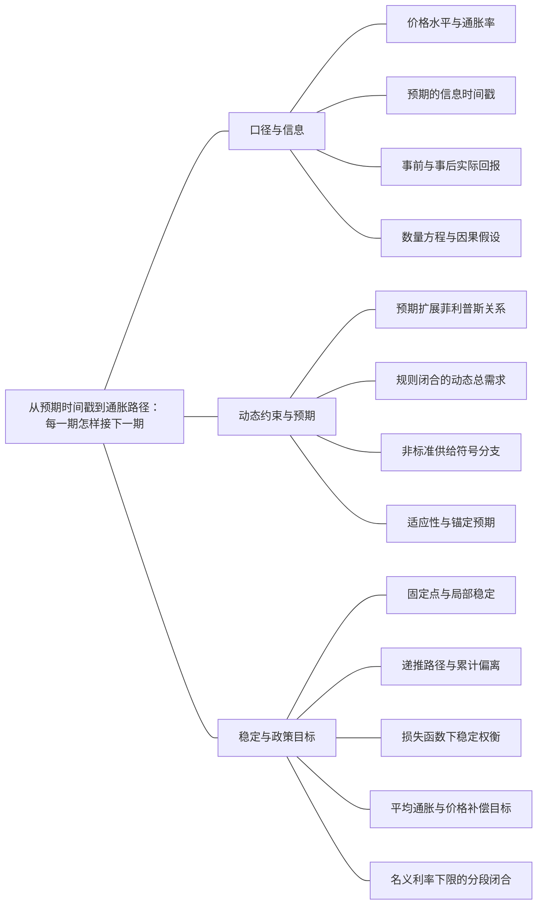

### 本专题知识联系

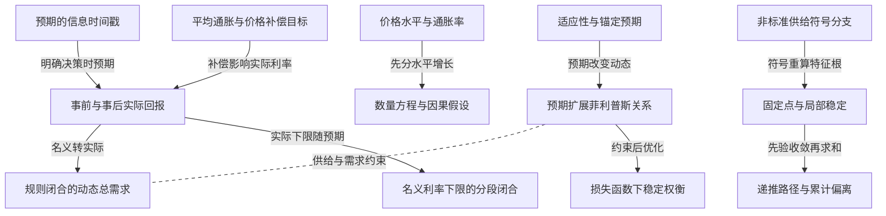

关系图中的箭头表示有方向的联系；虚线表示对照或类比。图中只画本专题主归属节点；跨专题关系在逐条命题中列明，可在练习室逐点追踪。具体成立条件以逐条说明为准。

### KMA053 价格水平与通胀率

身份：既有资料概括

还用于：从IS—LM到AD—AS：把价格与目标接进来；从人口身份到失业滞后：分母、流量与自然率；从数据到机制比较：论述怎样有证据地落地

**定义与对象**

价格水平是观察时点的物价指数水平，通胀率是其跨期变化率。

**何时调用**

AD AS价格比较、PPI同比、目标通胀和价格路径。

**适用条件**

离散倍率、对数变化与连续增长各按题设；百分点变化须与比例区分。

**核心公式与机制**

离散$1+\pi_t=\frac{P_t}{P_{t-1}}$；正通胀下降仍可能伴随价格继续上涨。

**推导与理由**

把本期价格除以上期价格才形成通胀，不能由价格一次跳升直接推永久通胀。

**边界与易错**

P、π与Δπ三个纵轴含义不同；算术平均通胀不等于复利价格路径。

**整理依据**

- card CK01：总量、人均量、有效人均量不是同一变量；有技术进步时有效人均稳态可以对应总产出持续增长。离散模型先写下一期分母，连续模型先对定义求导。名义和实际量同口径比较，价格水平与通胀率也要分开。
- card FA02：**条件检查。** 物价指数翻倍、名义GDP增加50%、人口不变时，实际人均GDP变为原来的$\frac{1.5}{2} = 0.75$，下降25%。通胀仍为正但下降，只说明物价上涨变慢；正增长率降低也不等于产出减少。进口消费品可进入CPI，但不直接进入本国GDP平减指数。

### KMA054 预期的信息时间戳

身份：既有资料概括

还用于：从数据到机制比较：论述怎样有证据地落地

**定义与对象**

预期的形成期与预测期决定它能在哪一条当期方程进入。

**何时调用**

同题出现Et−1πt、Etπt+1或新增预期冲击ηt。

**适用条件**

先固定信息集、冲击可观察时点与使用该预期的主体。

**核心公式与机制**

$E_{t-1}\pi_t$在t−1已定；将未来规则平移给它时，冲击也应变为ηt−1。

**推导与理由**

整体平移预期规则与把费雪式改为前瞻是不同操作，可产生不同当期导数。

**边界与易错**

不能把共同当期预期同时塞入供给与需求而不声明重设模型。

**整理依据**

- card CK05：$E_{t-1}\pi_t$在上一期形成、预测本期；$E_t\pi_{t+1}$在本期形成、预测下一期。将同一预期规则整体平移与修改费雪方程是两件事。先记谁在本期用哪个信息，再讨论预期冲击的当期效应。
- card FA30：**解题步骤。** 先查分母非零，再以$|\lambda|<1$检验稳定。不能把标准正AS结论直接套到$\kappa<0$。若新增预期规则$E_t\pi_{t+1}=\chi\pi_t+(1-\chi)\pi_{t-1}+\eta_t$按各期一致解释，应平移得到$q_t=E_{t-1}\pi_t=\chi\pi_{t-1}+(1-\chi)\pi_{t-2}+\eta_{t-1}$。

### KMA055 事前与事后实际回报

身份：既有资料概括

还用于：从两个市场到信用反馈：政策效果怎样算出来；从IS—LM到AD—AS：把价格与目标接进来；从工具操作到政策可信度：承诺为什么改变结果；从政府预算到债务可持续：先算账，再谈政策；从数据到机制比较：论述怎样有证据地落地

**定义与对象**

实际回报剔除货币购买力变化；事前决策用预期，事后实现用实际价格。

**何时调用**

名义降息伴通缩、跨期回报或精确费雪计算。

**适用条件**

期限、名义回报与价格因子一致；精确确定回报与随机期望应分开。

**核心公式与机制**

确定事后$1+r=\frac{1+i}{1+\pi}$；小变化事前$r\approx i-\pi^e$。

**推导与理由**

名义偿付换回商品数量需要除价格增长；预期通缩可在名义利率不变时提高事前融资成本。

**边界与易错**

E的比率与比率的E一般不同；名义利率下降不自动表示真实融资宽松。

**整理依据**

- card FA06：**解题步骤。** 数量题先判断$Y,V$是否固定，增长题再取对数变化或增长因子。事前实际利率用预期通胀，事后购买力回报用实际通胀。连续时间令实际货币余额$m = \frac{M}{P}$，实际铸币税收入为$\frac{\dot{M}}{P} = \dot{m} + \pi m$；若$m$固定，它等于$\pi m$。
- card FA06：$$ \begin{gathered} 1+r=\frac{1+i}{1+\pi}, \\ i\approx r+\pi^e. \end{gathered} $$

### KMA056 数量方程与因果假设

身份：既有资料概括

还用于：从工具操作到政策可信度：承诺为什么改变结果

**定义与对象**

数量方程核对名义支出、货币与周转速度，数量论还须附加外生性和长期供给假设。

**何时调用**

求流速、精确通胀或判断货币增长的因果含义。

**适用条件**

同一时期同口径M、V、P、Y；增长近似与精确倍率分开。

**核心公式与机制**

$MV=PY$；精确$1+\pi=\frac{(1+g_M)(1+g_V)}{1+g_Y}$。

**推导与理由**

恒等式可由任意三个已知量反求第四个，但它不规定哪个量导致哪个量。

**边界与易错**

M增长不必与通胀相等；固定速度是行为假设而非恒等式必然。

**整理依据**

- card FA06：$$ \begin{gathered} MV=PY, \\ g_M+g_V=\pi+g_Y. \end{gathered} $$
- card AC02：数量方程是恒等式，数量论还需要流通速度与长期供给等假设。一次提高货币存量主要改变长期价格水平，持续提高货币增长率才改变长期通胀率。预期通胀进入名义利率，未预期通胀则重新分配固定名义债权债务的实际价值。通胀的社会成本还包括持币与调价成本、相对价格混乱和税制扭曲；即使各人的名义收入同步变化，也不能说通胀毫无成本。

### KMA057 预期扩展菲利普斯关系

身份：既有资料概括

还用于：从人口身份到失业滞后：分母、流量与自然率；从工具操作到政策可信度：承诺为什么改变结果

**定义与对象**

菲利普斯关系把通胀偏离预期同就业或产出缺口及供给冲击联系。

**何时调用**

给通胀与失业变化、自然率或供给冲击。

**适用条件**

系数和符号按题定，失业率用比例或百分点一致；自然率是否固定需另说明。

**核心公式与机制**

$\pi_t=\pi_t^e-\beta_u(u_t-u_n)+v_t$；适应性预期时左边可写通胀变化。

**推导与理由**

把超额失业或产出压力映射为价格工资调整，预期指定了比较基准。

**边界与易错**

同样通胀数据在固定和滞后自然率下含义不同；不能混价格水平AS。

**整理依据**

- card FA27：**符号与前提。** $\pi_t=\pi_t^e-\beta_u(u_t-u_n)+v_t$、$\beta_u>0$；所有通胀和失业数值统一为比例或百分点。适应性预期可取$\pi_t^e=\pi_{t-1}$，但题目给两期加权就不能简化成一期。
- card FA26：**模型连接。** 布兰查德以$Y=N$、劳动力$L$固定作简化，$Y-Y_n=-L(u-u_n)$；代入$\pi-\pi^e=-\alpha_u(u-u_n)$得$\pi - \pi^e = (\frac{\alpha_u}{L}) (Y - Y_n)$。若$\pi^e=\pi_{t-1}$，PC纵轴可写$\Delta\pi$；中期稳定通胀要求$Y=Y_n$，央行还需把实际借款利率调整到对应自然水平。

### KMA058 规则闭合的动态总需求

身份：既有资料概括

还用于：从工具操作到政策可信度：承诺为什么改变结果

**定义与对象**

DAD将实际利率需求、费雪关系和政策规则合成为通胀与产出缺口的当期约束。

**何时调用**

给政策反应、自然实际利率及动态通胀供给。

**适用条件**

标准分支需求x=−a(r−ρ)+ε，前瞻费雪r=i−Etπt+1，Etπt+1=πt；规则i=π+ρ+θπ(π−π*)+θz x，a>0、θz≥0。

**核心公式与机制**

$x_t=-q(\pi_t-\pi^*)+e_t$，$q=\frac{a\theta_\pi}{1+a\theta_z},e_t=\frac{\varepsilon_t}{1+a\theta_z}$。

**推导与理由**

通胀偏离触发名义利率反应，扣除预期后形成实际紧缩或扩张，再进入需求。

**边界与易错**

规则内的内生反应不能重复画成另一外生冲击；传统AD的P坐标不同。

**整理依据**

- card FA29：**符号与前提。** $z_t=Y_t-\bar Y_t$，需求$z_t=-a(r_t-\rho)+\varepsilon_t$，$a>0$；$r_t=i_t-E_t\pi_{t+1}$；规则$i_t=\pi_t+\rho+\theta_\pi(\pi_t-\pi^*)+\theta_z z_t$；$E_t\pi_{t+1}=\pi_t$。供给为$\pi_t=\pi_{t-1}+\kappa z_t+v_t$、$\kappa>0$。
- card FA29：**解题步骤。** 严格按需求→Fisher→规则→预期顺序消元；给定上一期通胀先求当期交点，再把当期通胀带入下一期供给。暂时正需求首期使缺口与通胀升，退出后高通胀使缺口暂负；暂时供给冲击使通胀升、缺口负，退出后仍有预期惯性。

### KMA059 非标准供给符号分支

身份：既有资料概括

**定义与对象**

源题供给缺口符号若与教材标准不同，代数和稳定条件必须按原符号单列。

**何时调用**

原题负号、奇异分母或是否应纠正印刷的讨论。

**适用条件**

需求x=−α(r−ρ)+ε，政策i=π+ρ+θπ(π−π*)+θY x；供给π=π上一期+κx+v，费雪r=i−π上一期；Ad=1+αθY，相关分母非零。

**核心公式与机制**

$\lambda=\frac{A_d+\alpha\kappa}{A_d+\alpha\kappa(1+\theta_\pi)}$来自该明确闭合；κ负不能套正号结论。

**推导与理由**

将带符号供给代回同一需求和政策，再从递推系数判断，奇异点先查存在与唯一性。

**边界与易错**

不静默改号后宣称求出原题唯一解，也不将负号式当标准正向菲利普斯曲线。

**整理依据**

- card FA30：**符号与前提。** 保留需求参数$\alpha>0$及原规则，令$A_d=1+\alpha\theta_Y$。统一AS为$\pi_t=\pi_{t-1}+\kappa z_t+v_t$，原印负号对应$\kappa=-\varphi$，教材标准对应$\kappa=+\varphi$。第一问Fisher为$r_t=i_t-\pi_{t-1}$。
- card FA30：**解题步骤。** 先查分母非零，再以$|\lambda|<1$检验稳定。不能把标准正AS结论直接套到$\kappa<0$。若新增预期规则$E_t\pi_{t+1}=\chi\pi_t+(1-\chi)\pi_{t-1}+\eta_t$按各期一致解释，应平移得到$q_t=E_{t-1}\pi_t=\chi\pi_{t-1}+(1-\chi)\pi_{t-2}+\eta_{t-1}$。

### KMA060 适应性与锚定预期

身份：既有资料概括

**定义与对象**

预期权重决定暂时冲击是否以惯性形式传到下一期。

**何时调用**

给上一期通胀权重、目标锚或比较冲击持续性。

**适用条件**

明确θ的范围、目标与冲击序列；不是任意模型的理性预期解。

**核心公式与机制**

$\pi_t^e=\theta\pi_{t-1}+(1-\theta)\pi^*$；持续缺口在θ=1与锚定分支有不同通胀动态。

**推导与理由**

锚将部分预期直接拉回目标，适应性则继承过去实际通胀；两者进入供给后决定惯性。

**边界与易错**

θ接近1时累计偏离可能很大；理性预期四字不自动消除名义合同或滞后。

**整理依据**

- card FA47：**预期分支。** 适应性$\pi_t^e=\pi_{t-1}$时，持续正缺口使通胀逐期加速；锚定$\pi_t^e=\bar\pi$时，同样固定缺口给持续高于锚的通胀，不必逐期再加速。央行为保持实际利率固定，名义利率也要随预期变化，不能把水平实际LM和水平名义LM混同。
- review MA049：在缺口固定零时，代入预期规则并令 $z_t=\pi_t-2$，有

### KMA061 固定点与局部稳定

身份：既有资料概括

还用于：从资本积累到黄金律：先分水平，再分增长；从两个市场到信用反馈：政策效果怎样算出来；从IS—LM到AD—AS：把价格与目标接进来；从人口身份到失业滞后：分母、流量与自然率；从工具操作到政策可信度：承诺为什么改变结果；从政府预算到债务可持续：先算账，再谈政策；从数据到机制比较：论述怎样有证据地落地

**定义与对象**

固定点只表示可保持的状态，稳定还要求附近偏离在给定动态下衰减。

**何时调用**

递推、雅可比、债务反馈或人口稳定。

**适用条件**

先有闭合动态并核固定点存在；连续和离散特征根条件不同。

**核心公式与机制**

非线性一维离散的严格线性化充分判据为$|F^{\prime}(x^*)|<1$；连续严格负实部亦是充分判据，二维线性情形可用迹负且行列式正。临界模1或实部0须查高阶；纯线性系统可按根作充要判断。

**推导与理由**

线性化把局部偏离映射为线性运动，系数或特征根控制小扰动传播。

**边界与易错**

静态乘数分母符号不独自决定任意动态；局部不等于全局，纯线性单位根不渐近衰减，但非线性临界不能仅凭一阶根定论。

**整理依据**

- card FA10：**条件检查。** 局部稳定要求$|F'(k^*)|<1$，单调收敛还要求导数非负。标准参数通常满足，但非标准积累、时滞或政策反馈不保证。若$n=.02,g=.03,\delta=.05$，精确维持系数为$.1006$，不等于$.10$。总量稳态增长因子是$(1+n)(1+g)$；若报连续增长率需转换或说明近似。
- card FA21：**条件检查。** 位于两曲线上方时，初始同时有商品供给过剩与货币供给过剩，不能因为后续降息刺激投资就改称当下需求过剩。标准线性调整的雅可比迹为$-(\lambda a+\mu h)<0$，行列式为$\lambda\mu(ah+bk_m)>0$；这说明该动态设定的局部稳定，不意味着静态图唯一决定路径形状或调整先后。

### KMA062 递推路径与累计偏离

身份：既有资料概括

还用于：从人口身份到失业滞后：分母、流量与自然率

**定义与对象**

一期冲击大小、衰减速度、累计损失及损失基准是不同对象。

**何时调用**

几何通胀路径、累计产出损失或牺牲率。

**适用条件**

给冲击持续期、初始状态及累计口径；无穷和必须先验收敛。

**核心公式与机制**

若偏离$z_t=q^{t-1}z_1,|q|<1$，则$\sum_{t\ge1}z_t=\frac{z_1}{1-q}$。

**推导与理由**

逐期解出偏离再求和；高持久性可把小首冲击积成大总量。

**边界与易错**

单位根或永久水平损失使不贴现无穷和可能发散，不能只报有限牺牲率。

**整理依据**

- review MA049：初始偏离零且第一期冲击1，故 $z_1=1$，以后 $z_t=\theta^{t-1}$。当 $0\le\theta<1$，通胀路径为 $2+\theta^{t-1}$，累计偏离的几何和为 $\frac1{1-\theta}$ 个百分点期。
- card FA27：**解题步骤。** 先从零供给冲击且通胀等于预期时识别自然失业。反通胀路径先求每期超额失业，再经奥肯关系算各期产出缺口并累计。无供给冲击、一期适应性且参数固定时，累计关系给$S R = \frac{\eta}{\beta_u}$；多期预期则列历史通胀、预期、失业、缺口的时间表逐项更新。

### KMA063 损失函数下稳定权衡

身份：编者推导

还用于：从工具操作到政策可信度：承诺为什么改变结果

**定义与对象**

政策权衡用统一社会损失衡量通胀与产出偏离，而非默认完全稳价或稳产出。

**何时调用**

给二次损失与供给冲击，或比较政策权重。

**适用条件**

央行能控制题定工具；预期与供给约束已给，λ>0且可行域明确。

**核心公式与机制**

若$z=\kappa x+v,L=z^2+\lambda x^2$，无额外约束的最优$x^*=-\frac{\kappa v}{\lambda+\kappa^2}$。

**推导与理由**

将供给约束代损失，求凸二次目标的一阶条件，并同边界或极端目标比较。

**边界与易错**

不同制度要用同一社会评价尺；单期最优不自动等于长期动态最优。

**整理依据**

- case CMA09：供给z=0.5x+1，目标$(0.5x+1)^2+\lambda x^2$，一阶条件$0.5(0.5x+1)+\lambda x=0$，所以$x^*=-\frac{0.5}{\lambda+0.25}$，$z^*=\frac{\lambda}{\lambda+0.25}$。λ=1给x=−0.4、z=0.8、损失0.8。完全稳价z=0需x=−2，损失4；完全稳产出x=0给z=1，损失1。内点权衡更低损失，但这是当期目标与不同工具闭合，不能无说明当作第3问无限期a的最优值。

### KMA064 平均通胀与价格补偿目标

身份：既有资料概括

还用于：从工具操作到政策可信度：承诺为什么改变结果

**定义与对象**

年度目标、算术平均目标和恢复原价格路径要求的后期通胀不完全相同。

**何时调用**

前期低于目标，后期要补偿，或平均窗口未明。

**适用条件**

明确窗口、权重、复利路径及承诺是否可信，实际实现不能只靠宣布。

**核心公式与机制**

两年目标2%、首年0时，算术补偿4%，原价格路径补偿4.04%；两者来自不同目标约束。

**推导与理由**

先把目标写为平均约束或价格因子乘积，再反求后期通胀，之后分析预期实际利率传导。

**边界与易错**

目标通胀不是预期方程截距η；窗口不清会削弱公众对补偿的理解。

**整理依据**

- case CMA10：算术两年平均2%要求第二年4%；恢复原两年价格路径要求$(1+0)(1+\pi_2)=(1.02)^2$，故π2=4.04%。两者差来自复利与算术口径。η是预期方程的外生截距（百分点），不是目标实际通胀；A的本期响应仅为$\frac{\eta}{3}$，还受可信度、工具与供给关系约束。若要用η实现某个本期偏离，须按联立映射反求并确保预期承诺可实施，不能把4%或4.04%直接填作η就宣布目标实现。

### KMA065 名义利率下限的分段闭合

身份：既有资料概括

还用于：从两个市场到信用反馈：政策效果怎样算出来；从工具操作到政策可信度：承诺为什么改变结果

**定义与对象**

利率到下限时，原货币等式可能转为超额余额不等式，政策须按新分支求解。

**何时调用**

算出负名义利率、流动性陷阱或扩基础货币无进一步降息。

**适用条件**

题给0下限的简化模型；并非对所有现实货币需求作完整刻画。

**核心公式与机制**

$0\le i\perp[m-L(i,Y)]\ge0$；先解内点再检下限分支及余额可行。

**推导与理由**

若内点要求i负，改i=0后由商品条件求Y，并检查持币愿望能吸收额外余额。

**边界与易错**

下限约束的是名义率，实际利率还取决于预期；不能仅截掉负i却保留不相容的原等式。

**整理依据**

- card FA28：**符号与前提。** 先区分预期与未预期价格变化。下限模型可写$0\leq i\perp[m-L(i,Y)]\geq0$：正利率时货币市场取等号，下限时可有超额余额；该简化用于题给的流动性陷阱，不等于任意现实货币需求的完整结构。
- card FA28：**解题步骤。** 先按内点联立，再查利率是否为负；若负则改$i=0$，用商品市场求产出，并查余额不等式。S16的$C=1+.5Y,I=1-.5r,P=1,\pi^e=0$给IS $Y=4+2G-r$，从而

### 关系命题与条件

#### EMA050 价格水平与通胀率 → 数量方程与因果假设

前置；既有资料概括

精确通胀核算必须从价格因子而非价格水平差或百分数直接相减开始。

适用条件：同一时期的货币速度与实际产出因子。

理由：数量方程的P水平转为增长关系要除以上期量。

依据：card FA06「**符号与前提。** $V$为流通速度。连续增长率与离散年度变化要分别处理；已知确定的通胀或确定预期情形可用精确回报比率，不把随机实际回报的期望简单等同于各期望的比值。」

#### EMA051 预期的信息时间戳 → 事前与事后实际回报

前置；既有资料概括

费雪式用于事前需求前，须说明是上期形成的本期预期还是当期未来预期。

适用条件：模型给定形成时点，不能随意换指标。

理由：不同预期进入实际融资成本会改变当期冲击导数。

依据：card CK05「$E_{t-1}\pi_t$在上一期形成、预测本期；$E_t\pi_{t+1}$在本期形成、预测下一期。将同一预期规则整体平移与修改费雪方程是两件事。先记谁在本期用哪个信息，再讨论预期冲击的当期效应。」

#### EMA052 事前与事后实际回报 → 规则闭合的动态总需求

前置；既有资料概括

将名义政策规则转成实际融资成本，是推DAD的必要步骤。

适用条件：Etπt+1=πt等标准预期分支或明示其他规则。

理由：支出对实际利率反应，不能直接把名义利率总系数当需求系数。

依据：card FA29「**解题步骤。** 严格按需求→Fisher→规则→预期顺序消元；给定上一期通胀先求当期交点，再把当期通胀带入下一期供给。暂时正需求首期使缺口与通胀升，退出后高通胀使缺口暂负；暂时供给冲击使通胀升、缺口负，退出后仍有预期惯性。」

#### EMA053 预期扩展菲利普斯关系 → 规则闭合的动态总需求

对照；既有资料概括

菲利普斯供给和DAD分别约束通胀与产出，必须联立，不能互相当定义。

适用条件：同一时期、同一缺口单位与预期时点。

理由：一个来自价格工资调整，另一个来自需求金融政策反应。

依据：card FA29「**符号与前提。** $z_t=Y_t-\bar Y_t$，需求$z_t=-a(r_t-\rho)+\varepsilon_t$，$a>0$；$r_t=i_t-E_t\pi_{t+1}$；规则$i_t=\pi_t+\rho+\theta_\pi(\pi_t-\pi^*)+\theta_z z_t$；$E_t\pi_{t+1}=\pi_t$。供给为$\pi_t=\pi_{t-1}+\kappa z_t+v_t$、$\kappa>0$。」

#### EMA054 适应性与锚定预期 → 预期扩展菲利普斯关系

条件变化；既有资料概括

同一缺口在适应性预期下可引致通胀加速，在锚定预期下可形成高于目标的通胀水平。

适用条件：持续缺口、固定供给参数且无额外抵消冲击。

理由：预期是否继承上一期实际通胀决定下一期基准是否继续上移。

依据：card FA47「**预期分支。** 适应性$\pi_t^e=\pi_{t-1}$时，持续正缺口使通胀逐期加速；锚定$\pi_t^e=\bar\pi$时，同样固定缺口给持续高于锚的通胀，不必逐期再加速。央行为保持实际利率固定，名义利率也要随预期变化，不能把水平实际LM和水平名义LM混同。」

#### EMA055 非标准供给符号分支 → 固定点与局部稳定

条件变化；既有资料概括

供给符号改变后，政策递推和稳定区间须从新闭合重算。

适用条件：分母非零并保持原费雪时点。

理由：负反馈可转成正反馈，不能只用标准泰勒参数口诀。

依据：card FA30「**解题步骤。** 先查分母非零，再以$|\lambda|<1$检验稳定。不能把标准正AS结论直接套到$\kappa<0$。若新增预期规则$E_t\pi_{t+1}=\chi\pi_t+(1-\chi)\pi_{t-1}+\eta_t$按各期一致解释，应平移得到$q_t=E_{t-1}\pi_t=\chi\pi_{t-1}+(1-\chi)\pi_{t-2}+\eta_{t-1}$。」

#### EMA056 固定点与局部稳定 → 递推路径与累计偏离

前置；既有资料概括

要使用无穷几何累计公式，先证明偏离衰减系数绝对值小于1。

适用条件：无穷期、不贴现且路径满足给定线性递推。

理由：非收敛路径的无穷和不能借稳定分支的代数分式。

依据：review MA049「若θ等于1，冲击后偏离每期都为1，目标不再对预期提供回归锚，累计偏离无界。累计偏离是路径指标，不自动等于福利损失；实际损失还需通胀和产出损失函数。故初始冲击大小不足以决定总损失，且本题缺口固定零，不能另加未设定的紧缩产出成本后仍沿用同一路径。」

#### EMA057 预期扩展菲利普斯关系 → 损失函数下稳定权衡

前置；既有资料概括

供给约束规定稳价与稳产出的可行组合，再由损失权重选择政策。

适用条件：央行工具能实现所选缺口，预期给定。

理由：不能先宣称两个独立目标都精确达成，再忽略冲击约束。

依据：case CMA09「供给z=0.5x+1，目标$(0.5x+1)^2+\lambda x^2$，一阶条件$0.5(0.5x+1)+\lambda x=0$，所以$x^*=-\frac{0.5}{\lambda+0.25}$，$z^*=\frac{\lambda}{\lambda+0.25}$。λ=1给x=−0.4、z=0.8、损失0.8。完全稳价z=0需x=−2，损失4；完全稳产出x=0给z=1，损失1。内点权衡更低损失，但这是当期目标与不同工具闭合，不能无说明当作第3问无限期a的最优值。」

#### EMA058 平均通胀与价格补偿目标 → 事前与事后实际回报

机制；既有资料概括

可信未来通胀补偿可通过预期影响当前实际融资成本。

适用条件：名义利率未同量上调、承诺可信且支出对实际率敏感。

理由：预期提高使给定名义率下实际利率下降，但政策内生反应和供给可改变净效果。

依据：card FA28「**条件检查。** 利率为零后，常规增$M$不再降低本题政策利率，但前瞻指引、期限/风险溢价及信贷修复仍可能作用。实际利率下限取决于预期通胀，并非总为零。$M=4+2G$处为分支边界，不能继续外推内点线性乘数。」；case CMA10「算术两年平均2%要求第二年4%；恢复原两年价格路径要求$(1+0)(1+\pi_2)=(1.02)^2$，故π2=4.04%。两者差来自复利与算术口径。η是预期方程的外生截距（百分点），不是目标实际通胀；A的本期响应仅为$\frac{\eta}{3}$，还受可信度、工具与供给关系约束。若要用η实现某个本期偏离，须按联立映射反求并确保预期承诺可实施，不能把4%或4.04%直接填作η就宣布目标实现。」

#### EMA059 名义利率下限的分段闭合 → 央行操作闭合

条件变化；既有资料概括

下限绑定时，不能继续无条件沿原数量型LM等式外推政策。

适用条件：题给额外余额可以被持有的流动性陷阱。

理由：i锁定后新增货币未必再改变投资所面对的政策利率。

依据：card FA28「**条件检查。** 利率为零后，常规增$M$不再降低本题政策利率，但前瞻指引、期限/风险溢价及信贷修复仍可能作用。实际利率下限取决于预期通胀，并非总为零。$M=4+2G$处为分支边界，不能继续外推内点线性乘数。」

#### EMA060 事前与事后实际回报 → 名义利率下限的分段闭合

条件变化；既有资料概括

同样零名义利率在不同预期通胀下对应不同实际融资成本。

适用条件：利率下限是名义约束，事前实际率近似有效。

理由：预期通缩抬高实际率，可信补偿可以降低它。

依据：card FA28「**条件检查。** 利率为零后，常规增$M$不再降低本题政策利率，但前瞻指引、期限/风险溢价及信贷修复仍可能作用。实际利率下限取决于预期通胀，并非总为零。$M=4+2G$处为分支边界，不能继续外推内点线性乘数。」

#### EMA067 预期扩展菲利普斯关系 → 奥肯缺口换算

推导；既有资料概括

在明确自然率和无额外供给冲击下，可由降通胀求失业缺口再换产出缺口。

适用条件：两关系的单位、时点和基准一致。

理由：菲利普斯决定所需失业偏离，奥肯将其转换为产出损失。

依据：card FA27「**解题步骤。** 先从零供给冲击且通胀等于预期时识别自然失业。反通胀路径先求每期超额失业，再经奥肯关系算各期产出缺口并累计。无供给冲击、一期适应性且参数固定时，累计关系给$S R = \frac{\eta}{\beta_u}$；多期预期则列历史通胀、预期、失业、缺口的时间表逐项更新。」

#### EMA071 固定点与局部稳定 → 人口反馈的局部稳定

方法类比；编者类比

人口反馈与资本递推都可用离散固定点导数检验局部稳定，但状态与经济反馈不同。

适用条件：仅方法类比，不将资本和人口动态视为同一模型。

理由：相同绝对值条件来自离散线性化，具体导数仍须分别求。

依据：card FA10「**条件检查。** 局部稳定要求$|F'(k^*)|<1$，单调收敛还要求导数非负。标准参数通常满足，但非标准积累、时滞或政策反馈不保证。若$n=.02,g=.03,\delta=.05$，精确维持系数为$.1006$，不等于$.10$。总量稳态增长因子是$(1+n)(1+g)$；若报连续增长率需转换或说明近似。」；card FA18「**条件检查。** $G(c)=1$不能误写$G(c)=0$。人口映射$F(N)=NG(c(N))$在稳态的导数为$F'(N^*)=1-(1-a)c^*G'(c^*)$；局部稳定需其绝对值小于1。正向人口反馈过强可能振荡或失稳，不能只凭“高收入增加人口”就断言必然收敛。现代持续技术、资本、人力资本与生育选择不在这个简化模型之内。」

#### EMA077 数量方程与因果假设 → 铸币税与通胀税

对照；既有资料概括

数量方程说明支出核算，铸币税另核新货币对应的实际资源，两者不能互称因果。

适用条件：货币和价格口径一致，实际余额变化被保留。

理由：发行资源包含实际持币需求变化而非只有通胀损失。

依据：card FA06「**解题步骤。** 数量题先判断$Y,V$是否固定，增长题再取对数变化或增长因子。事前实际利率用预期通胀，事后购买力回报用实际通胀。连续时间令实际货币余额$m = \frac{M}{P}$，实际铸币税收入为$\frac{\dot{M}}{P} = \dot{m} + \pi m$；若$m$固定，它等于$\pi m$。」

#### EMA119 事前与事后实际回报 → 债务通缩与信用需求反馈

机制；既有资料概括

名义率受限或未同幅下降时，预期通缩提高实际率，与真实债务渠道共同压需求。

适用条件：费雪预期时点明确，实际率影响支出。

理由：一个是未来购买力回报，一个是既有债务重估，不可只看名义率。

依据：card FA28「**通缩机制。** 未预期通缩提高既定名义债务实际价值；借款人支出下降、违约和抵押价值损失可压低需求，不能以总债权债务相抵就宣称中性。预期通缩在名义利率给定或下限绑定时提高$r=i-\pi^e$，压低消费投资；另一方面价格下降增加$\frac{M}{P}$，这个扩张渠道也应列出，净结果取决于约束。」

### 对应题目分问路径

#### MA041

先固定原供给符号与信息时间，再区分三种预期闭合。

**第1问**

本问任务：推导DAD。

原费雪使用上一期形成的当期预期，先把政策与该预期代需求，保留通胀同滞后预期之差。

调用：KMA058 规则闭合的动态总需求；KMA055 事前与事后实际回报；KMA054 预期的信息时间戳

联系：EMA051、EMA052

**第2问**

本问任务：讨论$\theta_\pi<0$的后果及政策启示。

统一带符号κ联立求递推系数，分别核原负号与标准正号，负政策反应不能脱离分母和κ断言发散。

调用：KMA059 非标准供给符号分支；KMA058 规则闭合的动态总需求；KMA061 固定点与局部稳定

联系：EMA055

**第3问**

本问任务：预期规则改为$E_t\pi_{t+1}=\chi\pi_t+(1-\chi)\pi_{t-1}+\eta_t$，推导新DAD、DAS。

先整体平移预期规则使扰动为上一期η；另设前瞻费雪及共同前瞻供给时须明示是替代闭合。

调用：KMA054 预期的信息时间戳；KMA058 规则闭合的动态总需求；KMA059 非标准供给符号分支

联系：本问直接使用“预期的信息时间戳、规则闭合的动态总需求、非标准供给符号分支”所列定义、模型或既有结论核算，不将本问共同出现的知识点强行画成逻辑推出。

**第4问**

本问任务：$\eta_t>0$是否必然使本期通胀自我实现？交代时点与符号。

本期η在严格滞后分支尚未入式；前瞻分支导数需依供给符号和分母判断，不能笼统宣称预期自我实现。

调用：KMA054 预期的信息时间戳；KMA059 非标准供给符号分支；KMA055 事前与事后实际回报

联系：EMA051

#### MA042

正号动态供给中需求和成本首冲击产生不同缺口路径。

**第1问**

本问任务：推导通胀递推。

把需求代入正号供给，围绕目标通胀写递推，检验衰减系数。

调用：KMA058 规则闭合的动态总需求；KMA057 预期扩展菲利普斯关系；KMA060 适应性与锚定预期；KMA061 固定点与局部稳定

联系：EMA053

**第2问**

本问任务：仅第1期有需求冲击$\varepsilon_1=3$，其余冲击为0，求前3期通胀和缺口。

只在首期代需求冲击3，先求通胀再由需求回求每期缺口，首期与后期符号不同。

调用：KMA058 规则闭合的动态总需求；KMA062 递推路径与累计偏离

联系：本问直接使用“规则闭合的动态总需求、递推路径与累计偏离”所列定义、模型或既有结论核算，不将本问共同出现的知识点强行画成逻辑推出。

**第3问**

本问任务：若第1期改为供给冲击$v_1=1$、需求冲击为0，比较路径。

独立恢复初始状态再代供给冲击1，比较首期负缺口与前一实验，不能承接需求冲击的状态。

调用：KMA057 预期扩展菲利普斯关系；KMA062 递推路径与累计偏离

联系：本问直接使用“预期扩展菲利普斯关系、递推路径与累计偏离”所列定义、模型或既有结论核算，不将本问共同出现的知识点强行画成逻辑推出。

#### MA043

原负号供给的奇异、发散和振荡须按同一递推判断。

**第1问**

本问任务：求通胀偏离目标的递推系数。

保留负φ缺口供给，同x等于负通胀偏离联立，先写隐式变化关系再除系数。

调用：KMA059 非标准供给符号分支；KMA058 规则闭合的动态总需求

联系：本问直接使用“非标准供给符号分支、规则闭合的动态总需求”所列定义、模型或既有结论核算，不将本问共同出现的知识点强行画成逻辑推出。

**第2问**

本问任务：分别讨论$\varphi=0.2,1,3$的代数解与稳定性。

φ为0.2时根大于1，φ为1先查无解或不唯一，φ为3为负根收敛，奇异点不可直接取根。

调用：KMA059 非标准供给符号分支；KMA061 固定点与局部稳定

联系：EMA055

**第3问**

本问任务：为什么不能仅把负号静默改为正号后宣布原题唯一解成立？

改成正号就改变经济反馈，须把标准教材分支与原题分支分别说明，不能静默替换为唯一答案。

调用：KMA059 非标准供给符号分支

联系：本问直接使用“非标准供给符号分支”所列定义、模型或既有结论核算，不将本问共同出现的知识点强行画成逻辑推出。

#### MA044

供给是否采用共同前瞻指标决定预期冲击的量价方向。

**第1问**

本问任务：在供给A下求η对当期通胀与产出缺口的导数。

先在同一前瞻费雪需求下消去名义率及预期，再同滞后供给A联立求η的量价导数。

调用：KMA054 预期的信息时间戳；KMA058 规则闭合的动态总需求；KMA055 事前与事后实际回报

联系：EMA051、EMA052

**第2问**

本问任务：在供给B下求相同导数，并与A比较。

把供给替换为B后预期也直接进入定价，重新联立而非把A导数再乘权重。

调用：KMA054 预期的信息时间戳；KMA058 规则闭合的动态总需求；KMA057 预期扩展菲利普斯关系

联系：EMA053

**第3问**

本问任务：解释供给B相对A新增的经济与信息时点假设。

B增设供给定价使用当期未来预期的信息假设，两个闭合的产出反应可反向，不能仅凭预期上升共用结论。

调用：KMA054 预期的信息时间戳

联系：本问直接使用“预期的信息时间戳”所列定义、模型或既有结论核算，不将本问共同出现的知识点强行画成逻辑推出。

#### MA045

数量方程的核算、精确倍率和因果解释分层处理。

**第1问**

本问任务：逐年求货币流速V。

逐期用PY除M核流速，同一价格与产出时期不可错配。

调用：KMA056 数量方程与因果假设

联系：本问直接使用“数量方程与因果假设”所列定义、模型或既有结论核算，不将本问共同出现的知识点强行画成逻辑推出。

**第2问**

本问任务：用精确增长倍数检验数量方程。

按货币与流速增长因子相乘再除实际产出因子，核两段观察同数量恒等式一致。

调用：KMA056 数量方程与因果假设；KMA053 价格水平与通胀率

联系：EMA050

**第3问**

本问任务：若下一年M增长10%、Y增长5%、V下降4%，求精确通胀率，并比较增长率相加近似。

按1.10乘0.96再除1.05算精确通胀，减法近似漏交叉项与精确分母，误差用百分点报告。

调用：KMA056 数量方程与因果假设；KMA126 有限变动与局部比较静态

联系：本问直接使用“数量方程与因果假设、有限变动与局部比较静态”所列定义、模型或既有结论核算，不将本问共同出现的知识点强行画成逻辑推出。

#### MA046

短期流动性效应和长期预期调整须分别核实际率。

**第1问**

本问任务：用流动性效应和费雪效应解释短长期差异。

紧缩初期价格预期未充分调整，流动性可推名义率；长期预期通胀下降使名义率随费雪关系回落。

调用：KMA055 事前与事后实际回报；KMA034 货币市场LM条件；KMA054 预期的信息时间戳

联系：EMA051

**第2问**

本问任务：若当期预期通胀仍为2%，求当期实际利率近似值；长期值是多少？

按预期仍2%算短期实际率并同自然率比，长期预期0时另算；初始实际率不强行设为自然率。

调用：KMA055 事前与事后实际回报；KMA052 中性政策实际利率

联系：本问直接使用“事前与事后实际回报、中性政策实际利率”所列定义、模型或既有结论核算，不将本问共同出现的知识点强行画成逻辑推出。

**第3问**

本问任务：若只观察名义利率下降，能否断言货币宽松？

单一名义率下行不能识别宽松，需同步观察预期、实际率相对自然率及政策操作证据。

调用：KMA055 事前与事后实际回报；KMA122 机制一致与因果识别

联系：本问直接使用“事前与事后实际回报、机制一致与因果识别”所列定义、模型或既有结论核算，不将本问共同出现的知识点强行画成逻辑推出。

#### MA047

可预期通胀、意外通胀与理性预期的政策闭合各有条件。

**第1问**

本问任务：若公开可信地将通胀永久改为4%，公众同步预期，分析当期产出及预期调整。

可信公告使实际和预期同到4时意外项为零，按题定供给算产出缺口。

调用：KMA057 预期扩展菲利普斯关系；KMA060 适应性与锚定预期

联系：本问直接使用“预期扩展菲利普斯关系、适应性与锚定预期”所列定义、模型或既有结论核算，不将本问共同出现的知识点强行画成逻辑推出。

**第2问**

本问任务：若公众仍预期2%而当期实际通胀4%，分析产出并同前问比较。

当期预期仍2而实现4产生一次意外缺口，以后预期更新则同一固定通胀不再持续刺激。

调用：KMA057 预期扩展菲利普斯关系；KMA054 预期的信息时间戳

联系：本问直接使用“预期扩展菲利普斯关系、预期的信息时间戳”所列定义、模型或既有结论核算，不将本问共同出现的知识点强行画成逻辑推出。

**第3问**

本问任务：若公众知道央行总想制造2点意外通胀，讨论预期、可实现性与长期政策评价。

知道政策诱因的公众会内生形成预期；长期通胀需补政策损失和一致预期固定点闭合，不能每期固定误判2点。

调用：KMA054 预期的信息时间戳；KMA061 固定点与局部稳定；KMA128 条件—机制—证据的论述结构

联系：本问直接使用“预期的信息时间戳、固定点与局部稳定、条件—机制—证据的论述结构”所列定义、模型或既有结论核算，不将本问共同出现的知识点强行画成逻辑推出。

#### MA048

不同补偿目标先写精确定义再讨论预期利率渠道。

**第1问**

本问任务：若坚持固定年度通胀目标2%，求第二年通胀。

固定年度通胀目标每年独立回2，不补前一年偏离。

调用：KMA064 平均通胀与价格补偿目标

联系：本问直接使用“平均通胀与价格补偿目标”所列定义、模型或既有结论核算，不将本问共同出现的知识点强行画成逻辑推出。

**第2问**

本问任务：若要求两年通胀算术平均为2%，求第二年通胀。

两年算术平均约束下反求后年4%，这是窗口定义而非价格复利目标。

调用：KMA064 平均通胀与价格补偿目标

联系：本问直接使用“平均通胀与价格补偿目标”所列定义、模型或既有结论核算，不将本问共同出现的知识点强行画成逻辑推出。

**第3问**

本问任务：若要求两年末价格水平达到每年增长2%的原路径，求第二年通胀，并比较三种目标及其差异。

恢复原价格路径须使两年价格因子乘积等于1.02平方，得4.04%；可信沟通可经预期实际率影响需求但不保证实现。

调用：KMA064 平均通胀与价格补偿目标；KMA053 价格水平与通胀率；KMA055 事前与事后实际回报

联系：EMA058

#### MA049

预期锚定控制冲击惯性，累计偏离不等于福利损失。

**第1问**

本问任务：求各期通胀及累计偏离。

缺口固定零时把预期代供给得到偏离递推，先核权重范围再用几何和。

调用：KMA060 适应性与锚定预期；KMA062 递推路径与累计偏离；KMA061 固定点与局部稳定

联系：EMA056

**第2问**

本问任务：比较θ=0、0.5、0.9。

同一次首冲击分别代θ为0、0.5、0.9，比较持续性和累计百分点期，而非只比较第一期。

调用：KMA060 适应性与锚定预期；KMA062 递推路径与累计偏离

联系：本问直接使用“适应性与锚定预期、递推路径与累计偏离”所列定义、模型或既有结论核算，不将本问共同出现的知识点强行画成逻辑推出。

**第3问**

本问任务：θ=1时结果怎样，为什么不能只说首次冲击大小决定损失？

θ为1是无回归锚的单位根，累计偏离无界；其福利含义仍需额外损失函数，不能把首冲击小等同损失小。

调用：KMA060 适应性与锚定预期；KMA062 递推路径与累计偏离；KMA063 损失函数下稳定权衡

联系：本问直接使用“适应性与锚定预期、递推路径与累计偏离、损失函数下稳定权衡”所列定义、模型或既有结论核算，不将本问共同出现的知识点强行画成逻辑推出。

#### MA050

同一凸损失函数下选择供给冲击的产出通胀权衡。

**第1问**

本问任务：求最优x、z和损失。

将z等于x加2代单期损失，求唯一凸二次内点与目标值。

调用：KMA063 损失函数下稳定权衡；KMA057 预期扩展菲利普斯关系

联系：EMA057

**第2问**

本问任务：比较λ=1与λ=3。

分别代λ为1和3比较量价响应；不同λ的损失数值使用不同评价尺，不能据大小直接评制度优劣。

调用：KMA063 损失函数下稳定权衡

联系：本问直接使用“损失函数下稳定权衡”所列定义、模型或既有结论核算，不将本问共同出现的知识点强行画成逻辑推出。

**第3问**

本问任务：解释它与“任何冲击下都完全稳物价”或“完全稳产出”的差异。

完全稳价与稳产出分别是两个约束选择，按同一λ比较损失；不将单期最优推广为跨期承诺最优。

调用：KMA063 损失函数下稳定权衡；KMA049 按目标反推工具

联系：本问直接使用“损失函数下稳定权衡、按目标反推工具”所列定义、模型或既有结论核算，不将本问共同出现的知识点强行画成逻辑推出。

#### CMA09

从冲击递推到政策权重，再单列直接控制和供给改号。

**第1问**

本问任务：仅第1期有需求冲击ε1=3，其余ε与v为0。推导递推并求第1至3期通胀和缺口，求累计通胀偏离。

按正供给联立求偏离递推，代需求首冲击逐期回算缺口，再核累计偏离单位。

调用：KMA058 规则闭合的动态总需求；KMA057 预期扩展菲利普斯关系；KMA062 递推路径与累计偏离；KMA061 固定点与局部稳定

联系：EMA053、EMA056

**第2问**

本问任务：独立从π0=2出发，仅第1期供给冲击v1=1、需求无冲击，求前三期路径与累计缺口，并与第1问比较。

独立从原稳态施加供给冲击，首期起缺口为负；相同通胀现象不能唯一识别冲击来源。

调用：KMA057 预期扩展菲利普斯关系；KMA062 递推路径与累计偏离；KMA122 机制一致与因果识别

联系：本问直接使用“预期扩展菲利普斯关系、递推路径与累计偏离、机制一致与因果识别”所列定义、模型或既有结论核算，不将本问共同出现的知识点强行画成逻辑推出。

**第3问**

本问任务：保留第2问供给冲击而令a一般化，求通胀衰减系数、首次通胀和缺口及累计通胀/缺口；据此评价更强反应的取舍。

保留一般反应a，比较衰减、首期与累计量，累计缺口相同不排除平方损失和时间分布差异。

调用：KMA058 规则闭合的动态总需求；KMA062 递推路径与累计偏离；KMA063 损失函数下稳定权衡

联系：本问直接使用“规则闭合的动态总需求、递推路径与累计偏离、损失函数下稳定权衡”所列定义、模型或既有结论核算，不将本问共同出现的知识点强行画成逻辑推出。

**第4问**

本问任务：在冲击首期改用直接选x的单期政策，π0=2、v1=1，损失L=(π1−2)²+λx1²，λ>0。求最优解，并比较λ=1与完全稳价和完全稳产出。

本问工具改为直接选择x，代供给求单期最优并同两个极端比较，不当成原需求规则a的跨期最优。

调用：KMA063 损失函数下稳定权衡；KMA057 预期扩展菲利普斯关系；KMA049 按目标反推工具

联系：EMA057

**第5问**

本问任务：恢复a=1的需求且无冲击，若供给原式的+0.5x改为−φx，φ>0，推导稳定条件；说明为什么必须明示这种改变。

恢复原需求后仅改供给符号，先核φ等于1奇异，其他值按根绝对值判断，负号不能静默改回。

调用：KMA059 非标准供给符号分支；KMA061 固定点与局部稳定

联系：EMA055

#### CMA10

相同政策需求下比较供给信息假设与补偿沟通。

**第1问**

本问任务：将政策和预期代入需求，写出通胀偏离z=πt−2的需求关系。基准求x、π、i与实际利率r，说明ρ无需给数值也能求偏离。

先将政策和前瞻预期代需求，按供给A求基准；ρ平移利率而不改缺口。

调用：KMA058 规则闭合的动态总需求；KMA055 事前与事后实际回报；KMA054 预期的信息时间戳

联系：EMA051、EMA052

**第2问**

本问任务：供给A不变、χ=0.5时，沟通冲击η=1，求通胀缺口与名义/实际利率变化，并求η的一般边际效应。

χ为0.5而供给A固定，联立求η效应并逐项核名义率、预期与实际率变化。

调用：KMA058 规则闭合的动态总需求；KMA055 事前与事后实际回报；KMA054 预期的信息时间戳；KMA057 预期扩展菲利普斯关系

联系：EMA051、EMA052、EMA053

**第3问**

本问任务：将供给明确改为B、恢复χ=0.5，从η=0基准施加η=1，求相同量并与A比较；解释B增加的假设。

替换供给B重算量价和利率，解释共同预期直接进入定价使产出反应可反向。

调用：KMA054 预期的信息时间戳；KMA057 预期扩展菲利普斯关系；KMA058 规则闭合的动态总需求；KMA055 事前与事后实际回报

联系：EMA051、EMA052、EMA053

**第4问**

本问任务：保留一般χ，分别推A、B对η的解，列联立奇异的参数值；代数可解是否就证明跨期理性预期均衡稳定？

保留一般χ分别消元，奇异点先查相容和唯一；单期分母不构成完整跨期稳定证明。

调用：KMA054 预期的信息时间戳；KMA058 规则闭合的动态总需求；KMA061 固定点与局部稳定

联系：本问直接使用“预期的信息时间戳、规则闭合的动态总需求、固定点与局部稳定”所列定义、模型或既有结论核算，不将本问共同出现的知识点强行画成逻辑推出。

**第5问**

本问任务：回供给A、χ=0.5，若央行希望靠可信补偿沟通弥补前一年0通胀造成的两年目标缺口，比较算术平均目标与原每年2%的价格路径所需第二年通胀；说明η不能直接等于该目标差。

区分4%算术补偿与4.04%价格路径补偿，η是预期截距，若指定实现目标须通过联立映射反推。

调用：KMA064 平均通胀与价格补偿目标；KMA053 价格水平与通胀率；KMA049 按目标反推工具；KMA054 预期的信息时间戳

联系：本问直接使用“平均通胀与价格补偿目标、价格水平与通胀率、按目标反推工具、预期的信息时间戳”所列定义、模型或既有结论核算，不将本问共同出现的知识点强行画成逻辑推出。

## 从人口身份到失业滞后：分母、流量与自然率

失业率、自然率与人口怎样分别由统计身份、流量和历史反馈决定？

先对齐人口分母，再区分匹配、工资价格、竞争需求和历史滞后；反通胀损失需明确基准，人口门槛另作历史模型。

### 分支导图

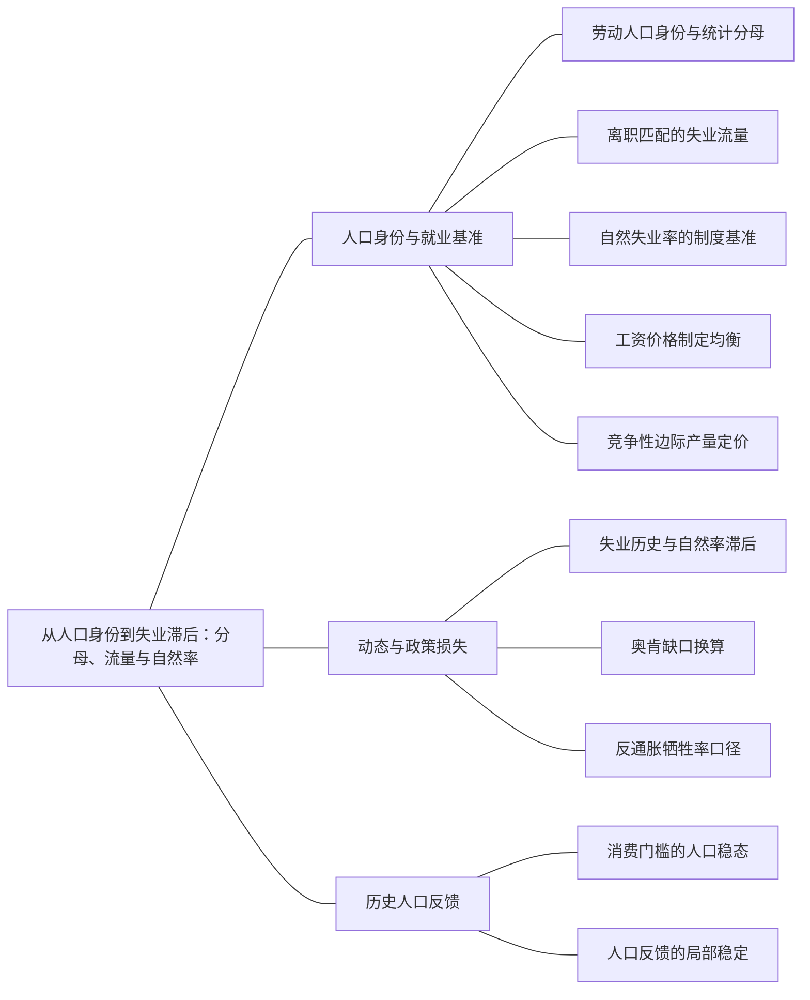

### 本专题知识联系

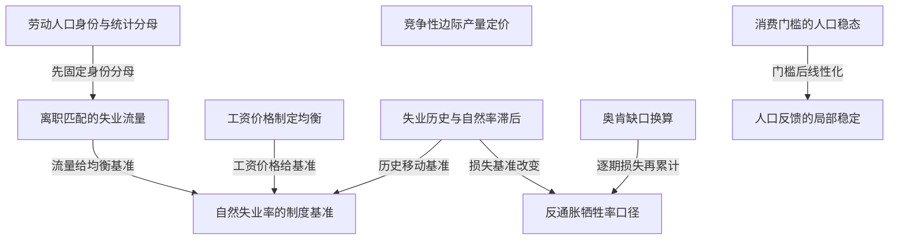

关系图中的箭头表示有方向的联系；虚线表示对照或类比。图中只画本专题主归属节点；跨专题关系在逐条命题中列明，可在练习室逐点追踪。具体成立条件以逐条说明为准。

### KMA066 劳动人口身份与统计分母

身份：既有资料概括

**定义与对象**

就业、积极求职失业与非劳动力构成不同身份，失业率、参与率和就业人口比使用不同分母。

**何时调用**

给就业失业退出人数，评价失业率下降。

**适用条件**

先固定劳动年龄人口与统计身份，不把停止求职者继续计失业。

**核心公式与机制**

$u=\frac{U}{E+U},p_L=\frac{E+U}{Pop},e_P=\frac{E}{Pop}$。

**推导与理由**

就业增加和退出都能降低统计失业率，但只有前者增加就业人数；三个比率联合识别变化。

**边界与易错**

分母变化时不能沿用固定劳动力递推，更不能把失业率下降全当新增工作。

**整理依据**

- review MA055：初始劳动力为就业600加失业100，合计700；其余300为非劳动力。故失业率为 $\frac{100}{700}=14.2857\%$，参与率70%，就业人口比60%。新一期就业620，原失业者中20就业、50退出，所以失业30、非劳动力350、劳动力650。新失业率为 $\frac{30}{650}=4.6154\%$，参与率65%，就业人口比62%，各身份仍合计1000。
- card FA08：**条件检查。** 离散式为$u_{t+1}=s_u+(1-s_u-f)u_t$，单调趋近还需系数非负；一般稳定要求$|1-s_u-f|<1$。退出劳动力市场会改变失业率，不能只用两状态式解释。古典劳动供给主要响应实际工资；凯恩斯式名义契约、价格预期或货币幻觉可使短期响应不同。自然率可随匹配、技能及制度改变；失业滞后效应还会使短期冲击影响未来自然率。

### KMA067 离职匹配的失业流量

身份：既有资料概括

**定义与对象**

失业存量由就业离职流入和失业匹配流出共同决定。

**何时调用**

给s、f和初始失业，求稳态、改革首期与收敛。

**适用条件**

固定劳动力两状态、按期初身份转移，s和f为相应条件概率且s+f>0。

**核心公式与机制**

$u_{t+1}=s+(1-s-f)u_t,u^*=\frac{s}{s+f}$；离散收敛须检查$|1-s-f|<1$。

**推导与理由**

原失业未匹配者留存，原就业离职者加入；令流入等于流出求稳态，改革从原状态逐期更新。

**边界与易错**

稳态人数不变不等于没有流动；改革不使状态瞬时跳到新稳态。

**整理依据**

- card FA08：**条件检查。** 离散式为$u_{t+1}=s_u+(1-s_u-f)u_t$，单调趋近还需系数非负；一般稳定要求$|1-s_u-f|<1$。退出劳动力市场会改变失业率，不能只用两状态式解释。古典劳动供给主要响应实际工资；凯恩斯式名义契约、价格预期或货币幻觉可使短期响应不同。自然率可随匹配、技能及制度改变；失业滞后效应还会使短期冲击影响未来自然率。
- case CMA11：下一期失业包括原失业未找到工作及原就业离职：$U_{t+1}=(1-f)U_t+s(1000-U_t)$。除以1000得$u_{t+1}=s+(1-s-f)u_t$。原固定点$\frac{s}{s+f}=0.1$，失业100、就业900。离职率是就业者转为失业的条件概率，失业率是劳动力存量比，受找工作流出共同决定，二者不是同一分母。

### KMA068 自然失业率的制度基准

身份：既有资料概括

**定义与对象**

自然失业率是给定匹配、工资形成与制度下的就业均衡基准，不是零失业或不可改变常数。

**何时调用**

区分周期缺口、结构失业及政策改革。

**适用条件**

自然率依模型定义，不把竞争劳动供给过剩未经定义等同官方统计失业。

**核心公式与机制**

搜寻、技能错配、工资刚性和制度可支持正自然失业，历史也可能改变它。

**推导与理由**

持续存在的劳动力流动和工资制定约束使无需求缺口时仍可有失业。

**边界与易错**

需求刺激和改善匹配不作用于同一环节；自然率不直接给社会最优或福利判断。

**整理依据**

- card AC02：自然失业率不是零失业率。搜寻、岗位调整、技能错配与实际工资刚性可使劳动力市场持续存在失业。稳态失业人数不变仍可同时发生大量离职和就业流动；改善匹配与改变工资决定机制，作用于不同失业来源。
- card FA08：**条件检查。** 离散式为$u_{t+1}=s_u+(1-s_u-f)u_t$，单调趋近还需系数非负；一般稳定要求$|1-s_u-f|<1$。退出劳动力市场会改变失业率，不能只用两状态式解释。古典劳动供给主要响应实际工资；凯恩斯式名义契约、价格预期或货币幻觉可使短期响应不同。自然率可随匹配、技能及制度改变；失业滞后效应还会使短期冲击影响未来自然率。

### KMA069 工资价格制定均衡

身份：既有资料概括

还用于：从IS—LM到AD—AS：把价格与目标接进来

**定义与对象**

WS与PS联立把工资诉求、企业加成和生产率转成自然失业及自然产出。

**何时调用**

给实际工资制定、加价率或生产率改变。

**适用条件**

中期$P^e=P$，生产Y=BN，价格加成μ≥0，WS的生产率缩放按题设。

**核心公式与机制**

$F(u_n,z)=\frac{B}{1+\mu},Y_n=BL(1-u_n)$；若WS也含B，则B可在自然失业条件抵消。

**推导与理由**

企业可支付的实际工资与劳动者工资诉求在某失业率相容，该交点决定自然就业。

**边界与易错**

不能只移动PS就宣布生产率必降低自然失业；须核u在0与1内。

**整理依据**

- card FA46：**题干触发。** 给工资议价、失业保障、企业加成或劳动生产率，要求求自然失业和潜在产出，而非简单外生给$\bar Y$。
- card FA46：**条件检查。** 劳动生产率若同时同比进入工资诉求，应写$W=P^eB\widetilde F(u,z)$，这时$\widetilde{F} (u_n , z) = \frac{1}{1 + \mu}$，不能仍用仅移动PS的办法断言生产率必降低自然失业。$P^e=P$是中期预期条件；短期偏离时需重新联立价格与产出。自然率受到制度与市场结构影响，但一个模型中的失业救济副作用不等于其总体福利必为负。
- card AC10：“自然产出给定”“资本完全流动”是便于分析的模型条件，不是任何题都能省略的机制。工资与价格制定决定自然失业和潜在产出，政策利率与通胀预期共同决定实际借款成本，国际资本流动弹性则决定BP曲线斜率及政策反馈。把这三组关系补全，可以解释为何相同财政、货币或供给冲击在不同教材中出现不同结果。

### KMA070 竞争性边际产量定价

身份：既有资料概括

还用于：从资本积累到黄金律：先分水平，再分增长；从现值预算到消费与投资：约束决定分支；从IS—LM到AD—AS：把价格与目标接进来

**定义与对象**

价格接受企业按边际产量选择投入，竞争收入份额可在额外技术条件下推得。

**何时调用**

生产函数求工资资本租金、劳动需求或要素份额。

**适用条件**

企业竞争、正内点且投入可调；产品耗尽还须规模报酬不变。

**核心公式与机制**

$\frac{W}{P}=MPN,r_K=MPK$；柯布道格拉斯和CRS下收入份额等于相应指数。

**推导与理由**

增加投入的额外产出收益与额外成本相等；Euler定理在CRS时将边际报酬加总为产出。

**边界与易错**

产品市场垄断需边际收益产品；资本服务租价不是自动扣折旧后的净资金利率。

**整理依据**

- card FA03：**符号与前提。** 企业在产品和要素市场接受价格，$Y=BK^\alpha N^{1-\alpha}$、$0<\alpha<1$。$B$为中性生产率，避免与劳动增进$A$混淆；$r_K$是每单位资本的实际租价，不自动等于金融净利率。
- card FA03：**条件检查。** 产品耗尽需要规模报酬不变及边际产量定价；产品垄断应使用边际收益产品。生产率提高通常提高要素边际产量，但劳动供给固定时就业不跳。统计失业还含求职和劳动力资格，本图供给过剩不能未经定义就等同全部官方失业。

### KMA071 失业历史与自然率滞后

身份：既有资料概括

**定义与对象**

过去实际失业可经技能和劳动力联系改变以后自然失业基准。

**何时调用**

自然率取历史失业平均、AR滞后或讨论反通胀长期代价。

**适用条件**

滞后方程与冲击时间明确；暂时持久与单位根永久影响区分。

**核心公式与机制**

示例$u_t^n=\frac{u_{t-1}+u_{t-2}}2$，另一模型$h_{t+1}=\rho_hh_t+\psi x_t$须独立按其系数求解。

**推导与理由**

技能损耗、退出与议价可使周期冲击传给后期供给基准；是否永久由递推结构决定。

**边界与易错**

不能把一次永久降低通胀水平理解为每期都降；短期缺口消失不保证回旧就业水平。

**整理依据**

- review MA051：过去高失业可能使劳动技能退化、求职联系减弱，并因内部人议价或劳动者退出而影响之后的就业均衡。题目用前两期实际失业的平均概括这种滞后，因此自然率不是固定不变的外生数。该平均律是明确的训练设定，机制解释不把它当所有经济的经验定律。
- review MA057：所以第二期0.32，长期趋零，累计自然率偏离为 $\frac{0.4}{1-0.8}=2$ 个百分点期。周期缺口消失后，自然率仍有暂时持续性。

### KMA072 奥肯缺口换算

身份：既有资料概括

还用于：从预期时间戳到通胀路径：每一期怎样接下一期

**定义与对象**

奥肯关系将失业缺口转为相对潜在产出的缺口，是题定经验或约化系数而非核算恒等式。

**何时调用**

给失业与潜在产出求损失，或配合菲利普斯算牺牲率。

**适用条件**

缺口采用同一自然基准，比例与百分点系数先统一，η>0。

**核心公式与机制**

$x=\frac{Y-\bar Y}{\bar Y}=-\eta(u-u_n)$，若用百分点则相应换单位。

**推导与理由**

劳动力闲置与工时利用映射为产出低于潜在的比例，系数由题设或经验指定。

**边界与易错**

增长下降与产出低于潜在不是同一量；自然基准变动后不能机械延用旧缺口。

**整理依据**

- card FA08：**符号与前提。** 固定劳动力人口，就业与失业两状态，分离率$s_u$、就业获得率$f$、$s_u+f>0$；奥肯系数$\eta>0$以题目为准，不把经验系数当恒等式。
- card FA27：$$ \begin{gathered} \Delta\pi_t=-\beta_u(u_t-u_n)+v_t, \\ x_t=-\eta(u_t-u_n). \end{gathered} $$

### KMA073 反通胀牺牲率口径

身份：既有资料概括

**定义与对象**

牺牲率是选定期间、基准下累计产出损失相对通胀降幅的比率。

**何时调用**

多期降通胀、比较快速与缓慢调整或自然率滞后。

**适用条件**

先给通胀路径、供给冲击和自然率运动；损失单位、期限及贴现说明。

**核心公式与机制**

以缺口百分比计，$SR=\frac{-\sum_t x_t^{\%}}{\pi_0-\pi_T\text{（百分点）}}$。

**推导与理由**

由菲利普斯求逐期超额失业，经奥肯换损失后累计；固定自然率和滞后自然率会给不同基准。

**边界与易错**

累计不是一年GDP增长下降；单位根永久旧基准损失可使不贴现无穷和发散。

**整理依据**

- card FA27：**解题步骤。** 先从零供给冲击且通胀等于预期时识别自然失业。反通胀路径先求每期超额失业，再经奥肯关系算各期产出缺口并累计。无供给冲击、一期适应性且参数固定时，累计关系给$S R = \frac{\eta}{\beta_u}$；多期预期则列历史通胀、预期、失业、缺口的时间表逐项更新。
- case CMA12：按当期自然率，第1期x^n=−4，此后为0，累计损失4个潜在产出百分比年（若一期一年），牺牲率$\frac{4}{1}$=4。按旧基准，前三期损失分别4、2、3，累计9。长期每期旧基准损失趋$2×\frac{4}{3}=\frac{8}{3}>0$，无限期不贴现累计发散，不能仍报有限牺牲率4。不同结果来自基准不同：一个只核周期偏离，一个也计历史导致的潜在就业水平损失；指标必须附基准和期限。

### KMA074 消费门槛的人口稳态

身份：既有资料概括

**定义与对象**

固定土地下，人口增长由消费决定时，正人口稳态可由生育维持门槛而非资本积累决定。

**何时调用**

土地固定、无人均资本积累，人口倍率依消费。

**适用条件**

$Y=BL^{1-a}N^a,0<a<1$，全部产出消费，$N_{t+1}=NG(c)$；须存在正消费根G(c*)=1。

**核心公式与机制**

$c=B(\frac LN)^{1-a},N^*=L(\frac B{c^*})^{\frac1{1-a}}$。

**推导与理由**

先由人口不变找消费门槛，再用生产反推人口；技术先提高既定人数消费，稳定时人口增加使消费回门槛。

**边界与易错**

G是毛倍率时根是1不是0；不可据此断言现代经济普遍不能持续人均增长。

**整理依据**

- card FA18：**解题步骤。** 先由人口不变确定消费门槛，再从生产反求人口。技术$B$上升使既定人口消费先升，人口随后增加；在$G$不变及稳定条件下，消费回到原门槛，稳态人口提高。

### KMA075 人口反馈的局部稳定

身份：既有资料概括

还用于：从预期时间戳到通胀路径：每一期怎样接下一期

**定义与对象**

消费影响人口的反馈强度决定人口门槛附近是收敛、振荡还是不稳定。

**何时调用**

人口与技术冲击后要求检验能否回稳态。

**适用条件**

正人口稳态存在、G和消费映射可微；固定土地和生产指数条件保留。

**核心公式与机制**

$F^{\prime}(N^*)=1-(1-a)c^*G^{\prime}(c^*)$，严格线性化充分稳定判据为其绝对值小于1；模1临界另查高阶。

**推导与理由**

人口提高降低人均消费，消费反馈再调节人口；负反馈过强也会越过均衡并振荡。

**边界与易错**

G随消费上升不足以保证稳定；局部条件不证明所有初始人口都收敛。

**整理依据**

- card FA18：**条件检查。** $G(c)=1$不能误写$G(c)=0$。人口映射$F(N)=NG(c(N))$在稳态的导数为$F'(N^*)=1-(1-a)c^*G'(c^*)$；局部稳定需其绝对值小于1。正向人口反馈过强可能振荡或失稳，不能只凭“高收入增加人口”就断言必然收敛。现代持续技术、资本、人力资本与生育选择不在这个简化模型之内。

### 关系命题与条件

#### EMA061 劳动人口身份与统计分母 → 离职匹配的失业流量

前置；既有资料概括

只有固定劳动力的两状态身份成立时，才能直接使用该失业流量递推。

适用条件：没有新增退出进入或另给参与行为。

理由：退出改变分母会使原两状态资源式不再完备。

依据：card FA08「**条件检查。** 离散式为$u_{t+1}=s_u+(1-s_u-f)u_t$，单调趋近还需系数非负；一般稳定要求$|1-s_u-f|<1$。退出劳动力市场会改变失业率，不能只用两状态式解释。古典劳动供给主要响应实际工资；凯恩斯式名义契约、价格预期或货币幻觉可使短期响应不同。自然率可随匹配、技能及制度改变；失业滞后效应还会使短期冲击影响未来自然率。」

#### EMA062 离职匹配的失业流量 → 自然失业率的制度基准

推导；既有资料概括

匹配模型的流入等于流出给失业稳态，s>0时它为正，是自然失业的一种机制来源。

适用条件：给定离职和匹配参数且未另设工资决定。

理由：稳态可以有大量流动而非所有人都持续失业。

依据：card AC02「自然失业率不是零失业率。搜寻、岗位调整、技能错配与实际工资刚性可使劳动力市场持续存在失业。稳态失业人数不变仍可同时发生大量离职和就业流动；改善匹配与改变工资决定机制，作用于不同失业来源。」

#### EMA063 工资价格制定均衡 → 自然失业率的制度基准

推导；既有资料概括

工资与价格制定的相容条件可内生决定自然失业。

适用条件：中期预期实现、工资缩放和加成按题设。

理由：这一机制不同于简单给定自然率，也不等于无摩擦竞争零失业。

依据：card FA46「**教材与题源。** 布兰查德第7章，物理第135—137页WS—PS及物理第139—140页章末第3题；第8—9章连接PC。曼昆第7章工资刚性作对照，S19物理第14页第74题。此模板明确自然产出的来源，不能用竞争性零失业交点直接替代。」

#### EMA064 工资价格制定均衡 → 潜在产出与缺口基准

推导；既有资料概括

WS PS确定自然就业后，可用生产函数求自然产出并作为缺口基准。

适用条件：劳动力和劳动生产率给定。

理由：Yn=BL(1−un)把劳动制度映射到供给能力。

依据：card FA46「$$ \begin{gathered} PS:\frac WP=\frac{B}{1+\mu}, \\ F(u_n,z)=\frac{B}{1+\mu}, \\ Y_n=BL(1-u_n). \end{gathered} $$」

#### EMA065 竞争性边际产量定价 → 黏性名义工资的劳动需求

条件变化；既有资料概括

固定工资不取消企业内点MPN=W/P，而改变工资由劳动市场出清决定的安排，供需可能不相等。

适用条件：工资约束实际绑定，劳动供给和可用量另核；企业内点MPN=W/P仍成立。

理由：企业沿需求选择的用工可低于愿意工作的劳动量。

依据：card FA03「**解题步骤。** 先求偏导，再代供给或工资条件。若$K$固定、名义工资受约束为$\bar W$，劳动需求为$N^d = [\frac{(1 - \alpha) B K^\alpha P}{\bar{W}}]^{\frac{1}{\alpha}}$；再查$N^d$是否超过可用劳动。工资下限无约束时使用出清就业；有约束时由较小的劳动需求确定就业，失业量为供给减需求。」

#### EMA066 失业历史与自然率滞后 → 自然失业率的制度基准

机制；既有资料概括

暂时高失业可经滞后关系移动以后自然率，而不是只形成当期周期缺口。

适用条件：模型包含技能、退出或历史实际失业的明确运动式。

理由：需求冲击可能留下供给侧历史影响，但永久性需看系数。

依据：review MA051「过去高失业可能使劳动技能退化、求职联系减弱，并因内部人议价或劳动者退出而影响之后的就业均衡。题目用前两期实际失业的平均概括这种滞后，因此自然率不是固定不变的外生数。该平均律是明确的训练设定，机制解释不把它当所有经济的经验定律。」

#### EMA068 奥肯缺口换算 → 反通胀牺牲率口径

前置；既有资料概括

牺牲率先需要每期可比产出缺口，再按降通胀总量求比率。

适用条件：所选期限及自然基准明示。

理由：增长率或某期绝对产出不能替代累计相对损失。

依据：card FA27「**解题步骤。** 先从零供给冲击且通胀等于预期时识别自然失业。反通胀路径先求每期超额失业，再经奥肯关系算各期产出缺口并累计。无供给冲击、一期适应性且参数固定时，累计关系给$S R = \frac{\eta}{\beta_u}$；多期预期则列历史通胀、预期、失业、缺口的时间表逐项更新。」

#### EMA069 失业历史与自然率滞后 → 反通胀牺牲率口径

条件变化；既有资料概括

自然率滞后时，相对当期自然与相对旧潜在的累计损失可能不同。

适用条件：特别是单位根或永久历史效应须单列。

理由：回到移动自然率不代表旧基准的就业产出恢复。

依据：case CMA12「按当期自然率，第1期x^n=−4，此后为0，累计损失4个潜在产出百分比年（若一期一年），牺牲率$\frac{4}{1}$=4。按旧基准，前三期损失分别4、2、3，累计9。长期每期旧基准损失趋$2×\frac{4}{3}=\frac{8}{3}>0$，无限期不贴现累计发散，不能仍报有限牺牲率4。不同结果来自基准不同：一个只核周期偏离，一个也计历史导致的潜在就业水平损失；指标必须附基准和期限。」

#### EMA070 消费门槛的人口稳态 → 人口反馈的局部稳定

推导；既有资料概括

人口门槛给固定点，人口映射导数再判断其局部稳定。

适用条件：正根存在并保持固定土地、消费反馈。

理由：代数稳态与动态吸引性质是不同问题。

依据：card FA18「**条件检查。** $G(c)=1$不能误写$G(c)=0$。人口映射$F(N)=NG(c(N))$在稳态的导数为$F'(N^*)=1-(1-a)c^*G'(c^*)$；局部稳定需其绝对值小于1。正向人口反馈过强可能振荡或失稳，不能只凭“高收入增加人口”就断言必然收敛。现代持续技术、资本、人力资本与生育选择不在这个简化模型之内。」

### 对应题目分问路径

#### MA051

自然率随历史移动时，短期缺口归零仍可留永久就业损失。

**第1问**

本问任务：解释自然失业率为何可能受最近实际失业影响。

从技能损耗、求职退出和议价解释前两期平均自然率；该方程是题设而非普遍经验定律。

调用：KMA071 失业历史与自然率滞后；KMA068 自然失业率的制度基准

联系：EMA066

**第2问**

本问任务：求主政策下失业递推、长期水平和稳定性。

一次永久降通胀只使首期变化负1，按当期自然率联立递推；单位根与负半根及初始两点决定长期水平和交替衰减。

调用：KMA071 失业历史与自然率滞后；KMA057 预期扩展菲利普斯关系；KMA053 价格水平与通胀率；KMA061 固定点与局部稳定

联系：本问直接使用“失业历史与自然率滞后、预期扩展菲利普斯关系、价格水平与通胀率、固定点与局部稳定”所列定义、模型或既有结论核算，不将本问共同出现的知识点强行画成逻辑推出。

**第3问**

本问任务：说明牺牲率的定义、累计损失及比较基准。

先分旧稳态和当期自然率两种失业累计；原题未给奥肯系数，不能报唯一产出牺牲数值。

调用：KMA071 失业历史与自然率滞后；KMA073 反通胀牺牲率口径；KMA072 奥肯缺口换算；KMA062 递推路径与累计偏离

联系：EMA068、EMA069

**第4问**

本问任务：评价短期和长期取舍；区别一次永久降通胀水平与连续每期降通胀的路径。

长期点由路径与初值决定；每期继续降1是不同输入，须另解并说明失业边界限制。

调用：KMA071 失业历史与自然率滞后；KMA057 预期扩展菲利普斯关系；KMA061 固定点与局部稳定

联系：本问直接使用“失业历史与自然率滞后、预期扩展菲利普斯关系、固定点与局部稳定”所列定义、模型或既有结论核算，不将本问共同出现的知识点强行画成逻辑推出。

#### MA052

固定土地人口反馈的门槛存在、稳态位置与可达性分别判断。

**第1问**

本问任务：求人口和人均消费的正稳态，分析技术提高的短期与长期效应。补充讨论正稳态存在与局部稳定的条件。

先从毛倍率G等于1核门槛存在再反求人口；技术当期提高既定人口消费，长期需先核复合映射导数绝对值及可达条件，不能只凭G递增断言稳定。

调用：KMA074 消费门槛的人口稳态；KMA075 人口反馈的局部稳定；KMA061 固定点与局部稳定

联系：EMA070、EMA071

**第2问**

本问任务：评价这一理论的解释范围。

限定前工业土地和人口反应机制，现代资本、技术和生育结构改变后不能沿用永久停滞结论。

调用：KMA074 消费门槛的人口稳态；KMA128 条件—机制—证据的论述结构

联系：本问直接使用“消费门槛的人口稳态、条件—机制—证据的论述结构”所列定义、模型或既有结论核算，不将本问共同出现的知识点强行画成逻辑推出。

#### MA053

匹配改革改变失业流量参数，实际存量按旧起点逐步调整。

**第1问**

本问任务：写离散失业递推并求稳态。

按期初身份写离职流入和匹配流出，再令流入等于流出求原稳态，避免同一期重复转移。

调用：KMA067 离职匹配的失业流量；KMA068 自然失业率的制度基准

联系：EMA062

**第2问**

本问任务：若就业匹配改革永久将f升至0.23，求新稳态、改革后首期失业率及收敛速度。

改f后先求新固定点，再用原失业算首期和几何路径，不将改革宣布视作立即到稳态。

调用：KMA067 离职匹配的失业流量；KMA061 固定点与局部稳定

联系：本问直接使用“离职匹配的失业流量、固定点与局部稳定”所列定义、模型或既有结论核算，不将本问共同出现的知识点强行画成逻辑推出。

**第3问**

本问任务：提高匹配率与刺激总需求有何区别？

匹配服务改变结构转移概率，总需求改变岗位需求；模型无支出通胀式，不能额外算需求乘数。

调用：KMA067 离职匹配的失业流量；KMA068 自然失业率的制度基准；KMA127 分层政策传导与退出证据

联系：EMA062

#### MA054

工资与价格制定的技术缩放决定自然失业对生产率的反应。

**第1问**

本问任务：求自然失业率与就业。

先让两实际工资关系相容，约去共同生产率，核自然率和就业及合法区间。

调用：KMA069 工资价格制定均衡；KMA068 自然失业率的制度基准

联系：EMA063

**第2问**

本问任务：加价率降至0.1时如何变化？

加价降低提高企业可支付工资，同工资诉求重交求新失业与就业。

调用：KMA069 工资价格制定均衡

联系：本问直接使用“工资价格制定均衡”所列定义、模型或既有结论核算，不将本问共同出现的知识点强行画成逻辑推出。

**第3问**

本问任务：A提高一倍、其他参数不变时自然失业和实际工资怎样？说明模型边界。

技术在两式同比进入时不改自然失业却提高真实工资，本问只核这两个量，不能只看PS移动断言失业下降。

调用：KMA069 工资价格制定均衡

联系：本问直接使用“工资价格制定均衡”所列定义、模型或既有结论核算，不将本问共同出现的知识点强行画成逻辑推出。

#### MA055

失业率下降要拆成就业增加和退出分母的两种身份变化。

**第1问**

本问任务：求两期失业率、参与率与就业人口比。

逐期核就业失业非劳动力合计，再用各自分母算失业率参与率和就业人口比。

调用：KMA066 劳动人口身份与统计分母

联系：本问直接使用“劳动人口身份与统计分母”所列定义、模型或既有结论核算，不将本问共同出现的知识点强行画成逻辑推出。

**第2问**

本问任务：说明失业率下降中有多少来自就业、多少来自退出。

失业人数少70中20就业50退出，百分点顺序分解依处理次序，不全归新增工作。

调用：KMA066 劳动人口身份与统计分母

联系：本问直接使用“劳动人口身份与统计分母”所列定义、模型或既有结论核算，不将本问共同出现的知识点强行画成逻辑推出。

**第3问**

本问任务：评价用单一失业率判断就业改善的局限。

退出者不在积极求职失业分母内，结合参与、就业人口比及工时质量评价改善。

调用：KMA066 劳动人口身份与统计分母；KMA128 条件—机制—证据的论述结构

联系：本问直接使用“劳动人口身份与统计分母、条件—机制—证据的论述结构”所列定义、模型或既有结论核算，不将本问共同出现的知识点强行画成逻辑推出。

#### MA056

牺牲率须注明自然基准、潜在产出单位与通胀总降幅。

**第1问**

本问任务：求每年失业率、产出缺口及累计产出损失。

由每期通胀变化推超额失业，经奥肯换每年缺口后累计，保留可比潜在产出单位。

调用：KMA057 预期扩展菲利普斯关系；KMA072 奥肯缺口换算；KMA062 递推路径与累计偏离

联系：EMA067

**第2问**

本问任务：求牺牲率。

累计损失除通胀总降幅而非末年水平；求金额需逐期乘各自潜在产出基数，不能把缺口和增长下降混同。

调用：KMA073 反通胀牺牲率口径；KMA072 奥肯缺口换算；KMA062 递推路径与累计偏离

联系：EMA068

**第3问**

本问任务：若自然失业率存在滞后，哪一步不能照搬？

固定自然率允许政策后缺口归零，历史自然率则须重写联立，不能延用固定5%的基准。

调用：KMA071 失业历史与自然率滞后；KMA068 自然失业率的制度基准；KMA073 反通胀牺牲率口径

联系：EMA066、EMA069

#### MA057

自然率滞后中的暂时持久与永久变化由反馈根区分。

**第1问**

本问任务：求h1、h2及长期h。

只把第0期失业缺口注入一次，后期按0.8衰减，求前两期及长期自然率偏离。

调用：KMA071 失业历史与自然率滞后；KMA061 固定点与局部稳定

联系：本问直接使用“失业历史与自然率滞后、固定点与局部稳定”所列定义、模型或既有结论核算，不将本问共同出现的知识点强行画成逻辑推出。

**第2问**

本问任务：求自然率累计偏离。

按收敛几何路径累计自然率偏离，单位为百分点期而非某期失业率。

调用：KMA071 失业历史与自然率滞后；KMA062 递推路径与累计偏离

联系：本问直接使用“失业历史与自然率滞后、递推路径与累计偏离”所列定义、模型或既有结论核算，不将本问共同出现的知识点强行画成逻辑推出。

**第3问**

本问任务：若把系数0.8改为1，结果怎样？比较暂时持续性与永久历史依赖。

自回归改1后冲击留永久水平且累计无界，不使用收敛无穷几何和；本题x为失业缺口，训练系数不与产出缺口或二阶模型混用。

调用：KMA071 失业历史与自然率滞后；KMA061 固定点与局部稳定；KMA062 递推路径与累计偏离

联系：本问直接使用“失业历史与自然率滞后、固定点与局部稳定、递推路径与累计偏离”所列定义、模型或既有结论核算，不将本问共同出现的知识点强行画成逻辑推出。

#### MA058

竞争劳动需求与工资制度一起决定技术冲击的就业结果。

**第1问**

本问任务：求竞争就业、工资及产出。

由边际产量定价写劳动需求，与劳动供给联立求灵活工资就业产出；不将供给人数直接当就业。

调用：KMA070 竞争性边际产量定价；KMA068 自然失业率的制度基准

联系：本问直接使用“竞争性边际产量定价、自然失业率的制度基准”所列定义、模型或既有结论核算，不将本问共同出现的知识点强行画成逻辑推出。

**第2问**

本问任务：若制度将实际工资固定为5，求劳动需求与失业供给差。

实际工资固定5时按需求短边决定就业，供给减需求为超额供给；这是实际工资制度约束，不是固定名义工资下的意外价格渠道。

调用：KMA070 竞争性边际产量定价

联系：本问直接使用“竞争性边际产量定价”所列定义、模型或既有结论核算，不将本问共同出现的知识点强行画成逻辑推出。

**第3问**

本问任务：技术系数20提高至30，分别讨论灵活工资与固定工资下就业变化，并说明不能只用需求曲线作总量结论。

技术提高后分别重算固定和灵活实际工资制度；比较保持供给偏好及产品条件，现实若需求参与同变须联立，单条需求移动不识别净总量就业。

调用：KMA070 竞争性边际产量定价；KMA122 机制一致与因果识别

联系：本问直接使用“竞争性边际产量定价、机制一致与因果识别”所列定义、模型或既有结论核算，不将本问共同出现的知识点强行画成逻辑推出。

#### MA059

给定人口倍率先解消费门槛，再验证技术冲击后的局部反馈。

**第1问**

本问任务：求A=2时稳态与局部稳定性。

以毛倍率等于1解消费门槛，再反推人口总量及复合导数，A为2时核局部稳定。

调用：KMA074 消费门槛的人口稳态；KMA075 人口反馈的局部稳定；KMA061 固定点与局部稳定

联系：EMA070、EMA071

**第2问**

本问任务：A一次升为3，说明当期与长期人口、消费。

技术提高当期人口不变，先算消费和人口倍率，再在收敛条件下给新长期人口与消费；不用资本有效人均存量重算公式。

调用：KMA074 消费门槛的人口稳态；KMA075 人口反馈的局部稳定

联系：EMA070

**第3问**

本问任务：对照现代持续人均增长，指出模型需要改变的环节。

固定土地正人口反应吸收一次技术收益，现代持续人均增长需改变积累技术教育或生育机制，不作跨时期普遍停滞论。

调用：KMA074 消费门槛的人口稳态；KMA128 条件—机制—证据的论述结构

联系：本问直接使用“消费门槛的人口稳态、条件—机制—证据的论述结构”所列定义、模型或既有结论核算，不将本问共同出现的知识点强行画成逻辑推出。

#### MA060

稳态减少失业的单位成本是窄指标，不能代替完整福利比较。

**第1问**

本问任务：求原稳态及两政策新稳态失业人数。

先求原稳态人数，再独立改匹配率和离职率各求新稳态，两个政策不叠加。

调用：KMA067 离职匹配的失业流量；KMA068 自然失业率的制度基准

联系：EMA062

**第2问**

本问任务：计算每减少一名稳态失业者的当期政策成本。

分别用每期成本除相对原稳态减少人数，比率较低与减少人数较多是不同排序。

调用：KMA067 离职匹配的失业流量

联系：本问直接使用“离职匹配的失业流量”所列定义、模型或既有结论核算，不将本问共同出现的知识点强行画成逻辑推出。

**第3问**

本问任务：讨论为何该比率不足以决定最优政策，还需哪些动态、分配和质量信息。

比率未含收敛速度、持续费用和贴现，也未计岗位质量与重配代价，因此不直接证明社会最优。

调用：KMA067 离职匹配的失业流量；KMA128 条件—机制—证据的论述结构；KMA062 递推路径与累计偏离

联系：本问直接使用“离职匹配的失业流量、条件—机制—证据的论述结构、递推路径与累计偏离”所列定义、模型或既有结论核算，不将本问共同出现的知识点强行画成逻辑推出。

#### CMA11

固定劳动力流量先追改革路径，再处理独立政策和身份退出。

**第1问**

本问任务：从失业与就业流量推导失业率递推，求原稳态，并说明不能把离职率直接当失业率。

由人数流入流出推固定分母递推，离职概率与失业存量比的条件分母不同。

调用：KMA067 离职匹配的失业流量；KMA066 劳动人口身份与统计分母

联系：EMA061

**第2问**

本问任务：求两期匹配冲击后的失业率和人数；改革后的首期即第3期失业率是多少？写改革后完整收敛式。

两期低匹配连续更新，改革后以第2期真实状态119人为初值，求第3期与新稳态偏离路径。

调用：KMA067 离职匹配的失业流量；KMA061 固定点与局部稳定

联系：本问直接使用“离职匹配的失业流量、固定点与局部稳定”所列定义、模型或既有结论核算，不将本问共同出现的知识点强行画成逻辑推出。

**第3问**

本问任务：把改革与“仅提高总需求”的政策比较，说明两者怎样通过不同环节影响就业，以及本模型是否足以定量预测需求政策。

匹配改革直接改f，需求刺激需给岗位到匹配的函数；现式不能定量预测未设映射。

调用：KMA067 离职匹配的失业流量；KMA127 分层政策传导与退出证据；KMA122 机制一致与因果识别

联系：EMA126

**第4问**

本问任务：独立比较政策A、B的新稳态失业人数与每减少一名稳态失业者的当期成本，哪项该比率较低？为什么这还不是完整最优政策判断？

独立回无冲击原稳态比较两政策的稳态人数和单位成本，补转轨费用福利限制。

调用：KMA067 离职匹配的失业流量；KMA128 条件—机制—证据的论述结构

联系：本问直接使用“离职匹配的失业流量、条件—机制—证据的论述结构”所列定义、模型或既有结论核算，不将本问共同出现的知识点强行画成逻辑推出。

**第5问**

本问任务：回第2问改革路径，第3期末有50名失业者停止积极求职、其他身份不变。求统计失业率、参与率和就业人口比；说明可否把失业率变化全归于就业改善。

从第3期末先固定就业再转50人退出，重算三个分母；后续若预测须重写参与流量，原固定劳动力假设失效。

调用：KMA066 劳动人口身份与统计分母；KMA067 离职匹配的失业流量

联系：EMA061

#### CMA12

同一降通胀路径下分别计当期自然缺口与旧基准永久损失。

**第1问**

本问任务：说明自然失业率滞后可能有什么机制，并由主政策写失业递推，求第1至3期失业与自然失业率。

主政策只有首期降通胀1点，联立历史自然率逐期算实际和自然失业，区分当期缺口及旧基准偏离。

调用：KMA071 失业历史与自然率滞后；KMA057 预期扩展菲利普斯关系；KMA068 自然失业率的制度基准

联系：EMA066

**第2问**

本问任务：求第2期以后的特征根和主路径的长期失业率，解释为何一次通胀水平变化可能留下永久水平影响。

二阶根1和负半决定永久水平与交替衰减，用初始两期定长期点。

调用：KMA071 失业历史与自然率滞后；KMA061 固定点与局部稳定

联系：本问直接使用“失业历史与自然率滞后、固定点与局部稳定”所列定义、模型或既有结论核算，不将本问共同出现的知识点强行画成逻辑推出。

**第3问**

本问任务：按相对当期自然率的缺口计算累计产出损失及每降低1点通胀的牺牲率；再用旧基准计算前3期累计损失，说明无限期结果。

当期自然率口径仅首期损失，旧基准前三期累计9且无限期发散，牺牲率必须附基准期限。

调用：KMA073 反通胀牺牲率口径；KMA072 奥肯缺口换算；KMA071 失业历史与自然率滞后；KMA062 递推路径与累计偏离

联系：EMA068、EMA069

**第4问**

本问任务：若改用无历史滞后的固定自然率5、其余主通胀路径不变，求失业与累计损失，并评价“慢降通胀必无代价”是否由本题成立。

另设固定自然率使两基准重合，比较损失但不由单次实验推出慢降必然无代价。

调用：KMA071 失业历史与自然率滞后；KMA073 反通胀牺牲率口径；KMA057 预期扩展菲利普斯关系

联系：EMA069

**第5问**

本问任务：独立改为πt=4−t（至少前3期），求第1至3期失业；说明这与主政策何处不同，并指出把该线性路径永久外推的限制。

独立改每期降低通胀则每期新增失业缺口，前3期重算，永久外推会越真实失业和线性域边界。

调用：KMA071 失业历史与自然率滞后；KMA057 预期扩展菲利普斯关系；KMA053 价格水平与通胀率

联系：本问直接使用“失业历史与自然率滞后、预期扩展菲利普斯关系、价格水平与通胀率”所列定义、模型或既有结论核算，不将本问共同出现的知识点强行画成逻辑推出。

## 从工具操作到政策可信度：承诺为什么改变结果

从央行账户操作到政策可信度，中间哪些行为和制度条件不能省略？

区分基础货币、账户交换与后续传导，再从规则实际反应进入承诺、偏差和制度权衡；时滞与共同风险限制工具。

### 分支导图

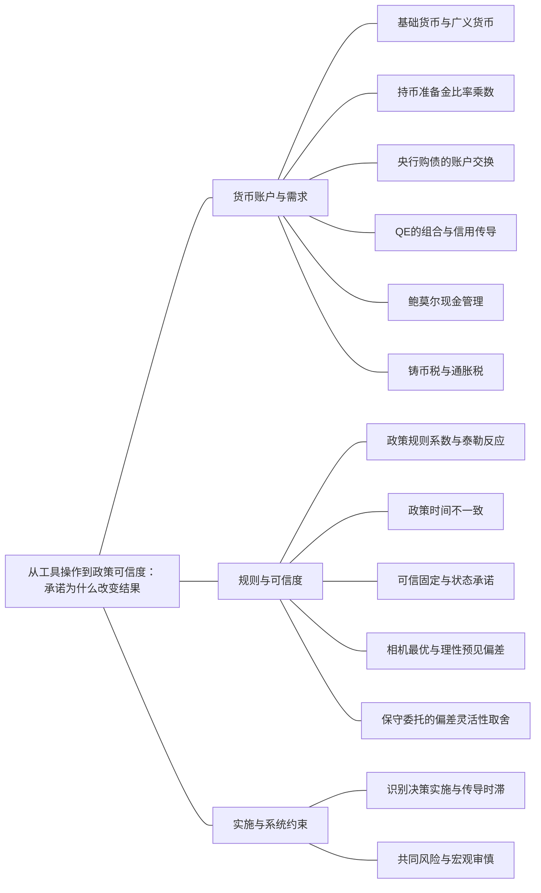

### 本专题知识联系

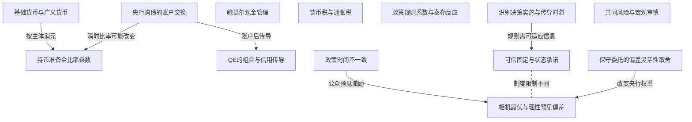

关系图中的箭头表示有方向的联系；虚线表示对照或类比。图中只画本专题主归属节点；跨专题关系在逐条命题中列明，可在练习室逐点追踪。具体成立条件以逐条说明为准。

### KMA076 基础货币与广义货币

身份：既有资料概括

**定义与对象**

基础货币由公众现金与银行准备金构成，广义货币包含公众存款，两者主体口径不同。

**何时调用**

央行操作、贷款、存款、准备金和现金核账。

**适用条件**

先排除重复计入银行库存现金；贷款是银行资产而非基础货币。

**核心公式与机制**

$H=C_u+R_b,M=C_u+D$，银行资本与准备金也不是同一个项目。

**推导与理由**

银行放贷可同时形成贷款资产和存款负债，后续支付提款再改变准备金分布。

**边界与易错**

不能把贷款额加进H；向银行购债与向非银行公众购债的存款变化可不同。

**整理依据**

- card FA05：**符号与前提。** 非银行公众通货$C_u$、存款$D$、银行准备金$R_b$，基础货币$H=C_u+R_b$，货币$M=C_u+D$。令$c = \frac{C_u}{D}$、$r r = \frac{R_b}{D}$，$rr$可再分法定与超额部分；先确认题目“流通现金”是否已排除银行库存现金。
- card AC02：货币提供交易媒介、计价单位和价值储藏等服务，居民在流动性与生息资产收益之间权衡。商业银行放贷通常同时形成贷款资产和存款负债；支付、提款和结算再引起准备金转移。简单乘数连接基础货币和货币供给，但公众持币、超额准备金、资本监管与信贷需求都会改变这个关系，不能把它当作机械放贷指令。

### KMA077 持币准备金比率乘数

身份：既有资料概括

**定义与对象**

现金与准备金相对存款的比率将基础货币同广义货币在同一时点联系。

**何时调用**

给c、准备率、基础货币，或危机改公众持币与超额准备。

**适用条件**

比率以存款为分母且覆盖法定超额部分；给定比率分支与交易瞬间分开。

**核心公式与机制**

$M=\frac{1+c}{c+rr}H$，其中$rr=\frac{R_b}{D}$。

**推导与理由**

将现金cD、准备金rrD分别代入H和M，再消去D。

**边界与易错**

乘数是条件存量关系，不是银行按准备金机械放贷的行为指令。

**整理依据**

- card FA05：**符号与前提。** 非银行公众通货$C_u$、存款$D$、银行准备金$R_b$，基础货币$H=C_u+R_b$，货币$M=C_u+D$。令$c = \frac{C_u}{D}$、$r r = \frac{R_b}{D}$，$rr$可再分法定与超额部分；先确认题目“流通现金”是否已排除银行库存现金。
- card FA05：**条件检查。** 贷款余额不属于基础货币，不能把贷款加上现金和准备金。银行库存现金是银行准备金的一部分，若已计入$R_b$就不能再重复加。S20的基础货币选择题所附答案存在把贷款等混入的风险，必须按定义独立列账。给出的货币总量增加既可能来自$H$也可能来自$m_H$变化，不能倒推比例必然固定。

### KMA078 央行购债的账户交换

身份：既有资料概括

**定义与对象**

央行按等于账面值的成交价向银行买债，首先是银行资产结构和央行负债的交换。

**何时调用**

QE或缩表要求资产负债、基础货币和净财富变化。

**适用条件**

交易对手为银行、价格等账面、无即时新贷款或存款；到期筹资另逐笔列账。

**核心公式与机制**

央行国债与准备金负债同增；银行国债减、准备金增，资产总额和权益不直接增加。

**推导与理由**

合并政府与央行，私人持有的政府负债期限构成改变，不凭会计换资产创造净资源。

**边界与易错**

购债不等于政府购买商品，交易瞬间不可沿固定旧乘数报存款自动增加。

**整理依据**

- case CMA14：央行资产国债+40、负债准备金+40；银行资产国债−40、准备金+40，负债不变，总资产不变。公众存款250与现金50仍不变，准备金增至90，B=140但M仍300。法定率仍.1，实际总准备金率$\frac{90}{250}$=.36，超额率e=.26。若合并政府与央行，私人部门只是国债收益权换准备金，不增加净金融财富；央行购债不是政府直接购买商品40。若机械用原乘数3乘140，会违反交易瞬间存款未变的条件。
- review MA066：央行购买长期国债100，同时在银行准备金账户记入100：其资产国债增100、负债准备金增100。银行资产中长期国债减100、准备金增100，资产总额不变，负债与权益不变。故基础货币增加100；因为本交易未给非银行公众新增存款，且银行不立即新增贷款，广义货币不必同步增加100。

### KMA079 QE的组合与信用传导

身份：既有资料概括

还用于：从两个市场到信用反馈：政策效果怎样算出来

**定义与对象**

资产购买可通过期限溢价、资产再平衡和信用约束影响支出，账户变化本身不是固定产出乘数。

**何时调用**

问准备金扩张为何可能有效或为何未立即带动贷款。

**适用条件**

关注资产替代、贷款需求、银行资本和准备金收益，须有相应行为条件。

**核心公式与机制**

减少长期债流通供给可能改变期限收益，组合转移可推其他资产价值，融资条件改善才影响投资消费。

**推导与理由**

持有人资产选择与银行承险能力把央行交易接到实体，哪个渠道强取决于实际约束。

**边界与易错**

流动性注入不自动补净值；即使M或H上升，支出仍可能受风险和需求限制。

**整理依据**

- review MA066：长期国债流通供给减少可能降低期限溢价；持有人再平衡资产组合可推高其他资产价格；银行资产约束改善也可能支持信贷。传导仍取决于资本约束、贷款需求、风险和准备金收益等条件，故准备金增加不保证固定倍数的支出。政府采购100直接进入产品需求G，而QE首先交换金融资产，二者不能按金额相同而混同。

### KMA080 鲍莫尔现金管理

身份：既有资料概括

还用于：从两个市场到信用反馈：政策效果怎样算出来；从数据到机制比较：论述怎样有证据地落地

**定义与对象**

均匀支出下，取款固定成本与持币利息损失共同决定最优现金库存。

**何时调用**

给支出X、每次费用F和利率，求次数、取款额及平均余额。

**适用条件**

X,F,i正并同一期间，均匀支付且无额外预防需求；次数为整数时另比较邻近可行值。

**核心公式与机制**

$TC=FN+\frac{iX}{2N}$，$N^*=\sqrt{\frac{iX}{2F}},\bar M^*=\sqrt{\frac{FX}{2i}}$。

**推导与理由**

多取款降低平均现金及利息损失，却增加固定取款成本；一阶条件平衡边际成本。

**边界与易错**

平均余额是单次额的一半；有限利率变化用平方根比率而非把局部弹性当精确变化。

**整理依据**

- card FA07：**符号与前提。** 期内均匀支出$X>0$，每次取款真实费用$F>0$，与期间匹配的利率$i>0$，取款$N$次；不含预防动机、信用额度等额外条件。平均余额是单次取款额的一半。
- card FA07：$$ \begin{gathered} TC(N)=FN+i\frac{X}{2N}, \\ N^*=\sqrt{\frac{iX}{2F}}. \end{gathered} $$
- card FA07：**解题步骤。** 时间成本先乘小时工资，例如半小时与80元/小时得到$F=40$。最小化取款费加利息损失，求出连续候选值；若次数必须为正整数，比较相邻整数及至少一次取款边界。年支出2万元、$F=40$、$i=0.1$时，平均持币2000元、单次4000元、每年5次。

### KMA081 铸币税与通胀税

身份：既有资料概括

还用于：从预期时间戳到通胀路径：每一期怎样接下一期

**定义与对象**

发行货币获取资源与持有货币购买力损失相联系，但不是一般逐期相同的两个量。

**何时调用**

货币融资收入、实际余额变化和通胀持币成本。

**适用条件**

连续实际余额m=M/P，明确铸币税按新货币流量而非全部货币存量计算。

**核心公式与机制**

$\frac{\dot M}{P}=\dot m+\pi m$；m固定时才等于πm。

**推导与理由**

名义货币增加既可补购买力损失，也可满足实际持币需求增加；后者使两种税量不同。

**边界与易错**

货币需求会随通胀改变，不能推发行越快收入永远越多。

**整理依据**

- card FA06：**解题步骤。** 数量题先判断$Y,V$是否固定，增长题再取对数变化或增长因子。事前实际利率用预期通胀，事后购买力回报用实际通胀。连续时间令实际货币余额$m = \frac{M}{P}$，实际铸币税收入为$\frac{\dot{M}}{P} = \dot{m} + \pi m$；若$m$固定，它等于$\pi m$。
- card FA06：**条件检查。** 货币增长率与通胀率只有在实际产出和速度的相应条件下相等。预期费雪效应与短期流动性效应不矛盾，前者强调长期回报补偿，后者强调既定价格下货币市场调整。铸币税是政府发行货币所得资源，通胀税是持币购买力损失，两者一般不逐期完全相同；货币需求随通胀下降时，收入也不必随货币增长无限增加。

### KMA082 政策规则系数与泰勒反应

身份：既有资料概括

还用于：从预期时间戳到通胀路径：每一期怎样接下一期

**定义与对象**

同一政策规则因截距写法不同，通胀系数的数值和实际反应解释也不同。

**何时调用**

求名义实际利率响应、将目标通胀截距改写为当前通胀。

**适用条件**

预期通胀如何随当前通胀变须明示；标准泰勒原理还依赖其他闭合条件。

**核心公式与机制**

$\pi^*+1.5(\pi-\pi^*)=\pi+0.5(\pi-\pi^*)$；总名义反应1.5不等于当前通胀基准的附加系数0.5。

**推导与理由**

名义反应扣去预期反应才是实际紧缩；大于一比一是该参数化下的条件描述。

**边界与易错**

不能只看一个系数就宣布所有含预期、下限或负号模型均稳定。

**整理依据**

- card FA29：**条件检查。** $a,\kappa>0,\theta_z\geq0,\theta_\pi>0$给$0 < \frac{1}{1 + \kappa q} < 1$。规则对通胀的名义利率总反应为$1+\theta_\pi$，大于1才是本参数化的泰勒原理；若规则直接写$i=\bar i+\varphi_\pi(\pi-\pi^*)$，条件改为$\varphi_\pi>1$。改变符号、预期时点或加入下限后，要重新检查完整特征根，不能只盯一个参数。
- review MA063：故以当前通胀为基准的写法中 $\theta_\pi=0.5$，而不是1.5。两系数只因截距口径不同，不是两个相互矛盾的政策。完整稳定性还取决于需求供给、预期时序和金融条件，不能只凭该系数作所有模型的判定。

### KMA083 政策时间不一致

身份：既有资料概括

**定义与对象**

政策制定者事前想承诺的安排，在公众行动已定后可能不再符合其事后激励。

**何时调用**

先宣布、公众定工资预期、央行再选通胀。

**适用条件**

目标失业低于自然率且可制造意外通胀的分支；行动顺序明确。

**核心公式与机制**

事后希望借价格意外改善就业，公众若预见此动机，单纯宣布不构成可信约束。

**推导与理由**

先行动者的价格工资一旦给定，央行最优反应可能偏离原承诺，导致制度问题而非一次计算失误。

**边界与易错**

社会目标等于自然率或没有意外收益时偏差可能消失；不能把消费者偏好不一致当同一模型。

**整理依据**

- card AC09：时间不一致是事前承诺与事后激励不一致。公众的工资价格决策既定后，政策制定者可能希望利用意外通胀刺激就业；公众预见这一动机，形成通胀偏差而没有长期就业收益。可信规则可以改善这一结果，但应对不可预见冲击的灵活性仍有价值。政策评价需比较短期与中期、规则内反应与规则变更，以及产出、物价、分配和金融风险。
- card FA43：**题干触发。** 央行先宣布、公众形成预期、央行再选通胀，给PC和二次损失，求三种均衡。

### KMA084 可信固定与状态承诺

身份：既有资料概括

**定义与对象**

可信承诺可约束事后激励，也可事前规定可核验冲击下的反应而不必永远固定工具。

**何时调用**

比较承诺零通胀、相机政策和有冲击规则。

**适用条件**

公众相信且制度能执行；状态规则需冲击可核验，固定规则与状态规则分别评价。

**核心公式与机制**

无冲击目标通胀承诺消除意外；有冲击时可选择π=kv等预设响应并用统一损失优化。

**推导与理由**

承诺改变公众预期和央行可选策略，保留状态反应可避免把可信度与僵化混同。

**边界与易错**

不能因有通胀偏差就宣布任意固定规则都优于灵活政策。

**整理依据**

- card FA43：**解题步骤。** 承诺分支先令公众相信且执行$\pi=\pi^e$，最优通胀为目标$\pi^*$；惊喜分支固定先前预期，对政策通胀求一阶条件；理性预见的相机分支再令反应式$\pi=\pi^e$。比较损失而不只比较通胀。
- case CMA13：Ev=0故πe=0，x=(k−1)v，期望损失$1+4(k-1)^2+4k^2$。导数$8(k-1)+8k=0$，k=$\frac{1}{2}$，二阶导数16>0。此时$\pi=\frac{v}{2}$、$x=-\frac{v}{2}$，期望损失3，小于相机4和固定规则5。它保留同相机的状态稳定幅度，但没有固定均值1的通胀偏差。公众可观察冲击并相信承诺是关键；若v不可核验、规则不能执行或模型有测量误差，实施效果需另评。

### KMA085 相机最优与理性预见偏差

身份：既有资料概括

**定义与对象**

先固定公众预期求央行反应，再施加一致预期，可形成无平均就业收益的通胀偏差。

**何时调用**

求惊喜分支、相机均衡和承诺损失比较。

**适用条件**

下面闭式限无冲击$u=u_n-a(\pi-\pi^e),L=(u-u^*)^2+\lambda(\pi-\pi^*)^2$，a,λ正；带冲击须先逐状态固定公众预期求最优，再按已知分布施期望一致性，不能照代无冲击数值。

**核心公式与机制**

无冲击基准$\pi^D=\pi^*+\frac{a(u_n-u^*)}{\lambda},u^D=u_n$。

**推导与理由**

反应式里的预期在事后求导时固定，但均衡预期必须等于公众可预见的政策结果；带冲击时一致性是预期等于状态政策的期望。

**边界与易错**

惊喜低失业不是可无限重复收益；加冲击后还要比较稳定化好处。

**整理依据**

- card FA43：$$ \pi(\pi^e)=\frac{a(u_n-u^*)+a^2\pi^e+\lambda\pi^*}{a^2+\lambda}. $$
- card FA43：$$ \begin{gathered} \pi^D=\pi^*+\frac{a(u_n-u^*)}{\lambda}, \\ u^D=u_n. \end{gathered} $$
- case CMA13：取期望$\pi^e=\frac{1+\pi^e}{2}$，得πe=1，政策$\pi=1+\frac{v}{2}$，$x=-\frac{v}{2}$。v=2时π=2、x=−1、L=8；v=−2时π=0、x=1、L=0，期望L=4。均值π=1但均值x=0，持续通胀偏差不能带来平均产出目标1；状态项$\frac{v}{2}$仍提供冲击稳定，不能因有偏差就否认相机反应的所有收益。

### KMA086 保守委托的偏差灵活性取舍

身份：既有资料概括

**定义与对象**

委托更重视通胀的央行可降低偏差，却可能削弱对供给冲击的稳定。

**何时调用**

比较央行损失权重与社会损失，或讨论无限保守。

**适用条件**

社会评价标准保持不变，央行权重改变；冲击分布与可承诺性分别明确。

**核心公式与机制**

无冲击较高通胀权重可降低可预测偏差；有冲击时须连同就业波动计算统一期望损失。

**推导与理由**

制度改变的是央行反应，不是让社会直接更换评价尺，因此不能用较小央行损失冒充社会改进。

**边界与易错**

无冲击结果不足以支持无限保守；最优程度依冲击、信息与承诺条件。

**整理依据**

- review MA065：γ为1时通胀6、失业6，社会损失 $6^2+6^2=72$。γ为4时通胀1.5、失业6，社会仍以既定权重1评价，损失 $6^2+1.5^2=38.25$。保守委托降低无效通胀而不改变自然失业，因此在本无冲击比较中改善社会结果；评价尺子不能改为央行自己的γ。
- case CMA13：央行反应$\pi=\frac{1+\pi^e+v}{1+\gamma}$，一致预期$\pi^e=\frac{1}{\gamma}$，故$\pi=\frac{1}{\gamma}+\frac{v}{1+\gamma}$，$x=-\frac{\gamma v}{1+\gamma}$。γ=4给均值π=$\frac{1}{4}$、状态反应$\frac{v}{5}$、x=$-\frac{4v}{5}$。统一社会期望损失$1+\frac{1}{\gamma^2}+\frac{4(\gamma^2+1)}{(1+\gamma)^2}$，γ=4为$\frac{1513}{400}$=3.7825，小于γ=1的4，却大于可信状态规则3。γ趋无穷时损失趋5，因为政策几乎不反应冲击；降低偏差与保留灵活性有取舍，不能据有限比较宣布无限保守最优。

### KMA087 识别决策实施与传导时滞

身份：既有资料概括

还用于：从政府预算到债务可持续：先算账，再谈政策

**定义与对象**

政策从冲击发生到确认、批准、落地和产生效果存在不同时间间隔。

**何时调用**

冲击预计会消退，或总乘数分布在多个时期。

**适用条件**

以真实时间线对齐冲击及政策效应，不把总长期效应当本期实现。

**核心公式与机制**

$\Delta Y_t=\sum_{j\ge0}k_j\Delta G_{t-j}$需要逐期作用而非立即相加。

**推导与理由**

识别和批准延迟可使政策在原冲击结束后才扩大需求，形成反向稳定风险。

**边界与易错**

规则也可能模型错误或僵化；自动稳定器与预先沟通不能消除所有执行和传导时滞。

**整理依据**

- card FA45：**可直接背诵。** 自动稳定器不必每次新立法：衰退降低税收并增加符合条件的转移，缓冲可支配收入和支出下降。实际赤字随周期变，不直接代表主动刺激强弱；结构性或周期调整余额要按潜在产出估算。相机政策面临认识、决策、实施及传导时滞，冲击退出后政策才生效可能反而放大周期。
- review MA069：以冲击发生为零时点：半年后才被统计确认，属于识别时滞；再过半年审批完成，为决策时滞；再过半年实施，为实施时滞。政策最早在1.5年才落实，真实融资和支出反应还可能更晚，即作用时滞。冲击预计一年消退，所以追踪旧数据的刺激可能在恢复之后加需求而顺周期。

### KMA088 共同风险与宏观审慎

身份：既有资料概括

还用于：从两个市场到信用反馈：政策效果怎样算出来；从储蓄投资到汇率：制度决定调整变量；从数据到机制比较：论述怎样有证据地落地

**定义与对象**

宏观审慎关注机构共同敞口、杠杆顺周期与抛售外部性，超出单个银行账面稳健。

**何时调用**

金融风险政策、资本缓冲、流动性与关联资产压力。

**适用条件**

需要掌握系统关联和实际约束，工具与风险承担责任匹配。

**核心公式与机制**

资本缓冲、流动性要求和借款约束可抑制共同去杠杆反馈，但作用对象与成本不同。

**推导与理由**

单机构售资产看似降风险，若共同出售压低价格，其他机构净值再受损，形成系统外部性。

**边界与易错**

不能用政策降息代替全部损失确认或监管修复，也不能宣称所有风险可零成本消除。

**整理依据**

- card FA45：**审慎检查。** 微观审慎关注单个机构稳健，宏观审慎关注共同风险、杠杆顺周期、关联敞口与抛售外部性。资本缓冲、流动性要求与借款约束可改变金融传导，不能用简单降息代替全部监管修复。财政空间、利率下限、央行承诺、资本流动和汇率制度也会限制工具选择。供给冲击存在稳产出与稳价格权衡，不能承诺无代价同时解决。
- card AC04：金融中介的资本缓冲和流动性决定了它能否把资金传到实体。资产损失减少净值并提高杠杆，银行为恢复资本比率可能减少贷款，抛售又压低资产价格，形成金融加速反馈。流动性支持帮助应对短期融资压力，资本补充承担损失，两者不能互相替代。

### 关系命题与条件

#### EMA072 基础货币与广义货币 → 持币准备金比率乘数

推导；既有资料概括

由现金与准备金的定义代入同一存款比率，可推出货币乘数。

适用条件：比率口径覆盖且分母c+rr正。

理由：H与M共享存款基数，消去D即得条件存量关系。

依据：card FA05「**符号与前提。** 非银行公众通货$C_u$、存款$D$、银行准备金$R_b$，基础货币$H=C_u+R_b$，货币$M=C_u+D$。令$c = \frac{C_u}{D}$、$r r = \frac{R_b}{D}$，$rr$可再分法定与超额部分；先确认题目“流通现金”是否已排除银行库存现金。」

#### EMA073 央行购债的账户交换 → 持币准备金比率乘数

条件变化；既有资料概括

购债瞬间准备金增加而存款未动时，超额准备金率会内生变化，不能固定旧乘数。

适用条件：央行向银行购债且无即时新存贷款。

理由：会计交易先变资产结构，行为调整不在同一瞬间自动发生。

依据：case CMA14「央行资产国债+40、负债准备金+40；银行资产国债−40、准备金+40，负债不变，总资产不变。公众存款250与现金50仍不变，准备金增至90，B=140但M仍300。法定率仍.1，实际总准备金率$\frac{90}{250}$=.36，超额率e=.26。若合并政府与央行，私人部门只是国债收益权换准备金，不增加净金融财富；央行购债不是政府直接购买商品40。若机械用原乘数3乘140，会违反交易瞬间存款未变的条件。」

#### EMA074 央行购债的账户交换 → QE的组合与信用传导

前置；既有资料概括

先核资产交换，再讨论期限和组合如何影响支出，不能把后续行为混进会计直接结果。

适用条件：交易条件与主体已明确。

理由：财富、利率和信用作用需要行为与风险假设。

依据：review MA066「长期国债流通供给减少可能降低期限溢价；持有人再平衡资产组合可推高其他资产价格；银行资产约束改善也可能支持信贷。传导仍取决于资本约束、贷款需求、风险和准备金收益等条件，故准备金增加不保证固定倍数的支出。政府采购100直接进入产品需求G，而QE首先交换金融资产，二者不能按金额相同而混同。」

#### EMA076 鲍莫尔现金管理 → 货币市场LM条件

机制；既有资料概括

取款技术降低固定费用可降低同一支出下现金需求，从而改变货币需求而非只沿原LM移动。

适用条件：现金管理机制适用，其他支付与偏好条件给定。

理由：最优平均现金随取款成本平方根变化。

依据：card FA07「**条件检查。** 收入/支出弹性为$\frac{1}{2}$，利率弹性为$- \frac{1}{2}$，但有限变化须用平方根比率。利率5%升到6%时，余额比为$\sqrt{\frac{5}{6}}$，精确下降约8.71%；“下降10%”只是局部弹性近似，不是精确数。金融技术减少$F$会降低同一支出对应的现金需求，不能据“货币需求只含利率与收入”的简式否认技术移动需求函数。」

#### EMA078 政策规则系数与泰勒反应 → 规则闭合的动态总需求

推导；既有资料概括

在明确费雪预期下，规则的实际利率反应形成DAD斜率。

适用条件：标准正号供给与规则参数分支，改时点后重推。

理由：名义反应大于预期变动时实际率升，压需求。

依据：card FA29「**条件检查。** $a,\kappa>0,\theta_z\geq0,\theta_\pi>0$给$0 < \frac{1}{1 + \kappa q} < 1$。规则对通胀的名义利率总反应为$1+\theta_\pi$，大于1才是本参数化的泰勒原理；若规则直接写$i=\bar i+\varphi_\pi(\pi-\pi^*)$，条件改为$\varphi_\pi>1$。改变符号、预期时点或加入下限后，要重新检查完整特征根，不能只盯一个参数。」

#### EMA079 政策时间不一致 → 相机最优与理性预见偏差

机制；既有资料概括

事后制造意外的动机若被理性公众预见，可形成通胀偏差而无长期失业收益。

适用条件：自然率高于政策理想值，原PC与损失条件成立。

理由：公众预期改变后，实际政策不再持续出乎意料。

依据：card AC09「时间不一致是事前承诺与事后激励不一致。公众的工资价格决策既定后，政策制定者可能希望利用意外通胀刺激就业；公众预见这一动机，形成通胀偏差而没有长期就业收益。可信规则可以改善这一结果，但应对不可预见冲击的灵活性仍有价值。政策评价需比较短期与中期、规则内反应与规则变更，以及产出、物价、分配和金融风险。」

#### EMA080 可信固定与状态承诺 → 相机最优与理性预见偏差

对照；既有资料概括

可信承诺与相机理性预见面对不同可选策略和公众预期，不能混用惊喜结果。

适用条件：无冲击或有冲击分支分别按统一损失比较。

理由：执行约束能去掉偏差，但固定规则也可能失去稳定化。

依据：card FA43「**解题步骤。** 承诺分支先令公众相信且执行$\pi=\pi^e$，最优通胀为目标$\pi^*$；惊喜分支固定先前预期，对政策通胀求一阶条件；理性预见的相机分支再令反应式$\pi=\pi^e$。比较损失而不只比较通胀。」

#### EMA081 保守委托的偏差灵活性取舍 → 相机最优与理性预见偏差

条件变化；既有资料概括

保守委托改变政策反应及通胀偏差，社会仍用原损失标准评价。

适用条件：央行相机但公众理性，权重与冲击明确。

理由：增加厌恶通胀可约束事后激励，同时降低稳定供给冲击意愿。

依据：review MA065「γ为1时通胀6、失业6，社会损失 $6^2+6^2=72$。γ为4时通胀1.5、失业6，社会仍以既定权重1评价，损失 $6^2+1.5^2=38.25$。保守委托降低无效通胀而不改变自然失业，因此在本无冲击比较中改善社会结果；评价尺子不能改为央行自己的γ。」

#### EMA082 识别决策实施与传导时滞 → 可信固定与状态承诺

条件变化；既有资料概括

预先公布状态规则可改善时滞与预期，但必须有可靠可核验的状态信息。

适用条件：冲击识别和实施仍受约束，不能承诺未知数据的精准即时反应。

理由：可信度改善不等于获取全部未来信息。

依据：card FA45「**可直接背诵。** 自动稳定器不必每次新立法：衰退降低税收并增加符合条件的转移，缓冲可支配收入和支出下降。实际赤字随周期变，不直接代表主动刺激强弱；结构性或周期调整余额要按潜在产出估算。相机政策面临认识、决策、实施及传导时滞，冲击退出后政策才生效可能反而放大周期。」；case CMA13「Ev=0故πe=0，x=(k−1)v，期望损失$1+4(k-1)^2+4k^2$。导数$8(k-1)+8k=0$，k=$\frac{1}{2}$，二阶导数16>0。此时$\pi=\frac{v}{2}$、$x=-\frac{v}{2}$，期望损失3，小于相机4和固定规则5。它保留同相机的状态稳定幅度，但没有固定均值1的通胀偏差。公众可观察冲击并相信承诺是关键；若v不可核验、规则不能执行或模型有测量误差，实施效果需另评。」

### 对应题目分问路径

#### MA061

按公众先定预期的时序区分可信承诺、未识破偏离与理性相机均衡。

**第1问**

本问任务：央行宣布并遵守固定通胀规则、公众相信时，求通胀与失业。

可信固定通胀使实际等于预期，失业回自然率，再以固定政策的损失选择零通胀。

调用：KMA084 可信固定与状态承诺；KMA057 预期扩展菲利普斯关系

联系：本问直接使用“可信固定与状态承诺、预期扩展菲利普斯关系”所列定义、模型或既有结论核算，不将本问共同出现的知识点强行画成逻辑推出。

**第2问**

本问任务：公众仍相信该承诺，央行却可偏离时，分别宣布和执行什么通胀？

公众仍信零时求央行反应须固定预期，得到一次事后偏离与低失业，不提前施加一致预期。

调用：KMA083 政策时间不一致；KMA085 相机最优与理性预见偏差

联系：本问直接使用“政策时间不一致、相机最优与理性预见偏差”所列定义、模型或既有结论核算，不将本问共同出现的知识点强行画成逻辑推出。

**第3问**

本问任务：公众理性预见相机抉择时，求均衡。

将理性一致预期代最优反应求政策预期固定点，均衡留下正通胀偏差而失业回自然率，不套适应性更新规则。

调用：KMA085 相机最优与理性预见偏差；KMA061 固定点与局部稳定

联系：本问直接使用“相机最优与理性预见偏差、固定点与局部稳定”所列定义、模型或既有结论核算，不将本问共同出现的知识点强行画成逻辑推出。

**第4问**

本问任务：比较政策效果并评价长期制度选择。

用同一损失比较三分支，惊喜收益不能重复；无冲击承诺优势不证明所有机械规则在有冲击时最优。

调用：KMA083 政策时间不一致；KMA084 可信固定与状态承诺；KMA063 损失函数下稳定权衡

联系：本问直接使用“政策时间不一致、可信固定与状态承诺、损失函数下稳定权衡”所列定义、模型或既有结论核算，不将本问共同出现的知识点强行画成逻辑推出。

#### MA062

平均目标的刺激依赖可信历史补偿和实际利率传导。

**第1问**

本问任务：从通胀形成和货币传导说明传统通胀目标的理论基础与缺陷。

低稳通胀目标锚预期，短期经实际率信用资产等传导；下限和供给冲击限制传统回归目标框架。

调用：KMA084 可信固定与状态承诺；KMA055 事前与事后实际回报；KMA065 名义利率下限的分段闭合；KMA063 损失函数下稳定权衡

联系：EMA060

**第2问**

本问任务：在需求低迷、名义利率受有效下限约束时，为什么平均目标可能提供额外刺激？

可信承诺未来补低通胀可在名义率受限时提高预期并降实际率，支出还需融资与意愿，不是统计平均本身刺激。

调用：KMA064 平均通胀与价格补偿目标；KMA055 事前与事后实际回报；KMA065 名义利率下限的分段闭合；KMA084 可信固定与状态承诺

联系：EMA058、EMA060

**第3问**

本问任务：若未明确平均窗口长度，会产生什么问题，为什么？

窗口不明使补偿量和退出难核验，恢复后提前收紧诱因削弱承诺；无统一最优窗口，不等同永久提目标。

调用：KMA064 平均通胀与价格补偿目标；KMA083 政策时间不一致；KMA084 可信固定与状态承诺

联系：本问直接使用“平均通胀与价格补偿目标、政策时间不一致、可信固定与状态承诺”所列定义、模型或既有结论核算，不将本问共同出现的知识点强行画成逻辑推出。

#### MA063

统一百分点及截距口径才能读懂政策规则的实际反应。

**第1问**

本问任务：求名义与实际利率（预期通胀等于当前π）。

按题给目标截距规则算名义率，预期等当期通胀时再扣预期求实际率。

调用：KMA082 政策规则系数与泰勒反应；KMA055 事前与事后实际回报

联系：本问直接使用“政策规则系数与泰勒反应、事前与事后实际回报”所列定义、模型或既有结论核算，不将本问共同出现的知识点强行画成逻辑推出。

**第2问**

本问任务：若通胀再增1点、缺口不变，真实利率如何变？

缺口固定时名义反应1.5扣同步预期1，实际率只增0.5点。

调用：KMA082 政策规则系数与泰勒反应；KMA055 事前与事后实际回报

联系：本问直接使用“政策规则系数与泰勒反应、事前与事后实际回报”所列定义、模型或既有结论核算，不将本问共同出现的知识点强行画成逻辑推出。

**第3问**

本问任务：将规则写成$i=\rho+\pi+\theta_\pi(\pi-\pi^*)+0.5x$，求θπ并解释不能混淆系数。

改为当前通胀截距后附加系数是0.5，完整稳定性还需需求供给和信息闭合，不能将1.5直接移作θ；本问不另推DAD斜率。

调用：KMA082 政策规则系数与泰勒反应；KMA061 固定点与局部稳定

联系：本问直接使用“政策规则系数与泰勒反应、固定点与局部稳定”所列定义、模型或既有结论核算，不将本问共同出现的知识点强行画成逻辑推出。

#### MA064

冲击后的灵活反应和平均通胀偏差要在同一社会损失下比较。

**第1问**

本问任务：求相机最优反应及理性预期均衡。

公众先定预期，央行见v后固定预期求反应，再以零均值冲击施加期望一致性。

调用：KMA085 相机最优与理性预见偏差；KMA083 政策时间不一致；KMA057 预期扩展菲利普斯关系

联系：EMA079

**第2问**

本问任务：求期望损失。

分别列两冲击状态的通胀缺口和损失，再按各半概率平均，不能把均值变量直接代平方损失。

调用：KMA085 相机最优与理性预见偏差；KMA063 损失函数下稳定权衡

联系：本问直接使用“相机最优与理性预见偏差、损失函数下稳定权衡”所列定义、模型或既有结论核算，不将本问共同出现的知识点强行画成逻辑推出。

**第3问**

本问任务：比较可信固定零通胀规则的期望损失，说明“有偏差所以规则必优”为何不完整。

可信零固定规则重新算两状态，偏差虽消失但稳定冲击能力较差；状态承诺可能同时保留灵活性。

调用：KMA084 可信固定与状态承诺；KMA063 损失函数下稳定权衡

联系：本问直接使用“可信固定与状态承诺、损失函数下稳定权衡”所列定义、模型或既有结论核算，不将本问共同出现的知识点强行画成逻辑推出。

#### MA065

委托权重改变央行反应，社会评价权重保持原值。

**第1问**

本问任务：求两种委托下均衡π、u和社会损失。

分别固定预期求两权重的央行反应并加一致预期，再用社会权重1算社会损失。

调用：KMA086 保守委托的偏差灵活性取舍；KMA085 相机最优与理性预见偏差

联系：EMA081

**第2问**

本问任务：解释保守委托的收益。

无冲击时更保守降低可预测通胀偏差而不改变自然失业，收益不是换评价尺制造的。

调用：KMA086 保守委托的偏差灵活性取舍；KMA083 政策时间不一致

联系：本问直接使用“保守委托的偏差灵活性取舍、政策时间不一致”所列定义、模型或既有结论核算，不将本问共同出现的知识点强行画成逻辑推出。

**第3问**

本问任务：若存在供给冲击，为什么仍不能只凭该无冲击结果选择γ无穷大？

有供给冲击时需计较弱响应带来的就业波动，无冲击比较不能证明无限保守最优。

调用：KMA086 保守委托的偏差灵活性取舍；KMA063 损失函数下稳定权衡

联系：本问直接使用“保守委托的偏差灵活性取舍、损失函数下稳定权衡”所列定义、模型或既有结论核算，不将本问共同出现的知识点强行画成逻辑推出。

#### MA066

银行对手QE首先交换资产，后续行为才把准备金接到支出。

**第1问**

本问任务：分别列央行和商业银行资产负债表变化。

央行国债和准备金负债同增，银行国债减准备金增，按账面成交无即时存款与权益增加。

调用：KMA078 央行购债的账户交换；KMA076 基础货币与广义货币

联系：本问直接使用“央行购债的账户交换、基础货币与广义货币”所列定义、模型或既有结论核算，不将本问共同出现的知识点强行画成逻辑推出。

**第2问**

本问任务：基础货币、银行总资产、私人部门净金融财富怎样变化？

基础货币增加但银行资产总额不变，合并政府央行后私人债权期限变化不凭空增加净金融财富。

调用：KMA078 央行购债的账户交换；KMA076 基础货币与广义货币

联系：本问直接使用“央行购债的账户交换、基础货币与广义货币”所列定义、模型或既有结论核算，不将本问共同出现的知识点强行画成逻辑推出。

**第3问**

本问任务：解释组合再平衡、期限溢价和信贷渠道，并说明QE不等于政府直接支出100。

通过期限溢价、组合和信用条件解释可能传导；贷款需求资本风险仍约束支出，不能把购债额当G。

调用：KMA079 QE的组合与信用传导；KMA078 央行购债的账户交换

联系：EMA074

#### MA067

到期不续作须连同财政向公众融资的完整支付链列账。

**第1问**

本问任务：列最终央行资产、准备金及公众存款变化。

先记公众购新债使存款准备金下降及财政账户增加，再记旧债偿付，合计央行缩表和银行数量变化。

调用：KMA078 央行购债的账户交换；KMA076 基础货币与广义货币；KMA089 政府预算与初级余额

联系：本问直接使用“央行购债的账户交换、基础货币与广义货币、政府预算与初级余额”所列定义、模型或既有结论核算，不将本问共同出现的知识点强行画成逻辑推出。

**第2问**

本问任务：缩表必然使短期利率上升吗？

稀缺准备金可能推短率，充裕地板体系由政策付息锚率，数量减少不必立刻加息。

调用：KMA036 央行操作闭合；KMA079 QE的组合与信用传导

联系：本问直接使用“央行操作闭合、QE的组合与信用传导”所列定义、模型或既有结论核算，不将本问共同出现的知识点强行画成逻辑推出。

**第3问**

本问任务：比较准备金稀缺与充裕两种制度，说明对信用和总需求的可能影响。

分别按两准备金制度讨论组合和信用约束，贷款不按固定乘数自动收缩，也无固定产出损失。

调用：KMA079 QE的组合与信用传导；KMA036 央行操作闭合；KMA122 机制一致与因果识别

联系：本问直接使用“QE的组合与信用传导、央行操作闭合、机制一致与因果识别”所列定义、模型或既有结论核算，不将本问共同出现的知识点强行画成逻辑推出。

#### MA068

危机现金和超储偏好改变条件乘数，恢复M不保证恢复信用支出。

**第1问**

本问任务：求货币乘数、存款及M。

把现金法定与超额准备金均写成存款比率，从两存量式消D求倍数及各项核账。

调用：KMA076 基础货币与广义货币；KMA077 持币准备金比率乘数

联系：EMA072

**第2问**

本问任务：危机使c升至0.4、e升至0.2，B不变，求新M。

危机后用新c和e重新算倍数与M，基础不变不意味广义货币不变。

调用：KMA077 持币准备金比率乘数；KMA076 基础货币与广义货币

联系：EMA072

**第3问**

本问任务：若央行只为维持原M需多少B？讨论为何这仍不保证贷款和支出恢复。

按目标M反推所需基础货币，再说明风险资本贷款需求和流速仍可变，乘数不是固定行为指令。

调用：KMA077 持币准备金比率乘数；KMA049 按目标反推工具；KMA079 QE的组合与信用传导

联系：本问直接使用“持币准备金比率乘数、按目标反推工具、QE的组合与信用传导”所列定义、模型或既有结论核算，不将本问共同出现的知识点强行画成逻辑推出。

#### MA069

把冲击消退同政策落地时间对齐，识别顺周期实施风险。

**第1问**

本问任务：画文字时间线，区分识别、决策、实施和作用时滞。

从发生时点依次加识别审批实施各半年，最早1.5年落地而冲击1年消退，作用时滞还在其后。

调用：KMA087 识别决策实施与传导时滞

联系：本问直接使用“识别决策实施与传导时滞”所列定义、模型或既有结论核算，不将本问共同出现的知识点强行画成逻辑推出。

**第2问**

本问任务：说明自动稳定器及预先沟通能解决什么问题。

自动规则减少新审批，预先沟通有助预期，却不消除信息误差和金融支出传导时滞。

调用：KMA087 识别决策实施与传导时滞；KMA096 比例税和自动稳定器；KMA084 可信固定与状态承诺

联系：EMA082

**第3问**

本问任务：讨论规则与相机政策各自风险，说明如何避免机械反应。

规则可能因结构和数据变更失配，相机有误判延迟及偏离诱因；需明确触发修订退出责任。

调用：KMA087 识别决策实施与传导时滞；KMA084 可信固定与状态承诺；KMA083 政策时间不一致

联系：EMA082

#### MA070

下限是否约束要比较实现自然实际率所需的名义工具。

**第1问**

本问任务：若要保持x=0，冲击前后所需i各是多少？

令缺口零使实际率等自然率，再加预期通胀反推冲击前后名义率，检查负值不可行。

调用：KMA052 中性政策实际利率；KMA055 事前与事后实际回报；KMA049 按目标反推工具；KMA065 名义利率下限的分段闭合

联系：EMA060

**第2问**

本问任务：下限约束后的实际i、r、x是什么？

约束绑定取名义零后重算实际率及缺口，名义零仍可能相对自然率紧缩。

调用：KMA065 名义利率下限的分段闭合；KMA055 事前与事后实际回报；KMA052 中性政策实际利率

联系：EMA060

**第3问**

本问任务：若可信政策能把预期通胀提高到2.5%，能否消除缺口，需怎样设置i？说明承诺条件。

预期真升至2.5时按目标配合名义0.5；机械继续零会过度扩张，承诺可信和传导有效均须说明。

调用：KMA055 事前与事后实际回报；KMA049 按目标反推工具；KMA084 可信固定与状态承诺；KMA052 中性政策实际利率

联系：本问直接使用“事前与事后实际回报、按目标反推工具、可信固定与状态承诺、中性政策实际利率”所列定义、模型或既有结论核算，不将本问共同出现的知识点强行画成逻辑推出。

#### CMA13

同一社会损失比较相机、固定规则、状态承诺和保守委托。

**第1问**

本问任务：先不求均衡，固定公众πe求相机最优反应，检验二阶条件；解释为什么事前声明不能自动约束事后行动。

固定公众预期求见冲击后的凸最优反应，声明本身不约束事后行动。

调用：KMA083 政策时间不一致；KMA085 相机最优与理性预见偏差

联系：本问直接使用“政策时间不一致、相机最优与理性预见偏差”所列定义、模型或既有结论核算，不将本问共同出现的知识点强行画成逻辑推出。

**第2问**

本问任务：施加理性预期求相机均衡，列两状态的π、x、L与期望损失，区分通胀偏差和稳定冲击的反应。

期望一致性给均值偏差，再逐状态算量价损失，区分均值偏差与状态稳定收益。

调用：KMA085 相机最优与理性预见偏差；KMA063 损失函数下稳定权衡

联系：本问直接使用“相机最优与理性预见偏差、损失函数下稳定权衡”所列定义、模型或既有结论核算，不将本问共同出现的知识点强行画成逻辑推出。

**第3问**

本问任务：可信固定π=0规则下重算两状态与期望损失，说明“规则消除偏差，所以任何规则都优于相机”是否成立。

独立恢复可信零规则重算期望损失，放弃冲击反应可能超过消偏差收益，不推广为所有规则比较。

调用：KMA084 可信固定与状态承诺；KMA063 损失函数下稳定权衡

联系：本问直接使用“可信固定与状态承诺、损失函数下稳定权衡”所列定义、模型或既有结论核算，不将本问共同出现的知识点强行画成逻辑推出。

**第4问**

本问任务：可承诺的状态规则限定为π=kv、k为事前公开常数。求最优k及损失，并与前两政策比较，解释为何能同时避免偏差并稳定冲击。

可核验状态规则事前定k，预期由零均值冲击确定，对统一期望损失求最优反应幅度。

调用：KMA084 可信固定与状态承诺；KMA063 损失函数下稳定权衡

联系：本问直接使用“可信固定与状态承诺、损失函数下稳定权衡”所列定义、模型或既有结论核算，不将本问共同出现的知识点强行画成逻辑推出。

**第5问**

本问任务：不能承诺时，改委托目标Lc=(x−1)²+γπ²，比较γ=4与原γ=1的理性预期均衡和统一社会损失；能否由此选择γ无限大？

不能承诺时固定社会评价权重，重算γ为4的反应及损失；极端保守放弃冲击稳定，不能只按均值偏差选择。

调用：KMA086 保守委托的偏差灵活性取舍；KMA085 相机最优与理性预见偏差；KMA063 损失函数下稳定权衡

联系：EMA081

#### CMA14

先区分QE瞬时账户与条件比率调整，再处理下限和预期工具。

**第1问**

本问任务：从B=现金+准备金、现金=cD与准备金=(r_R+e)D推货币乘数，求初始存款、现金、准备金与M。

从现金与各类准备金存款比率推倍数，初始基础货币分现金和准备金，存款不直接等广义货币。

调用：KMA076 基础货币与广义货币；KMA077 持币准备金比率乘数

联系：EMA072

**第2问**

本问任务：列QE交易瞬间央行与银行资产负债变化，求B、M和新超额准备金率；解释银行资产总额和私人净金融财富是否增加。

交易瞬间存款现金不动，准备金和基础增40，超储率内生升；旧倍数不可照乘新基础。

调用：KMA078 央行购债的账户交换；KMA076 基础货币与广义货币；KMA077 持币准备金比率乘数

联系：EMA072、EMA073

**第3问**

本问任务：若随后体系重新实现原c、r_R、e三比率且B保持第2问交易后的基础货币值，求条件性M；若相反危机使c=0.4、e=0.2，r_R不变，B仍取交易后值，求M及维持原M所需B。

原比率恢复与危机比率是两个条件分支，用交易后同一B分别算M，再反推维持原M所需B。

调用：KMA077 持币准备金比率乘数；KMA049 按目标反推工具

联系：本问直接使用“持币准备金比率乘数、按目标反推工具”所列定义、模型或既有结论核算，不将本问共同出现的知识点强行画成逻辑推出。

**第4问**

本问任务：取自然利率由1降到−2、预期通胀仍1，求原先与冲击后消除缺口所需i，以及下限实际可行时的i、r和x；B扩张能否仅凭数量恒等式消除该缺口？

按需求目标反推名义率并核下限，数量存量式没有B到支出的完整映射，不能独自证明缺口消失。

调用：KMA065 名义利率下限的分段闭合；KMA055 事前与事后实际回报；KMA052 中性政策实际利率；KMA079 QE的组合与信用传导

联系：EMA060

**第5问**

本问任务：若可信沟通使预期通胀升至2.5且自然利率仍−2，求消除缺口所需i；评价政策组合的条件和应监测的证据。

预期真正提高后反推配合名义率，监测融资利差和支出证据；期限溢价未量化不可虚构固定贡献。

调用：KMA049 按目标反推工具；KMA055 事前与事后实际回报；KMA084 可信固定与状态承诺；KMA079 QE的组合与信用传导

联系：本问直接使用“按目标反推工具、事前与事后实际回报、可信固定与状态承诺、QE的组合与信用传导”所列定义、模型或既有结论核算，不将本问共同出现的知识点强行画成逻辑推出。

## 从政府预算到债务可持续：先算账，再谈政策

政府今天怎样融资、明天怎样偿还，与短期刺激和长期资源配置怎样相接？

从预算、储蓄与债务率的计期进入跨期可持续和家庭融资等价，再辨自动税、供给激励及意外通胀分配。

### 分支导图

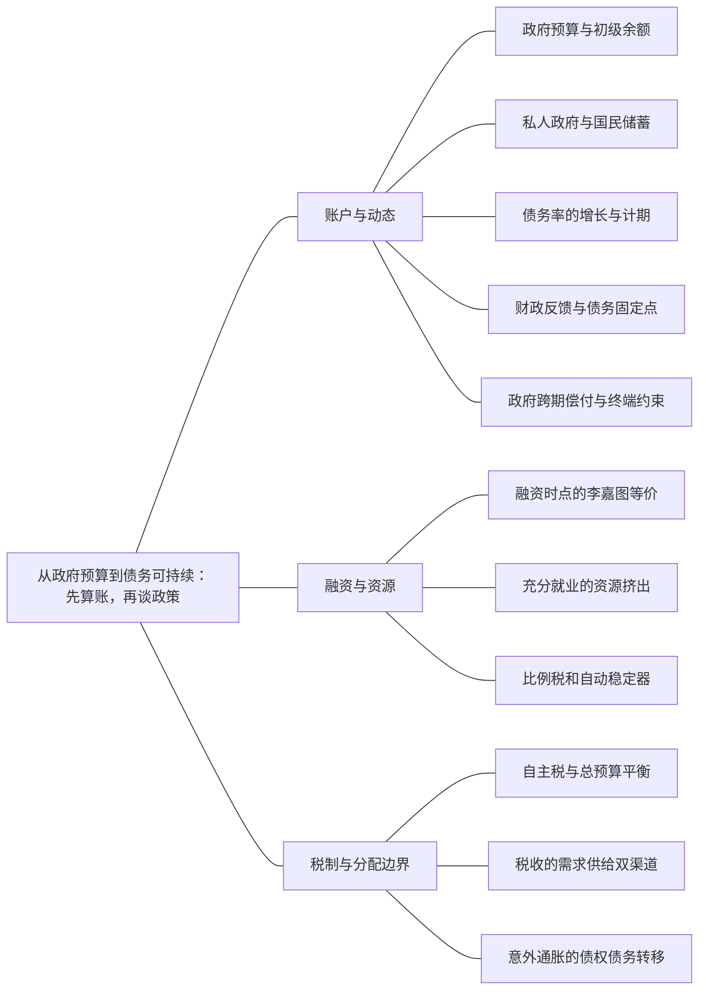

### 本专题知识联系

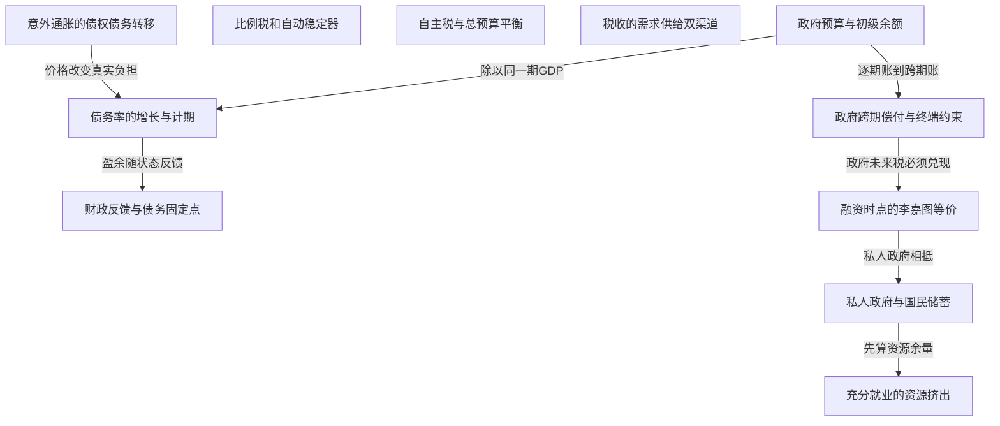

关系图中的箭头表示有方向的联系；虚线表示对照或类比。图中只画本专题主归属节点；跨专题关系在逐条命题中列明，可在练习室逐点追踪。具体成立条件以逐条说明为准。

### KMA089 政府预算与初级余额

身份：既有资料概括

还用于：从现值预算到消费与投资：约束决定分支；从工具操作到政策可信度：承诺为什么改变结果

**定义与对象**

政府债务存量变化由初级支出税收差和利息共同形成，必须先规定期初期末。

**何时调用**

给B、r、G、T，求债务或辨总赤字初级赤字。

**适用条件**

以下Bt为本期期初债务，利息本期支付，初级支出不重复含利息。

**核心公式与机制**

$B_{t+1}=(1+r_t)B_t+G_t-T_t$；初级盈余S=T−G，总赤字为rB−S。

**推导与理由**

本期收入不足以覆盖购买和债务本息的余额形成新债，而非把旧本金再算一次初级购买。

**边界与易错**

存量与流量、利息与初级支出不可混；本公式不自动证明偿债可行。

**整理依据**

- review MA071：期初债务本期需还本付息 $(1+r_t)B_t$，政府购买为G，税收为 $\tau_tY_t$；期末剩余融资成为下期期初债务，所以
- card AC09：财政赤字是流量，政府债务是过去融资累积形成的存量。债务变化取决于初级余额和利息，债务率还取决于经济增长及价格变化。利率高于增长时，给定正债务率通常需要初级盈余才能稳定；利率低于增长可以提供空间，但不能据此证明无限融资总是可行，融资期限、币种、风险和财政反应都会改变可持续性。

### KMA090 私人政府与国民储蓄

身份：既有资料概括

还用于：从资本积累到黄金律：先分水平，再分增长；从现值预算到消费与投资：约束决定分支；从两个市场到信用反馈：政策效果怎样算出来；从储蓄投资到汇率：制度决定调整变量

**定义与对象**

私人和政府储蓄在一致净税口径下加总为国民未消费资源。

**何时调用**

财政赤字、减税私人储蓄、国民储蓄和投资。

**适用条件**

T若已扣转移，不再另加TR；简化核算暂略跨境要素收入。

**核心公式与机制**

$S_p=Y-T-C,S_g=T-G,S=Y-C-G$；开放核算$S-I=NX$。

**推导与理由**

税收在私人和政府之间转移，不直接改变合并资源；消费行为和购买改变总储蓄。

**边界与易错**

政府债券不凭自身创造净国民财富；实际S=I可含非意愿库存，不是计划均衡保证。

**整理依据**

- card FA01：$$ \begin{gathered} Y=C+I+G+NX, \\ S_p=Y-T-C, \\ S_g=T-G. \end{gathered} $$
- card FA01：$$ \begin{gathered} S=S_p+S_g=Y-C-G, \\ S-I=NX. \end{gathered} $$

### KMA091 债务率的增长与计期

身份：既有资料概括

还用于：从数据到机制比较：论述怎样有证据地落地

**定义与对象**

债务率的利息增长差效应来自债务与GDP增长因子的比率，盈余分母取期不能混。

**何时调用**

名义或实际债务率递推、稳定盈余和GDP增速冲击。

**适用条件**

若pt=St/Yt且Bt/Yt为期初同口径债务率，GDP下一期增1+g；名义r配名义g。

**核心公式与机制**

$b_{t+1}=\frac{(1+r)b_t-p_t}{1+g}$；若盈余按下期GDP计，则其项不再除1+g。

**推导与理由**

将预算逐项除以同一个目标期GDP，旧债本息和初级余额因原分母不同而得到不同因子。

**边界与易错**

不能把名义利率放进实量增长式；固定债务额与固定债务率要求不同盈余。

**整理依据**

- card FA41：**解题步骤。** 先写记账时点，检查利息未在$G$中重复计入，再除本期GDP。目标$b$不变时，所需初级盈余率为$[\frac{r - g}{1 + g}] b$。$r=.04,g=.02,b=.6,d=.01$时，新债务率约$.621765$；稳定$.6$需初级盈余约1.1765% GDP。
- case CMA15：债务率$b_{t+1}=\frac{1.04b_t-p_t}{1.02}$，不能先从债务减去按下期GDP计的盈余。b=1时p=.02，下一期仍1。偏离递推系数$\frac{1.04-\phi}{1.02}$，渐近稳定要求$-1.02<1.04-\phi<1.02$，即.02<φ<2.06；结合φ≥0不再改变。债务率固定1仍允许B同GDP按2%增长；债务额固定则需S=rB，对应不同盈余标准。

### KMA092 财政反馈与债务固定点

身份：既有资料概括

还用于：从预期时间戳到通胀路径：每一期怎样接下一期；从数据到机制比较：论述怎样有证据地落地

**定义与对象**

财政盈余随债务率调整会改变债务动态系数，固定点位置与稳定性须分别求。

**何时调用**

给p规则、稳定区间、增长变动后重新校准。

**适用条件**

明确盈余按哪期GDP计，利率增长给定，1+g正；财政反应可实施另核。

**核心公式与机制**

按本期GDP，若$p=p_0+\phi(b-\bar b)$，线性系数为$\frac{1+r-\phi}{1+g}$。

**推导与理由**

反馈越强通常增强回拉，但过强可交替发散；增长下降还可能移动固定点。

**边界与易错**

交点存在不等于稳定，线性稳定也不等于税收支出能力足以执行。

**整理依据**

- card FA41：**稳定分支。** 固定$d$时映射斜率$q = \frac{1 + r}{1 + g}$，稳态$b^* = \frac{d}{1 - q}$，正交点存在不表示稳定。若财政规则$d_t=d_0-\phi b_{t-1}$，斜率改$q-\phi$，局部稳定需$|q-\phi|<1$。
- case CMA15：新递推$b_{t+1}=1.04b_t-[.02+.1(b_t-1)]=.94b_t+.08$。从b0=1得b1=1.02；固定点$b^*=\frac{.08}{.06}=\frac{4}{3}$，系数.94<1故收敛，但目标由1移到$\frac{4}{3}$。原规则只是对旧增长条件的平衡安排，增长降使利息增长差扩大、维持b1所需盈余增加；稳定性和固定点位置要分别计算，不能因路径收敛就说债务风险完全不变。

### KMA093 政府跨期偿付与终端约束

身份：既有资料概括

还用于：从数据到机制比较：论述怎样有证据地落地

**定义与对象**

跨期政府预算要求未来可用初级盈余与初始债务相容，终端条件限制单纯滚债。

**何时调用**

有限两期终止、无限期不庞氏或r与g比较。

**适用条件**

回报与盈余时点、期限和风险已给；有限期终端零债与无限期条件分开。

**核心公式与机制**

有限期可逐期递推并将最终债务设0；无限期须说明贴现终端项为何消失。

**推导与理由**

借款将支付转到未来而不消除偿付资源要求；r>g提高维持负担，却不独自证明违约。

**边界与易错**

债务率形式稳态、动态稳定与实际偿债能力是三个判断。

**整理依据**

- review MA079：两期未来盈余现值恰偿初始债务。
- card AC09：财政赤字是流量，政府债务是过去融资累积形成的存量。债务变化取决于初级余额和利息，债务率还取决于经济增长及价格变化。利率高于增长时，给定正债务率通常需要初级盈余才能稳定；利率低于增长可以提供空间，但不能据此证明无限融资总是可行，融资期限、币种、风险和财政反应都会改变可持续性。

### KMA094 融资时点的李嘉图等价

身份：既有资料概括

还用于：从现值预算到消费与投资：约束决定分支

**定义与对象**

支出路径不变时，未来税收现值抵消当前减税，可使家庭净财富和消费不变。

**何时调用**

发债减税后未来增税、私人储蓄和政府储蓄。

**适用条件**

家庭前瞻承担未来税负、同相关利率自由借贷、非扭曲总额税且无代际断裂，政府偿付可行。

**核心公式与机制**

$\Delta T_1+\frac{\Delta T_2}{R}=0$使家庭税后现值不变；ΔSp与ΔSg相抵。

**推导与理由**

先核政府现值，再把对应未来税放入家庭预算；不能把债券和未来税各当一份净资源。

**边界与易错**

借款限制、未来税由他人承担、扭曲税或利率差会破坏抵消；政府增购不属纯融资比较。

**整理依据**

- card FA42：**符号与前提。** 两期、相同相关贴现$R>0$、政府偿债可行，家庭前瞻且承担未来税负；无借贷约束、非扭曲总额税，无代际断裂或其他财富效应。初始债务保持不变，只比较政策变动。
- card FA42：$$ \begin{gathered} \Delta T_1+\frac{\Delta T_2}{R}=0, \\ \Delta W_{household}=-\Delta T_1-\frac{\Delta T_2}{R}=0. \end{gathered} $$

### KMA095 充分就业的资源挤出

身份：既有资料概括

**定义与对象**

固定总资源下政府购买增加会减少留给私人投资或其他用途的资源。

**何时调用**

长期封闭经济给固定Y，求S、I和实际利率。

**适用条件**

充分就业Y固定、消费仅按可支配收入、封闭且投资对实际率递减；财政税收条件明确。

**核心公式与机制**

$S=\bar Y-C(\bar Y-T)-G=I(r)$；T与C不变时ΔI=−ΔG。

**推导与理由**

G占用既定产出，国民储蓄下降，利率升至投资缩减后资源重新相容。

**边界与易错**

短期闲置资源时产出可变，不能照搬完全挤出；开放经济还会调整净出口。

**整理依据**

- card FA04：**符号与前提。** 充分就业产出$\bar Y$给定，消费$C(\bar Y-T)$，投资$I(r)$递减；若消费含$r$、家庭前瞻或经济开放，应增加相应关系。
- card AC01：古典长期模型把资本、劳动与技术视为供给条件，价格调整使要素市场和资金市场出清。竞争企业按边际产量支付实际要素报酬。在充分就业、消费只取决于可支配收入的封闭经济中，财政扩张减少国民储蓄，通过较高实际利率挤出私人投资；这一资源配置结论不能直接移植到价格刚性且存在闲置资源的短期。

### KMA096 比例税和自动稳定器

身份：既有资料概括

还用于：从两个市场到信用反馈：政策效果怎样算出来；从工具操作到政策可信度：承诺为什么改变结果

**定义与对象**

税收和符合条件转移随收入自动变化，可缓冲可支配收入与需求波动。

**何时调用**

比例税、衰退赤字变化或主动政策强弱评价。

**适用条件**

税制规则与资格自动响应，不等同新审批；简单乘数结论要求其他闭合固定。

**核心公式与机制**

比例税使消费反馈由c变为c(1−τ)，在给定价格利率的正分母分支降低需求乘数。

**推导与理由**

衰退时少收税或多转移部分抵消收入下降，扩张时反向作用。

**边界与易错**

赤字上升不全是主动刺激；稳定效应还伴激励、财政和执行成本。

**整理依据**

- card FA45：**可直接背诵。** 自动稳定器不必每次新立法：衰退降低税收并增加符合条件的转移，缓冲可支配收入和支出下降。实际赤字随周期变，不直接代表主动刺激强弱；结构性或周期调整余额要按潜在产出估算。相机政策面临认识、决策、实施及传导时滞，冲击退出后政策才生效可能反而放大周期。
- card FA19：**符号与前提。** $C=C_0+c(Y-T_0-\tau Y+TR)$，$0<c<1$，$NX=X_0-m_yY$，$m_y\geq0$，利率价格固定，投资$I_0$外生。定义$a=1-c(1-\tau)+m_y>0$。

### KMA097 自主税与总预算平衡

身份：既有资料概括

还用于：从两个市场到信用反馈：政策效果怎样算出来

**定义与对象**

自主税工具与随收入变动的总税收不同，“等额增支增税”须说明是哪一个税额。

**何时调用**

比例税下平衡预算乘数、严格总税平衡。

**适用条件**

固定税率τ时总税T=T0+τY；税率变化时按完整有限变动或微分另算。

**核心公式与机制**

固定τ时$\Delta T=\Delta T_0+\tau\Delta Y$，严格预算要求ΔG=ΔT而非仅ΔT0。

**推导与理由**

收入随政策变动会自动改税收，所以设定ΔT0=ΔG通常不保证总税恰增同额。

**边界与易错**

平衡预算乘数是否为1还取决于进口、货币需求和利率闭合，不能无条件背结论。

**整理依据**

- case CMA06：短期封闭经济价格固定，$C=20+0.75(Y-T)$，$T=T_0+0.2Y$，投资$I=40-2i$，政府购买G=20。实际货币需求$m^d=0.5(Y-T)-5i$，供给m=20，初始T0=0。政府总税收含比例税，比较政策时不得把T0同T混用。第2至4问均从初始均衡独立出发；第5问仅讨论模型口径与适用范围。
- review MA024：仅G增10时，产出增12.5、利率增1.25；仅自主税增10时，产出降10、利率降1。两者同时增10，产出增2.5。按题面G与自主税等额变化口径，响应为0.25。总税还含 $0.25Y$，实际税收增 $10+0.25\times2.5=10.625$，预算结余增加0.625，故并非总税与G严格平衡。

### KMA098 税收的需求供给双渠道

身份：既有资料概括

还用于：从资本积累到黄金律：先分水平，再分增长；从IS—LM到AD—AS：把价格与目标接进来

**定义与对象**

税收既改变可支配需求，也可能经劳动投资激励或公共投入改变供给。

**何时调用**

减税同时给需求和生产率参数，评价时滞融资分配。

**适用条件**

各参数变化由题给或数据识别，公共收入用途和财政融资明确。

**核心公式与机制**

先分别把减税进入AD的需求项和AS或增长方程的供给项，再联立量价变化。

**推导与理由**

需求扩张倾向抬量价，供给改善可增量压价，组合效应由强度及时点决定。

**边界与易错**

训练参数不是经验估计；减税也不能无说明既保留政府同额投入又不交代融资。

**整理依据**

- review MA080：减税提高税后回报能否促劳动投资，取决于税基与行为弹性；财政收入损失需借债、削支或其他税补足，可能抵消刺激；供给调整常慢于直接需求，存在实施时滞；群体税负和公共服务变化又影响分配。题内1与0.5只是训练参数，不是现实减税效果的经验估计，福利评价须另计融资和执行成本。
- card FA14：**条件检查。** 资本、税前技术产出、税后产出与普通/有效人均不能混用。若另加正折旧$\delta$，维持项是$g+\delta$，税率不再完全抵消；该分支应标“扩展”。政府把税收用于生产资本、研发或公共品时，还需增加其投资方程，不能继续固定所有生产条件。

### KMA099 意外通胀的债权债务转移

身份：既有资料概括

**定义与对象**

价格意外改变既定本币名义债务的实际值，是债务人与债权人的财富转移。

**何时调用**

债务稀释、国内债权人、短期浮息或指数债。

**适用条件**

债务为固定本币名义额且未充分预期；条款与持有人身份需给。

**核心公式与机制**

实际债务$\frac{B^{nom}}P$随P上升下降；国内政府与债权人的直接转移合并相抵。

**推导与理由**

债务契约名义额暂定，价格改变同一偿付可购买的资源，政府减负对应债权人受损。

**边界与易错**

不等于社会净资源增加；浮息滚动、指数或外币债会重定价或受汇率影响。

**整理依据**

- review MA078：未指数化固定名义债务的真实价值为名义额除以价格。价格从1升至1.25，债务由100降为 $\frac{100}{1.25}=80$。政府实际负担减少20，本国债权人实际资产也减少20。国内私人和政府合并时，这项直接财富转移抵消，并未新增社会生产资源；其福利仍可因群体边际效用和税制扭曲而不同。
- card FA41：**条件检查。** 名义债务除GDP时，旧债负担因子为$\frac{1 + i}{(1 + \pi) (1 + g)}$；不能把名义利率直接放进实际式。题目若要求债务绝对额不变且净税收固定，可有$rB=T-G$，但这不是通用债务硬上限。未预期通胀对既定本币名义债务的稀释，不适用于同样程度的指数债务或外币债务。

### 关系命题与条件

#### EMA084 政府预算与初级余额 → 债务率的增长与计期

推导；既有资料概括

将逐期政府预算按明示GDP分母换算，得到利息增长因子与初级盈余项。

适用条件：债务和GDP名义实际口径相容。

理由：每项时点相同才能避免盈余漏除或重复除增长因子。

依据：case CMA15「债务率$b_{t+1}=\frac{1.04b_t-p_t}{1.02}$，不能先从债务减去按下期GDP计的盈余。b=1时p=.02，下一期仍1。偏离递推系数$\frac{1.04-\phi}{1.02}$，渐近稳定要求$-1.02<1.04-\phi<1.02$，即.02<φ<2.06；结合φ≥0不再改变。债务率固定1仍允许B同GDP按2%增长；债务额固定则需S=rB，对应不同盈余标准。」

#### EMA085 债务率的增长与计期 → 财政反馈与债务固定点

推导；既有资料概括

将财政盈余规则代入债务率递推，分别得到固定点与线性调整系数。

适用条件：规则按同一期GDP定义且参数给定。

理由：财政反馈改变映射斜率，而增长变化也可移动截距和目标。

依据：card FA41「**稳定分支。** 固定$d$时映射斜率$q = \frac{1 + r}{1 + g}$，稳态$b^* = \frac{d}{1 - q}$，正交点存在不表示稳定。若财政规则$d_t=d_0-\phi b_{t-1}$，斜率改$q-\phi$，局部稳定需$|q-\phi|<1$。」

#### EMA086 财政反馈与债务固定点 → 固定点与局部稳定

方法类比；编者类比

线性债务反馈与其他线性状态系统可用同一特征根原则检验，但财政可行性仍须另核。

适用条件：仅方法类比，不把各模型参数或政策结论互换。

理由：数学收敛与经济实施是不同层。

依据：card FA41「**稳定分支。** 固定$d$时映射斜率$q = \frac{1 + r}{1 + g}$，稳态$b^* = \frac{d}{1 - q}$，正交点存在不表示稳定。若财政规则$d_t=d_0-\phi b_{t-1}$，斜率改$q-\phi$，局部稳定需$|q-\phi|<1$。」

#### EMA087 政府预算与初级余额 → 政府跨期偿付与终端约束

前置；既有资料概括

先对齐逐期本息和盈余，才能迭代得到现值偿付与终端条件。

适用条件：明确每期回报及期末剩债。

理由：跨期约束来自逐期预算的贴现加总，不是独立免除偿付的口号。

依据：review MA079「两期未来盈余现值恰偿初始债务。」

#### EMA088 政府跨期偿付与终端约束 → 融资时点的李嘉图等价

前置；既有资料概括

家庭融资等价需要政府未来税收现值与当前减税融资相容。

适用条件：政府购买路径固定且财政偿付可行。

理由：若未来税不承担原借款，家庭净财富抵消式没有资源依据。

依据：card FA42「**解题步骤。** 先写政府支出现值不变的预算，再把未来税负放入家庭现值资源，说明当前可支配收入增加为何不等于财富增加。减税额储蓄用于将来还税，私人和政府储蓄相抵；不把政府债券与对应税负分别当两份净资源。」

#### EMA090 融资时点的李嘉图等价 → 私人政府与国民储蓄

推导；既有资料概括

融资等价条件成立时，私人储蓄增加恰抵政府储蓄减少，国民储蓄可不变。

适用条件：不改变政府购买和家庭消费的纯融资实验。

理由：税收时点在两部门间重新分配现金，但合并资源未增加。

依据：card FA42「**解题步骤。** 先写政府支出现值不变的预算，再把未来税负放入家庭现值资源，说明当前可支配收入增加为何不等于财富增加。减税额储蓄用于将来还税，私人和政府储蓄相抵；不把政府债券与对应税负分别当两份净资源。」

#### EMA091 私人政府与国民储蓄 → 充分就业的资源挤出

前置；既有资料概括

充分就业挤出先按消费和政府购买核国民储蓄，再由投资需求反求利率。

适用条件：封闭、固定资源、消费条件给定。

理由：利率是使投资使用量同剩余资源相容的价格。

依据：card FA04「**解题步骤。** 先算国民储蓄，再反求使投资等于储蓄的$r$。储蓄增加令实际利率下降、投资增加；投资需求提高但储蓄不变时，利率升而均衡投资量不变。财政扩张且总资源固定时，投资减少等于政府购买增加。」

#### EMA092 比例税和自动稳定器 → 计划支出与收入乘数

条件变化；既有资料概括

比例税减少每轮新增收入转为消费的比例，使同一自主冲击的产出响应较小。

适用条件：固定利率价格和其余漏出，正分母分支。

理由：扩张与收缩两方向都被缓冲，而非只削弱好政策。

依据：card FA19「**符号与前提。** $C=C_0+c(Y-T_0-\tau Y+TR)$，$0<c<1$，$NX=X_0-m_yY$，$m_y\geq0$，利率价格固定，投资$I_0$外生。定义$a=1-c(1-\tau)+m_y>0$。」

#### EMA093 自主税与总预算平衡 → 税后收入货币需求

条件变化；既有资料概括

严格总税平衡还会改变税后货币需求，须同商品式一起求工具和利率。

适用条件：货币需求明确依Y−T，央行闭合给定。

理由：ΔT0不等ΔT时，消费与交易需求的变化都不能机械使用同一外生税额。

依据：case CMA06「预算约束$\Delta T=\Delta T_0+0.2\Delta Y=7$，故ΔT0=7−0.2ΔY。代入$0.56\Delta Y=7-0.55\Delta T_0$，得$0.45\Delta Y=3.15$，所以ΔY=7、ΔT0=5.6、Δi=0.56−0.56=0。检验总税5.6+1.4=7。这里严格总税平衡乘数为1，来源是本题货币需求按税后收入、预算联动后的利率不变；不同货币需求口径未必同结果。直接ΔT0=7会再加自动税，不能称总税恰增7。」

#### EMA094 税收的需求供给双渠道 → 需求供给复合冲击

机制；既有资料概括

减税的需求和供给效应叠加后，价格方向可不同于只计需求的结果。

适用条件：供给效率变化与需求参数为题定独立入口。

理由：联立避免把同一减税只画一次AD便宣称全部后果。

依据：review MA080「只看需求时把效率变化误设零，得到 $1.5\Delta x=2$，产出增 $\frac43$、价格增 $\frac23$。因此相对完整模型，遗漏供给改善低估产出增量 $\frac13$，高估价格增量 $\frac13$。这不是仅凭“减税好或坏”的定性判断，而是同一需求冲击下逐渠道比较。」

#### EMA095 意外通胀的债权债务转移 → 债务率的增长与计期

条件变化；既有资料概括

名义债务率还受价格增长影响，不能仅用真实利率增长式分析名义融资。

适用条件：本币固定名义债务，名义和实际增长转换明确。

理由：物价改变旧名义债务相对名义GDP的负担，但契约重定价会改变结果。

依据：card FA41「**条件检查。** 名义债务除GDP时，旧债负担因子为$\frac{1 + i}{(1 + \pi) (1 + g)}$；不能把名义利率直接放进实际式。题目若要求债务绝对额不变且净税收固定，可有$rB=T-G$，但这不是通用债务硬上限。未预期通胀对既定本币名义债务的稀释，不适用于同样程度的指数债务或外币债务。」

#### EMA097 私人政府与国民储蓄 → 长期小国储蓄投资与汇率

前置；既有资料概括

长期开放均衡先由国民储蓄与投资求净资本流出，再反求实际汇率。

适用条件：充分就业小国与外部回报给定。

理由：会计差额限定需要由贸易实现的资源转移。

依据：card FA31「**解题步骤。** 先算储蓄投资差额，再从净出口函数反求实际汇率。储蓄减少或投资需求增加使$NCO$降，均衡实际汇率升、净出口降；关税若仅使给定汇率下$NX$增加而$S,I$不变，则实际升值抵消初始改善，净出口总额不变。」

### 对应题目分问路径

#### MA071

债务记账、融资等价与债务上限标准须明确各自条件。

**第1问**

本问任务：写政府本期预算。

按期初债务本期付息再融资本期差额，分清债务本金、初级赤字和含息总赤字。

调用：KMA089 政府预算与初级余额

联系：本问直接使用“政府预算与初级余额”所列定义、模型或既有结论核算，不将本问共同出现的知识点强行画成逻辑推出。

**第2问**

本问任务：说明债务与税收融资等价的条件及不成立的环境。

购买路径固定且未来税现值由同一家庭承担时，发债减税与未来增税可抵消；约束代际扭曲税等分别破坏该链条。

调用：KMA094 融资时点的李嘉图等价；KMA093 政府跨期偿付与终端约束；KMA016 家庭现值预算

联系：EMA088、EMA089

**第3问**

本问任务：若政府初级盈余恰能支付利息即达题目所说的债务上限，求稳态决定式及上限。再说明债务额不变与债务率不变的差别。

题设盈余恰付利息给静止债务额上限，另除下期GDP求稳定债务率，核r零和盈余边界；非普遍国家阈值。

调用：KMA089 政府预算与初级余额；KMA091 债务率的增长与计期；KMA093 政府跨期偿付与终端约束

联系：EMA084、EMA087

#### MA072

债务率固定点位置、维持盈余和偏离稳定性是三个计算。

**第1问**

本问任务：推导债务率递推、求b1。

名义债务预算除下期名义GDP，本期盈余率也随分母除增长因子后求b1。

调用：KMA089 政府预算与初级余额；KMA091 债务率的增长与计期

联系：EMA084

**第2问**

本问任务：求形式稳态并判断无反馈时稳定性。

先解形式固定点再写偏离系数，r大于g且无反馈使固定点不稳定，不自动回归1。

调用：KMA091 债务率的增长与计期；KMA061 固定点与局部稳定

联系：本问直接使用“债务率的增长与计期、固定点与局部稳定”所列定义、模型或既有结论核算，不将本问共同出现的知识点强行画成逻辑推出。

**第3问**

本问任务：要在初始债务率上保持稳定，p应是多少？

令下期仍为初始0.8反求维持盈余2.4%，这只维持该点，不证明对邻近扰动有稳定反馈。

调用：KMA091 债务率的增长与计期；KMA049 按目标反推工具

联系：本问直接使用“债务率的增长与计期、按目标反推工具”所列定义、模型或既有结论核算，不将本问共同出现的知识点强行画成逻辑推出。

#### MA073

财政反馈太弱或太强都可能使离散债务率偏离扩大。

**第1问**

本问任务：证明b=1是固定点。

先代候选b1核固定点，再将整条盈余规则代预算写偏离系数，不只代稳态盈余。

调用：KMA092 财政反馈与债务固定点；KMA091 债务率的增长与计期

联系：EMA085

**第2问**

本问任务：求局部稳定的φ区间。

对离散系数取绝对值小于1求双边区间，过强反应也可越界。

调用：KMA092 财政反馈与债务固定点；KMA061 固定点与局部稳定

联系：EMA086

**第3问**

本问任务：比较φ=0、0.1、2.2。

逐个代φ为0、0.1、2.2，区分正向发散、单调收敛与交替发散。

调用：KMA092 财政反馈与债务固定点；KMA061 固定点与局部稳定

联系：EMA086

**第4问**

本问任务：为什么稳定要求之外还要检查财政调整可行性？

局部稳定不保证税基行政政治福利上可执行，若紧缩反改增长利息需重联立。

调用：KMA092 财政反馈与债务固定点；KMA128 条件—机制—证据的论述结构

联系：本问直接使用“财政反馈与债务固定点、条件—机制—证据的论述结构”所列定义、模型或既有结论核算，不将本问共同出现的知识点强行画成逻辑推出。

#### MA074

发债减税的现值抵消先核政府，再进入家庭消费预算。

**第1问**

本问任务：证明家庭税后现值资源不变并求消费变化。

减税2同未来增税2.4按1.2折现抵消，偏好和可行消费集合不变，证明无需另设原税为零，也无需另求Euler数值。

调用：KMA094 融资时点的李嘉图等价；KMA016 家庭现值预算

联系：EMA089

**第2问**

本问任务：求私人储蓄变化。

消费不变使私人储蓄增2，与政府储蓄减2相抵，合并国民储蓄不变。

调用：KMA094 融资时点的李嘉图等价；KMA090 私人政府与国民储蓄

联系：EMA090

**第3问**

本问任务：列出至少三种会破坏结论的条件，并给相应机制。

分别说明借款约束、代际负担和扭曲税如何破坏现值抵消或集合不变，支出变化已超纯融资比较。

调用：KMA094 融资时点的李嘉图等价；KMA018 不等式可行分支；KMA098 税收的需求供给双渠道

联系：本问直接使用“融资时点的李嘉图等价、不等式可行分支、税收的需求供给双渠道”所列定义、模型或既有结论核算，不将本问共同出现的知识点强行画成逻辑推出。

#### MA075

比例税与进口漏出改变固定价格利率下的收入反馈。

**第1问**

本问任务：求均衡与自主需求乘数。

商品出清将进口和税后消费反馈移到分母，先求基准产出和自主支出乘数。

调用：KMA032 计划支出与收入乘数；KMA096 比例税和自动稳定器

联系：EMA092

**第2问**

本问任务：自主需求下降20时，比较t=0.25与t=0两种制度的产出变化。

两税制各在自身基准承受同一下降20，比较响应而非误认为初始产出相同。

调用：KMA032 计划支出与收入乘数；KMA096 比例税和自动稳定器

联系：EMA092

**第3问**

本问任务：税率较高为什么既降低扩张乘数也缓冲下行？这种稳定是否无成本？

税负随收入自动变动减弱上行放大也缓冲下行，仍有赤字激励分配和供给成本，不能用封闭乘数。

调用：KMA096 比例税和自动稳定器；KMA098 税收的需求供给双渠道；KMA089 政府预算与初级余额

联系：本问直接使用“比例税和自动稳定器、税收的需求供给双渠道、政府预算与初级余额”所列定义、模型或既有结论核算，不将本问共同出现的知识点强行画成逻辑推出。

#### MA076

税率改革改变反馈分母，央行闭合决定货币或利率内生。

**第1问**

本问任务：求初始Y和m。

按初始税率和给定i先求Y，再用需求算初始m，两个后续分支共用此基准。

调用：KMA033 IS商品市场条件；KMA034 货币市场LM条件；KMA036 央行操作闭合

联系：本问直接使用“IS商品市场条件、货币市场LM条件、央行操作闭合”所列定义、模型或既有结论核算，不将本问共同出现的知识点强行画成逻辑推出。

**第2问**

本问任务：t降至0.2，分别求两种货币闭合下的新Y、i。

税改后固定i需内生增加m；固定原m则联立求i上升与部分挤出，不能同时锁i和m。

调用：KMA036 央行操作闭合；KMA035 IS—LM联立乘数；KMA034 货币市场LM条件

联系：EMA029、EMA031

**第3问**

本问任务：解释税率变化为何改变乘数分母。

税率变化作用于每单位收入的消费反馈而非固定自主项，故分母变化；明确政策内外生变量。

调用：KMA096 比例税和自动稳定器；KMA032 计划支出与收入乘数；KMA036 央行操作闭合

联系：EMA092

#### MA077

充分就业资源固定时，购买与税收组合决定投资被挤出的幅度。

**第1问**

本问任务：求国民储蓄与均衡r。

由既定可支配收入求消费和国民储蓄，再同投资出清求实际率。

调用：KMA090 私人政府与国民储蓄；KMA095 充分就业的资源挤出

联系：EMA091

**第2问**

本问任务：G增50而T不变，求r与投资变化。

G增税不变使既定资源少留投资，同投资函数求更高利率，购买增量等于投资减少。

调用：KMA095 充分就业的资源挤出；KMA090 私人政府与国民储蓄

联系：EMA091

**第3问**

本问任务：G和T同增50时再算。

G与T同增50时消费先降40，国民储蓄仅少10，不能照上一分支完全挤出50。

调用：KMA090 私人政府与国民储蓄；KMA095 充分就业的资源挤出

联系：EMA091

**第4问**

本问任务：与短期凯恩斯需求扩张比较条件。

完全挤出依封闭充分就业和利率出清，短期闲置产能或开放资本与货币配合改变调整变量。

调用：KMA095 充分就业的资源挤出；KMA032 计划支出与收入乘数；KMA036 央行操作闭合

联系：本问直接使用“充分就业的资源挤出、计划支出与收入乘数、央行操作闭合”所列定义、模型或既有结论核算，不将本问共同出现的知识点强行画成逻辑推出。

#### MA078

固定名义债务的意外价格重估是直接财富转移，福利另论。

**第1问**

本问任务：求债务实际价值变化。

未指数化本币债100除新价格1.25，实际负担从100到80，有限变化不可只减通胀百分点；本问是债务购买力不是GDP核算。

调用：KMA099 意外通胀的债权债务转移

联系：本问直接使用“意外通胀的债权债务转移”所列定义、模型或既有结论核算，不将本问共同出现的知识点强行画成逻辑推出。

**第2问**

本问任务：区分政府与债权人的财富变化，能否把债务稀释全称社会净收益？

政府减负对应国内债权人受损，直接合并不增加社会资源；分配扭曲信用可改变福利。

调用：KMA099 意外通胀的债权债务转移

联系：本问直接使用“意外通胀的债权债务转移”所列定义、模型或既有结论核算，不将本问共同出现的知识点强行画成逻辑推出。

**第3问**

本问任务：若债务是浮动利率、短期滚动或通胀指数债，结论怎样变化？

浮息滚动会重定价，指数债按条款保护购买力，外币债还受汇率，不能沿用固定本币债80。

调用：KMA099 意外通胀的债权债务转移；KMA055 事前与事后实际回报

联系：本问直接使用“意外通胀的债权债务转移、事前与事后实际回报”所列定义、模型或既有结论核算，不将本问共同出现的知识点强行画成逻辑推出。

#### MA079

终端零债要求未来初级盈余现值覆盖初债。

**第1问**

本问任务：求S2。

逐期先计息扣盈余，第二期令债务零反求盈余，再折现核预算。

调用：KMA089 政府预算与初级余额；KMA093 政府跨期偿付与终端约束

联系：EMA087

**第2问**

本问任务：若第一期盈余降为20，求S2及其变化。

首期少还10会连同一期利息转给第二期，不能把延后偿付当资源约束取消。

调用：KMA089 政府预算与初级余额；KMA093 政府跨期偿付与终端约束

联系：EMA087

**第3问**

本问任务：比较有限期预算、无限期跨期约束与“不庞氏条件”，说明“r>g所以必然违约”为何不成立。

有限期零债同无限期贴现终端限制分别说明，r大于g增加所需盈余却不独自证明违约。

调用：KMA093 政府跨期偿付与终端约束；KMA091 债务率的增长与计期；KMA128 条件—机制—证据的论述结构

联系：本问直接使用“政府跨期偿付与终端约束、债务率的增长与计期、条件—机制—证据的论述结构”所列定义、模型或既有结论核算，不将本问共同出现的知识点强行画成逻辑推出。

#### MA080

减税的需求供给双渠道要联立，评价还须融资与时点证据。

**第1问**

本问任务：求x、P变化。

把需求增加和效率改善分别进入两变化式，再消元求共同量价，而非只看需求。

调用：KMA098 税收的需求供给双渠道；KMA048 AD—AS均衡与正根筛选；KMA050 需求供给复合冲击

联系：EMA094

**第2问**

本问任务：若只看需求效应会得什么结果？

独立去供给改善求需求单渠道结果，同完整模型比较遗漏导致的数量和价格误差；按题给线性变化式重解。

调用：KMA098 税收的需求供给双渠道；KMA048 AD—AS均衡与正根筛选

联系：本问直接使用“税收的需求供给双渠道、AD—AS均衡与正根筛选”所列定义、模型或既有结论核算，不将本问共同出现的知识点强行画成逻辑推出。

**第3问**

本问任务：从税收激励、财政融资、实施时滞和分配四方面评价这项政策，指出题内参数不能被当作经验估计。

从行为弹性、融资补足、供给实施时滞和群体分配评价，题内参数是训练设定而非实证估计。

调用：KMA098 税收的需求供给双渠道；KMA087 识别决策实施与传导时滞；KMA089 政府预算与初级余额；KMA128 条件—机制—证据的论述结构

联系：本问直接使用“税收的需求供给双渠道、识别决策实施与传导时滞、政府预算与初级余额、条件—机制—证据的论述结构”所列定义、模型或既有结论核算，不将本问共同出现的知识点强行画成逻辑推出。

#### CMA15

增长冲击可以移动稳定固定点，恢复旧目标需重新校准财政截距。

**第1问**

本问任务：推导债务率递推，验证原规则固定点并求局部稳定条件；解释债务额与债务率稳定有何不同。

按本期盈余率除下期GDP推递推，验证原点和双边稳定区间；固定债务率允许债务额随GDP增长。

调用：KMA089 政府预算与初级余额；KMA091 债务率的增长与计期；KMA092 财政反馈与债务固定点；KMA061 固定点与局部稳定

联系：EMA084、EMA085、EMA086

**第2问**

本问任务：比较φ=0、0.1、2.2，在债务率小幅偏离1后说明调整类型；固定点存在为什么不等于可以持续实现？

三个反馈系数分别判发散收敛和振荡，数学稳定仍需税基支出及执行可行。

调用：KMA092 财政反馈与债务固定点；KMA061 固定点与局部稳定

联系：EMA086

**第3问**

本问任务：φ保持0.1且g永久降为0，求冲击后首期债务率、新固定点及稳定系数；原“稳定规则”是否仍把债务率拉回1？

增长永久降零后重写递推，求首期、新固定点和系数，收敛不意味着回旧目标1。

调用：KMA091 债务率的增长与计期；KMA092 财政反馈与债务固定点；KMA061 固定点与局部稳定

联系：EMA085、EMA086

**第4问**

本问任务：在g=0环境，保持φ=0.1但允许改规则截距，使b=1重新成为固定点。求新截距、收敛路径，并评价所需财政调整。

在新增长下令b1固定反求截距，再按实施时点写路径，增盈余有需求分配和增长成本。

调用：KMA049 按目标反推工具；KMA092 财政反馈与债务固定点；KMA091 债务率的增长与计期

联系：EMA085

**第5问**

本问任务：独立有限期审计：初始债务100，总回报1.1，第一期初级盈余30，第二期结束债务必须为0。求第二期盈余；第一期改为20时怎样变？解释不能由r>g独自判违约。

独立有限期重置终端零债，逐期及现值双核第二期盈余；r大于g不能代替偿付能力判定。

调用：KMA089 政府预算与初级余额；KMA093 政府跨期偿付与终端约束

联系：EMA087

#### CMA16

相同融资现值在借款限制与异质聚合下产生不同短期需求。

**第1问**

本问任务：分别核政府两种融资的现值预算；在自由借贷下求两方案家庭税后现值财富、消费和私人金融储蓄。

分别核政府融资现值与每户税后资源，先自由Euler再算金融头寸，原借1到存1不改消费。

调用：KMA094 融资时点的李嘉图等价；KMA016 家庭现值预算；KMA017 跨期Euler内点条件；KMA090 私人政府与国民储蓄

联系：EMA014、EMA089、EMA090

**第2问**

本问任务：不可借款家庭在基准与债务方案下分别怎样选择？检验约束是否绑定，求消费变化而非直接套“减税全部消费”。

基准自由解需借款不可行，边界核方向；改税后自由解可储蓄，消费只增1而非减税2全部消费。

调用：KMA018 不等式可行分支；KMA016 家庭现值预算；KMA017 跨期Euler内点条件

联系：EMA014、EMA015

**第3问**

本问任务：从第1、2问说明李嘉图等价依赖哪些条件，并给至少三种破坏机制；不能用“家庭不理性”概括全部例外。

将自由融资同受限结果对照，从代际税负扭曲和利率不确定分别解释例外，不笼统归非理性。

调用：KMA094 融资时点的李嘉图等价；KMA018 不等式可行分支；KMA098 税收的需求供给双渠道

联系：本问直接使用“融资时点的李嘉图等价、不等式可行分支、税收的需求供给双渠道”所列定义、模型或既有结论核算，不将本问共同出现的知识点强行画成逻辑推出。

**第4问**

本问任务：100户按既定类型加总，求第一期消费直接变化、私人储蓄变化和政府储蓄变化；核对国民储蓄直接效应。

按固定50户两类型加总消费和私人储蓄，再合并政府储蓄；等价仅作自由组对照，混合全体不满足私人政府恰抵，国民储蓄直接下降50。

调用：KMA021 家庭聚合与金融市场出清；KMA090 私人政府与国民储蓄；KMA094 融资时点的李嘉图等价

联系：本问直接使用“家庭聚合与金融市场出清、私人政府与国民储蓄、融资时点的李嘉图等价”所列定义、模型或既有结论核算，不将本问共同出现的知识点强行画成逻辑推出。

**第5问**

本问任务：为分析需求反馈，另给短期价格固定、闲置产能、无挤出，除第4问直接冲击外，后续收入每增1引起额外消费0.5。求产出总变化，并指出不能由此证明债务融资永久免费。

只有直接消费50进入新增短期反馈，解总产出100；未来税利息仍受财政约束，不把减税200直接乘倍数或称永久免费。

调用：KMA021 家庭聚合与金融市场出清；KMA032 计划支出与收入乘数；KMA089 政府预算与初级余额；KMA093 政府跨期偿付与终端约束

联系：EMA087

## 从储蓄投资到汇率：制度决定调整变量

同一财政、汇率或外部风险变化，为什么会因制度、合同和资产负债结构而不同？

先定报价和实际比价，再分长期资源配置与短期汇率制度；平价、有限资本流动、贸易时滞及地理反馈各有独立条件。

### 分支导图

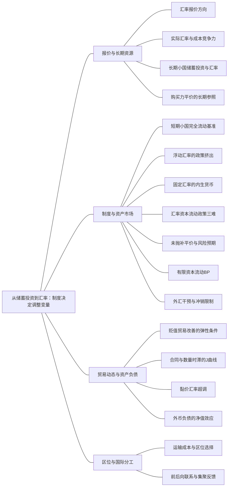

### 本专题知识联系

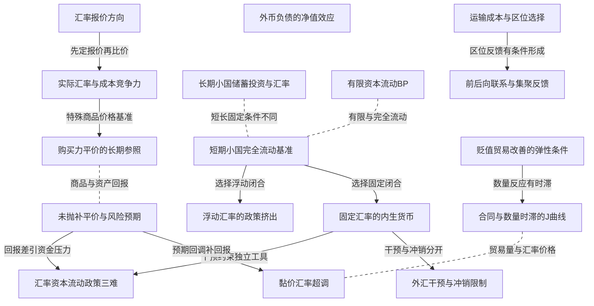

关系图中的箭头表示有方向的联系；虚线表示对照或类比。图中只画本专题主归属节点；跨专题关系在逐条命题中列明，可在练习室逐点追踪。具体成立条件以逐条说明为准。

### KMA100 汇率报价方向

身份：既有资料概括

**定义与对象**

直接与间接报价互为倒数，升贬值的数字方向因此相反。

**何时调用**

给一单位外币本币价，或使用升值指标e。

**适用条件**

先声明E为本币/外币、e为外币/本币，不在中途换定义。

**核心公式与机制**

$e=\frac1E$；本币贬值为E上升、e下降。

**推导与理由**

同一外币变贵意味着一单位本币能换的外币变少，因此两个报价必须反向。

**边界与易错**

随机倒数的期望不是期望倒数；真实汇率和名义报价也不是同一个量。

**整理依据**

- card FA34：**符号与前提。** 为推回报先临时用$S = \frac{1}{e}$，即本币/外币。忽略交易成本，在风险中性且预期回报可直接比较的简化下，外国债券以本币计价的预期回报为$\frac{(1 + i^*) E_t S_{t + 1}}{S_t}$；风险补偿另列$\rho_i$。
- card FA33：**教材与题源。** 曼昆第13章，布兰查德第19—20章，多恩布什第13、23章；《小黑屋真题试卷（三）》物理第5页图形第4题、《小黑屋真题试卷（四）》物理第4页简答第5题；S19物理第17页第92题。汇率报价反向时，升贬值解释必须一起改。

### KMA101 实际汇率与成本竞争力

身份：既有资料概括

还用于：从数据到机制比较：论述怎样有证据地落地

**定义与对象**

实际汇率把名义汇率同两国价格相接，衡量产品相对贵贱。

**何时调用**

名义贬值伴本国通胀，或问竞争力。

**适用条件**

物价篮子与货币单位一致；明确升值或贬值指标定义。

**核心公式与机制**

直接报价下$q=\frac{EP^*}{P}$越高表示本国产品相对便宜；倒数$\epsilon=\frac{eP}{P^*}$方向相反。

**推导与理由**

名义贬值的价格优势可被国内价格上涨抵消，有限变化应乘精确增长因子。

**边界与易错**

竞争力还受生产率、进口投入、外币债务和质量影响，不由名义变动一项决定。

**整理依据**

- card FA35：**符号与前提。** 恢复$e=$外币/本币，$\epsilon = \frac{e P}{P^*}$；一价定律与绝对PPP需可比商品篮子、可贸易性、低交易成本等条件。普通国内物价与外国物价的货币单位必须一致。
- review MA088：本题q上升定义为本国产品相对便宜。若另采用其倒数作为实际汇率，所有升降含义要反转，不能混用两个定义。国内外价格指数须按一致基期使用，名义汇率的币种单位与实际指标也须保持一致。

### KMA102 长期小国储蓄投资与汇率

身份：既有资料概括

还用于：从政府预算到债务可持续：先算账，再谈政策

**定义与对象**

充分就业小国中世界利率给投资，储蓄投资差约束净资本流出，汇率使净出口相容。

**何时调用**

给S、I(r*)和NX汇率函数，比较财政或世界利率。

**适用条件**

资本充分流动且风险不变、长期产出给定，简化跨境要素转移口径。

**核心公式与机制**

$NCO=S-I(r^*)=NX(\epsilon)$，$NX_\epsilon<0$。

**推导与理由**

先由真实资源和世界回报求S−I，再让相对价格调节外需，而不是让本国利率清国内资金。

**边界与易错**

财政可能压NX而非国内I；关税若改S或I、反制和福利，不能继续固定NCO。

**整理依据**

- card FA31：**符号与前提。** 小型经济$r=r^*$、充分就业$\bar Y$、资本充分流动且风险不变；$e$为外币/本币，$\epsilon = \frac{e P}{P^*}$，$NX_\epsilon<0$。简化核算暂略跨境净要素收入与转移。
- card FA31：**解题步骤。** 先算储蓄投资差额，再从净出口函数反求实际汇率。储蓄减少或投资需求增加使$NCO$降，均衡实际汇率升、净出口降；关税若仅使给定汇率下$NX$增加而$S,I$不变，则实际升值抵消初始改善，净出口总额不变。

### KMA103 短期小国完全流动基准

身份：既有资料概括

**定义与对象**

短期MF在价格和世界利率等条件给定下，用商品、货币与汇率制度确定需求产出。

**何时调用**

政策比较先问浮动还是固定汇率、资本是否完全流动。

**适用条件**

本外价格给定、风险和预期汇率回报相应固定，基准i=i*；改风险预期须扩展平价。

**核心公式与机制**

商品$Y=C(Y-T)+I(i^*)+G+NX(e)$，货币$m=L(i^*,Y)$，再指定e或m的外生性。

**推导与理由**

完全流动限制利差，汇率与货币谁调整由制度决定，所以同一财政冲击可能有不同产出乘数。

**边界与易错**

不能同时固定e、m、i又要求任意支出变动仍出清；长期充分就业模型不同。

**整理依据**

- card FA32：**符号与前提。** 短期本外价格给定，预期通胀及风险不变，$r=r^*$；$\frac{M}{P} = L (r^* , Y)$，$L_Y>0$；商品式$Y=C(Y-T)+I(r^*)+G+NX(e)$。
- card AC06：短期蒙代尔—弗莱明模型还要固定价格并说明汇率制度。浮动汇率允许汇率承担调整，标准完全资本流动模型中财政扩张被净出口下降抵消，货币扩张通过贬值提高产出；固定汇率下央行必须买卖外汇以履约，货币量转为内生，财政扩张得到货币配合，独立货币扩张则被干预抵消。三难约束讨论资本自由流动、固定汇率和货币政策独立性之间的制度相容。

### KMA104 浮动汇率的政策挤出

身份：既有资料概括

**定义与对象**

标准浮动MF中给定实际货币与世界利率先固定收入，财政需求由升值和净出口调整抵消。

**何时调用**

浮动、完全流动、固定m的财政或货币操作。

**适用条件**

采用L(i*,Y)、价格与风险固定；净收入货币需求或利差变化时重推。

**核心公式与机制**

该分支ΔY/ΔG=0、ΔNX=−ΔG；增加m使Y提高并通常贬值。

**推导与理由**

财政先改变商品需求，但货币条件不允许Y变，故汇率调整NX；扩币则直接改变可支持的收入。

**边界与易错**

最终产出零效应不表示构成、汇率、分配和福利不变。

**整理依据**

- card FA32：**解题步骤。** 货币市场先决定唯一收入，再用商品市场决定汇率。财政扩张使IS*右移、本币升值，净出口下降抵消政府购买；货币扩张使LM*右移、贬值提高净出口和产出；贸易限制使IS*右移，升值抵消净出口改善，收入和总净出口不变。

### KMA105 固定汇率的内生货币

身份：既有资料概括

**定义与对象**

维持汇率承诺要求央行通过外汇交易调整本币，货币量成为内生变量。

**何时调用**

财政配套货币、独立扩币抵消或官方改变汇率目标。

**适用条件**

短期价格给定、完全资本流动与可信固定目标，储备及干预可行。

**核心公式与机制**

财政扩张引升值压力时购汇投本币；独立扩币引贬值压力时卖汇收本币，守原目标可抵消扩张。

**推导与理由**

外汇市场压力触发承诺操作，使LM配合商品均衡而非另定任意m。

**边界与易错**

主动官方贬值是改目标，不是守原目标的扩币；有限储备和资本限制改变结果。

**整理依据**

- card FA33：**解题步骤。** 财政或贸易需求扩张产生升值压力，央行买外币、卖本币，储备和货币增加，LM*右移配合更高收入。独立货币扩张产生贬值压力，央行卖外币、收本币，撤回原扩张。官方主动贬值是降低$e$的目标，不能与守住原目标的扩张混为一谈。

### KMA106 汇率资本流动政策三难

身份：既有资料概括

**定义与对象**

固定汇率、资本自由流动和独立货币政策在标准完全替代条件下不能同时任意选择。

**何时调用**

央行试图一面守汇率一面独立设利率或货币。

**适用条件**

无风险预期变化的完全流动基准；资本管制、风险和资产替代不完全需扩展。

**核心公式与机制**

守汇率时资金流动和干预使货币操作受约束，选择制度意味着选择可独立的工具。

**推导与理由**

利率偏离引起资产流动，央行为守目标买卖外汇，抵消部分独立操作。

**边界与易错**

三难不是任何现实偏离都不可能的算术定理，制度强度和风险条件需明示。

**整理依据**

- review MA082：完全资本流动把本国利率同世界水平联系，固定汇率又使央行必须干预，所以独立货币数量目标不能同时维持。改变资本管制、不完全资产替代或汇率制度可改变组合，但并非无成本同时获得三目标。图上财政扩张须有适应货币；独立扩币后的暂时压力最终通过干预回到原均衡。
- card FA33：**条件检查。** 加收入引致进口$m_yY$后，财政乘数为$\frac{1}{1 - c (1 - \tau) + m_y}$，不是无限大。冲销干预可通过反向国内资产操作暂时抵消货币变化，但在完全流动和可信固定汇率等极端条件下，独立利率持续偏离仍会触发资金流动与储备压力。储备耗尽、资本限制和信心改变需要另设模型。

### KMA107 未抛补平价与风险预期

身份：既有资料概括

**定义与对象**

UIP比较跨币种预期回报，当前汇率同时反映利差、未来汇率预期与风险补偿。

**何时调用**

给国内外利率和预期E，或资本外流、守汇率利差。

**适用条件**

外币回报和交易成本条件明确，风险补偿另列；不是锁定未来汇率的无风险套利。

**核心公式与机制**

直接报价近似$i-i^*\approx E_t\Delta\ln E+\rho$，无风险确定回报可由换汇现金流写精确比率。

**推导与理由**

高本币利率可使本币当前升值而未来预期贬值补偿利差，两句发生在不同时间。

**边界与易错**

预期与风险可同时变化；随机题不得把E(e)直接倒数当E(E)。

**整理依据**

- card FA34：**解题步骤。** 先画“换汇—投资—未来换回”的现金流，再解即期价格。未来汇率预期固定时，本国利率提高通常使本币当前升值，而以后预期贬值补偿较高利息；“高息意味着本币预期贬值”与“加息使本币现在升值”不矛盾。
- card FA34：**条件检查。** UIP涉及风险和预期，不是无风险的保证收益；远期锁定汇率的抛补平价则是另一条件。随机倒数的期望一般不等于期望的倒数，精确随机题应按现金流求期望，不能机械把$E(S)$换成$\frac{1}{E (e)}$。

### KMA108 有限资本流动BP

身份：既有资料概括

**定义与对象**

有限资本利率弹性下，收入引致进口与资本流入共同决定不依赖新增储备融资的外部平衡。

**何时调用**

求BP斜率、IS BP交点与货币支持。

**适用条件**

$NX=X_0-m_yY-\nu e,CF=\kappa_f(i-i^*)$，my,ν,κf正，固定e看Y i图。

**核心公式与机制**

$i=i^*+\frac{m_yY-X_0+\nu e}{\kappa_f}$，BP斜率$\frac{m_y}{\kappa_f}$。

**推导与理由**

较高收入增加进口需更高利差吸引流入补偿，资本越敏感所需利差越小。

**边界与易错**

含储备的完整国际收支会计总能平衡；BP残差指官方融资前的外部压力。

**整理依据**

- card FA48：**符号与前提。** 短期价格给定，$e$仍为外币/本币。令$NX=X_0-m_yY-\nu e$、$m_y,\nu>0$，净资本流入$CF=\kappa_f(i-i^*)$、$\kappa_f>0$，暂略风险变化。BP表示不依赖新增官方储备融资的外部平衡，而完整国际收支会计含储备后本身仍平衡。
- card FA48：$$ \begin{gathered} BP=NX+CF=0\Rightarrow i=i^*+\frac{m_yY-X_0+\nu e}{\kappa_f}, \\ \frac{di}{dY}=\frac{m_y}{\kappa_f}. \end{gathered} $$

### KMA109 外汇干预与冲销限制

身份：既有资料概括

**定义与对象**

冲销用反向国内资产操作抵消外汇干预的货币影响，但不自动消除外部资金压力。

**何时调用**

固定汇率下储备变化、试图独立维持货币。

**适用条件**

外汇和国内资产负债表明确，资本替代性、风险、储备和资本管制条件给定。

**核心公式与机制**

购汇通常投本币、卖汇通常回收本币；反向国内资产操作可暂时抵消货币量。

**推导与理由**

本币资产结构改变可暂时改变流动性，却不能在完全流动可信固定汇率下持续任意偏离利率平价。

**边界与易错**

储备、风险和金融资产替代限制仍在，不能把冲销当作突破所有三难的免费工具。

**整理依据**

- card FA48：**汇率与政策。** 本币贬值是$e\downarrow$，在净出口改善条件下使BP下移/右移；升值反向。财政扩张初始提高收入与利率，进口漏出与资本流入方向相反，需比较BP与LM斜率，不能一律按完全流动MF判财政无效。固定汇率下，盈余通常伴随央行购汇投放本币，赤字伴随卖汇收币；冲销用国内资产反向操作抵消货币影响。
- card FA33：**条件检查。** 加收入引致进口$m_yY$后，财政乘数为$\frac{1}{1 - c (1 - \tau) + m_y}$，不是无限大。冲销干预可通过反向国内资产操作暂时抵消货币变化，但在完全流动和可信固定汇率等极端条件下，独立利率持续偏离仍会触发资金流动与储备压力。储备耗尽、资本限制和信心改变需要另设模型。

### KMA110 购买力平价的长期参照

身份：既有资料概括

**定义与对象**

PPP以可比商品篮子的购买力比较提供长期名义汇率参照，不是每期精确报价规律。

**何时调用**

商品换币比较、两国通胀与长期汇率。

**适用条件**

篮子可比、贸易性和低交易成本等条件；非贸易品和市场分割会造成偏离。

**核心公式与机制**

间接报价绝对PPP为$e=\frac{P^*}{P}$；相对变化近似$g_e\approx\pi^*-\pi$。

**推导与理由**

同篮子换成同一货币若价格差可交易，应有套利压缩差；不满足可交易条件时此机制受限。

**边界与易错**

相对PPP近似不等于名义有限变化的精确相减；PPP与UIP一个比商品一个比资产回报。

**整理依据**

- card FA35：**符号与前提。** 恢复$e=$外币/本币，$\epsilon = \frac{e P}{P^*}$；一价定律与绝对PPP需可比商品篮子、可贸易性、低交易成本等条件。普通国内物价与外国物价的货币单位必须一致。
- card FA35：**条件检查。** PPP是长期参照而非每期精确定律；非贸易品、不同篮子、关税和市场分割都会造成偏离。名义贬值若被国内通胀抵消，不等于实际贬值。贸易余额改善与居民购买进口品的福利改善也不是同一判断。

### KMA111 贬值贸易改善的弹性条件

身份：既有资料概括

**定义与对象**

贬值同时改变出口进口数量和进口单位成本，贸易余额是否改善需净比较。

**何时调用**

判断贬值改善NX、短期价格传递或长期数量反应。

**适用条件**

常用ML形式需初始贸易平衡、适当价格传递和明确需求弹性定义，非普遍无条件结论。

**核心公式与机制**

基本条件下出口与进口需求弹性绝对值之和大于1可使贬值后的数量效应超过单位进口成本效应。

**推导与理由**

出口增量和进口替代改善余额，进口更贵损害余额，净额依弹性与计价。

**边界与易错**

余额改善与居民购买进口品福利改善不同；加入进口中间品、债务和贸易反制后须扩展。

**整理依据**

- card FA35：**解题步骤。** 先把同一商品换成同种货币再比较实际价格。贸易题把数量与进口单位成本分开：实际贬值提高出口量、压低进口量，同时提高以本国产品计价的每单位进口成本。在初始贸易平衡、充分价格传递等基础条件下，出口与进口需求弹性绝对值之和大于1，是马歇尔—勒纳条件的常用形式。

### KMA112 合同与数量时滞的J曲线

身份：既有资料概括

**定义与对象**

价格和合同先反应、数量后调整时，贸易余额可能先恶化再改善。

**何时调用**

给出口进口合同币种及短长期数量，逐期核贸易余额。

**适用条件**

短期数量固定且计价规则使进口成本效应先占优，长期改善还须相应弹性和供给条件。

**核心公式与机制**

先以每期合同货币换为同币收入支出，再用长期新数量计算，不能只看汇率升贬值。

**推导与理由**

短期出口本币收入未同步增而进口变贵可致赤字，之后数量变化才可能逆转。

**边界与易错**

并非所有贬值都出现J曲线；不同合同可使短期结果不同。

**整理依据**

- card FA35：**动态检查。** 短期数量按旧合同不易变，价格效应先恶化贸易余额；数量随后调整，满足相应弹性条件时余额改善，形成J曲线。它不是“先升后降”。黏价超调模型中，永久货币扩张短期压低国内利率，UIP要求本币此后预期升值；在长期货币中性和逐步价格调整等条件下，即期本币会先贬过新的长期水平，再部分回升。不能把超调当所有汇率冲击的结论。
- review MA087：初始汇率1时，出口本币收入10，进口支出10，贸易余额零。贬值到1.2的短期数量固定，出口合同本币单价仍1，所以出口收入仍10；进口外币单价固定，支出为 $1.2\times10=12$，余额-2。长期数量变为出口12、进口8，同样合同规则下收入12、支出9.6，余额2.4。

### KMA113 黏价汇率超调

身份：既有资料概括

**定义与对象**

金融价格快调而商品价格慢调时，永久货币冲击可使汇率先越过新长期位置再回调。

**何时调用**

永久扩币、国内利率暂降及汇率动态。

**适用条件**

特定黏价资产模型、长期货币中性、逐步价格调整与相应预期平价；不是所有冲击。

**核心公式与机制**

短期本币先贬过新长期值，随后预期部分升值以补偿暂低利率。

**推导与理由**

资产价格需立刻满足跨币回报条件，而商品价格未到长期，故即期先额外调整。

**边界与易错**

超调不是J曲线；前者是汇率价格路径，后者是贸易余额路径。

**整理依据**

- card FA35：**动态检查。** 短期数量按旧合同不易变，价格效应先恶化贸易余额；数量随后调整，满足相应弹性条件时余额改善，形成J曲线。它不是“先升后降”。黏价超调模型中，永久货币扩张短期压低国内利率，UIP要求本币此后预期升值；在长期货币中性和逐步价格调整等条件下，即期本币会先贬过新的长期水平，再部分回升。不能把超调当所有汇率冲击的结论。

### KMA114 外币负债的净值效应

身份：既有资料概括

还用于：从两个市场到信用反馈：政策效果怎样算出来

**定义与对象**

本币贬值可提高外币负债本币值，侵蚀净值并约束投资，经营外币收入可能部分对冲。

**何时调用**

外币借款、本币资产、出口进口同时存在。

**适用条件**

债务币种期限、套保和经营现金流计价明确；流量与期末重估按同一权益账核。

**核心公式与机制**

债务重估损失不能同本期偿还本金重复扣；净经营收入和存量负债的汇率风险须按期限分别列。

**推导与理由**

固定外币偿付义务不会随本币资产价值同比降低，净值损失可传到银行信用。

**边界与易错**

出口收入上升不保证股东总收益提高；本期流量与无限期负债不能无期限无折现直接相减作最优对冲。

**整理依据**

- case CMA18：债务账面由700升到770，增加70，记汇兑损失70。依题定本期利润现金留存，贬值情形权益增量162−70=92；汇率不变时权益增120，因此贬值使权益增长少28。合并外币敞口为当期净经营美元60减既有美元债100，即−40万美元，乘ΔE=.7给−28。债务尚未偿付，不能在现金经营利润又扣本金770，并同时重复记全部汇兑损失。
- card AC06：汇率预期、风险溢价、有限资本流动、进口价格及外币债务会改变简单结论。贬值既改善出口竞争力，也提高进口购买成本；数量调整有时滞，贸易余额不保证即刻改善。国际收支平衡、充分就业、稳定物价是不同目标，政策组合需要辨认每个工具的传导和约束。

### KMA115 运输成本与区位选择

身份：既有资料概括

**定义与对象**

运输成本在专业化规模收益与远距销售费用之间形成区位权衡。

**何时调用**

跨国分工、出口地到岸价差、中心外围或供应链布局。

**适用条件**

商品运输需成本，可能有固定设厂成本和规模经济；模型语境先区分。

**核心公式与机制**

运输成本扩大两地可套利价格区间，低运输费可便利集中供货，但区位还受工资地租拥挤和要素流动约束。

**推导与理由**

集中节约重复设厂，分散靠近消费者降低运输，净选择由两种成本及市场可达性决定。

**边界与易错**

运输越低不必必然越集中；地理中心外围与结构主义中心外围不是同一理论。

**整理依据**

- card AC06：**扩展论述：运输成本、中心—外围与国际分工。** 运输成本扩大出口地与进口地的到岸价格差，使一部分原本存在比较成本优势的交易不再获利，通常压低贸易量及可实现的贸易利益，并为本地生产提供一定保护。若存在固定成本和规模经济，企业集中生产能够节约重复设厂成本，但也要承担向远处消费者运输的费用。因此，生产区位取决于规模经济、市场可达性、运输成本、要素流动及拥挤成本的共同作用。封闭经济中的跨地区交易也有这一权衡：企业靠近大市场以扩大销量形成后向关联；工人作为消费者靠近制造业集中地，可以享有更多品种、较低运输费用和较低消费价格指数，形成前向关联；生产与需求相互吸引，可能累积形成制造业中心和农业外围。开放经济中，国际劳动力流动若受限，企业间的投入产出联系仍可发挥类似作用：下游靠近中间品供应商以降低投入价格，构成前向关联；供应商靠近下游购买者以扩大市场，构成后向关联。运输成本下降可能使跨境供货更便利，并在一定模型条件下强化集中生产和国际分工；工资上涨、土地租金、拥挤、竞争及低成本地区的吸引又可能促使产业扩散。不能把“运输成本越低必然越集中”或某一模型的集聚不等式写成普遍规律。答题先说明运输成本对交易的直接影响，再写规模经济与前后向关联的累积机制，最后交代分散力量和模型条件；新经济地理的中心—外围模型与结构主义的中心—外围论应先区分理论语境。回练入口：S17物理第86—87页，2014年复旦简答第3题；参考解析的历史叙述及特定数值条件不作为通式背诵。

### KMA116 前后向联系与集聚反馈

身份：既有资料概括

**定义与对象**

市场需求、投入供给和要素区位的相互吸引可形成集聚反馈，同时存在分散力量。

**何时调用**

制造业中心、上下游网络或国际劳动力受限的产业联系。

**适用条件**

需规模收益及市场或投入联系等条件，不只凭同地共现；要素流动限制按模型给。

**核心公式与机制**

靠近大市场扩大销量的后向联系，与靠近供应降低投入或消费成本的前向联系可累积增强集中。

**推导与理由**

企业吸引需求与供应，需求供应又吸引企业；工资地租、拥挤和竞争可抵消或逆转。

**边界与易错**

不能只画正反馈便宣布唯一集中均衡；模型阈值不能当普遍经验定律。

**整理依据**

- card AC06：**扩展论述：运输成本、中心—外围与国际分工。** 运输成本扩大出口地与进口地的到岸价格差，使一部分原本存在比较成本优势的交易不再获利，通常压低贸易量及可实现的贸易利益，并为本地生产提供一定保护。若存在固定成本和规模经济，企业集中生产能够节约重复设厂成本，但也要承担向远处消费者运输的费用。因此，生产区位取决于规模经济、市场可达性、运输成本、要素流动及拥挤成本的共同作用。封闭经济中的跨地区交易也有这一权衡：企业靠近大市场以扩大销量形成后向关联；工人作为消费者靠近制造业集中地，可以享有更多品种、较低运输费用和较低消费价格指数，形成前向关联；生产与需求相互吸引，可能累积形成制造业中心和农业外围。开放经济中，国际劳动力流动若受限，企业间的投入产出联系仍可发挥类似作用：下游靠近中间品供应商以降低投入价格，构成前向关联；供应商靠近下游购买者以扩大市场，构成后向关联。运输成本下降可能使跨境供货更便利，并在一定模型条件下强化集中生产和国际分工；工资上涨、土地租金、拥挤、竞争及低成本地区的吸引又可能促使产业扩散。不能把“运输成本越低必然越集中”或某一模型的集聚不等式写成普遍规律。答题先说明运输成本对交易的直接影响，再写规模经济与前后向关联的累积机制，最后交代分散力量和模型条件；新经济地理的中心—外围模型与结构主义的中心—外围论应先区分理论语境。回练入口：S17物理第86—87页，2014年复旦简答第3题；参考解析的历史叙述及特定数值条件不作为通式背诵。
- card AC06：**扩展论述：运输成本、中心—外围与国际分工。** 运输成本扩大出口地与进口地的到岸价格差，使一部分原本存在比较成本优势的交易不再获利，通常压低贸易量及可实现的贸易利益，并为本地生产提供一定保护。若存在固定成本和规模经济，企业集中生产能够节约重复设厂成本，但也要承担向远处消费者运输的费用。因此，生产区位取决于规模经济、市场可达性、运输成本、要素流动及拥挤成本的共同作用。封闭经济中的跨地区交易也有这一权衡：企业靠近大市场以扩大销量形成后向关联；工人作为消费者靠近制造业集中地，可以享有更多品种、较低运输费用和较低消费价格指数，形成前向关联；生产与需求相互吸引，可能累积形成制造业中心和农业外围。开放经济中，国际劳动力流动若受限，企业间的投入产出联系仍可发挥类似作用：下游靠近中间品供应商以降低投入价格，构成前向关联；供应商靠近下游购买者以扩大市场，构成后向关联。运输成本下降可能使跨境供货更便利，并在一定模型条件下强化集中生产和国际分工；工资上涨、土地租金、拥挤、竞争及低成本地区的吸引又可能促使产业扩散。不能把“运输成本越低必然越集中”或某一模型的集聚不等式写成普遍规律。答题先说明运输成本对交易的直接影响，再写规模经济与前后向关联的累积机制，最后交代分散力量和模型条件；新经济地理的中心—外围模型与结构主义的中心—外围论应先区分理论语境。回练入口：S17物理第86—87页，2014年复旦简答第3题；参考解析的历史叙述及特定数值条件不作为通式背诵。

### 关系命题与条件

#### EMA096 汇率报价方向 → 实际汇率与成本竞争力

前置；既有资料概括

实际汇率的升贬方向必须先有名义报价和价格单位。

适用条件：直接与间接报价全程一致。

理由：两个实际汇率互为倒数，NX函数的方向也须随定义匹配。

依据：card FA35「**符号与前提。** 恢复$e=$外币/本币，$\epsilon = \frac{e P}{P^*}$；一价定律与绝对PPP需可比商品篮子、可贸易性、低交易成本等条件。普通国内物价与外国物价的货币单位必须一致。」

#### EMA098 长期小国储蓄投资与汇率 → 短期小国完全流动基准

对照；既有资料概括

长期小国固定供给产出，短期MF固定价格并允许需求产出变化，财政传导不能互搬。

适用条件：比较时分别保持各自资本流动和风险条件。

理由：相同外部利率不代表相同产出决定机制。

依据：card AC06「长期小型开放经济在资本充分流动且风险条件不变时面对给定世界利率，国内储蓄与投资的差额对应净资本流出，实际汇率调整使净出口与之相等。长期财政扩张主要通过储蓄投资差额与实际升值压低净出口，不能直接照搬封闭经济的国内利率挤出。」；card AC06「短期蒙代尔—弗莱明模型还要固定价格并说明汇率制度。浮动汇率允许汇率承担调整，标准完全资本流动模型中财政扩张被净出口下降抵消，货币扩张通过贬值提高产出；固定汇率下央行必须买卖外汇以履约，货币量转为内生，财政扩张得到货币配合，独立货币扩张则被干预抵消。三难约束讨论资本自由流动、固定汇率和货币政策独立性之间的制度相容。」

#### EMA099 短期小国完全流动基准 → 浮动汇率的政策挤出

条件变化；既有资料概括

浮动制度以给定m和外部利率约束收入，汇率调整商品需求。

适用条件：标准货币需求取决于Y而非税后收入，风险不变。

理由：财政移IS*但不改变竖直货币约束，NX调整抵消。

依据：card FA32「**解题步骤。** 货币市场先决定唯一收入，再用商品市场决定汇率。财政扩张使IS*右移、本币升值，净出口下降抵消政府购买；货币扩张使LM*右移、贬值提高净出口和产出；贸易限制使IS*右移，升值抵消净出口改善，收入和总净出口不变。」

#### EMA100 短期小国完全流动基准 → 固定汇率的内生货币

条件变化；既有资料概括

固定汇率时商品均衡确定收入，央行提供相应货币并干预守目标。

适用条件：储备和市场交易可行，目标可信。

理由：外汇操作使货币转为内生，而不沿旧固定m线强求交点。

依据：card FA33「**解题步骤。** 财政或贸易需求扩张产生升值压力，央行买外币、卖本币，储备和货币增加，LM*右移配合更高收入。独立货币扩张产生贬值压力，央行卖外币、收本币，撤回原扩张。官方主动贬值是降低$e$的目标，不能与守住原目标的扩张混为一谈。」

#### EMA101 固定汇率的内生货币 → 汇率资本流动政策三难

推导；既有资料概括

在完全流动下守住固定汇率的干预，会限制独立持续货币操作。

适用条件：完全替代和风险预期固定的基准。

理由：试图独立拉开利率会引资金流动和反向干预。

依据：card FA33「**条件检查。** 加收入引致进口$m_yY$后，财政乘数为$\frac{1}{1 - c (1 - \tau) + m_y}$，不是无限大。冲销干预可通过反向国内资产操作暂时抵消货币变化，但在完全流动和可信固定汇率等极端条件下，独立利率持续偏离仍会触发资金流动与储备压力。储备耗尽、资本限制和信心改变需要另设模型。」

#### EMA102 未抛补平价与风险预期 → 汇率资本流动政策三难

机制；既有资料概括

平价预期回报约束是固定汇率与独立利率冲突的资产市场渠道。

适用条件：资本可自由流动且风险预期未抵消利差。

理由：资产选择使持续回报差不能无资金压力保留。

依据：card FA34「**解题步骤。** 先画“换汇—投资—未来换回”的现金流，再解即期价格。未来汇率预期固定时，本国利率提高通常使本币当前升值，而以后预期贬值补偿较高利息；“高息意味着本币预期贬值”与“加息使本币现在升值”不矛盾。」；card FA33「**条件检查。** 加收入引致进口$m_yY$后，财政乘数为$\frac{1}{1 - c (1 - \tau) + m_y}$，不是无限大。冲销干预可通过反向国内资产操作暂时抵消货币变化，但在完全流动和可信固定汇率等极端条件下，独立利率持续偏离仍会触发资金流动与储备压力。储备耗尽、资本限制和信心改变需要另设模型。」

#### EMA103 有限资本流动BP → 短期小国完全流动基准

对照；既有资料概括

有限κ的BP有收入进口斜率，只有弹性趋无限的极限才接近外部固定利率线。

适用条件：NX收入项与利差流入形式保留。

理由：有限资本流入不能任意补所有进口变化。

依据：card FA48「**解题步骤。** 在$(Y,i)$平面，BP上方较高利率吸引资本，外部余额为正；下方为负。给定$i$，右侧收入高、进口多，出现赤字，左侧相反。资本流动更敏感使BP更平，进口倾向更大使BP更陡；只有$\kappa_f\to\infty$才趋于水平世界利率线。」

#### EMA104 固定汇率的内生货币 → 外汇干预与冲销限制

条件变化；既有资料概括

冲销可暂抵干预货币效应，却不改变守汇率所需外汇交易本身。

适用条件：国内资产操作可行且仍核储备风险约束。

理由：两个资产市场操作对基础货币方向相反，外部偿付压力仍可能存在。

依据：card FA48「**汇率与政策。** 本币贬值是$e\downarrow$，在净出口改善条件下使BP下移/右移；升值反向。财政扩张初始提高收入与利率，进口漏出与资本流入方向相反，需比较BP与LM斜率，不能一律按完全流动MF判财政无效。固定汇率下，盈余通常伴随央行购汇投放本币，赤字伴随卖汇收币；冲销用国内资产反向操作抵消货币影响。」

#### EMA105 实际汇率与成本竞争力 → 购买力平价的长期参照

推导；既有资料概括

可比篮子无交易阻隔的绝对PPP将实际汇率限制为特定同价基准。

适用条件：相同篮子、可贸易性和低成本等充分条件。

理由：不同货币的同篮子价格若可套利，换币后趋同。

依据：card FA35「**符号与前提。** 恢复$e=$外币/本币，$\epsilon = \frac{e P}{P^*}$；一价定律与绝对PPP需可比商品篮子、可贸易性、低交易成本等条件。普通国内物价与外国物价的货币单位必须一致。」

#### EMA106 购买力平价的长期参照 → 未抛补平价与风险预期

对照；既有资料概括

PPP比较商品购买力，UIP比较跨币资产预期回报，两者不是可相互替代的平价。

适用条件：分别满足各自交易和风险信息条件。

理由：一个约束商品价格比，一个约束预期收益，时间和对象不同。

依据：card FA35「**条件检查。** PPP是长期参照而非每期精确定律；非贸易品、不同篮子、关税和市场分割都会造成偏离。名义贬值若被国内通胀抵消，不等于实际贬值。贸易余额改善与居民购买进口品的福利改善也不是同一判断。」；card FA34「**条件检查。** UIP涉及风险和预期，不是无风险的保证收益；远期锁定汇率的抛补平价则是另一条件。随机倒数的期望一般不等于期望的倒数，精确随机题应按现金流求期望，不能机械把$E(S)$换成$\frac{1}{E (e)}$。」

#### EMA107 贬值贸易改善的弹性条件 → 合同与数量时滞的J曲线

条件变化；既有资料概括

长期弹性有利于余额改善，不表示数量受合同时短期就改善。

适用条件：短期计价成本先变，数量后变且长期条件满足。

理由：短期价格成本效应与后续数量效应发生在不同时间。

依据：card FA35「**动态检查。** 短期数量按旧合同不易变，价格效应先恶化贸易余额；数量随后调整，满足相应弹性条件时余额改善，形成J曲线。它不是“先升后降”。黏价超调模型中，永久货币扩张短期压低国内利率，UIP要求本币此后预期升值；在长期货币中性和逐步价格调整等条件下，即期本币会先贬过新的长期水平，再部分回升。不能把超调当所有汇率冲击的结论。」

#### EMA108 未抛补平价与风险预期 → 黏价汇率超调

机制；既有资料概括

在黏价超调模型中，暂低利率要求本币以后预期升值，可使即期先过度贬值。

适用条件：永久货币扩张、长期中性和缓慢价格调整。

理由：资产价格即时满足回报关系，而商品价格尚未完成调整。

依据：card FA35「**动态检查。** 短期数量按旧合同不易变，价格效应先恶化贸易余额；数量随后调整，满足相应弹性条件时余额改善，形成J曲线。它不是“先升后降”。黏价超调模型中，永久货币扩张短期压低国内利率，UIP要求本币此后预期升值；在长期货币中性和逐步价格调整等条件下，即期本币会先贬过新的长期水平，再部分回升。不能把超调当所有汇率冲击的结论。」

#### EMA109 合同与数量时滞的J曲线 → 黏价汇率超调

对照；既有资料概括

J曲线描述贸易余额先恶化后改善，超调描述汇率先越长期值再回调。

适用条件：各模型动态条件分别成立。

理由：不能用贸易数量时滞直接证明资产价格超调。

依据：card FA35「**动态检查。** 短期数量按旧合同不易变，价格效应先恶化贸易余额；数量随后调整，满足相应弹性条件时余额改善，形成J曲线。它不是“先升后降”。黏价超调模型中，永久货币扩张短期压低国内利率，UIP要求本币此后预期升值；在长期货币中性和逐步价格调整等条件下，即期本币会先贬过新的长期水平，再部分回升。不能把超调当所有汇率冲击的结论。」

#### EMA110 外币负债的净值效应 → 信用利差的需求反馈

机制；既有资料概括

净外币负债重估损失可降低抵押净值、提高利差并压投资需求。

适用条件：本币贬值且未被外币收入或保值足额抵消。

理由：固定外币债与本币资产的币种错配使贬值不是纯出口刺激。

依据：case CMA18「本币贬值一方面提高固定美元净经营收入的本币值，另一方面放大外币负债，削弱净值和抵押保障。银行面对违约风险可提高利差、缩减授信，企业因现金与资本约束削减投资、雇佣，需求下降又影响销售；若被迫售资产，还会压低共同抵押品价格。应按企业净外币敞口、币种合同、债务期限、进口依赖和套保分组，观察订单数量、利润、净值、融资利差与投资的时序。只看出口总额或总汇率不足以分辨两机制，宏观总效应仍需相应参数和分布。」

#### EMA111 运输成本与区位选择 → 前后向联系与集聚反馈

机制；既有资料概括

运输和规模成本影响市场可达性，结合前后向联系可产生区位累积反馈。

适用条件：存在固定成本和规模经济等相应结构，分散力量同时保留。

理由：集中既省生产成本又付远距运输，供需联系改变两者权衡。

依据：card AC06「**扩展论述：运输成本、中心—外围与国际分工。** 运输成本扩大出口地与进口地的到岸价格差，使一部分原本存在比较成本优势的交易不再获利，通常压低贸易量及可实现的贸易利益，并为本地生产提供一定保护。若存在固定成本和规模经济，企业集中生产能够节约重复设厂成本，但也要承担向远处消费者运输的费用。因此，生产区位取决于规模经济、市场可达性、运输成本、要素流动及拥挤成本的共同作用。封闭经济中的跨地区交易也有这一权衡：企业靠近大市场以扩大销量形成后向关联；工人作为消费者靠近制造业集中地，可以享有更多品种、较低运输费用和较低消费价格指数，形成前向关联；生产与需求相互吸引，可能累积形成制造业中心和农业外围。开放经济中，国际劳动力流动若受限，企业间的投入产出联系仍可发挥类似作用：下游靠近中间品供应商以降低投入价格，构成前向关联；供应商靠近下游购买者以扩大市场，构成后向关联。运输成本下降可能使跨境供货更便利，并在一定模型条件下强化集中生产和国际分工；工资上涨、土地租金、拥挤、竞争及低成本地区的吸引又可能促使产业扩散。不能把“运输成本越低必然越集中”或某一模型的集聚不等式写成普遍规律。答题先说明运输成本对交易的直接影响，再写规模经济与前后向关联的累积机制，最后交代分散力量和模型条件；新经济地理的中心—外围模型与结构主义的中心—外围论应先区分理论语境。回练入口：S17物理第86—87页，2014年复旦简答第3题；参考解析的历史叙述及特定数值条件不作为通式背诵。」

### 对应题目分问路径

#### MA081

浮动完全流动基准中财政经升值挤出外需，扩币改变可支持收入。

**第1问**

本问任务：求初始Y、e、NX。

世界利率固定且货币只随收入需求，先由货币求Y再由商品求实际升值指标及NX；不把题定实际指标当名义直接报价。

调用：KMA103 短期小国完全流动基准；KMA104 浮动汇率的政策挤出；KMA101 实际汇率与成本竞争力

联系：EMA099

**第2问**

本问任务：G增10、m固定时求新均衡。

m不变约束Y不变，G增10由升值减少NX10核账，零总量效应仍有构成改变。

调用：KMA104 浮动汇率的政策挤出；KMA103 短期小国完全流动基准

联系：EMA099

**第3问**

本问任务：m增20而G不变时求新均衡。作图并解释两类政策。

独立恢复原G扩m求新Y和贬值指标，Y与e同轴标IS向下及货币竖线；结果受短期制度条件约束。

调用：KMA104 浮动汇率的政策挤出；KMA103 短期小国完全流动基准；KMA101 实际汇率与成本竞争力

联系：EMA099

#### MA082

守原汇率使货币适应财政，独立扩币会被干预抵消。

**第1问**

本问任务：求初始均衡。

先用固定e求净出口及商品产出，再反求支持均衡的货币。

调用：KMA103 短期小国完全流动基准；KMA105 固定汇率的内生货币

联系：EMA100

**第2问**

本问任务：G增加10，求Y和为维持汇率所需m。

财政增支下汇率利率不动，商品产出变而货币内生增加，不另任意固定原m。

调用：KMA105 固定汇率的内生货币；KMA036 央行操作闭合

联系：本问直接使用“固定汇率的内生货币、央行操作闭合”所列定义、模型或既有结论核算，不将本问共同出现的知识点强行画成逻辑推出。

**第3问**

本问任务：央行试图独立将m从100增至120、G不变，会面对什么干预？

独立扩币产生贬值压力，守承诺需卖外汇收本币，在储备和可信条件下抵消原扩张；本问没有另给国内资产冲销操作。

调用：KMA105 固定汇率的内生货币

联系：本问直接使用“固定汇率的内生货币”所列定义、模型或既有结论核算，不将本问共同出现的知识点强行画成逻辑推出。

**第4问**

本问任务：说明资本完全流动、固定汇率与独立货币政策的关系。

完全流动利率平价和守汇率干预共同约束货币自主性，改变资本或资产替代条件需扩展模型。

调用：KMA106 汇率资本流动政策三难；KMA105 固定汇率的内生货币；KMA107 未抛补平价与风险预期

联系：EMA101、EMA102

#### MA083

出口限制的需求乘数与食品相对价格福利需要不同方程。

**第1问**

本问任务：求初始和冲击后Y。

固定价格汇率外部利率下从自主出口变化求商品产出，乘数来自国内消费反馈。

调用：KMA105 固定汇率的内生货币；KMA032 计划支出与收入乘数；KMA103 短期小国完全流动基准

联系：EMA100

**第2问**

本问任务：若货币需求m=0.5Y，央行货币如何调整？

随收入下降货币需求减少，守汇率需适应收缩m，不能再锁数量不变。

调用：KMA105 固定汇率的内生货币；KMA036 央行操作闭合

联系：本问直接使用“固定汇率的内生货币、央行操作闭合”所列定义、模型或既有结论核算，不将本问共同出现的知识点强行画成逻辑推出。

**第3问**

本问任务：若政策同时降低国内食品价格，应怎样扩展模型，为什么不能从总需求式直接回答全部福利？

原式无食品相对价格和群体福利，需另立供需及分配制度，训练参数不当历史估计或虚构关税。

调用：KMA103 短期小国完全流动基准；KMA128 条件—机制—证据的论述结构；KMA122 机制一致与因果识别

联系：本问直接使用“短期小国完全流动基准、条件—机制—证据的论述结构、机制一致与因果识别”所列定义、模型或既有结论核算，不将本问共同出现的知识点强行画成逻辑推出。

#### MA084

当前直接标价同时由风险、利差和未来预期决定。

**第1问**

本问任务：解当前E。

按给定一年近似平价移项求当前E，百分利率用小数并检正分母。

调用：KMA107 未抛补平价与风险预期；KMA100 汇率报价方向

联系：本问直接使用“未抛补平价与风险预期、汇率报价方向”所列定义、模型或既有结论核算，不将本问共同出现的知识点强行画成逻辑推出。

**第2问**

本问任务：风险溢价升至2%，其他量固定时E如何变化？

风险单独升高使分母降和E升，表示本币当前贬值，不混未来补偿方向。

调用：KMA107 未抛补平价与风险预期；KMA100 汇率报价方向

联系：本问直接使用“未抛补平价与风险预期、汇率报价方向”所列定义、模型或既有结论核算，不将本问共同出现的知识点强行画成逻辑推出。

**第3问**

本问任务：若预期未来E同时降至9.5，求新E并解释为什么不能只看风险溢价给方向。

未来E预期同时下降要重算分子分母，净结果可升值，不能仅凭风险项推总方向。

调用：KMA107 未抛补平价与风险预期；KMA100 汇率报价方向

联系：本问直接使用“未抛补平价与风险预期、汇率报价方向”所列定义、模型或既有结论核算，不将本问共同出现的知识点强行画成逻辑推出。

#### MA085

有限资本流动中商品和外部平衡决定交点，货币须配套。

**第1问**

本问任务：推导BP并求与IS的交点。

固定e后把净出口同资本流入相加为零推BP，与IS联立求Y和i，不强行令i等世界率。

调用：KMA108 有限资本流动BP；KMA033 IS商品市场条件

联系：本问直接使用“有限资本流动BP、IS商品市场条件”所列定义、模型或既有结论核算，不将本问共同出现的知识点强行画成逻辑推出。

**第2问**

本问任务：若货币需求$m=0.5Y-10i$，维持该交点需多少m？

将交点代货币需求反求m，并核贸易顺差与资本净流出相抵，负资本流入不自相矛盾。

调用：KMA108 有限资本流动BP；KMA034 货币市场LM条件；KMA036 央行操作闭合

联系：本问直接使用“有限资本流动BP、货币市场LM条件、央行操作闭合”所列定义、模型或既有结论核算，不将本问共同出现的知识点强行画成逻辑推出。

**第3问**

本问任务：比较资本流动系数变大时BP斜率；说明固定汇率下冲销的限制。

资本敏感度升使BP更平，冲销仅暂抵货币效应，持续利差仍受储备替代和可信度限制。

调用：KMA108 有限资本流动BP；KMA109 外汇干预与冲销限制；KMA106 汇率资本流动政策三难

联系：本问直接使用“有限资本流动BP、外汇干预与冲销限制、汇率资本流动政策三难”所列定义、模型或既有结论核算，不将本问共同出现的知识点强行画成逻辑推出。

#### MA086

长期小国资源配置先求S减I，再由实际汇率使净出口相容。

**第1问**

本问任务：求资本净流出、NX和e。

充分就业下S减I等净资本流出及NX，再解升值指标，不误叫净流入。

调用：KMA102 长期小国储蓄投资与汇率；KMA090 私人政府与国民储蓄；KMA101 实际汇率与成本竞争力

联系：EMA097

**第2问**

本问任务：财政赤字使S降20，求新均衡。

财政使储蓄少20而I给定，净流出NX下降并实际升值，不另用本国利率清资金。

调用：KMA102 长期小国储蓄投资与汇率；KMA090 私人政府与国民储蓄

联系：EMA097

**第3问**

本问任务：若同时世界利率上升使I降10，再算；区分长期模型与短期产出政策结论。

财政同世界率上升合并后重算S减I，相对初始和单财政基准分别比较；长期小国Y固定不与短期开放需求乘数混用。

调用：KMA102 长期小国储蓄投资与汇率；KMA103 短期小国完全流动基准

联系：EMA098

#### MA087

贸易余额路径由合同币种、价格换算和数量调整时点共同决定。

**第1问**

本问任务：求初始、短期、长期本币贸易余额。

按每期合同计价核同币收入支出，出口本币价固定不可再乘E，长期换新数量再核余额。

调用：KMA112 合同与数量时滞的J曲线；KMA100 汇率报价方向

联系：本问直接使用“合同与数量时滞的J曲线、汇率报价方向”所列定义、模型或既有结论核算，不将本问共同出现的知识点强行画成逻辑推出。

**第2问**

本问任务：解释短期恶化长期改善的机制。

短期进口换算成本先变，出口本币价固定对应外币降价，随后数量响应可能扭转余额。

调用：KMA112 合同与数量时滞的J曲线；KMA111 贬值贸易改善的弹性条件

联系：EMA107

**第3问**

本问任务：说明这不是所有贬值必出现的经验规律。

是否出现J形取决于传递弹性产能与初始贸易，不由一组数量推出所有贬值改善或完成福利判断。

调用：KMA112 合同与数量时滞的J曲线；KMA111 贬值贸易改善的弹性条件；KMA128 条件—机制—证据的论述结构

联系：EMA107

#### MA088

名义贬值的成本竞争力要经两国价格调整，并核企业敞口。

**第1问**

本问任务：求q的精确变化。

用E和两价格增长因子的乘除算q精确倍率，不能把10%名义变化当实际变化。

调用：KMA101 实际汇率与成本竞争力；KMA100 汇率报价方向；KMA126 有限变动与局部比较静态

联系：EMA096

**第2问**

本问任务：比较只看10%名义贬值的结论。

本国价格上涨抵消大部分名义贬值，仅余2%实际相对便宜，名义报价和实际相对价格指标不同，不调用名实GDP核算。

调用：KMA101 实际汇率与成本竞争力

联系：本问直接使用“实际汇率与成本竞争力”所列定义、模型或既有结论核算，不将本问共同出现的知识点强行画成逻辑推出。

**第3问**

本问任务：从生产率、进口中间品、外币债务及产业结构讨论贬值对竞争力的限制。

生产率质量进口成本外债和产业结构共同限制竞争力及福利，q若用倒数定义须反转方向；本问不使用贸易余额的ML弹性判据。

调用：KMA101 实际汇率与成本竞争力；KMA114 外币负债的净值效应

联系：本问直接使用“实际汇率与成本竞争力、外币负债的净值效应”所列定义、模型或既有结论核算，不将本问共同出现的知识点强行画成逻辑推出。

#### MA089

守汇率所需利差与国内紧缩成本可形成预期反馈。

**第1问**

本问任务：在近似利率平价下，为补偿预期和风险，国内利率相对i*需提高多少？

近似平价将预期贬值10与风险2相加为相对世界率利差12点，未给i星不能报国内绝对率。

调用：KMA107 未抛补平价与风险预期；KMA100 汇率报价方向

联系：本问直接使用“未抛补平价与风险预期、汇率报价方向”所列定义、模型或既有结论核算，不将本问共同出现的知识点强行画成逻辑推出。

**第2问**

本问任务：解释维持汇率与国内产出的权衡。

提高利率抑需求增债务服务，卖外汇耗储备并收本币，弃守另改资产负债和预期；未假设另有国内资产冲销。

调用：KMA105 固定汇率的内生货币；KMA107 未抛补平价与风险预期

联系：本问直接使用“固定汇率的内生货币、未抛补平价与风险预期”所列定义、模型或既有结论核算，不将本问共同出现的知识点强行画成逻辑推出。

**第3问**

本问任务：为什么资本流出既可能反映基本面，也可能被预期强化？

基本面恶化和资本外流可通过储备耗损及防守成本互相强化，存在反馈不证明任意预期必自我实现；本题是守汇率预期压力，不套共同资产抛售监管模型。

调用：KMA107 未抛补平价与风险预期；KMA105 固定汇率的内生货币；KMA122 机制一致与因果识别

联系：本问直接使用“未抛补平价与风险预期、固定汇率的内生货币、机制一致与因果识别”所列定义、模型或既有结论核算，不将本问共同出现的知识点强行画成逻辑推出。

#### MA090

财政乘数须先选制度闭合，四环境不能拼成统一传导。

**第1问**

本问任务：在封闭固定货币环境分析财政扩张的利率及产出渠道。

封闭固定m下财政沿LM提高Y与i并部分挤投资，没有汇率NX渠道；本分支Y可变，不使用充分就业固定Y完全挤出模型。

调用：KMA035 IS—LM联立乘数

联系：本问直接使用“IS—LM联立乘数”所列定义、模型或既有结论核算，不将本问共同出现的知识点强行画成逻辑推出。

**第2问**

本问任务：在完全流动浮动汇率环境分析财政的利率、汇率、净出口与产出渠道。

完全流动浮动下外部率给定，升值挤NX可全抵G，固定m和价格是关键条件。

调用：KMA103 短期小国完全流动基准；KMA104 浮动汇率的政策挤出

联系：EMA099

**第3问**

本问任务：在完全流动固定汇率环境分析财政的利率、汇率、净出口、产出及配套货币。

完全流动守汇率要求央行适应供给，财政产出作用较强，若有收入进口NX仍随Y变。

调用：KMA103 短期小国完全流动基准；KMA105 固定汇率的内生货币；KMA036 央行操作闭合

联系：EMA100

**第4问**

本问任务：讨论资本不完全流动时的条件结果，说明为什么须先识别制度再求乘数。

不完全流动需IS LM BP和干预共同联立，风险预期利率等变动另列，不能直接保留完全流动乘数。

调用：KMA108 有限资本流动BP；KMA109 外汇干预与冲销限制；KMA103 短期小国完全流动基准

联系：EMA103

#### CMA17

同一开放经济基准下独立比较财政、货币与汇率制度。

**第1问**

本问任务：求原Y、e、NX和投资；说明资本完全流动、价格固定与汇率变量定义各起什么作用。

用世界率求I，货币定Y再商品求e和NX，e为题定实际升值指标而非名义本币外币报价。

调用：KMA103 短期小国完全流动基准；KMA101 实际汇率与成本竞争力；KMA104 浮动汇率的政策挤出

联系：EMA099

**第2问**

本问任务：浮动汇率下G增加10、m不变，求Y、e、NX变化；用国民支出核账解释财政效应。

浮动m不变使Y不动，G10同NX负10在支出账抵消，非普遍财政无效。

调用：KMA104 浮动汇率的政策挤出；KMA103 短期小国完全流动基准；KMA117 国民支出核算与计划均衡

联系：EMA099

**第3问**

本问任务：独立从原均衡固定原汇率，G同增10，求Y与维持汇率所需m。再说明央行若只想把m增加20而G不变，最终会怎样。

固定原e后财政要求内生m增加；独立扩币守目标最终回收，不能同时任意固定e i m。

调用：KMA105 固定汇率的内生货币；KMA036 央行操作闭合；KMA106 汇率资本流动政策三难

联系：EMA101

**第4问**

本问任务：恢复原浮动制度、G=20，永久增加m20，求Y、e、NX；比较它同第2问财政的传导，并用准确坐标描述两类移动。

恢复原浮动G后扩m，逐项核消费和NX增量支撑产出，并在Y e坐标准确写IS及竖直货币线。

调用：KMA104 浮动汇率的政策挤出；KMA103 短期小国完全流动基准；KMA101 实际汇率与成本竞争力

联系：EMA099

**第5问**

本问任务：若资本流动不完全，写国际收支条件的一般形式并说明本题哪些决定关系不能直接保留；需要何种数据才能定量比较财政乘数。

有限资本流动放松i等i星，需给收入进口、风险预期和冲销规则再联立，不能只给原结论换名。

调用：KMA108 有限资本流动BP；KMA103 短期小国完全流动基准；KMA109 外汇干预与冲销限制

联系：EMA103

#### CMA18

经营流量收益与外债存量重估按同一权益账合并。

**第1问**

本问任务：求不变汇率基准与贬值后人民币出口、进口和经营利润，分解利润变化来自收入端与成本端。

先按固定美元出口进口分别换人民币，经营净美元流量60决定利润对ΔE的短期变化，不把出口总额当净敞口。

调用：KMA100 汇率报价方向；KMA114 外币负债的净值效应

联系：本问直接使用“汇率报价方向、外币负债的净值效应”所列定义、模型或既有结论核算，不将本问共同出现的知识点强行画成逻辑推出。

**第2问**

本问任务：求外币债务人民币账面变化及本期权益变动；与E不变基准比较，说明经营利润改善是否保证股东总收益提高。

未到期债本金重估增70计汇兑损失，留存经营现金162减重估得权益增92；不再重复扣未偿本金，也不套实物资本部分调整投资式。

调用：KMA114 外币负债的净值效应

联系：本问直接使用“外币负债的净值效应”所列定义、模型或既有结论核算，不将本问共同出现的知识点强行画成逻辑推出。

**第3问**

本问任务：求实际汇率的精确变化，比较名义贬值和实际相对价格变化；为什么不能由它直接推长期销量？

两国价格因子使实际贬值仅2%，合同数量固定；相对价格不直接给销量弹性和长期订单。

调用：KMA101 实际汇率与成本竞争力；KMA126 有限变动与局部比较静态；KMA111 贬值贸易改善的弹性条件

联系：本问直接使用“实际汇率与成本竞争力、有限变动与局部比较静态、贬值贸易改善的弹性条件”所列定义、模型或既有结论核算，不将本问共同出现的知识点强行画成逻辑推出。

**第4问**

本问任务：若企业下一期把外币本金降至40万美元，其他当期经营敞口和同样汇率变化保持，比较汇率变动对权益增量的影响；评价自然对冲和主动还债的区别。

新期初债结构40与相同经营敞口条件比较得净影响14，自然对冲不包含主动还债所需现金机会成本。

调用：KMA114 外币负债的净值效应；KMA128 条件—机制—证据的论述结构

联系：本问直接使用“外币负债的净值效应、条件—机制—证据的论述结构”所列定义、模型或既有结论核算，不将本问共同出现的知识点强行画成逻辑推出。

**第5问**

本问任务：再从宏观金融层面说明：若许多企业有第2问的净外币负债，贬值可能怎样经银行、信用和投资反馈？提出能区分贸易刺激与资产负债冲击的证据。

净外币负债可经净值抵押风险压授信投资，按币种期限进口套保分组观察订单利润融资时序，才区分贸易与资产负债渠道。

调用：KMA114 外币负债的净值效应；KMA039 信用利差的需求反馈；KMA088 共同风险与宏观审慎；KMA122 机制一致与因果识别

联系：EMA110

## 从数据到机制比较：论述怎样有证据地落地

从账户和同向变动到机制与政策结论，还缺哪些识别条件？

先核生产覆盖、名义实际和支出贡献，再将债务金融、真实与名义摩擦作为竞争机制，以条件证据评价政策。

### 分支导图

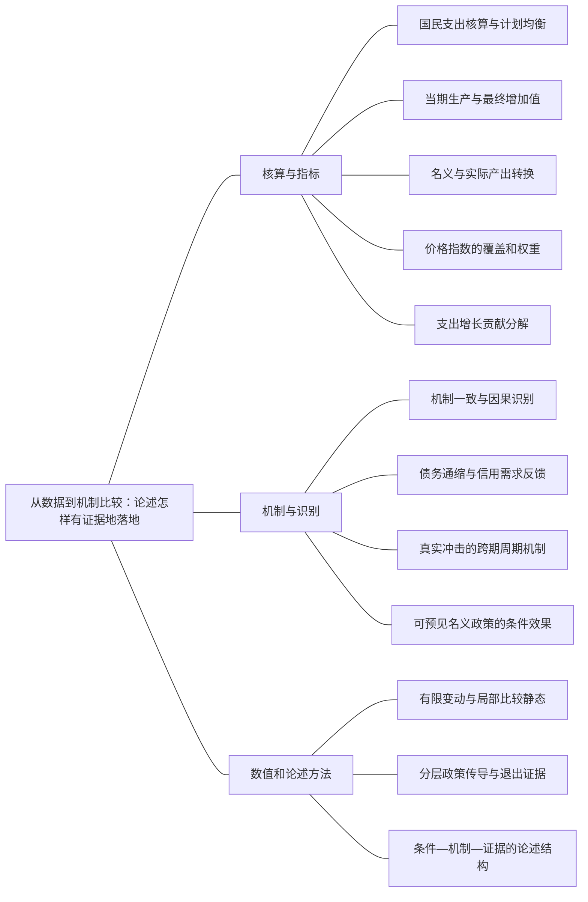

### 本专题知识联系

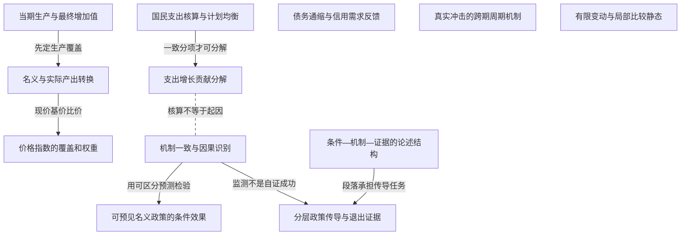

关系图中的箭头表示有方向的联系；虚线表示对照或类比。图中只画本专题主归属节点；跨专题关系在逐条命题中列明，可在练习室逐点追踪。具体成立条件以逐条说明为准。

### KMA117 国民支出核算与计划均衡

身份：既有资料概括

还用于：从现值预算到消费与投资：约束决定分支；从储蓄投资到汇率：制度决定调整变量

**定义与对象**

事后支出恒等式记录已生产资源去向，不自动等同所有主体的计划均衡。

**何时调用**

GDP加总、S I相等、存货和支出冲击归因。

**适用条件**

实际投资包含库存，统计期和价格口径一致；计划投资需另设行为。

**核心公式与机制**

$Y=C+I+G+NX$为事后恒等式，计划支出PE=Y则是商品市场均衡条件。

**推导与理由**

产出未卖出的部分记入实际库存投资，使会计成立却仍可有企业减产压力。

**边界与易错**

恒等式、行为函数与市场出清三者不能按等号外观混用。

**整理依据**

- card CK02：国民核算中的投资含非意愿存货，$Y=C+I+G+NX$事后成立不意味着计划支出始终等于产出。产品市场均衡、货币需求、消费最优等需要各自的行为或出清条件。失衡题正是考计划支出与产出的差。
- card FA01：**解题步骤。** 先按最终用途归类，进出口分别记号；用总额算储蓄，再把已知变动代入$\Delta S_p+\Delta S_g-\Delta I=\Delta NX$。计划支出为$PE$时，非意愿存货为$IU=Y-PE$；$IU>0$说明企业卖不完，生产有收缩压力。事后实际投资含这笔存货，因此事后恒等式仍成立。

### KMA118 当期生产与最终增加值

身份：既有资料概括

**定义与对象**

GDP按境内当期生产最终产品服务计量，用增加值避免中间投入重复。

**何时调用**

新旧房、金融资产、转移支付或进口投入是否计入。

**适用条件**

境内、当期与最终用途口径明确；新中介服务可与二手物本身分开。

**核心公式与机制**

新建资本与库存形成计入投资；既有资产转手不重新形成该资产的产出，转移支付不直接是政府购买。

**推导与理由**

不同收入和支出记录应归到同一生产活动，不能将金融筹资当新增实体生产。

**边界与易错**

GDP不等于国民可支配收入或福利，跨境要素收入和分配需要另核。

**整理依据**

- card AC01：国内生产总值是在一定时期、一国境内生产的最终产品与服务的市场价值。增加值法、收入法和支出法从不同角度记录同一生产活动。中间品通过增加值避免重复计算；二手物品本身不属于当期生产，但当期中介服务计入。购买金融资产属于所有权和融资安排，新建住宅、企业固定资本形成及存货增加才是核算中的投资。转移支付没有对应的当期产品与服务，因此不直接计入政府购买。

### KMA119 名义与实际产出转换

身份：既有资料概括

**定义与对象**

现价产出同时受价格数量影响，固定基价实际产出只记录给定权重下的数量变化。

**何时调用**

两期价格数量、实际GDP增长或人均增长。

**适用条件**

基期、篮子和链式规则按题给，有限变动不直接减百分率。

**核心公式与机制**

$NGDP_t=\sum_jp_{jt}q_{jt},RGDP_t=\sum_jp_{j0}q_{jt}$；精确$1+g_{real}=\frac{1+g_{nom}}{1+\pi}$。

**推导与理由**

逐项以对应价格权重加总，再做比率；若算人均还须除人口增长因子。

**边界与易错**

实际产出不变不表示每件产品数量不变；指数与增长率的分母需写明。

**整理依据**

- card FA02：$$ \begin{gathered} NGDP_t=\sum_jp_{jt}q_{jt}, \\ RGDP_t=\sum_jp_{j0}q_{jt}. \end{gathered} $$
- card FA02：**解题步骤。** 分别列价格与数量表，逐项加总，再做比率。先算总量实际增长，再除人口增长因子。小变化才用$g_{nominal}\approx g_{real}+\pi$；大幅变化使用乘除，不把百分比直接相减。

### KMA120 价格指数的覆盖和权重

身份：既有资料概括

**定义与对象**

平减指数与消费指数因生产覆盖及数量权重不同而可能给不同涨幅。

**何时调用**

求GDP平减、拉氏或居民进口消费价格。

**适用条件**

本题基础拉氏固定基期消费篮子，平减用本期国内产出；其他指数按题设。

**核心公式与机制**

$P_t^{GDP}=100\frac{NGDP_t}{RGDP_t}$，拉氏$100\frac{\sum p_tq_0}{\sum p_0q_0}$。

**推导与理由**

当前国内产出权重与基期消费篮子各自反映不同经济对象，计算前先确认哪些商品被包括。

**边界与易错**

进口消费可进CPI而不直接作国内产出进GDP平减；投入成本的间接传导不是重复计入进口总价。

**整理依据**

- card FA02：$$ \begin{gathered} P^{GDP}_t=100\frac{NGDP_t}{RGDP_t}, \\ CPI_t=100\frac{\sum_jp_{jt}q_{j0}}{\sum_jp_{j0}q_{j0}}. \end{gathered} $$
- card AC01：名义GDP同时受价格和数量影响，实际GDP衡量生产数量，价格指数衡量价格变化。GDP平减指数与CPI的覆盖范围和权重不同：前者针对本国生产的最终产品，后者针对居民消费篮子，可能含进口品。实际产出、人口和收入分配都影响居民生活，GDP增长不能直接等同于福利改善。

### KMA121 支出增长贡献分解

身份：既有资料概括

**定义与对象**

支出分解把总产出变动分摊到同口径分项，是核算贡献而不是初始因果解释。

**何时调用**

GDP从1000到950，比较消费投资购买净出口变化。

**适用条件**

分项真实量和总量口径相同、统计差异已给；增长百分点以基期总Y为分母。

**核心公式与机制**

$\Delta Y=\Delta C+\Delta I+\Delta G+\Delta NX$，分项贡献为$\frac{\Delta X}{Y_0}$。

**推导与理由**

逐项增减相加核总变化，再比较直接下降量；占总降幅与占基期GDP是两种分母。

**边界与易错**

投资跌最多不证明它是外生先行冲击；反向需求、金融和共同冲击都可能。

**整理依据**

- review MA098：按同口径支出恒等式核对，两期分别为 $600+200+180+20=1000$ 与 $585+160+190+15=950$。消费、投资、政府购买、净出口变化依次为-15、-40、+10、-5，合计-50。以初始GDP1000作分母，各贡献为-1.5、-4、+1、-0.5个百分点，加总-5%，与实际GDP增长一致。净出口仍正不等于对增长正贡献，它从20降至15。
- case CMA19：基期Y=600+200+180+20=1000，本期Y=585+160+190+15=950。变化依次−15、−40、+10、−5，合计−50。相对基期GDP贡献为−1.5、−4、+1、−.5个百分点，总增长−5%。投资是最大直接支出下降项，占GDP下降绝对量$\frac{40}{50}$=80%；此是核算贡献，未说明投资为何下降或是否先发生，不能当作80%的结构因果贡献。

### KMA122 机制一致与因果识别

身份：既有资料概括

还用于：从资本积累到黄金律：先分水平，再分增长；从现值预算到消费与投资：约束决定分支；从IS—LM到AD—AS：把价格与目标接进来；从预期时间戳到通胀路径：每一期怎样接下一期；从人口身份到失业滞后：分母、流量与自然率；从工具操作到政策可信度：承诺为什么改变结果；从储蓄投资到汇率：制度决定调整变量

**定义与对象**

数据可与某机制一致，但唯一因果解释需要时序、可比组或外生变化等额外证据。

**何时调用**

历史衰退归因、PPI政策、政策效果及学派比较。

**适用条件**

先列竞争机制和可观察预测，控制预期、制度和共同冲击的差异。

**核心公式与机制**

采用分组暴露、政策意外时点、价格工资调整记录与融资标准等证据区分渠道。

**推导与理由**

共同变动可能来自反馈或第三因素；设计能使竞争模型给不同预测的观察，才比相关叙述更强。

**边界与易错**

不能用一次恢复快证明每项政策有效，或用一条余额数据排除全部货币金融机制。

**整理依据**

- card CK06：第一句回应问法，第二句给机制或模型条件，随后结合数据或图，最后写边界。比较题按同一维度对齐；政策题写传导链和代价；数据题区分“与机制一致”和“识别因果”。本册段落是可扩缩的作答骨架，不要求逐字背诵。
- review MA098：投资可能因消费或出口先下降、预期销售走弱而内生减少，也可能同消费一起受融资约束或共同信心冲击影响；库存变化还可反映非意愿调整。判断初始原因需订单、贷款、政策意外和分行业时序对照，而不能因投资跌幅最大就认定唯一外生投资冲击。核算关系正确不等于已完成结构因果识别。

### KMA123 债务通缩与信用需求反馈

身份：既有资料概括

还用于：从两个市场到信用反馈：政策效果怎样算出来；从预期时间戳到通胀路径：每一期怎样接下一期

**定义与对象**

通缩提高固定名义负担并可能损害借款者支出及信用，而不是只增加实际货币余额。

**何时调用**

实际余额上升却产出下降、固定债务和投资反应。

**适用条件**

债务名义固定；借款约束、抵押或违约渠道实际存在，债权人反应也需考虑。

**核心公式与机制**

实际负债$B^{nom}/P$随P降上升；违约和抵押损失可进一步收紧信贷并压需求。

**推导与理由**

债务人支出减少与银行风险传导可能超过债权人财富增加的需求，价格再降使负担继续强化。

**边界与易错**

债权债务合计相抵不保证需求中性；不能只用M/P上升排除实际利率和信用收缩。

**整理依据**

- card FA28：**通缩机制。** 未预期通缩提高既定名义债务实际价值；借款人支出下降、违约和抵押价值损失可压低需求，不能以总债权债务相抵就宣称中性。预期通缩在名义利率给定或下限绑定时提高$r=i-\pi^e$，压低消费投资；另一方面价格下降增加$\frac{M}{P}$，这个扩张渠道也应列出，净结果取决于约束。
- review MA096：通缩提高借款者实际负担，降低净值并增加违约；银行损失和抵押品贬值压缩资本及授信，利差可能上升，使未违约企业也削减投资。支出下降又压需求和价格，反过来加重真实债务，形成放大反馈。债权人真实资产同时上升，但双方支出倾向、破产成本和融资约束不同，财富转移不必总量中性。完整强度仍须额外行为与市场出清关系识别。

### KMA124 真实冲击的跨期周期机制

身份：既有资料概括

还用于：从IS—LM到AD—AS：把价格与目标接进来

**定义与对象**

RBC基准从技术等实际冲击改变生产率和相对回报，解释劳动、消费和投资的跨期调整。

**何时调用**

比较技术周期与名义信息周期的冲击、劳动消费及政策。

**适用条件**

技术、偏好、价格灵活和预期条件明确；具体反应取决于财富替代与持续性。

**核心公式与机制**

真实回报变动改变劳动闲暇及跨期消费选择，消费可平滑，投资吸收部分持久性判断。

**推导与理由**

生产率提高改变当期收益和未来财富，劳动的替代与收入效应可能相反，因此不能无条件定工时方向。

**边界与易错**

不是只看资本或货币不存在；简化灵活价格静态模型不等于完整RBC。

**整理依据**

- card FA44：**解题步骤。** 按冲击来源、预期、价格工资调整、市场摩擦和政策结论五点对照。货币周期理论可强调货币需求或货币供给冲击经名义刚性、信息辨识传到产出；RBC强调技术等实际冲击改变生产率、相对价格和跨期劳动消费选择。不能把RBC简化成“只看资本”或“货币不存在”。
- review MA094：RBC以生产率、资源或偏好等真实冲击为主，通常设竞争、灵活价格和跨期优化。生产率提高增加产出能力与当前劳动回报；暂时高回报使劳动跨期替代倾向于多在当期工作，但终身财富增加又提高闲暇需求，净工时方向须由偏好、冲击持久性和资本反应决定。消费按预期终身资源平滑，临时产出上升的一部分可储蓄，永久收入提高通常有更大消费响应，而非消费总同当期产出一比一变化。在无名义扭曲的基准中，可预期纯名义货币变化不改真实配置；真实税楔、公共品或保险仍可影响福利，均衡波动不证明现实任何衰退都最优。

### KMA125 可预见名义政策的条件效果

身份：既有资料概括

还用于：从IS—LM到AD—AS：把价格与目标接进来

**定义与对象**

预期到的名义政策是否改变实际配置，取决于价格信息和金融摩擦，不由理性预期标签独自决定。

**何时调用**

新古典与新凯恩斯需求冲击比较、预期政策无效命题。

**适用条件**

先分纯名义与真实冲击，充分信息灵活价格与合同/信贷受限分别保持。

**核心公式与机制**

纯预期名义变化在灵活充分信息基准可由价格吸收；既存名义合同下即使预期到也可能改短期量。

**推导与理由**

理性预期只是利用信息的规则，不意味着所有价格立即调节或所有借款约束消失。

**边界与易错**

短期、长期货币中性与超中性是不同命题，不能将学派等同于政策万能或永远无效。

**整理依据**

- card FA44：**可直接背诵。** 货币主义重视货币对名义支出和通胀的作用，强调自然率与政策时滞，不主张靠持续意外通胀永久降低失业。新古典模型强调理性预期与市场出清，某些价格错觉设定下可预见名义政策不产生同等实际作用。新凯恩斯也可以采用理性预期，但加入名义刚性、不完全竞争和金融摩擦，预期到的政策仍可能改变短期实际配置。
- review MA095：两类理论都可采用跨期优化、均衡与明确预期，但对名义调整和信息条件有不同假设。若同一冲击只是纯名义需求下降，在灵活价格、充分信息并已被预期、真实技术禀赋不变的基准下，价格下降吸收名义变化，实际产出和就业维持原真实均衡。若需求下降来自偏好、政府购买、税楔等真实因素，则真实配置也变，不能一般声称中性。若冲击意外且信息不充分，生产者还可误认真实回报下降，暂时减少劳动和产出，之后随信息澄清恢复。

### KMA126 有限变动与局部比较静态

身份：既有资料概括

还用于：从资本积累到黄金律：先分水平，再分增长；从预期时间戳到通胀路径：每一期怎样接下一期；从工具操作到政策可信度：承诺为什么改变结果；从储蓄投资到汇率：制度决定调整变量

**定义与对象**

导数弹性描述局部变化，有限百分比冲击须回到原函数和精确倍率。

**何时调用**

利率从5到6、数量方程、人均增长或名义实际换算。

**适用条件**

知道函数形式或增长因子；不同基数的百分率不直接相加。

**核心公式与机制**

若余额与利率负二分之一次幂相关，有限余额比为利率比的负二分之一次幂，而非固定弹性乘任意变动。

**推导与理由**

导数是切线近似，有限变化跨多个斜率和分母，乘积交叉项不可省。

**边界与易错**

百分点、相对百分比与倍率各自列分母；不能把近似算错说成恒等式失效。

**整理依据**

- card FA07：**条件检查。** 收入/支出弹性为$\frac{1}{2}$，利率弹性为$- \frac{1}{2}$，但有限变化须用平方根比率。利率5%升到6%时，余额比为$\sqrt{\frac{5}{6}}$，精确下降约8.71%；“下降10%”只是局部弹性近似，不是精确数。金融技术减少$F$会降低同一支出对应的现金需求，不能据“货币需求只含利率与收入”的简式否认技术移动需求函数。
- card FA02：**解题步骤。** 分别列价格与数量表，逐项加总，再做比率。先算总量实际增长，再除人口增长因子。小变化才用$g_{nominal}\approx g_{real}+\pi$；大幅变化使用乘除，不把百分比直接相减。

### KMA127 分层政策传导与退出证据

身份：既有资料概括

还用于：从IS—LM到AD—AS：把价格与目标接进来；从人口身份到失业滞后：分母、流量与自然率

**定义与对象**

政策论述按具体约束写工具、传导、代价、效果监测和退出，而非罗列名称。

**何时调用**

需求弱、成本瓶颈、银行风险同时存在的材料。

**适用条件**

先分需求供给金融入口，时点、财政能力与制度条件明示。

**核心公式与机制**

需求支持作用订单收入，供给修复回应关键投入，信用治理针对风险和净值；各用对应指标监测。

**推导与理由**

同一产出弱可能由多链条造成，工具应对症且随约束解除退出，避免延长无效投资和风险。

**边界与易错**

不能承诺一个工具无代价同稳全部目标；模型参数未识别时不编造固定贡献。

**整理依据**

- review MA099：需求偏弱与服务就业慢说明应对支出和收入预期识别约束。可针对受限及高消费倾向群体提供转移和公共服务支持，并选择有真实回报的有效公共投资，增加消费、订单和就业；同时说明筹资、执行和挤出。货币若能降低实际融资成本也可支持需求，但下限与风险利差会削弱传导。监测应看实际消费、服务订单、就业与到达群体，不只看拨款或货币数量。
- case CMA19：证据应追踪订单和投资计划先后、银行贷款标准/利差、企业净债务暴露、通胀预期与违约率；按高低债务、受贷依赖和外部需求暴露分组，并利用政策意外时点或可比地区检验差异。需求支持经订单就业收入改善实现，但受供给和财政约束；信用处置和资本修复可阻断资产负债反馈，但需确认损失并防无效续贷；供给修复回应具体成本瓶颈，不能用普遍扩产替代需求判断。评价看就业产出、利差、违约及价格预期并设退出条件，不能由恢复速度反推每项工具有效，也不能由一个余额指标排除所有货币机制。

### KMA128 条件—机制—证据的论述结构

身份：既有资料概括

还用于：从预期时间戳到通胀路径：每一期怎样接下一期；从人口身份到失业滞后：分母、流量与自然率；从政府预算到债务可持续：先算账，再谈政策；从储蓄投资到汇率：制度决定调整变量

**定义与对象**

宏观论述每段先回答设问，再给条件和机制，以材料证据落地并注明不能推出什么。

**何时调用**

比较题、政策评价和资料不充分的问答。

**适用条件**

把原资料概括、编者推导与类比明确区分，避免将模型结果冒充现实测量。

**核心公式与机制**

同维度比较冲击、信息、价格调整、数量、政策与边界，不以学派人名或口号代替。

**推导与理由**

条件保证推理对象一致，机制说明为什么，证据判断是否发生，边界限制外推。

**边界与易错**

复合问题不能用同一段空泛政策结尾；段落骨架可扩缩，不要求逐字背诵。

**整理依据**

- card CK06：第一句回应问法，第二句给机制或模型条件，随后结合数据或图，最后写边界。比较题按同一维度对齐；政策题写传导链和代价；数据题区分“与机制一致”和“识别因果”。本册段落是可扩缩的作答骨架，不要求逐字背诵。

### 关系命题与条件

#### EMA113 国民支出核算与计划均衡 → 支出增长贡献分解

前置；既有资料概括

支出贡献先要求总量与分项在同一实际口径下核对。

适用条件：统计差异按题设处理。

理由：若总额无法加总，直接占比会把统计口径差当经济机制。

依据：case CMA19「基期Y=600+200+180+20=1000，本期Y=585+160+190+15=950。变化依次−15、−40、+10、−5，合计−50。相对基期GDP贡献为−1.5、−4、+1、−.5个百分点，总增长−5%。投资是最大直接支出下降项，占GDP下降绝对量$\frac{40}{50}$=80%；此是核算贡献，未说明投资为何下降或是否先发生，不能当作80%的结构因果贡献。」

#### EMA114 当期生产与最终增加值 → 名义与实际产出转换

前置；既有资料概括

名义实际GDP比较前，先确定哪些产品和服务是境内当期最终生产。

适用条件：商品集合与期间一致。

理由：价格数量变动不能补救重复计中间品或错计既有资产。

依据：card AC01「国内生产总值是在一定时期、一国境内生产的最终产品与服务的市场价值。增加值法、收入法和支出法从不同角度记录同一生产活动。中间品通过增加值避免重复计算；二手物品本身不属于当期生产，但当期中介服务计入。购买金融资产属于所有权和融资安排，新建住宅、企业固定资本形成及存货增加才是核算中的投资。转移支付没有对应的当期产品与服务，因此不直接计入政府购买。」

#### EMA115 名义与实际产出转换 → 价格指数的覆盖和权重

推导；既有资料概括

以当前价格和基期价格对同一产量加总，再取比可得到GDP平减指数。

适用条件：同一国内产出覆盖，基期指数100。

理由：分子分母数量相同而价格不同，隔离所定义权重下的价格变化。

依据：card FA02「$$ \begin{gathered} P^{GDP}_t=100\frac{NGDP_t}{RGDP_t}, \\ CPI_t=100\frac{\sum_jp_{jt}q_{j0}}{\sum_jp_{j0}q_{j0}}. \end{gathered} $$」

#### EMA116 支出增长贡献分解 → 机制一致与因果识别

对照；既有资料概括

支出下降贡献只能说明直接组成，不能单独识别衰退的先行外生冲击。

适用条件：可能有反向反馈和共同原因。

理由：投资减少可同时是需求下降的结果或金融约束的响应。

依据：review MA098「投资可能因消费或出口先下降、预期销售走弱而内生减少，也可能同消费一起受融资约束或共同信心冲击影响；库存变化还可反映非意愿调整。判断初始原因需订单、贷款、政策意外和分行业时序对照，而不能因投资跌幅最大就认定唯一外生投资冲击。核算关系正确不等于已完成结构因果识别。」

#### EMA117 债务通缩与信用需求反馈 → 信用利差的需求反馈

机制；既有资料概括

真实债务负担与违约抵押风险可使银行提高利差，进一步压低投资和需求。

适用条件：借款者受限、银行资产质量受影响。

理由：固定债务与价格反馈把实体下降转为金融约束。

依据：review MA096「通缩提高借款者实际负担，降低净值并增加违约；银行损失和抵押品贬值压缩资本及授信，利差可能上升，使未违约企业也削减投资。支出下降又压需求和价格，反过来加重真实债务，形成放大反馈。债权人真实资产同时上升，但双方支出倾向、破产成本和融资约束不同，财富转移不必总量中性。完整强度仍须额外行为与市场出清关系识别。」

#### EMA120 真实冲击的跨期周期机制 → 相对价格辨识的供给

对照；既有资料概括

RBC以真实生产回报变化解释周期，信息模型以名义价格误判解释短期数量变化。

适用条件：同维度比较冲击持续性、信息和劳动消费条件。

理由：两者不能因都写生产函数便认定同一因果链。

依据：card FA44「**解题步骤。** 按冲击来源、预期、价格工资调整、市场摩擦和政策结论五点对照。货币周期理论可强调货币需求或货币供给冲击经名义刚性、信息辨识传到产出；RBC强调技术等实际冲击改变生产率、相对价格和跨期劳动消费选择。不能把RBC简化成“只看资本”或“货币不存在”。」

#### EMA123 机制一致与因果识别 → 可预见名义政策的条件效果

前置；既有资料概括

比较政策有效性需设计让不同摩擦模型给出不同预测的证据。

适用条件：微观调价、合同、信息和外生政策事件可观察。

理由：单一价格产出共动可能同时符合多种解释。

依据：review MA095「可用微观价格重定价频率、工资合同长度与指数化、企业信息调查，以及可识别政策意外后P、Y、就业的动态响应区分机制。政策和需求均可能内生，信用异质性与多种摩擦可同时存在，单一总量相关不能排除所有竞争解释。比较必须声明冲击是名义还是实际、预期或意外，并在同一信息时点和自然产出基准下提出预测，而非把两派缩为“政策总有效”与“总无效”。」

#### EMA124 有限变动与局部比较静态 → 鲍莫尔现金管理

方法类比；编者类比

现金管理有限利率变化与其他非线性比较都应回到函数，而非无条件放大局部弹性。

适用条件：仅数值方法类比，原函数与经济条件分别保留。

理由：平方根函数的斜率会随利率改变，精确比率有不同分母。

依据：card FA07「**条件检查。** 收入/支出弹性为$\frac{1}{2}$，利率弹性为$- \frac{1}{2}$，但有限变化须用平方根比率。利率5%升到6%时，余额比为$\sqrt{\frac{5}{6}}$，精确下降约8.71%；“下降10%”只是局部弹性近似，不是精确数。金融技术减少$F$会降低同一支出对应的现金需求，不能据“货币需求只含利率与收入”的简式否认技术移动需求函数。」

#### EMA125 条件—机制—证据的论述结构 → 分层政策传导与退出证据

前置；既有资料概括

政策稿先落实条件机制证据的论述结构，再为每条约束选工具和监测指标。

适用条件：回应题给具体需求、供给、金融信息。

理由：工具名称本身不说明为何可作用或何时退出。

依据：card CK06「第一句回应问法，第二句给机制或模型条件，随后结合数据或图，最后写边界。比较题按同一维度对齐；政策题写传导链和代价；数据题区分“与机制一致”和“识别因果”。本册段落是可扩缩的作答骨架，不要求逐字背诵。」

#### EMA126 机制一致与因果识别 → 分层政策传导与退出证据

前置；既有资料概括

政策监测要能识别工具作用与竞争机制，不能将恢复本身当所有措施有效的证明。

适用条件：时序和分组数据相容，代价与反事实有说明。

理由：共同冲击和内生政策选择可能同时解释结果。

依据：case CMA19「证据应追踪订单和投资计划先后、银行贷款标准/利差、企业净债务暴露、通胀预期与违约率；按高低债务、受贷依赖和外部需求暴露分组，并利用政策意外时点或可比地区检验差异。需求支持经订单就业收入改善实现，但受供给和财政约束；信用处置和资本修复可阻断资产负债反馈，但需确认损失并防无效续贷；供给修复回应具体成本瓶颈，不能用普遍扩产替代需求判断。评价看就业产出、利差、违约及价格预期并设退出条件，不能由恢复速度反推每项工具有效，也不能由一个余额指标排除所有货币机制。」

### 对应题目分问路径

#### MA091

支出、余额、预期实际率与信用提供互补机制，表内差异须保留说明。

**第1问**

本问任务：若将大萧条归于支出冲击，IS怎样移动，哪些数据支持？

消费投资下降同IS需求收缩相容，先核直接支出幅度，投资也可内生响应，不能识别全部初始因果。

调用：KMA033 IS商品市场条件；KMA121 支出增长贡献分解；KMA122 机制一致与因果识别

联系：EMA116

**第2问**

本问任务：名义货币下降对应LM紧缩的解释，有哪些支持或反对证据？

名义M下降需同价格和题给M除P实际余额核对，1931列有近似整理差异须注明采用原列，不静默改表或只凭M定LM；不调用名实GDP产出核算。

调用：KMA034 货币市场LM条件；KMA122 机制一致与因果识别

联系：本问直接使用“货币市场LM条件、机制一致与因果识别”所列定义、模型或既有结论核算，不将本问共同出现的知识点强行画成逻辑推出。

**第3问**

本问任务：除直接影响LM外，名义货币下降和通缩还可能通过哪些渠道影响经济？逐问说明数据能与不能证明什么。

实际通胀不等预期，真实率渠道须条件表述；固定债务和银行损失可压IS并改货币需求，需时序制度对照才能选主因。

调用：KMA055 事前与事后实际回报；KMA123 债务通缩与信用需求反馈；KMA039 信用利差的需求反馈；KMA122 机制一致与因果识别

联系：EMA117、EMA118、EMA119

#### MA092

共同上斜供给可以来自商品重定价、工资合同或信息误判的不同微观机制。

**第1问**

本问任务：分别介绍黏性价格、黏性工资、不完全信息三种短期总供给模型。

分别说明既定相对售价带订单、固定W下实际成本降、总体价格误认相对信号三渠道，不能合写同一种合同。

调用：KMA043 黏性价格的短期供给；KMA044 黏性名义工资的劳动需求；KMA045 相对价格辨识的供给

联系：EMA039、EMA040

**第2问**

本问任务：比较它们的共同结论、摩擦位置、价格超出预期时的传导及长期调整。作答需说明共同供给关系为什么不是三种相同机制。

共同意外价格关系不等机制相同，长期通过各自重定价重签或信息更新回当时自然水平；一次P跳升非永续通胀。

调用：KMA043 黏性价格的短期供给；KMA044 黏性名义工资的劳动需求；KMA045 相对价格辨识的供给；KMA048 AD—AS均衡与正根筛选；KMA047 潜在产出与缺口基准

联系：EMA039、EMA040、EMA043

#### MA093

PPI同比变化要把基数、外部成本和政策需求链条分开识别。

**第1问**

本问任务：建立至少三条解释PPI变化的可能机制。

紧缩需求、国际能源成本及汇率升值可同时压工业价格，投资减速也可由独立因素，不将先后等同政策独因。

调用：KMA127 分层政策传导与退出证据；KMA050 需求供给复合冲击；KMA101 实际汇率与成本竞争力

联系：本问直接使用“分层政策传导与退出证据、需求供给复合冲击、实际汇率与成本竞争力”所列定义、模型或既有结论核算，不将本问共同出现的知识点强行画成逻辑推出。

**第2问**

本问任务：区分PPI价格水平与同比增速，解释由正转负的含义。

两同比读数基期不同，8到负2为涨幅降10点，不是政策日起指数累计降10%，PPI篮子也不等CPI。

调用：KMA053 价格水平与通胀率；KMA120 价格指数的覆盖和权重

联系：本问直接使用“价格水平与通胀率、价格指数的覆盖和权重”所列定义、模型或既有结论核算，不将本问共同出现的知识点强行画成逻辑推出。

**第3问**

本问任务：提出有助识别货币政策独立作用的证据清单。

追政策意外融资信用时序及利率能源暴露组差，控制外需汇率和数据修订；单总量序列不能分唯一因果百分比。

调用：KMA122 机制一致与因果识别；KMA128 条件—机制—证据的论述结构

联系：本问直接使用“机制一致与因果识别、条件—机制—证据的论述结构”所列定义、模型或既有结论核算，不将本问共同出现的知识点强行画成逻辑推出。

#### MA094

用冲击、信息、跨期反应和可检验证据比较真实周期与货币信号周期。

**第1问**

本问任务：说明真实经济周期的冲击、价格信息假设、劳动消费跨期反应和政策含义。

技术等真实冲击下劳动替代与财富效应竞争，消费按持久资源平滑；纯名义可预期中性限定无名义摩擦基准。

调用：KMA124 真实冲击的跨期周期机制；KMA022 收入持久性与消费反应；KMA125 可预见名义政策的条件效果

联系：本问直接使用“真实冲击的跨期周期机制、收入持久性与消费反应、可预见名义政策的条件效果”所列定义、模型或既有结论核算，不将本问共同出现的知识点强行画成逻辑推出。

**第2问**

本问任务：说明不完全信息货币周期的冲击、信息摩擦、劳动消费反应及预期政策效果。

意外货币信号可误认真实回报并暂改劳动，消费还取决于感知持久性；无完整消费式不能指定数值。

调用：KMA045 相对价格辨识的供给；KMA022 收入持久性与消费反应；KMA125 可预见名义政策的条件效果

联系：EMA122

**第3问**

本问任务：比较两理论的政策与经验限制，并给能区分机制的可观察证据。

在同维度比较技术与信息证据，TFP余值含利用误差且货币会内生，多摩擦共存使相关性不足选唯一理论。

调用：KMA124 真实冲击的跨期周期机制；KMA045 相对价格辨识的供给；KMA122 机制一致与因果识别

联系：EMA120

#### MA095

同一次需求变化的结果取决于名义性质、可预见性与摩擦位置。

**第1问**

本问任务：说明共同方法基础及灵活价格基准下价格、产出和就业预测。

共同优化预期方法下，已预期纯名义且充分信息灵价可由价格吸收；真实偏好财政冲击或意外信号须另分支。

调用：KMA125 可预见名义政策的条件效果；KMA045 相对价格辨识的供给；KMA124 真实冲击的跨期周期机制

联系：EMA120、EMA122

**第2问**

本问任务：说明名义刚性或信息摩擦如何改变传导，比较政策反应。

名义合同使需求收缩先压订单用工，可预期政策也可能有量效；下限信用和福利目标限制工具。

调用：KMA043 黏性价格的短期供给；KMA044 黏性名义工资的劳动需求；KMA045 相对价格辨识的供给；KMA125 可预见名义政策的条件效果

联系：EMA039、EMA040、EMA121、EMA122

**第3问**

本问任务：提出可区分机制的证据，避免将学派等同于政府万能或政策永远无效。

用调价频率工资合同和信息调查及政策意外动态区分机制，先声明冲击及自然基准，不用学派名称代有效无效。

调用：KMA122 机制一致与因果识别；KMA128 条件—机制—证据的论述结构；KMA125 可预见名义政策的条件效果

联系：EMA123

#### MA096

通缩同时增加债务存量负担和预期实际利率，直接投资损失不等总产出。

**第1问**

本问任务：求真实债务和近似事前真实利率。

固定名义债除当期P算负担，事前率另用预期负4而不是事后价格降幅，两个计算时点不同；债务重估不调用名实GDP核算。

调用：KMA123 债务通缩与信用需求反馈；KMA055 事前与事后实际回报

联系：EMA119

**第2问**

本问任务：求题设债务渠道的投资变化。

按真实债务增加12.5乘给定投资敏感度，只得直接资产负债渠道负6.25，不添未给总乘数。

调用：KMA123 债务通缩与信用需求反馈；KMA126 有限变动与局部比较静态

联系：本问直接使用“债务通缩与信用需求反馈、有限变动与局部比较静态”所列定义、模型或既有结论核算，不将本问共同出现的知识点强行画成逻辑推出。

**第3问**

本问任务：说明债务通缩怎样与银行资产、需求和价格形成反馈；哪些参数还不足以算总产出变化？

债务净值损失传银行资本授信，支出再压价格形成反馈；债权人获益不因异质支出和破产而保证中性，强度待行为和出清式。

调用：KMA123 债务通缩与信用需求反馈；KMA039 信用利差的需求反馈；KMA122 机制一致与因果识别

联系：EMA117、EMA118

#### MA097

同一数量价格数据的现价、基价和不同篮子指数分别核算。

**第1问**

本问任务：求两期名义GDP、实际GDP增长、GDP平减指数与拉氏指数。

逐项按各期现价和固定基价加总，先得名义实际及平减指数，再以固定基期数量算拉氏，实际加总零不等各数量不变。

调用：KMA119 名义与实际产出转换；KMA120 价格指数的覆盖和权重

联系：EMA115

**第2问**

本问任务：解释两个价格指标为何不同。

拉氏用基期篮子而平减用当前生产数量，权重变化解释指数差，不当同一价格计算错误。

调用：KMA120 价格指数的覆盖和权重；KMA119 名义与实际产出转换

联系：EMA115

**第3问**

本问任务：若居民进口消费增加，其价格能否直接进入本国GDP平减指数？

进口最终消费不直接进入本国生产平减篮子但可入消费价格；中间投入成本的间接影响仍须防重复核增加值。

调用：KMA120 价格指数的覆盖和权重；KMA118 当期生产与最终增加值

联系：本问直接使用“价格指数的覆盖和权重、当期生产与最终增加值”所列定义、模型或既有结论核算，不将本问共同出现的知识点强行画成逻辑推出。

#### MA098

支出增长贡献是完整核算分解，最大下降项不是已识别外生原因。

**第1问**

本问任务：核对两期GDP并分解变化贡献。

同口径支出两期相加核GDP，再以基期总量作分母算各变化百分点贡献并核和。

调用：KMA117 国民支出核算与计划均衡；KMA121 支出增长贡献分解

联系：EMA113

**第2问**

本问任务：哪项是主要直接支出下降项？

投资下降40为净降50的80%，正政府贡献抵消下行，其他情形占比可超100%，核算占比无需强限区间。

调用：KMA121 支出增长贡献分解

联系：本问直接使用“支出增长贡献分解”所列定义、模型或既有结论核算，不将本问共同出现的知识点强行画成逻辑推出。

**第3问**

本问任务：能否由投资跌幅认定衰退的初始原因是投资冲击？提出至少两种反向或共同原因。

投资可能响应出口消费、融资或共同信心，也可能含非意愿库存；需订单贷款时序对照才能识别初始冲击。

调用：KMA121 支出增长贡献分解；KMA122 机制一致与因果识别；KMA030 目标存货与非意愿库存

联系：EMA116

#### MA099

政策工具要分别回应需求、供给和信用约束并设监测退出。

**第1问**

本问任务：针对需求链条提出有传导解释的政策，并说明监测。

对受限高消费倾向群体转移和有效投资经收入订单支持就业，需说明筹资执行挤出及到达证据，货币还受下限利差。

调用：KMA127 分层政策传导与退出证据；KMA032 计划支出与收入乘数；KMA018 不等式可行分支

联系：本问直接使用“分层政策传导与退出证据、计划支出与收入乘数、不等式可行分支”所列定义、模型或既有结论核算，不将本问共同出现的知识点强行画成逻辑推出。

**第2问**

本问任务：针对供给瓶颈提出对应措施及限制。

先分暂时物流能源同长期技能技术能力，工具按约束及时滞配，不能许诺长期生产率措施当期立即降价。

调用：KMA127 分层政策传导与退出证据；KMA047 潜在产出与缺口基准；KMA050 需求供给复合冲击

联系：本问直接使用“分层政策传导与退出证据、潜在产出与缺口基准、需求供给复合冲击”所列定义、模型或既有结论核算，不将本问共同出现的知识点强行画成逻辑推出。

**第3问**

本问任务：针对金融信用链条提出治理、监测与退出安排，避免仅列工具。

区分流动性与真实信用损失，识损重组资本审慎和有效授信配套，监测违约杠杆就业通胀并公开退出，不虚构最优参数。

调用：KMA039 信用利差的需求反馈；KMA088 共同风险与宏观审慎；KMA127 分层政策传导与退出证据

联系：本问直接使用“信用利差的需求反馈、共同风险与宏观审慎、分层政策传导与退出证据”所列定义、模型或既有结论核算，不将本问共同出现的知识点强行画成逻辑推出。

#### MA100

每项无条件命题都须指出被改变的模型前提与反例机制。

**第1问**

本问任务：储蓄率提高必永久提高人均增长率。

递减技术下储蓄改水平非永久人均增长，线性AK则可改持续增长，先辨积累技术与人口时序。

调用：KMA004 索洛正稳态；KMA009 AK非递减资本增长；KMA001 有效人均口径

联系：EMA008

**第2问**

本问任务：名义利率下降必表示融资更宽松。

名义率下降可被预期通缩与风险利差扩大抵消，要比实际融资成本相对自然率及可得性。

调用：KMA055 事前与事后实际回报；KMA052 中性政策实际利率；KMA039 信用利差的需求反馈

联系：EMA048

**第3问**

本问任务：政府债务率存在稳态就一定稳定。

固定点存在不保证偏离根绝对值小于1，更不保证财政可执行，三个检验分别给条件。

调用：KMA091 债务率的增长与计期；KMA092 财政反馈与债务固定点；KMA061 固定点与局部稳定；KMA093 政府跨期偿付与终端约束

联系：EMA085、EMA086

**第4问**

本问任务：实际货币余额增加足以排除货币金融因素导致衰退。最后说明宏观结论如何依模型闭合。

M除P上升不排除实际率和债务信用收缩，宏观反例须说明变量时点约束闭合改变，而非否定模型自身条件推论。

调用：KMA034 货币市场LM条件；KMA055 事前与事后实际回报；KMA123 债务通缩与信用需求反馈；KMA039 信用利差的需求反馈；KMA128 条件—机制—证据的论述结构

联系：EMA117、EMA118、EMA119

#### CMA19

先核总量支出，再把余额、预期与代表企业债务接到可检验反馈。

**第1问**

本问任务：核对两年实际GDP，分解各项支出变化及对基期GDP增长的百分点贡献；指出主要直接下降项，但不要据此预判初始冲击。

逐项核两年总量及基期百分点贡献，投资80%是核算份额而不是初始结构因果占比。

调用：KMA117 国民支出核算与计划均衡；KMA121 支出增长贡献分解；KMA122 机制一致与因果识别

联系：EMA113、EMA116

**第2问**

本问任务：计算实际货币余额及近似事前实际利率的变化。数据是否足以支持“名义货币下降必使LM向左且实际融资更宽松”的说法？

精确按M除P算实际余额增加，再用预期通胀算实际率上升，名义M和i同降不能分别直接认定LM左移和实际宽松；不套产出GDP换算模型。

调用：KMA034 货币市场LM条件；KMA055 事前与事后实际回报；KMA122 机制一致与因果识别

联系：本问直接使用“货币市场LM条件、事前与事后实际回报、机制一致与因果识别”所列定义、模型或既有结论核算，不将本问共同出现的知识点强行画成逻辑推出。

**第3问**

本问任务：求代表企业的真实债务及题定直接投资损失。为什么不能从该数字直接求GDP变化或解释全部投资下降？

按企业单位求负债和直接投资损失，未给企业权重及其他行为不能同总I下降40相加或虚构GDP乘数；这里的企业加总限制不套家庭类型市场出清模型。

调用：KMA123 债务通缩与信用需求反馈；KMA126 有限变动与局部比较静态

联系：本问直接使用“债务通缩与信用需求反馈、有限变动与局部比较静态”所列定义、模型或既有结论核算，不将本问共同出现的知识点强行画成逻辑推出。

**第4问**

本问任务：围绕这些数据建立至少三条相互区别又可能反馈的衰退机制，明确各自IS、LM或资产负债环节；说明怎样与同一观察相容。

分别定位自主需求、预期实际率、固定负债信用机制，需求价格债务可闭环，同一观察不选唯一先行冲击。

调用：KMA033 IS商品市场条件；KMA034 货币市场LM条件；KMA055 事前与事后实际回报；KMA123 债务通缩与信用需求反馈；KMA039 信用利差的需求反馈

联系：EMA117、EMA118、EMA119

**第5问**

本问任务：设计一份能区分上述机制的证据和政策评价方案，分别说明需求、供给及金融措施的作用与边界，避免只列工具名称。

追订单信用标准预期与违约，按负债和外需分组；分别评需求支持供给瓶颈与信用修复的目标边界及退出，恢复速度不独证工具有效。

调用：KMA122 机制一致与因果识别；KMA127 分层政策传导与退出证据；KMA088 共同风险与宏观审慎

联系：EMA126

#### CMA20

三个替代供给闭合在同一需求冲击下给不同量价，预期更新后再反推目标。

**第1问**

本问任务：F和S在需求下降首期各给出什么y、p和缺口？解释两模型为何在相同需求下数量反应不同。

F以完全信息灵价固定当期自然产出，S按给定预期上斜供给联立，首期量反应不同；F静态式不包含完整RBC机制。

调用：KMA048 AD—AS均衡与正根筛选；KMA043 黏性价格的短期供给；KMA047 潜在产出与缺口基准；KMA125 可预见名义政策的条件效果

联系：EMA043、EMA121

**第2问**

本问任务：I模型先令需求变化未被识别、感知总体价格仍为0，求y和p；若公众当期完整得知需求变化且无相对价格误判，求一致的感知价格与均衡，比较可预见性作用。

未识别时感知价格固定零，完全得知且无误判时须感知等实现，分别联立；可预见中性仅限定该信息渠道。

调用：KMA045 相对价格辨识的供给；KMA054 预期的信息时间戳；KMA125 可预见名义政策的条件效果

联系：EMA122

**第3问**

本问任务：S模型下一期d仍−10、a=0，Pe按上一期实际p更新，求第二期与长期均衡。若当期用需求政策恢复y=0，所需d是多少？说明暂时数量效果与长期结果。

第二期预期用上期实际p再求量价，长期预期实现回自然；当期恢复y零按已有预期反推d，不把Pe重置初值。

调用：KMA129 价格水平的适应性更新；KMA048 AD—AS均衡与正根筛选；KMA049 按目标反推工具；KMA047 潜在产出与缺口基准

联系：EMA043、EMA044、EMA045

**第4问**

本问任务：独立恢复d=0、pe=0并令潜在产出a=4，分别求F和S当期y、p及相对新潜在缺口；S若要当期达到新潜在产出，所需d是多少？

独立恢复原需求预期后提高a，分别核新潜在缺口；需求适应填新能力缺口不等创造技术，也不使用有效人均资本存量重算公式。

调用：KMA047 潜在产出与缺口基准；KMA048 AD—AS均衡与正根筛选；KMA049 按目标反推工具

联系：EMA043、EMA044、EMA045

**第5问**

本问任务：若现实只观察到产出、物价同时下降，能否从三模型中唯一选出一种？提出可区分机制的证据，并说明应怎样评价预期到和意外政策。

量价同降可兼容多种摩擦，需合同调价信息时序及公告意外差异，评价政策依福利和摩擦条件，不作无代价全有效或永无效结论。

调用：KMA043 黏性价格的短期供给；KMA045 相对价格辨识的供给；KMA122 机制一致与因果识别；KMA125 可预见名义政策的条件效果

联系：EMA121、EMA122、EMA123

