# 人大802微观知识导图与拓扑

本稿与本地练习室共用一份知识底稿。导图看结构，拓扑看前置、推导、对照、条件变化、机制和方法类比；应用路径逐问对应当前训练。

编者将现有知识卡、专题和已审校作答拆为单一知识点，支撑导图、关系拓扑与逐问应用。既有资料概括、编者推导和方法类比分别标明；连续证据来自当前本地编者资料，不冒充教材逐字原文。

知识点134个；关系155条；知识卡75张；120道题、300个分问。

## 怎样使用

1. 从专题问题进入分支，独立解释节点的定义、条件与推导。
2. 沿关系句复述“为什么成立”，将条件变化后的分支另作检查。
3. 先做对应小问，再核对其实际调用节点和关系；认识概念、解释联系、独立解题分别自评。

来源说明：知识卡、已有专题、专项审校与编者综合题分别标注。摘录可回查当前资料，但不自动视为教材逐字引文。

## 从预算约束到需求与福利补偿

同一预算问题在什么条件下可用切点、何时必须换成角点或补偿问题？

先识别效用表示与可行域，再求普通选择；对偶、微分和有限补偿分别固定不同对象，最后以数据可负担性检验理性。

### 分支导图

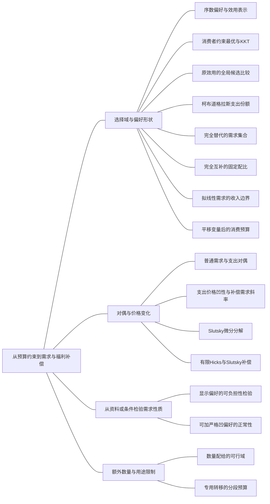

### 本专题知识联系

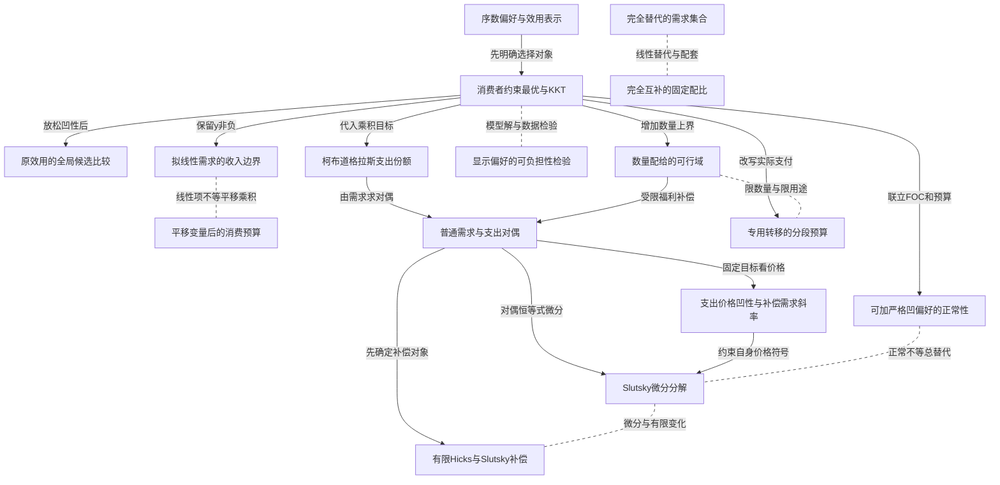

关系图中的箭头表示有方向的联系；虚线表示对照或类比。图中只画本专题主归属节点；跨专题关系在逐条命题中列明，可在练习室逐点追踪。具体成立条件以逐条说明为准。

### KMI001 序数偏好与效用表示

身份：既有资料概括

还用于：风险、信息与跨期：先列状态，再作选择；从个人最优到交换均衡，再到分配实施

**定义与对象**

效用数字表示确定消费束的偏好排序，不直接表示可跨人相加的福利量。

**何时调用**

题目改变效用刻度、询问理性或凸性时，先区分排序与数值。

**适用条件**

讨论确定性选择；彩票排序和社会效用加总需要额外结构。

**核心公式与机制**

严格递增变换保留消费束排序；凸偏好对应拟凹而非任意表示均凹。

**推导与理由**

同一对消费束经严格递增函数后大小关系不变，故同一预算上的最优集合不变。

**边界与易错**

需求相同不说明CE、社会加总或不同效用刻度的目标参数可直接混用。

**整理依据**

- card MC01：序数效用只记录排序
- card MC12：任意两束的排序不变

### KMI002 消费者约束最优与KKT

身份：既有资料概括

还用于：税制改变哪条约束，福利由谁承担；从个人最优到交换均衡，再到分配实施

**定义与对象**

在预算和非负约束共同限制下寻找消费最优，内点切线只是一种候选。

**何时调用**

给效用、预算并要求需求、角点或乘子时使用。

**适用条件**

先核定义域、存在性与预算是否用尽；KKT必要性需约束正规条件。

**核心公式与机制**

正内点通常满足 $MU_x/MU_y=p_x/p_y$；边界需要互补松弛并比较可行候选。

**推导与理由**

固定预算后求内点，再检查非负性和边界；凹目标与凸可行域可保证全局，非凹时另比较。

**边界与易错**

驻点、预算用尽和唯一性不能不经条件检验直接宣布。

**整理依据**

- card FM02：候选代回原约束，再用凹性或逐点效用比较确认最大值。

### KMI003 原效用的全局候选比较

身份：既有资料概括

还用于：税制改变哪条约束，福利由谁承担；风险、信息与跨期：先列状态，再作选择

**定义与对象**

凹性不足或偏好形状特殊时比较所有可行候选；效用非凹本身不等于偏好非凸。

**何时调用**

平方和、负系数min或切点给出反直觉结果时启动。

**适用条件**

保留原效用和原可行域，不预设单调与凸；目标变换不能偷换所报效用。

**核心公式与机制**

预算线上的凸目标可在端点取最大，内部驻点可能是最小。

**推导与理由**

一元化预算目标后检查二阶导与所有端点；原函数值决定全局排序。

**边界与易错**

一个最优点与普通互补偏好相同，不证明整套偏好相同。

**整理依据**

- card FM07：第一类在预算线代入成一元凸的平方和，最大值在端点。

### KMI004 柯布道格拉斯支出份额

身份：既有资料概括

还用于：税制改变哪条约束，福利由谁承担；劳动市场：供给、需求与工资制度；从个人最优到交换均衡，再到分配实施

**定义与对象**

正指数乘积效用使各品支出占收入的比例等于归一化指数。

**何时调用**

效用是正幂乘积或加权对数，要求需求和价格冲击时使用。

**适用条件**

正价格收入、正指数；份额 $s_i=\alpha_i/\sum_j\alpha_j$。

**核心公式与机制**

普通需求 $x_i=s_i m/p_i$；不同效用表示计算原效用时仍应返回题给刻度。

**推导与理由**

对数化求FOC，各式乘数量并加总得到预算乘子与总支出，再恢复各品需求。

**边界与易错**

指数和不为1时不能直接把原指数当份额；普通零交叉效应不意味着补偿零效应。

**整理依据**

- card FM03：总预算归一后得到份额。

### KMI005 完全替代的需求集合

身份：既有资料概括

**定义与对象**

线性效用在预算上比较每元购买的效用，平价时最优通常多值。

**何时调用**

题给线性效用、相对价格跨临界值。

**适用条件**

两品非负、正价格且线性效用系数为正。

**核心公式与机制**

比较 $a/p_x$ 与 $b/p_y$；严格较大者包办，平价时整条预算线均最优。

**推导与理由**

效用是两品支出的线性加权平均，把全部预算投向单位支出收益最高者即可。

**边界与易错**

平价不强制各买一半；切点等式不能选出唯一篮子。

**整理依据**

- card FM04：相等时预算线上全部点均最优。

### KMI006 完全互补的固定配比

身份：既有资料概括

还用于：税制改变哪条约束，福利由谁承担

**定义与对象**

min型效用由较短一边决定，最小支出使两有效数量相等。

**何时调用**

成套消费、固定比例以及CV/EV比较。

**适用条件**

正系数、正价格、非负消费；负系数min不属此模板。

**核心公式与机制**

$u=\min\{ax,by\}$ 时 $ax=by$，支出 $e=\bar u(p_x/a+p_y/b)$。

**推导与理由**

多买不限制效用的一边不提高效用，移去多余支出可买另一边，故最优沿固定比例。

**边界与易错**

普通需求仍随配套价格变化，补偿数量固定不代表普通价格效应为零。

**整理依据**

- card FM04：互补品先把两项相等，再联立预算。

### KMI007 拟线性需求的收入边界

身份：既有资料概括

还用于：税制改变哪条约束，福利由谁承担；从个人最优到交换均衡，再到分配实施

**定义与对象**

计价商品正消费时某品需求可不随收入变，但低收入时该结论可能失效。

**何时调用**

效用含单独线性y、收入不足或转移用途受限。

**适用条件**

计价商品价格归一、凹f，必须保留y非负和x定义域。

**核心公式与机制**

$u=f(x)+y$ 先优化 $f(x)-px$，再把候选截断到 $0\le x\le m/p$。

**推导与理由**

内点边际效用等于p；若它超过可负担量，预算端点y0约束最优。

**边界与易错**

拟线性不等于全域无收入效应；补偿路径也可能碰到y0。

**整理依据**

- card FM05：若内点量太贵，取$y=0$。

### KMI008 平移变量后的消费预算

身份：既有资料概括

还用于：劳动市场：供给、需求与工资制度

**定义与对象**

把有最低消费或坐标平移的效用改写为新变量，同时正确移动预算常数和变量界。

**何时调用**

最低消费、平移乘积、消费门槛。

**适用条件**

先辨认正平移和最低消费的符号；新变量保留原约束产生的下界。

**核心公式与机制**

平移后可使用乘积需求方法，但有效收入须扣最低支出或加禀赋等值，角点另核。

**推导与理由**

用代换把效用简化，同时把原预算和非负域完整代入，再检验新内点是否满足下界。

**边界与易错**

含加号的乘积不自动是拟线性；不能只变效用而不变预算。

**整理依据**

- card FM06：先求乘积内点，再检查$X\ge a$。

### KMI009 普通需求与支出对偶

身份：既有资料概括

还用于：税制改变哪条约束，福利由谁承担；技术到成本，成本到供给，供给到进入；劳动市场：供给、需求与工资制度

**定义与对象**

效用最大化固定收入，支出最小化固定目标效用，两问题通过价值函数互相联系。

**何时调用**

求间接效用、支出、Hicks需求及福利补偿。

**适用条件**

正价格、目标可达且预算有效使用；Roy导数还需收入边际效用非零与相关可微性。

**核心公式与机制**

正规情形 $e(p,v(p,m))=m$，$h(p,v(p,m))=x(p,m)$。

**推导与理由**

把普通需求代回得v，再固定效用反解收入可得e；固定目标重新优化得到最便宜的消费。

**边界与易错**

饱和或收入未用尽时不能无条件写对偶恒等式；目标效用刻度须一致。

**整理依据**

- card FM08：先解需求再代回求$v$
- card MC02：普通需求固定货币收入，希克斯需求固定效用。

### KMI010 支出价格凹性与补偿需求斜率

身份：既有资料概括

还用于：从个人最优到交换均衡，再到分配实施

**定义与对象**

固定效用的最小支出是价格线性函数的下包络，因而对价格凹。

**何时调用**

证明补偿自身效应非正、Shephard或可积性条件。

**适用条件**

可达目标的可行集合不随价格变化；导数与Hessian论证需要相关光滑性。

**核心公式与机制**

Shephard给 $h_i=e_{p_i}$，价格凹性使 $\partial h_i/\partial p_i\le0$。

**推导与理由**

混合价格下同一篮子支出是加权平均，分别最小化得到凹性不等式；对光滑e再求二阶导。

**边界与易错**

不能从固定效用凹性直接断言普通需求必下降，也不能把价格凹性当效用凹性。

**整理依据**

- card MC13：所以支出函数对价格凹。

### KMI011 Slutsky微分分解

身份：既有资料概括

**定义与对象**

普通价格导数等于固定福利的替代导数加实际购买力变化引起的需求变化。

**何时调用**

求自身或交叉价格效应、证明吉芬必要条件。

**适用条件**

相关可微，补偿导数在原间接效用处评价；不跨未核验的角点分支。

**核心公式与机制**

$x_{i,p_j}=h_{i,p_j}-x_jx_{i,m}$；自身补偿效应非正时，吉芬须有 $x_m<0$，使 $-xx_m>0$ 且大到压过负替代效应。

**推导与理由**

对恒等式 $x(p,m)=h(p,v(p,m))$ 或支出补偿关系求全微分，把收入调整项移到一边。

**边界与易错**

劣等不充分保证吉芬；普通交叉导数不必对称，零混合边际效用不等于零交叉需求。

**整理依据**

- card FM09：微分式在$\bar u=v(p,m)$处评价
- card MC02：低档本身不足以构成吉芬。

### KMI012 有限Hicks与Slutsky补偿

身份：既有资料概括

**定义与对象**

有限价格变化可固定旧效用，也可保持旧篮子可负担，两种中间束一般不同。

**何时调用**

价格离散跳变并要求替代/收入效应或补偿金额。

**适用条件**

同一旧束、新价格和实际收入基准；每个中间束需满足对应约束。

**核心公式与机制**

Hicks收入 $m_H=e(p^1,u^0)$，Slutsky收入 $m_S=p^1\cdot x^0$。

**推导与理由**

各求中间束，再以中间减旧束为替代、最终减中间为收入；加总必须等于最终减旧束。

**边界与易错**

有限两种中间束不可混用；微分一阶相同不代表有限金额相同。

**整理依据**

- card FM09：有限Hicks与Slutsky中间点通常不同

### KMI013 显示偏好的可负担性检验

身份：既有资料概括

**定义与对象**

观察到的选择只有结合其他篮子当时是否可负担，才形成显示偏好约束。

**何时调用**

给多期价量而不给效用，或用价格指数推断福利。

**适用条件**

明确WARP/GARP版本、严格不等号与是否允许多值最优；每期预算口径一致。

**核心公式与机制**

先列交叉支出，再连显示不劣关系，检查是否与反向严格可负担关系冲突。

**推导与理由**

选择原篮子且买得起另一篮子才显示不劣；传递闭合进一步检验有限数据可理性化。

**边界与易错**

买得多不直接代表更偏好，单一价格指数不能替代两期选择的可负担性证据。

**整理依据**

- card FM11：购买量多不直接显示更偏好；须看原来能否买到。

### KMI014 可加严格凹偏好的正常性

身份：既有资料概括

**定义与对象**

两商品可加、边际效用正且递减的内点模型，两品对收入均增加。

**何时调用**

给零交叉边际效用并要求正常性、交叉价格性质。

**适用条件**

两商品、可加、严格凹、正价格及同一内点分支，不能仅凭交叉偏导零。

**核心公式与机制**

固定价格对FOC与预算联立微分，两数量随收入同向；预算和为正故两收入导数为正。

**推导与理由**

边际效用相等的价格调整式给两数量增量同号，收入增加的预算约束排除同为负。

**边界与易错**

正常性不决定普通交叉价格效应为正，交叉价格改变还影响收入购买力。

**整理依据**

- card MC14：两二阶导同负，$dx,dy$同号

### KMI129 数量配给的可行域

身份：既有资料概括

**定义与对象**

限购直接限制可选数量，原无约束需求即使买得起也可能被排除。

**何时调用**

购买上限、配给、给定交易量的家庭选择与补偿。

**适用条件**

明确限购商品和上限；预算、效用域与上限必须同时满足。

**核心公式与机制**

在受限区间优化原效用；上界可由目标单调性或约束乘子支持。

**推导与理由**

先求无上限候选，若超上限则在限购边界与其他可行候选比较，恢复福利时也保留同一上限。

**边界与易错**

收入不足角点与数量上限不是同一个约束；给现金不自动解除限购。

**整理依据**

- review MI008：约化目标在此区间严格递增

### KMI130 专用转移的分段预算

身份：既有资料概括

**定义与对象**

只能买指定商品且不能兑现金的补助改变现金支出函数，不必等同可自由支配收入。

**何时调用**

代金券、用途限制、余款自付或不可找零。

**适用条件**

按题意保留面额、可转售性、支付顺序和另有数量限制。

**核心公式与机制**

专用券V支付x时，常见现金约束为 $\max\{p_xx-V,0\}+p_yy\le m$，是否完全用券须回验。

**推导与理由**

券覆盖段和自付段分别优化并比较；现金与券只在现金转移最优束能用足券且不额外受限时可能等价。

**边界与易错**

补助提高效用水平不代表取消原配给的效率损失；不同反事实预算须分别比较。

**整理依据**

- review MI008：因此补贴与消除数量约束不是同一政策。

### 关系命题与条件

#### EMI001 序数偏好与效用表示 → 消费者约束最优与KKT

前置；编者推导

先确定偏好表示和可行消费域，才能建立消费者约束最优问题。

适用条件：确定性消费者问题，效用表示与域已给定。

理由：KKT对某个明确目标和约束求解，不替代偏好和可行性定义。

依据：card MC01「切点条件只适用于光滑内点」

#### EMI002 消费者约束最优与KKT → 原效用的全局候选比较

条件变化；编者推导

若凹性不足，约束驻点不再足以确定最大值，必须比较原效用的全局候选。

适用条件：目标可能非凹但候选与可行域可枚举或一元化。

理由：必要的一阶条件可同时被最小点满足，端点比较才能排除。

依据：card FM02「驻点不等于最大值」

#### EMI003 消费者约束最优与KKT → 柯布道格拉斯支出份额

推导；编者推导

正指数乘积效用的内点最优条件与预算联立，推出归一化指数支出份额。

适用条件：正价格收入、各指数正，内点存在。

理由：对数FOC分别乘数量再求和，预算确定共同乘子。

依据：card FM03「总预算归一后得到份额。」

#### EMI004 完全替代的需求集合 → 完全互补的固定配比

对照；编者推导

完全替代按每元效用选角点或整段，完全互补按固定有效配比选择。

适用条件：两种正系数模型分别成立，非同一偏好下的推导。

理由：线性模型可在品种间替换，min模型多余一边不能弥补另一边不足。

依据：card FM04「替代品先比较“每元效用”而不求切线；互补品先把两项相等，再联立预算。」

#### EMI005 消费者约束最优与KKT → 拟线性需求的收入边界

推导；编者推导

拟线性消费者的约束最优给内点需求或y零边界，因此无收入效应只在有效内点成立。

适用条件：凹f、计价商品非负、收入有限。

理由：一维无约束最优若买不起，KKT的非负约束接管。

依据：card FM05「若内点量太贵，取$y=0$。」

#### EMI006 拟线性需求的收入边界 → 平移变量后的消费预算

对照；编者推导

拟线性加法结构与平移乘积具有不同收入效应，不能因式中出现线性y就互套需求。

适用条件：分别按原效用代数结构识别。

理由：平移乘积的交互作用仍存在，其预算平移会改变两品选择。

依据：card FM06「内点两商品均有收入效应，故不属于拟线性福利相等的捷径。」

#### EMI007 柯布道格拉斯支出份额 → 普通需求与支出对偶

推导；编者推导

CD需求代回原效用得到间接效用，再反解收入可得到同刻度支出函数。

适用条件：CD正参数、目标可达且预算用尽。

理由：普通最优值与最低达标支出是对偶，不是将ln效用数值直接当原效用。

依据：card FM03「把需求代回原效用求$v$，再反解收入得到$e$」

#### EMI008 普通需求与支出对偶 → 支出价格凹性与补偿需求斜率

推导；编者推导

支出最小化的可行集合固定效用后不随价格改变，由此推出价格凹性与补偿自身效应非正。

适用条件：相关最优值与导数存在。

理由：每个固定篮子的支出对价格线性，下包络给凹性，Shephard再连接需求。

依据：card MC13「可微时其Hessian半负定，由Shephard得到$\frac{\partial h_i}{\partial p_i} \le 0$」

#### EMI009 普通需求与支出对偶 → Slutsky微分分解

推导；编者推导

对偶关系在同一基准效用处微分，把普通价格变化拆成补偿变化和收入项。

适用条件：可微且处于同一有效分支。

理由：保持效用的收入调整等于原需求对相应价格的支出变化，移项即得Slutsky式。

依据：card FM09「微分式在$\bar u=v(p,m)$处评价」

#### EMI010 支出价格凹性与补偿需求斜率 → Slutsky微分分解

推导；编者推导

补偿自身效应非正与Slutsky式共同说明，正普通自身价格效应必须由劣等品收入项反向压过。

适用条件：商品数量正、可微且采用自身价格变化。

理由：正常收入效应只会加强涨价后的需求下降，无法把总效应转正。

依据：card MC02「吉芬品是普通自身价格导数为正的低档品，必须有收入效应压过替代效应」

#### EMI011 普通需求与支出对偶 → 有限Hicks与Slutsky补偿

前置；编者推导

有限Hicks补偿须先有固定目标效用的支出问题，Slutsky补偿则先给旧篮子成本。

适用条件：明确旧束、旧效用和新价格。

理由：两种固定对象不同，先定义基准才能计算中间束。

依据：card FM09「有限变化先记旧束$x^0$、旧效用$u^0$、新价格$p^1$」

#### EMI012 Slutsky微分分解 → 有限Hicks与Slutsky补偿

对照；编者推导

Slutsky微分关系描述局部导数，有限两种补偿一般产生不同中间数量。

适用条件：有限变化不可直接用单点导数作精确总变化。

理由：局部一阶补偿相同不保证非线性路径上的支出和效用变化相同。

依据：card FM09「只有微小变化的一阶关系相同。」

#### EMI013 消费者约束最优与KKT → 显示偏好的可负担性检验

对照；编者推导

有已知效用时直接求最优；只有价量资料时用可负担性检验是否能由理性偏好支持。

适用条件：前者需给效用，后者需给各期预算选择。

理由：显示偏好不虚构效用曲面，而用观察选择形成必要一致性限制。

依据：card FM11「给多期价格与消费束，不给效用；判断是否与效用最大化相容。」

#### EMI014 消费者约束最优与KKT → 可加严格凹偏好的正常性

推导；编者推导

可加严格凹的两商品内点FOC与收入预算联立微分，推出两商品收入导数均正。

适用条件：两商品、正边际效用与严格凹且内点。

理由：两数量增量同号，而收入增加的支出加总为正，所以均增加。

依据：card MC14「收入增加时预算和式为正，故二者都增加。」

#### EMI015 可加严格凹偏好的正常性 → Slutsky微分分解

对照；编者推导

可加严格凹保证正常性，但并不单独决定普通交叉价格导数的符号。

适用条件：交叉价格变动需要同时追踪替代与购买力。

理由：零效用交叉偏导和正常品性质都不足替代Slutsky交叉项的实际计算。

依据：card MC14「不能只凭混合偏导$u_{xy}=0$断定普通交叉价格效应等于0。」

#### EMI016 消费者约束最优与KKT → 数量配给的可行域

条件变化；编者推导

消费者问题加入限购后，原需求需再次检验可行性并在上界优化。

适用条件：限购独立于支付能力且确实约束。

理由：买得起的篮子仍可能不被制度允许，非负约束不能代替限购。

依据：review MI008「再把配给上限作为可行域」

#### EMI017 消费者约束最优与KKT → 专用转移的分段预算

条件变化；编者推导

专用券要求按实际现金支付重建分段预算后再作约束最优。

适用条件：券不可兑现金，面额和支付用途明确。

理由：直接把面额加收入会扩大本来不能购买的消费集合。

依据：review MI008「且券不能兑现金，故用足允许购买量最优。」

#### EMI018 数量配给的可行域 → 专用转移的分段预算

对照；编者推导

限购限制数量，专用转移限制补助用途，二者可并存且不能彼此替代。

适用条件：家庭同时面对限购和用途约束时。

理由：券支付购买费用并不授权购买超过上限的商品。

依据：review MI008「因此补贴与消除数量约束不是同一政策。」

#### EMI019 数量配给的可行域 → 普通需求与支出对偶

条件变化；编者推导

数量上限下恢复给定福利，应在同一限购可行集上求最低支出。

适用条件：目标福利在限购下可达，价格与上限保持题给条件。

理由：原无上限Hicks束若违反限购，不是这个补偿问题的可行解。

依据：case CMI01「这补偿的是新价格下的配给损失」

#### EMI024 拟线性需求的收入边界 → 税收收入的税基极值

前置；编者推导

拟线性税基须先经过计价商品非负约束，才能在各有效分支最大化税收。

适用条件：家庭收入可能不足，商品价格含税。

理由：无约束需求超过预算时，收入极值的公式与区间均改变。

依据：card FM27「低收入时$x_t$还受$\frac{m}{p + t}$截断」

#### EMI025 普通需求与支出对偶 → CV与EV的福利基准

前置；编者推导

CV与EV计算依赖以指定旧或新效用为目标的支出最小化。

适用条件：支出目标可达、效用刻度一致。

理由：补偿需要反事实价格下的最低支出而非原普通支出。

依据：card FM10「再用旧效用新价格算CV、新效用旧价格算EV」

#### EMI027 拟线性需求的收入边界 → 消费者剩余与福利面积

推导；编者推导

拟线性且所有相关补偿保持计价商品正消费时，普通需求面积可等于精确货币补偿。

适用条件：不只初末内点，两个支出补偿路径也须内点。

理由：计价商品边际效用恒定且需求在该域无收入效应，普通与补偿需求沿相关路径一致。

依据：card MC02「拟线性相等结论要求相关补偿路径也不触及计价商品为零」

#### EMI033 消费者约束最优与KKT → 超额部分税的连续预算折点

条件变化；编者推导

消费者约束最优在超额税下须加入连续预算折点，不能只解一条税段FOC。

适用条件：个体出售量和税款按超额制度定义。

理由：候选只在所属税段有效，门槛可由左右边际激励共同支持。

依据：card FM43「当$t\ge1$，卖方停在$z=1$折点」

#### EMI034 原效用的全局候选比较 → 全量门槛税的跳跃与存在性

前置；编者推导

全量门槛税下须先比较个人各分支原效用，再检验其最优需求是否出清。

适用条件：预算有跳跃，允许确定配置而未另作平滑或随机制度。

理由：个人非全局最优的出清根不构成竞争均衡。

依据：card FM44「先求每段候选及端点，再比较同一效用，最后出清。」

#### EMI042 序数偏好与效用表示 → VNM效用的正仿射变换

对照；编者推导

确定性需求允许严格递增变换，全部彩票EU排序只由正仿射变换保持。

适用条件：以同一最终财富分布评价风险选择。

理由：非线性变换不能移出期望，逐状态排序保留不等于加权和排序保留。

依据：card MC12「风险彩票中还须保持期望效用结构，只有正仿射变换保留全部彩票排序。」

#### EMI076 普通需求与支出对偶 → 成本的Shephard与价格性质

方法类比；编者类比

消费者支出最小化与企业固定产量成本最小化都取达到目标的最低费用，价格导数分别恢复补偿消费和条件投入。

适用条件：分别保留目标效用与目标产量且可微，二者对象不同并非彼此逻辑推出。

理由：都是固定技术或偏好可行集合上线性价格费用的下包络，因此同有齐次凹性和包络导数结构。

依据：card FM24「**题干触发。**给利润函数求供给或要素需求；技术改变、价格改变对利润的影响。  $$ \Pi(p,w)=\max_{q,z}\{pq-w\cdot z:(q,z)\text{技术可行}\}, $$ $$ \begin{gathered} \Pi_p=q^*, \\ \Pi_{w_i}=-z_i^*, \\ z_i^c(w,q)=C_{w_i}(w,q). \end{gathered} $$ 上式最后一项对成本函数求导时固定产量$q$，不把产品价格放入成本约束；前两项的最优产量与投入则可随价格变化。  **步骤。**先辨认最优值固定的外生参数，再对原目标中的参数直接求偏导、代入最优选择。利润函数对所有价格一次齐次且凸；成本对投入价格一次齐次且凹。投入价格上升不会使最优利润增加，因为原选择仍提供一个比较基准。  **边界检查。**最优选择跳跃时，普通导数可能不存在，使用单侧或集合版本。短期已固定投入价格上涨可直接降低会计利润，但是否改变可调投入要看技术与决策可行集；不能把条件需求的导数直接当全调整劳动需求。  **原书与题源。**平新乔第7讲利润函数与供给部分；尼科尔森第11章第14题PDF184含技术变化与利润函数；范里安第20章第1、7题PDF55—56。2009计算5题PDF88询问要素涨价对利润，适用包络判断。」；card FM09「**题干触发。**收入效应、替代效应、补偿价格弹性、Hicks/Slutsky补偿金额。  $$ \begin{gathered} x_{i , p_j} = h_{i , p_j} - x_j x_{i , m} , \\ \varepsilon^M_{i i} = \varepsilon^H_{i i} - s_i \eta_i , \\ s_i = \frac{p_i x_i}{m} . \end{gathered} $$  **变量与前提。**微分式在$\bar u=v(p,m)$处评价，要求相关可微性。有限变化先记旧束$x^0$、旧效用$u^0$、新价格$p^1$；Hicks补偿收入$m_H=e(p^1,u^0)$，Slutsky补偿收入$m_S=p^1\cdot x^0$。  **步骤。**各自求中间束$x^H=h(p^1,u^0)$或$x^S=x(p^1,m_S)$。统一拆成“中间减旧束”和“新束减中间”，两项相加必须等于总效应。若预算用尽，$\sum_i s_i\eta_i=1$；同一需求各价格弹性加收入弹性等于0。  **边界检查。**有限Hicks与Slutsky中间点通常不同，只有微小变化的一阶关系相同。完全互补的补偿自身弹性为0，普通弹性仍可非零；角点和偏好折点不允许直接套某段导数到全区间。  **原书与题源。**平新乔第3讲PDF36页起；T-PING-03-04（PDF58）、范里安第8章PDF27—29；2022第四题PDF23、2017第五题PDF48。例$\sqrt{xy},m=100,p_x:1\to2,p_y=1$，Slutsky中间$x=37.5$，Hicks中间$x = \frac{50}{\sqrt{2}}$，不能混写。」

#### EMI122 普通需求与支出对偶 → 工资变化的补偿劳动分解

方法类比；编者类比

劳动补偿和商品Hicks选择都按新价格最低支出保持旧效用。

适用条件：把闲暇作为消费对象且保留时间边界。

理由：共同支出最小化方法可复用，实际财富来自时间禀赋需另计。

依据：review MI063「工资既是闲暇价格又重估时间禀赋，先求普通选择，再以旧效用约束计算新工资补偿消费，分解两效应。」；review MI063「劳动者预算为 $c+wl=16w$。最大化 $\ln c+\ln l$ 的FOC给 $c=wl$，所以闲暇8、劳动8，消费为8w。工资2时消费16，工资4时消费32；普通劳动总变化为0。旧效用为 $\ln16+\ln8=\ln128$。」；review MI063「新工资4下，达到旧效用等价于 $cl\ge128$，最小全支出为 $\min(c+4l)$。最优必满足 $c=\frac{128}{l}$，目标导数为 $-\frac{128}{l^2}+4=0$，得  $$l^h=4\sqrt2,\qquad c^h=16\sqrt2,\qquad e^h=32\sqrt2.$$  预算严格凸的约化成本给唯一最小值。新全收入64中可抽取总付税 $64-32\sqrt2$，使消费者恰停在旧效用。」；review MI063「补偿劳动为 $h^h=16-4\sqrt2>8$。以“补偿点减原点”为替代效应，劳动增加 $8-4\sqrt2$；以“新实际点减补偿点”为收入效应，劳动减少同一数量，两者相加为0。工资作为闲暇价格诱导少休闲、多工作；作为时间禀赋的价格又提高财富，诱导多休闲。总变化为0并不代表任何一项单独为0。」

#### EMI151 拟线性需求的收入边界 → 禀赋交换的竞争预算

条件变化；编者推导

拟线性内点需求用于交换也须核计价物非负，资源耗尽时改角点。

适用条件：以禀赋估值且总计价物可能为零。

理由：消费预算和资源共同限制购买，普通内点未必可实施。

依据：review MI073「拟线性内点需求不能在计价商品资源耗尽时直接使用。」

### 对应题目分问路径

#### MI001

由CD预算份额计算价量，再以旧效用构造收入补偿。

**第1问**

本问任务：求收入90、原价格(3,2)及x价格降为1后两套普通需求与效用。

本问两套正价格和收入90允许CD正内点，由预算份额求普通需求并代回原乘积效用。

调用：KMI002 消费者约束最优与KKT；KMI004 柯布道格拉斯支出份额

联系：EMI003

**第2问**

本问任务：在新价格(1,2)下，以旧效用为基准求收入补偿，并说明x降价的替代效应和收入效应方向。

本问新价下固定旧效用与最终收入，先求Hicks中间束，再分解有限替代和收入变化。

调用：KMI009 普通需求与支出对偶；KMI012 有限Hicks与Slutsky补偿

联系：EMI011

#### MI002

拟线性内点须通过收入与非负y条件。

**第1问**

本问任务：推导给定收入与价格下的完整需求，检查非负消费边界。

本问先解8lnx的无约束量，再核m能否支付，从而列y正内点与y零边界。

调用：KMI002 消费者约束最优与KKT；KMI007 拟线性需求的收入边界

联系：EMI005

**第2问**

本问任务：固定收入6，将x价格从2降至1，比较需求与效用；评价“拟线性必无收入效应”。

收入6使原候选可能超预算，p由2到1的比较必须使用正确分支，不能直接套零收入效应。

调用：KMI002 消费者约束最优与KKT；KMI007 拟线性需求的收入边界

联系：EMI005

#### MI003

固定配套比求两次效用，再分别固定旧、新福利计算支出。

**第1问**

本问任务：价格由(2,2)降为(1,2)，分别求需求与效用并给支出函数。

min{x,2y}先沿x等于2y联立每套预算，同时得到固定目标效用的支出表达。

调用：KMI006 完全互补的固定配比；KMI009 普通需求与支出对偶

联系：本问直接应用完全互补的固定配比、普通需求与支出对偶，所列任务没有另要求由一个独立结论推出另一个结论，不强加逻辑推出边。

**第2问**

本问任务：按题给两个定义计算CV、EV并解释差别。

CV用新价和旧效用，EV用旧价和新效用，本问直接调用同一支出对偶而不额外推断另一模型。

调用：KMI009 普通需求与支出对偶；KMI019 CV与EV的福利基准

联系：EMI025

#### MI004

线性效用按每元效用比较并保留多值。

**第1问**

本问任务：求x价格为正时的最优需求集合，并分别代入x价格2、3、4（y价格均为2）。

比较3/px与2/py，在px为2、3、4分别核角点或整段需求。

调用：KMI005 完全替代的需求集合

联系：本问直接应用完全替代的需求集合，所列任务没有另要求由一个独立结论推出另一个结论，不强加逻辑推出边。

**第2问**

本问任务：解释为何本题不能只靠切点方程。

本问评价切点适用范围：线性目标缺少严格内点唯一性，等斜率只能给整段。

调用：KMI002 消费者约束最优与KKT；KMI005 完全替代的需求集合

联系：本问直接应用消费者约束最优与KKT、完全替代的需求集合，所列任务没有另要求由一个独立结论推出另一个结论，不强加逻辑推出边。

#### MI005

原函数一元化后全局比较，再评价偏好与切点。

**第1问**

本问任务：求内部驻点与各端点效用，确定全局最优。

x²加2y²代预算后需比较驻点和端点原效用，不能把驻点直接当全局最大。

调用：KMI002 消费者约束最优与KKT；KMI003 原效用的全局候选比较

联系：EMI002

**第2问**

本问任务：检验偏好凸性并评价通常消费者切点法的适用性。

本问要求判凸偏好和切点适用性，区分效用表示、凹性充分条件与实际端点最优。

调用：KMI001 序数偏好与效用表示；KMI002 消费者约束最优与KKT；KMI003 原效用的全局候选比较

联系：EMI001、EMI002

#### MI006

正常性用联立微分证明，交叉价格另核。

**第1问**

本问任务：说明交叉边际效用的含义，并证明两商品正常。

可加f与g的严格凹内点使收入微分两数量同号，预算收入增加迫使二者为正。

调用：KMI002 消费者约束最优与KKT；KMI014 可加严格凹偏好的正常性

联系：EMI014

**第2问**

本问任务：推导交叉价格导数，判断总替代命题并给反例。

本问改变另一商品价格，正常性并不决定总替代，须联立或按Slutsky交叉项计算并给反例。

调用：KMI011 Slutsky微分分解；KMI014 可加严格凹偏好的正常性

联系：EMI015

#### MI007

扣最低消费支出后求需求，涨价时固定原福利。

**第1问**

本问任务：推导可负担条件、需求和间接效用，计算原情形。

先设超最低消费变量，收入须扣2px加py，再按半数份额恢复原商品需求和效用。

调用：KMI004 柯布道格拉斯支出份额；KMI008 平移变量后的消费预算

联系：本问直接应用柯布道格拉斯支出份额、平移变量后的消费预算，所列任务没有另要求由一个独立结论推出另一个结论，不强加逻辑推出边。

**第2问**

本问任务：只将x价格由2提高为3，求维持原效用所需收入增加，并核最低消费可负担性。

x价提高到3后重算最低支出和固定原效用的最小支出，差额才是所需现金补偿。

调用：KMI008 平移变量后的消费预算；KMI009 普通需求与支出对偶

联系：本问直接应用平移变量后的消费预算、普通需求与支出对偶，所列任务没有另要求由一个独立结论推出另一个结论，不强加逻辑推出边。

#### MI008

数量上限和用途受限补助分别改变预算可行域。

**第1问**

本问任务：比较无配给与限购 $x\le2$ 时的最优、效用和货币损失。

拟线性二次效用先求无上限量，再把x最多2纳入约束，效用差以y为单位解释。

调用：KMI002 消费者约束最优与KKT；KMI129 数量配给的可行域

联系：EMI016

**第2问**

本问任务：仍限购 $x\le2$，加入只能买x、面额8的代金券后求最终选择，判断是否消除损失。

专用券8不能无条件当现金；本问在x上限与券支付规则下重新核可行选择和福利。

调用：KMI002 消费者约束最优与KKT；KMI129 数量配给的可行域；KMI130 专用转移的分段预算

联系：EMI016、EMI017、EMI018

#### MI009

由交叉支出检验选择一致性并限定价格指数信息。

**第1问**

本问任务：列两篮子在两套价格下的支出并检验WARP。

两篮子必须放入两套价格分别算支出，只有另一篮子可负担时才能形成WARP约束。

调用：KMI013 显示偏好的可负担性检验

联系：本问直接应用显示偏好的可负担性检验，所列任务没有另要求由一个独立结论推出另一个结论，不强加逻辑推出边。

**第2问**

本问任务：计算价格指数，说明它能否单独认定福利改善。

本问把旧、新篮子成本组成价格指数，但福利判断仍取决于选择与可负担性，不能由指数单独宣布。

调用：KMI013 显示偏好的可负担性检验

联系：本问直接应用显示偏好的可负担性检验，所列任务没有另要求由一个独立结论推出另一个结论，不强加逻辑推出边。

#### MI010

从对偶微分建立Slutsky，再核具体数值。

**第1问**

本问任务：推导自身价格Slutsky方程并证明吉芬品的必要条件。

先固定原间接效用微分对偶关系，结合补偿自身效应非正，证明正普通价格效应需劣等性。

调用：KMI009 普通需求与支出对偶；KMI010 支出价格凹性与补偿需求斜率；KMI011 Slutsky微分分解

联系：EMI008、EMI009、EMI010

**第2问**

本问任务：在指定效用、价格和收入下分别计算三项价格分解并核加总。

平方根乘积偏好给显式普通需求，再计算自身价格导数、收入项和补偿项核相加。

调用：KMI004 柯布道格拉斯支出份额；KMI011 Slutsky微分分解

联系：本问直接应用柯布道格拉斯支出份额、Slutsky微分分解，所列任务没有另要求由一个独立结论推出另一个结论，不强加逻辑推出边。

#### CMI01

同一家庭把普通价格变化、两类补偿和限购福利连为一条路径。

**第1问**

本问任务：求初始普通需求与效用，说明最优性与预算是否用尽。

收入24、正价格和平方根乘积允许正内点，先从FOC得到一般份额再算基准。

调用：KMI002 消费者约束最优与KKT；KMI004 柯布道格拉斯支出份额

联系：EMI003

**第2问**

本问任务：仅把x价格提高到2，收入不变。求需求、效用和两种商品的支出；比较价格变化前后购买量。

价格x升为2但收入不变，本问直接用普通份额需求计算数量、原刻度效用与支出。

调用：KMI004 柯布道格拉斯支出份额

联系：本问直接应用柯布道格拉斯支出份额，所列任务没有另要求由一个独立结论推出另一个结论，不强加逻辑推出边。

**第3问**

本问任务：在新价格下，要把家庭效用补偿到初始水平，最少需增加多少收入？给出补偿后的两种购买量，并按Hicks口径分解x购买量变化。

本问固定初始效用而非旧篮子成本，Hicks支出与中间束确定后再作两项分解。

调用：KMI009 普通需求与支出对偶；KMI012 有限Hicks与Slutsky补偿

联系：EMI011

**第4问**

本问任务：仍在新价格下，改以恰好买得起初始篮子为补偿标准。求所需收入、最优篮子，并按这一标准分解x的价格效应。解释它与上一问的区别。

改为旧篮子在新价格可负担的收入，本问直接比较该中间束与Hicks固定福利的差别。

调用：KMI012 有限Hicks与Slutsky补偿

联系：本问直接应用有限Hicks与Slutsky补偿，所列任务没有另要求由一个独立结论推出另一个结论，不强加逻辑推出边。

**第5问**

本问任务：恢复收入24及新价格 $(2,1)$，再规定x最多购买5单位。求受限最优与效用。若只允许增加现金，最少加多少才能在该上限下达到本题第二问的无上限效用？

收入恢复24、新价与x上限5并存，先受限最优，再对第二问福利目标求有上限最低支出。

调用：KMI002 消费者约束最优与KKT；KMI009 普通需求与支出对偶；KMI129 数量配给的可行域

联系：EMI016、EMI019

#### CMI02

收入边界与专用券让拟线性局部结论接受约束检验。

**第1问**

本问任务：推导任意正收入和价格下的普通需求，说明内点与边界条件。

一般m和p下先核y非负，再给6lnx内点与低收入角点需求。

调用：KMI002 消费者约束最优与KKT；KMI007 拟线性需求的收入边界

联系：EMI005

**第2问**

本问任务：保持收入8，x价格由1提高到2。求两次选择和效用差，说明x需求的收入性质在这两点是否适用。

收入8、p由1升2均在同一内点，直接计算普通选择与效用差，不把它外推全收入。

调用：KMI007 拟线性需求的收入边界

联系：本问直接应用拟线性需求的收入边界，所列任务没有另要求由一个独立结论推出另一个结论，不强加逻辑推出边。

**第3问**

本问任务：保留x价格2，将收入降低为4，不给补助。求新的最优与两商品收入边际效应，评价“x在这个模型中对收入始终不敏感”的说法。

收入降4、p仍2使无约束x买不起，必须以y0边界重求并解释局部收入导数。

调用：KMI002 消费者约束最优与KKT；KMI007 拟线性需求的收入边界

联系：EMI005

**第4问**

本问任务：只针对第二问的价格上涨，恢复收入基准8作为比较起点：在价格2时最少补多少现金可达到价格1时的基准效用？求补偿篮子并核非负条件。

恢复收入8比较涨价，在固定旧福利的支出问题中检验补偿y是否仍正。

调用：KMI007 拟线性需求的收入边界；KMI009 普通需求与支出对偶；KMI019 CV与EV的福利基准

联系：EMI025

**第5问**

本问任务：回到第三问 $m=4,p=2$ 的低收入情形。政府给面额4、只能购买x且不可出售找零的券，家庭最多用完面额，余款自付。求最终最优，与直接发现金4比较，并说明本题结果能否推广为所有专用券与现金等价。

重新回到收入4的家庭，券4构成分段现金支出，枚举券覆盖与自付段而非直接增加一般收入。

调用：KMI002 消费者约束最优与KKT；KMI130 专用转移的分段预算

联系：EMI017

## 税制改变哪条约束，福利由谁承担

税款、价格限制和配额究竟改变边际交易、财政转移还是实际资源？

先求真实需求与税基，再固定明确的福利口径；连续与跳跃制度、价格与数量限制分别检验全局选择和财政归属。

### 分支导图

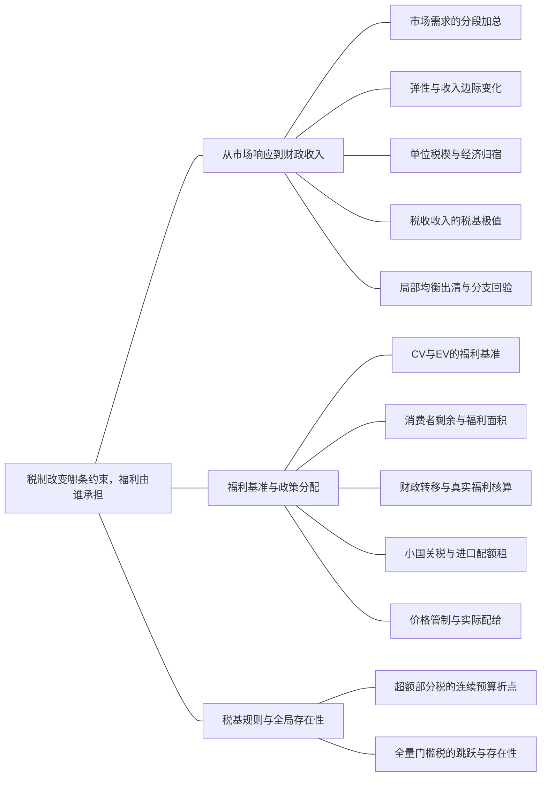

### 本专题知识联系

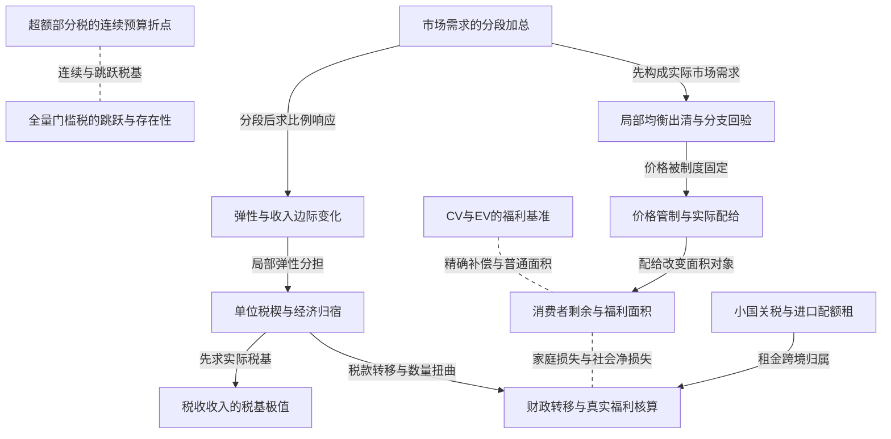

关系图中的箭头表示有方向的联系；虚线表示对照或类比。图中只画本专题主归属节点；跨专题关系在逐条命题中列明，可在练习室逐点追踪。具体成立条件以逐条说明为准。

### KMI015 市场需求的分段加总

身份：既有资料概括

还用于：从垄断、串联垄断到古诺与 n 厂商；私人信息到机制：谁知道什么，谁选择什么

**定义与对象**

相同价格下加总各主体的实际非负需求，退出群体改变总需求斜率。

**何时调用**

多个群体、保留价、统一销售或市场出清。

**适用条件**

各主体需求在同一商品和价格口径下；截断与可行域先于相加。

**核心公式与机制**

$D(p)=\sum_i\max\{a_i-b_ip,0\}$，每一保留价区间独立出清。

**推导与理由**

按退出价格排序，每段只加仍活跃的购买者，候选价格回验所属区间。

**边界与易错**

不能把负需求继续相加，也不能用一段导数穿过退出折点。

**整理依据**

- card FM01：先按$\frac{a_i}{b_i}$排序找各群体退出价

### KMI016 弹性与收入边际变化

身份：既有资料概括

还用于：从垄断、串联垄断到古诺与 n 厂商；博弈模型：策略、时序、信息与执行

**定义与对象**

弹性是数量的比例变动对价格或收入比例变动的局部响应，不等于直线斜率。

**何时调用**

税负分担、收益变化、正常品或市场加成。

**适用条件**

在正价正量且可微的评价点定义；带符号与绝对值记号区分。

**核心公式与机制**

$\varepsilon_p=Q_p p/Q$，$[pQ(p)]_p=Q(1+\varepsilon_p)$。

**推导与理由**

用需求导数乘价格数量比，收益求导的两项分别是单位收入提高与销售量变化。

**边界与易错**

需求直线斜率恒定而弹性通常变化，Q0处比例指标可能无定义。

**整理依据**

- card FM01：直线斜率恒定不表示弹性恒定

### KMI017 单位税楔与经济归宿

身份：既有资料概括

还用于：从垄断、串联垄断到古诺与 n 厂商；博弈模型：策略、时序、信息与执行；劳动市场：供给、需求与工资制度；从个人最优到交换均衡，再到分配实施；生产效率、外部性与公共品的统一比较

**定义与对象**

单位税使购买者总支付与生产者净收之间出现差额，出清和行为响应决定承担比例。

**何时调用**

从量税、工资税、税收转嫁与法律缴税者比较。

**适用条件**

先明确市场结构和两侧响应；局部弹性公式只用于其可微稳定竞争情形。

**核心公式与机制**

$p_c-p_s=t$，$D(p_c)=S(p_s)$；法定缴纳人不单独决定经济归宿。

**推导与理由**

税楔与同一交易量联立求两价；比较各价相对无税基准的变化。

**边界与易错**

垄断或买方势力须重求最佳反应，不能照搬竞争弹性分担公式。

**整理依据**

- card FM27：先设价格楔子，再出清。
- card MC05：最终税负由供求反应决定，不由法律规定谁缴款决定。

### KMI018 税收收入的税基极值

身份：既有资料概括

还用于：从预算约束到需求与福利补偿

**定义与对象**

收入为单位税乘实际交易量，最大税率必须同时计税基收缩和禁绝边界。

**何时调用**

问最优税率、收入最大化或不同需求分支。

**适用条件**

先求实际含税需求；收入不足和市场结构改变税基，禁绝后的需求应截为0。

**核心公式与机制**

$R(t)=tQ(t)$，内点导数 $R'=Q+tQ'$；端点及折点仍需比较。

**推导与理由**

每一有效需求分支单独求收入候选，再回验区间与停购点，最后比较全局收入。

**边界与易错**

财政最大化不是福利最大化；不可把内点二次收入式延伸到负交易量。

**整理依据**

- card FM27：税收最大$t = \frac{A}{2}$。

### KMI019 CV与EV的福利基准

身份：既有资料概括

还用于：从预算约束到需求与福利补偿

**定义与对象**

CV固定旧效用在新价计支出，EV固定新效用在旧价计支出，两者是不同精确货币指标。

**何时调用**

价格涨跌补偿、从收入中能抽走多少或需加多少钱。

**适用条件**

明确涨跌方向、正负号、目标效用刻度及各支出分支。

**核心公式与机制**

降价获益正记时 $CV=m-e(p^1,u^0)$，$EV=e(p^0,u^1)-m$。

**推导与理由**

先求初末效用，再分别固定它们求支出；不能只对名义支出差加减。

**边界与易错**

涨价损失需改符号；补偿目标可能触及y0，即使初末普通需求都内点。

**整理依据**

- card FM10：分别解初末消费与效用，再用旧效用新价格算CV、新效用旧价格算EV

### KMI020 消费者剩余与福利面积

身份：既有资料概括

还用于：从预算约束到需求与福利补偿；从垄断、串联垄断到古诺与 n 厂商

**定义与对象**

普通需求下积分衡量消费者剩余变化，是否等于精确补偿取决于收入效应与补偿路径。

**何时调用**

连续价格变化、非线性需求、梯形近似、福利损失。

**适用条件**

商品价值可按所给局部货币口径解释；拟线性精确性需相关补偿路径不碰约束。

**核心公式与机制**

$\Delta CS=\int_{p^1}^{p^0}x(p,m)\,dp$；非线性需求不能无故用端点梯形替代。

**推导与理由**

面积加总每一小段支付意愿，若存在收入效应，固定收入曲线和固定福利曲线不再相同。

**边界与易错**

普通面积通常只是货币福利近似；CS损失不等于含财政的社会净损失。

**整理依据**

- card MC02：消费者剩余是普通需求下的面积，通常是货币福利近似

### KMI021 财政转移与真实福利核算

身份：既有资料概括

还用于：技术到成本，成本到供给，供给到进入；从垄断、串联垄断到古诺与 n 厂商；博弈模型：策略、时序、信息与执行；劳动市场：供给、需求与工资制度；从个人最优到交换均衡，再到分配实施；生产效率、外部性与公共品的统一比较；私人信息到机制：谁知道什么，谁选择什么

**定义与对象**

税款和入场费在主体间转移，社会资源成本与某个家庭的效用损失是不同对象。

**何时调用**

计算DWL、返还、总付税、补贴或比较私人利润与社会福利。

**适用条件**

写清谁的福利、计价单位、财政收入是否纳入以及真实资源用途。

**核心公式与机制**

在适用的局部货币口径下比较CS、PS和政府净收入；资源耗费另扣，转移不重复扣。

**推导与理由**

同一支付降低付款人财富并增加收款人财富，合并时抵消；行为扭曲改变交易才造成额外损失。

**边界与易错**

效用加总、一般均衡帕累托比较和局部CS不自动等价；个体给定返还与按自身行为返还不同。

**整理依据**

- card MC20：税款增加不是新增真实资源
- card MC20：一次性返还影响分配而未必改边际决策

### KMI022 小国关税与进口配额租

身份：既有资料概括

还用于：生产效率、外部性与公共品的统一比较

**定义与对象**

关税固定进口价格楔，配额固定进口量，许可稀缺产生租，其归属影响本国福利。

**何时调用**

贸易政策、许可证给国内或国外、世界价变化。

**适用条件**

小国外生世界价、竞争且仍有正进口时用进口平价；禁绝后另验分支。

**核心公式与机制**

同一初始国内价可产生相同量价但不同财政/租归属，外部价变化后关税和固定配额可不再等价。

**推导与理由**

关税用世界价加税求需求供给；配额用净进口需求等于上限求国内价，再算价差乘进口量。

**边界与易错**

配额免费不等租金为零；租流国外不应加进本国剩余。

**整理依据**

- case CMI04：给外国出口商时租流出

### KMI023 价格管制与实际配给

身份：既有资料概括

**定义与对象**

有约束的价格上限可形成供需缺口，实际交易给谁决定剩余而非继续按出清求价格。

**何时调用**

最高价、短缺、随机或高愿付优先分配。

**适用条件**

先判管制是否约束；成交量和配给规则按题意，搜寻等真实成本另列。

**核心公式与机制**

有效配给按最高愿付者成交；随机配给只有给出分配概率或机制后才能确定平均福利。

**推导与理由**

固定上限分别计算供求，交易量不超过短边，再用实际被服务者的价值计算消费者剩余。

**边界与易错**

短缺数量可确定不等于消费者剩余可确定，随机配置不能无条件按有效面积算。

**整理依据**

- card FM27：先算短缺而非强行继续令需求等于供给

### KMI024 超额部分税的连续预算折点

身份：既有资料概括

还用于：从预算约束到需求与福利补偿；技术到成本，成本到供给，供给到进入；从个人最优到交换均衡，再到分配实施

**定义与对象**

只对超过门槛的交易部分征税，税额连续但边际税率在门槛变化。

**何时调用**

卖出超过一定量才对超出部分缴税、分段预算。

**适用条件**

准确写净交易与门槛；政府吸收或返还需进入资源与预算闭合。

**核心公式与机制**

$T(z)=t\max\{z-z_0,0\}$；税段候选与免税折点均须比较。

**推导与理由**

每段分别代回真实预算，保留所属区间并比较端点，连续折点可在一段FOC不成立时最优。

**边界与易错**

连续预算不等于全域可微；不能把税基误写为全部交易量。

**整理依据**

- card FM43：该预算连续但有折点，不等于M44的跳跃预算。
- card MC18：超额税$t\max(z-z_0,0)$在门槛连续

### KMI025 全量门槛税的跳跃与存在性

身份：既有资料概括

还用于：从预算约束到需求与福利补偿；技术到成本，成本到供给，供给到进入；从个人最优到交换均衡，再到分配实施

**定义与对象**

跨门槛后全部交易缴税，会让预算或目标跳跃，局部FOC可能不能支持任何出清最优。

**何时调用**

一旦超过门槛全部缴税、需求跳变或均衡不存在。

**适用条件**

门槛等号是否免税、个人非负消费及确定配置制度必须明确。

**核心公式与机制**

$T(z)=tz\mathbf1\{z>z_0\}$；比较免税端点与税段最优后再检验市场出清。

**推导与理由**

出清根可能给每个人想退回门槛的束，而门槛出清价又诱使跨入税段，形成无确定均衡区间。

**边界与易错**

不能只改连续税的常数项便宣称均衡相同，也不能以随机凸化替代原确定制度。

**整理依据**

- card FM44：不能靠税段一阶条件保证最优。
- card MC18：后者可造成需求跳跃和确定均衡不存在。

### KMI132 局部均衡出清与分支回验

身份：既有资料概括

还用于：技术到成本，成本到供给，供给到进入；劳动市场：供给、需求与工资制度

**定义与对象**

把市场需求与供给在同一价格、同一制度下联立，候选必须满足采用的活跃集合与数量界。

**何时调用**

单一市场竞争均衡、供需冲击、固定企业数与价格管制基准。

**适用条件**

个体行为已写清，市场制度决定价格是否可调整；外生世界价时不能另强制国内供需相等。

**核心公式与机制**

自由局部市场通常 $D(p)=S(p)$；管制约束价下分别算供求而不强制相等。

**推导与理由**

价格变化调节两侧愿交易量，只有一致的量价和所处分支才是均衡。

**边界与易错**

出清是市场一致性条件，不是任意主体的FOC；管制、税楔和贸易都需先改相应关系。

**整理依据**

- card FM01：与供给求交并回验区间。

### 关系命题与条件

#### EMI021 市场需求的分段加总 → 弹性与收入边际变化

推导；编者推导

市场需求在有效分段内确定后，可由该段导数计算评价点弹性。

适用条件：评价点价量正且不在退出折点。

理由：先截断加总避免负需求进入Q与导数分母。

依据：card FM01「再在所求均衡计算导数和弹性。」

#### EMI022 弹性与收入边际变化 → 单位税楔与经济归宿

推导；编者推导

稳定竞争均衡附近的供需弹性共同决定单位税两价的局部变化。

适用条件：可微、供给弹性正、需求带符号弹性负，非垄断通式。

理由：税楔和交易量相等两式微分，把数量响应联立后得到两价承担比例。

依据：card FM27「可微稳定局部均衡中」

#### EMI023 单位税楔与经济归宿 → 税收收入的税基极值

前置；编者推导

税楔改变成交量，求税收最大化前必须先得到一致的含税交易量。

适用条件：题目以单位税乘实际成交量计财政收入。

理由：固定原数量求收入会漏掉税率改变税基的反馈。

依据：card FM27「先设价格楔子，再出清。」

#### EMI026 CV与EV的福利基准 → 消费者剩余与福利面积

对照；编者推导

CV、EV固定福利基准，消费者剩余积分固定名义收入，三者一般不能互代。

适用条件：存在收入效应或补偿路径约束时尤须区分。

理由：所积分需求曲线固定对象不同，通常产生不同货币数值。

依据：card MC02「CV、EV用支出函数衡量保持旧效用或达到新效用的精确补偿。」

#### EMI028 单位税楔与经济归宿 → 财政转移与真实福利核算

机制；编者推导

单位税既产生政府收入转移，也经成交量改变产生真实配置变化，两者分别核算。

适用条件：明确税收归属并采用一致货币福利口径。

理由：税款不是被销毁的资源，损失在被排除或错误增加的交易净收益。

依据：card MC05「税收是主体间购买力转移」

#### EMI029 消费者剩余与福利面积 → 财政转移与真实福利核算

对照；编者推导

消费者剩余损失包含对其他主体的支付变化，不必等于社会DWL。

适用条件：政府、企业及其他群体是否合并须明示。

理由：加回合并主体所得转移后才剩真实交易或资源损失。

依据：card MC05「居民效用与包含财政收入的社会总剩余不能混为同一指标。」

#### EMI030 小国关税与进口配额租 → 财政转移与真实福利核算

机制；编者推导

同样的进口量价在租归本国与流国外时可有不同本国福利。

适用条件：本国而非世界福利，许可租确由指定主体获得。

理由：国内转移可加回，外国所得不属于本国收入。

依据：case CMI04「给外国出口商时租流出」

#### EMI031 价格管制与实际配给 → 消费者剩余与福利面积

条件变化；编者推导

价格上限下CS必须用实际获配者价值计算，随机分配不能直接套有效需求面积。

适用条件：交易量按短边而消费者分配另有规则。

理由：愿付最高者优先时需求曲线截取最高估值，随机时被服务群体不同。

依据：card FM27「实际分配和搜寻成本须按题意补充。」

#### EMI032 超额部分税的连续预算折点 → 全量门槛税的跳跃与存在性

对照；编者推导

只对超额部分计税与跨门槛全量计税具有不同预算连续性，局部税段条件相似不保证全局选择相同。

适用条件：同一交易量定义和门槛，税基规则不同。

理由：全量规则额外征到原免税部分，跨阈值的离散损失改变参与和出清。

依据：card MC18「两者税段FOC可能相同，但全局目标比较不同」

#### EMI035 市场需求的分段加总 → 局部均衡出清与分支回验

前置；编者推导

有不同群体退出时，先分段加总实际需求，再与同价供给联立出清。

适用条件：自由竞争单市场且需求群体可加总。

理由：错误的负需求会生成不属于任何真实市场分段的假交点。

依据：card FM01「在每个区间加总需求，与供给求交并回验区间。」

#### EMI036 局部均衡出清与分支回验 → 价格管制与实际配给

条件变化；编者推导

最高价低于原自由均衡时，原D等于S条件改为固定价格下短边和配给问题。

适用条件：价格上限确实约束且市场不能自由抬价出清。

理由：价格调节机制受限，数量缺口不再由同一价格自由调整消除。

依据：card FM27「最高价低于原均衡才约束；先算短缺而非强行继续令需求等于供给」

#### EMI069 超额部分税的连续预算折点 → 分档要素计价的成本

方法类比；编者类比

超额税预算和分档要素支出都需先写连续分段函数，再比较档内候选与门槛。

适用条件：仅是方法类比；前者最大化效用、后者最小化成本，参数与主体不可混用。

理由：共同的数学难点是局部FOC不自动跨档有效。

依据：card FM22「对每档分别最小化$wL+E_K(K)$并满足生产约束」

#### EMI070 全量门槛税的跳跃与存在性 → 分档要素计价的成本

方法类比；编者类比

全量门槛税与越阈值全部要素改价都可引入跳跃，需要全局比较而非仅改斜率。

适用条件：支出确按全量规则，不能当超额计费。

理由：门槛两侧常数差改变最优选择和存在性，尽管一段导数相似。

依据：card FM22「全量改价可能产生跳跃及非凸成本。」

#### EMI082 弹性与收入边际变化 → Lerner加成与需求弹性

前置；编者推导

Lerner使用垄断者实际面对的需求价格弹性，先核带符号与绝对值和评价点。

适用条件：价格数量均正。

理由：错把斜率或行业外部弹性代入会改变加成含义。

依据：card FM01「直线斜率恒定不表示弹性恒定」

#### EMI085 市场需求的分段加总 → 统一价格的覆盖集合优化

前置；编者推导

统一价利润分段优化先建立各保留价区间的真实市场需求。

适用条件：群体需求可按数量加总。

理由：退出点改变利润表达式的有效域。

依据：card FM29「不同区间的驻点要回验是否真的覆盖相应群体。」

#### EMI097 单位税楔与经济归宿 → 统一价格垄断的边际收益

条件变化；编者推导

垄断单位税进入有效MC，而固定一次性税只在未退出分支保留原内点量。

适用条件：明确税基和企业可退出性。

理由：前者随销量增税，后者不随边际单位改变但降低营业总收益。

依据：card FM28「税$t$进入边际成本$c+t$，固定一次性税不改变未退出企业的内点量」

#### EMI127 单位税楔与经济归宿 → 工资税的总支付净收入楔

方法类比；编者类比

商品税与工资税均需连接买方总支付和卖方净实得再重求均衡。

适用条件：各市场供求或招聘制度分别明确。

理由：法律征收点不改变给定同一楔的资源与收入条件。

依据：review MI066「同一4元税楔给出同样量与两种工资」

#### EMI153 单位税楔与经济归宿 → 企业所有权与利润资源闭合

机制；编者推导

生产税一次性返还可恢复财政收支，却不消除消费者价与企业净价的边际差。

适用条件：家庭视返还给定且税按量。

理由：转移改变财富，税仍改变新增生产激励。

依据：case CMI16「却没有消除消费者支付p与企业净收p减1之间的边际楔」

#### EMI174 单位税楔与经济归宿 → 开放经济生产消费分离

机制；编者推导

进口单位税改变国内生产消费相对价，财政返还不消税楔，零进口后不再强制进口平价。

适用条件：仅对进口征收、国内外价格和资源闭合。

理由：税只在实际进口时产生收入与价差。

依据：case CMI17「一个小型经济拥有劳动144，可在两部门自由配置，技术为 $x=\sqrt{L_x}$、$y=\sqrt{L_y}$，消费者效用 $u=xy$，拥有全部生产收入。原为封闭竞争经济；开放后世界价格为 $(p_x^*,p_y^*)=(2,1)$，无国际借贷，贸易按世界价平衡。政府的进口税仅在相应问启用，税收一次性返还且被消费者视为给定。」；case CMI17「劳动约束等价于 $x^2+y^2\le144$。在正量边界上，MRT绝对值为x/y，消费者MRS为y/x，封闭竞争同一消费生产点要求 $\frac{x}{y}=\frac{y}{x}$，故x等于y。代入得 $x=y=6\sqrt2$，价格比1，效用72。该配置也直接最大化边界乘积；生产与消费没有贸易差额。」；case CMI17「生产者在圆形PPF上最大化 $2x+y$，FOC给 $\frac{x}{y}=2$。联立边界得 $x^p=\frac{24}{\sqrt5},y^p=\frac{12}{\sqrt5}$，劳动分配为 $\frac{576}{5}$ 与 $\frac{144}{5}$，合计144。按世界价的生产收入 $m=2x^p+y^p=12\sqrt5$。生产选择看价格与技术，不应预先强加生产比例等于消费者喜爱比例；贸易允许消费离开本国生产点。」；case CMI17「Cobb-Douglas乘积效用在预算 $2x^c+y^c=12\sqrt5$ 下两项支出各半，故 $x^c=3\sqrt5,y^c=6\sqrt5$，效用90。x出口 $\frac{24}{\sqrt5}-3\sqrt5=\frac{9}{\sqrt5}$，y进口 $6\sqrt5-\frac{12}{\sqrt5}=\frac{18}{\sqrt5}$，出口价值2倍x恰等y进口价值。无税贸易使效用由72升到90，收益来自按世界相对价格重配生产与消费，不要求每种消费都比封闭时增加。」；case CMI17「只对进口y征单位税1/2，x自由交易。求国内价格、生产、消费、贸易与返还税收，核进口分支和预算；比较无税效用。」；case CMI17「若y仍进口，国内价格为 $(2,\frac{3}{2})$。生产最大化 $2x+(\frac{3}{2})y$，给 $\frac{x}{y}=\frac{4}{3}$，联立PPF得生产 $(\frac{48}{5},\frac{36}{5})$。消费者MRS给 $\frac{y^c}{x^c}=\frac{4}{3}$。税收是国内转移，世界贸易约束仍为 $2x^c+y^c=2(\frac{48}{5})+\frac{36}{5}=\frac{132}{5}$，联立解得 $x^c=\frac{198}{25},y^c=\frac{264}{25}$。  x出口 $\frac{42}{25}$，y进口 $\frac{84}{25}>0$，故所用进口价格分支成立。税收 $T=\frac12\cdot\frac{84}{25}=\frac{42}{25}$，家庭国内预算右边为生产收入30加T，即 $\frac{792}{25}$；两消费支出分别 $\frac{396}{25}$，核对相等。效用 $u=\frac{52272}{625}$，低于无税90，差为 $\frac{3978}{625}$。返还保证财政闭合，却不消除生产和消费面临的国内相对价格扭曲。」；case CMI17「独立将y进口税改为1，求可维持的均衡生产、消费、贸易和税收；说明为什么不能在更高税率下不检查贸易方向而机械令国内y价等于世界价加税。」；case CMI17「税1时进口平价给国内价格 $(2,2)$，相对价1，生产均分为 $(6\sqrt2,6\sqrt2)$。无贸易且税收0时消费者收入为 $24\sqrt2$，两品各消费 $6\sqrt2$，与生产一致，所以零贸易、零财政收入的均衡成立，效用回72。  若继续把国内y价抬到高于2，生产消费的相对价会转到本国更愿供y的一侧，可能推导出y出口，与“仅向进口征税”的价格分支不一致。禁止性关税后没有进口，进口平价应作为上界而非必须等式；本题可保持封闭配置，国内y价2低于更高的进口含税成本。不能将负进口乘税率报作负财政收入。」；case CMI17「生产按国内价格，消费按含返还财富；世界贸易平衡与国内预算同时核对，税率变化须检验实际贸易方向。」；case CMI17「关税收入不是外国资源；国内相对价与世界贸易记账价格不同；无进口时不强制进口平价等号。」；case CMI17「不引用原题图：本综合题的参数、条件变化及问次与原图未逐项完全一致。解答以方程、可行域与关键数量给出可核验关系；本题没有另设必须作图的小问。」

#### EMI197 财政转移与真实福利核算 → 筛选的向下扭曲与排除

对照；编者推导

筛选中的高型信息租是主体间分配，真实效率损失来自数量偏离有效交易。

适用条件：本题零MC与准线性收益。

理由：利润减少可分为买方租增加与总剩余损失。

依据：case CMI19「客户价值 $V_\theta(q)=\theta q-\frac{q^2}{2}$，类型为低型4、高型8；高型概率 $\mu\in(0,1)$、低型概率 $1-\mu$。卖者边际成本0，提供非负数量及支付菜单 $(q_L,T_L),(q_H,T_H)$，客户可拒绝而得0。类型私人信息，无差异时约定选择被分配且满足弱参与的合同。」；case CMI19「可观察类型时可把每型效用压至外部选项0，取支付等于其价值。分别最大化 $\theta q-\frac{q^2}{2}$，FOC为q等于θ，二阶导负1，故数量4和8、支付8和32，两型效用0。期望利润为 $(1-\mu)8+32\mu=8+24\mu$，同时也是该信息条件下的有效期望总剩余。支付提取全部剩余需要弱参与接受约定。」；case CMI19「写两型IR和IC，证明可实施数量须单调，并在给定单调数量时推导最低信息租及利润最大的支付表示。」；case CMI19「令 $U_i=\theta_iq_i-\frac{q_i^2}{2}-T_i$。IR为 $U_L,U_H\ge0$；高型IC为 $U_H\ge U_L+4q_L$，低型IC为 $U_L\ge U_H-4q_H$。后两式合并得 $4q_L\le U_H-U_L\le4q_H$，所以 $q_H\ge q_L$。给定非负单调数量，最大支付取 $U_L=0,U_H=4q_L$，满足全部IR与IC。故 $T_L=4q_L-\frac{q_L^2}{2}$、$T_H=8q_H-\frac{q_H^2}{2}-4q_L$。高型租是避免其购买低型合同必须留下的机会收益，不是生产成本。」；case CMI19「求任意 $\mu\in(0,1)$ 下最优数量的完整分支，并解释低型是否可能被排除以及高型数量的性质。」；case CMI19「消去支付后期望利润为  $$\Pi=(1-\mu)(4q_L-\frac{q_L^2}{2})+\mu(8q_H-\frac{q_H^2}{2}-4q_L).$$  对高型条件为 $\mu(8-q_H)=0$，所以 $q_H^*=8$。对低型导数 $(1-\mu)(4-q_L)-4\mu$，非负域最优为 $q_L^*=\max\{\frac{4(1-2\mu)}{1-\mu},0\}$。当 $0<\mu<\frac{1}{2}$ 为正内点；$\mu\ge\frac{1}{2}$ 时低型数量为0。目标对两数量严格凹，且所报低型数量不超过4、小于高型8，故单调约束满足，全局最优。高型始终无顶端扭曲，低型下降或被排除以节约高型信息租。」；case CMI19「取 $\mu=\frac{1}{4}$，求数量、支付、高型信息租和期望利润，并逐型检验合同选择。」；case CMI19「代入得 $q_L=\frac{8}{3},q_H=8$。低型支付 $T_L=4(\frac{8}{3})-\frac{(\frac{8}{3})^2}{2}=\frac{64}{9}$，高型租 $4q_L=\frac{32}{3}$，所以 $T_H=32-\frac{32}{3}=\frac{64}{3}$。期望利润 $(\frac{3}{4})(\frac{64}{9})+(\frac{1}{4})(\frac{64}{3})=\frac{32}{3}$。低型自身效用0，选高型合同得 $4\cdot8-32-\frac{64}{3}=-\frac{64}{3}<0$；高型自身效用 $\frac{32}{3}$，买低型合同也得 $4q_L=\frac{32}{3}$，按约定选择高合同。两型IR均满足。」；case CMI19「仍取上一问比例，求筛选下的期望总剩余与完全信息相比的损失，区分它与卖方利润损失及信息租。」；case CMI19「低型价值为64/9，高型价值为32，故期望总剩余 $W=(\frac{3}{4})(\frac{64}{9})+(\frac{1}{4})32=\frac{40}{3}$。完全信息为 $8+\frac{24}{4}=14$，效率损失 $14-\frac{40}{3}=\frac{2}{3}$。筛选利润32/3比完全信息14少10/3，其中高型期望信息租为 $(\frac{1}{4})(\frac{32}{3})=\frac{8}{3}$，与效率损失2/3加总为10/3。信息租是客户与卖方间分配，只有低型数量扭曲的净交易损失是本题真实效率代价。」；case CMI19「仍取同一比例，撤去菜单，仅允许统一非负单位价p。求全局最优及利润，与菜单比较，并核不同服务集合。」；case CMI19「若 $0\le p\le4$，客户需求分别4减p、8减p，期望量为 $5-p$，利润 $p(5-p)$ 在 $p=\frac{5}{2}$ 最大，为25/4。若 $4\le p\le8$，仅高型购买，利润 $(\frac{1}{4})p(8-p)$ 在该区间以p4为最大，值4；更高价格无销售。因此统一价全局利润25/4，低于菜单32/3。非线性菜单利用不同数量的激励约束调整总支付，而统一价无法按类型分别提取剩余；不能用完全信息支付直接替代私人信息菜单。」；case CMI19「先由可实施性得到数量单调与租区间，再消去支付优化；信息、比例与定价工具变化各自保持可行约束。」；case CMI19「利润损失含信息租转移，不能全部当DWL；低型正内点公式必须投影到非负域；高型无差异要交代。」；case CMI19「不引用原题图：本综合题的参数、条件变化及问次与原图未逐项完全一致。解答以方程、可行域与关键数量给出可核验关系；本题没有另设必须作图的小问。」

### 对应题目分问路径

#### MI011

从完整含税需求求财政极值，再分离家庭损失与DWL。

**第1问**

本问任务：推导含税需求并求税收最大化税率。

收入100足以支持拟线性内点，但税率到禁绝边界后需求须为零；用实际税基比较全税率收入。

调用：KMI007 拟线性需求的收入边界；KMI017 单位税楔与经济归宿；KMI018 税收收入的税基极值

联系：EMI023、EMI024

**第2问**

本问任务：计算该税率的效用损失、净损失，说明禁绝税率后的情况。

本问先算效用损失，再把政府税收转移加回得到净损失，不能把两者当同一福利。

调用：KMI020 消费者剩余与福利面积；KMI021 财政转移与真实福利核算

联系：EMI029

#### MI012

低收入改变需求分支，乘子加权的D函数另行求导。

**第1问**

本问任务：求完整需求分支并比较各分支税收最大值。

收入9使部分税率下预算约束截断拟线性需求，必须逐支比较税收而非套充分收入二次式。

调用：KMI002 消费者约束最优与KKT；KMI007 拟线性需求的收入边界；KMI018 税收收入的税基极值

联系：EMI005、EMI024

**第2问**

本问任务：在 $t=0.1$ 求预算乘子，检验题给 $D(t)$ 是否必严格增加。

t0.1的预算乘子来自原效用KKT，题定D含随税变化的乘子和收入，直接检验其数值与变化，不能把D默认视为DWL。

调用：KMI002 消费者约束最优与KKT；KMI021 财政转移与真实福利核算

联系：本问直接应用消费者约束最优与KKT、财政转移与真实福利核算，所列任务没有另要求由一个独立结论推出另一个结论，不强加逻辑推出边。

#### MI013

按旧数量返还与实际收入返还具有不同财政闭合。

**第1问**

本问任务：先求原需求，再对x征单位税1、按原最优数量一次性返还，求新需求、返还额及实际财政收支。

先用原份额求旧量与事前转移，再在含税价格和加转移收入下求需求，实际税收不必覆盖返还。

调用：KMI004 柯布道格拉斯支出份额；KMI017 单位税楔与经济归宿；KMI021 财政转移与真实福利核算

联系：EMI028

**第2问**

本问任务：若改为将实际税收均分返还，说明为何需重新建立闭合，并据既有答案检验它与事前按旧量返还的区别。

改为实际收入返还后，个人给定转移与均衡财政相等要分别写出，税楔仍影响选择。

调用：KMI017 单位税楔与经济归宿；KMI021 财政转移与真实福利核算

联系：EMI028

#### MI014

同财政收入下互补偏好比较边际税与总付税。

**第1问**

本问任务：方案A对x征单位税1，方案B改为与A同实际税收的总付税；分别求需求、效用和税收。

固定配比下先解单位税消费，再把其收入作为总付税额度重解，税款与资源区分。

调用：KMI006 完全互补的固定配比；KMI017 单位税楔与经济归宿；KMI021 财政转移与真实福利核算

联系：EMI028

**第2问**

本问任务：解释两方案的福利差异及无谓损失。

比较两方案同一效用和财政收入，判断DWL，不能仅因存在单位税就宣布一定有正损失。

调用：KMI006 完全互补的固定配比；KMI021 财政转移与真实福利核算

联系：本问直接应用完全互补的固定配比、财政转移与真实福利核算，所列任务没有另要求由一个独立结论推出另一个结论，不强加逻辑推出边。

#### MI015

非线性需求用精确积分并检查货币福利条件。

**第1问**

本问任务：价格由4降至2，计算端点需求和精确消费者剩余增量。

需求16/p²在价格2至4的变化不是直线，本问直接积分普通需求求CS增量。

调用：KMI020 消费者剩余与福利面积

联系：本问直接应用消费者剩余与福利面积，所列任务没有另要求由一个独立结论推出另一个结论，不强加逻辑推出边。

**第2问**

本问任务：计算端点梯形面积并解释哪个指标是精确补偿。

梯形只是数值近似；已给拟线性且收入充分，仍明确相关补偿域后把精确面积解释为货币补偿。

调用：KMI007 拟线性需求的收入边界；KMI019 CV与EV的福利基准；KMI020 消费者剩余与福利面积

联系：EMI026、EMI027

#### MI016

贸易政策量价与租归属都进入本国福利。

**第1问**

本问任务：世界价5，分别求自由贸易和单位关税3下的消费、生产、进口、财政及本国福利。

小国世界价5及关税3给进口含税价，核进口仍正后算消费、生产、收入与本国剩余。

调用：KMI017 单位税楔与经济归宿；KMI021 财政转移与真实福利核算；KMI022 小国关税与进口配额租

联系：EMI028

**第2问**

本问任务：取消关税，进口配额定为14；求均衡价与租金，并分别核许可证免费给国内企业、国外出口商的本国福利。

配额14由净进口需求反解国内价，租给国内或国外决定是否加回本国福利。

调用：KMI021 财政转移与真实福利核算；KMI022 小国关税与进口配额租

联系：EMI030

#### MI017

上限创造短缺，配给规则决定可算的福利。

**第1问**

本问任务：求无管制均衡，再将价格上限设为8，求需求供给及缺口。

先无管制出清，再将价格固定8分别求供求，不能在约束价继续强令需求等于供给。

调用：KMI023 价格管制与实际配给

联系：本问直接应用价格管制与实际配给，所列任务没有另要求由一个独立结论推出另一个结论，不强加逻辑推出边。

**第2问**

本问任务：保持上限8和交易量等于供给，按最高愿付价优先配给求剩余与DWL；再说明随机配给时哪些结果不唯一。

最高愿付优先允许按有效需求面积算CS和DWL；随机分配缺少获配信息时不唯一。

调用：KMI020 消费者剩余与福利面积；KMI021 财政转移与真实福利核算；KMI023 价格管制与实际配给

联系：EMI029、EMI031

#### MI018

垄断税制需重求最优，财政收入加回后作福利比较。

**第1问**

本问任务：分别求无税和对厂商征单位税8时的量价、利润及福利。

单位税8进入垄断边际成本，价格转嫁须由企业最优决定；福利不能把税款当资源成本。

调用：KMI017 单位税楔与经济归宿；KMI020 消费者剩余与福利面积；KMI021 财政转移与真实福利核算；KMI053 统一价格垄断的边际收益

联系：EMI028、EMI029、EMI097

**第2问**

本问任务：取消单位税，改征与其实际财政收入相同的固定税，重算并说明税负转嫁与法定缴纳主体的关系。

等实际税收的固定税不改变营业分支的边际量条件，但需核企业是否仍经营，法律纳税主体不等经济归宿。

调用：KMI017 单位税楔与经济归宿；KMI021 财政转移与真实福利核算；KMI048 沉没成本与可避免营业费；KMI053 统一价格垄断的边际收益

联系：EMI097

#### MI019

常弹性税基求收入极值，福利必须积分。

**第1问**

本问任务：求税收最大化的单位税率与收入。

生产者价2固定、含税价进入平方需求，税基随税率变，用R导数及端点求最大收入。

调用：KMI017 单位税楔与经济归宿；KMI018 税收收入的税基极值

联系：EMI023

**第2问**

本问任务：用积分求相对无税的DWL，比较税收并解释。

非线性需求以积分求家庭损失并减税收转移，税收和DWL即使数值相等也有不同经济含义。

调用：KMI020 消费者剩余与福利面积；KMI021 财政转移与真实福利核算

联系：EMI029

#### MI020

同一出售决策下连续超额税与跳跃全量税分别全局求解。

**第1问**

本问任务：超过出售1单位后，仅对超出部分每单位征税1，写预算各段并求最优出售量和消费。

禀赋4的出售量先写净交易预算，超出1的部分税1使预算连续折点，枚举两段和门槛。

调用：KMI002 消费者约束最优与KKT；KMI024 超额部分税的连续预算折点

联系：EMI033

**第2问**

本问任务：改为一旦出售超过1单位，就对全部出售量每单位征税1，重新比较全局最优。

全量触发规则在门槛跳跃，税段FOC即使类似也必须比较原效用与门槛，不能复用第一制度解。

调用：KMI003 原效用的全局候选比较；KMI024 超额部分税的连续预算折点；KMI025 全量门槛税的跳跃与存在性

联系：EMI032、EMI034

#### CMI03

同一家庭把税基、筹资、补偿和返还的不同目标分开。

**第1问**

本问任务：求随t变化的普通需求与y消费，给出不再购买x的税率范围，并核收入约束。

含税价2加t与收入100先确定二次拟线性需求和禁绝截断，检验y非负。

调用：KMI002 消费者约束最优与KKT；KMI007 拟线性需求的收入边界；KMI017 单位税楔与经济归宿

联系：EMI005

**第2问**

本问任务：求每户税收函数、收入最大化税率及该点购买量、消费者价和y消费。

本问以实际交易量形成财政收入并比较内部极值、禁绝和无税端点。

调用：KMI017 单位税楔与经济归宿；KMI018 税收收入的税基极值

联系：EMI023

**第3问**

本问任务：在上一问税率下，求相对无税的家庭效用损失与社会净损失。社会核算把税收作为政府所得加回，不计其他公共使用收益。

家庭效用损失按拟线性口径算，税收归政府须加回后才是社会净损失。

调用：KMI020 消费者剩余与福利面积；KMI021 财政转移与真实福利核算

联系：EMI029

**第4问**

本问任务：恢复无单位税的生产者价2，改征每户总付税，数额等于第二问税收且不返还。求需求、效用与社会净损失，比较两种财政筹资。

改总付税时恢复原商品价并扣固定收入，核营业/购买分支，不把固定筹资当边际税。

调用：KMI017 单位税楔与经济归宿；KMI021 财政转移与真实福利核算

联系：EMI028

**第5问**

本问任务：恢复第二问求得的单位税，改为把每户税收在均衡中原额一次性返还。求返还、家庭最终选择与效用、政府净收支。返还是否消除单位税的全部效率损失？

恢复所求单位税并原额返还，个体仍把返还当给定，均衡再核财政收支与未消除的税楔。

调用：KMI017 单位税楔与经济归宿；KMI021 财政转移与真实福利核算

联系：EMI028

#### CMI04

固定价格楔与固定进口量在世界价冲击后分离。

**第1问**

本问任务：先求自由贸易的消费、生产、进口、消费者剩余和生产者剩余。再征单位关税4，求这些数量和财政收入。

世界价4下先自由交易再关税4，核正进口分支并求两组数量与收入。

调用：KMI017 单位税楔与经济归宿；KMI022 小国关税与进口配额租

联系：本问直接应用单位税楔与经济归宿、小国关税与进口配额租，所列任务没有另要求由一个独立结论推出另一个结论，不强加逻辑推出边。

**第2问**

本问任务：求关税造成的本国净福利变化，并按生产与消费两个边际扭曲分别解释。

本国福利分别加消费者、生产者与财政，扭曲分为生产和消费，税款不是被销毁资源。

调用：KMI020 消费者剩余与福利面积；KMI021 财政转移与真实福利核算；KMI022 小国关税与进口配额租

联系：EMI029

**第3问**

本问任务：取消关税，改为进口配额，数量等于第一问关税下求得的进口量。求国内均衡价与配额租，分别在许可证免费给本国企业和免费给外国出口商时计算本国福利，与关税比较。

配额数量引用前问实际进口量，国内价及租由净进口决定，租国内外归属改变本国福利。

调用：KMI021 财政转移与真实福利核算；KMI022 小国关税与进口配额租

联系：EMI030

**第4问**

本问任务：世界价升至6。分别保持关税4和第三问确定的配额数量不变，配额租仍留本国。求各制度的新量价、收入或租及本国福利，并以新世界价下的自由贸易为比较基准。

世界价升6后分别保持关税和配额，重新核配额是否约束，并使用新自由贸易为福利基准。

调用：KMI017 单位税楔与经济归宿；KMI021 财政转移与真实福利核算；KMI022 小国关税与进口配额租

联系：EMI028、EMI030

**第5问**

本问任务：针对第四问，评价“配额使国内价格不涨，所以世界涨价没有使本国受损”和“进口更少就一定更好”两项说法。说明本题福利范围与未计事项。

即使配额内价不变，租金可随世界价缩小；用同一冲击下的完整福利评价“进口越少越好”。

调用：KMI021 财政转移与真实福利核算；KMI022 小国关税与进口配额租

联系：EMI030

## 风险、信息与跨期：先列状态，再作选择

在风险、信息和时间之间配置购买力时，究竟固定了哪种财富、价格与评价准则？

先逐状态求效用与参与，保险和组合由真实支付约束决定；跨期预算可作结构类比，但概率、回报和贴现不能因同名而混用。

### 分支导图

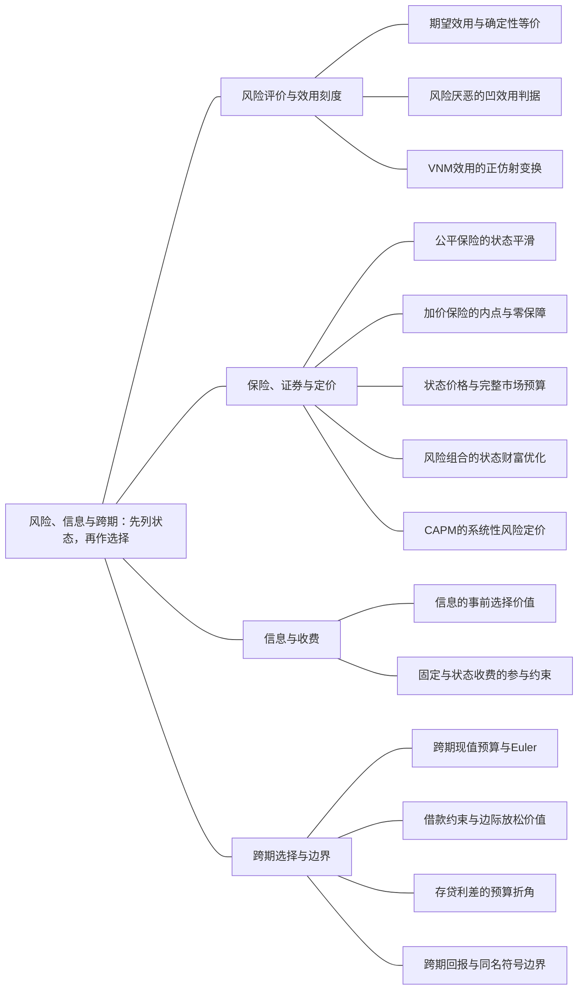

### 本专题知识联系

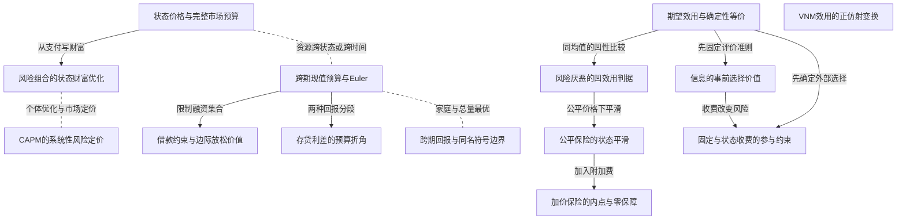

关系图中的箭头表示有方向的联系；虚线表示对照或类比。图中只画本专题主归属节点；跨专题关系在逐条命题中列明，可在练习室逐点追踪。具体成立条件以逐条说明为准。

### KMI026 期望效用与确定性等价

身份：既有资料概括

还用于：劳动市场：供给、需求与工资制度；私人信息到机制：谁知道什么，谁选择什么

**定义与对象**

逐状态评价最终财富效用并按概率加总，再以同效用确定财富定义CE。

**何时调用**

彩票、保险参与、风险资产、信息前后效用。

**适用条件**

概率非负和为1，财富在u定义域内，求CE需u严格递增。

**核心公式与机制**

$EU=\sum_s\pi_su(W_s)$，$u(CE)=EU$，$RP=E[W]-CE$。

**推导与理由**

先对每状态取效用而非先平均财富；反函数恢复CE，再与期望财富比较。

**边界与易错**

EU是效用单位，CE与风险溢价是财富单位，不能直接相减混用。

**整理依据**

- card FM13：逐状态先取效用再求和；用$u^{-1}$恢复CE

### KMI027 风险厌恶的凹效用判据

身份：既有资料概括

**定义与对象**

财富效用凹意味着同均值确定财富不差于彩票，严格凹与非退化风险给正风险溢价。

**何时调用**

判断风险态度、保险需求与安全资产比较。

**适用条件**

同一财富刻度和同一概率分布；Jensen比较相同均值，不替代任意两个财富方案。

**核心公式与机制**

$E[u(W)]\le u(EW)$，严格情形使 $CE<EW$。

**推导与理由**

凹性使均值点位于效用图像平均之上；CE经递增反函数位于均值之下。

**边界与易错**

严格风险厌恶仍可能选均值较高的彩票，不能仅据凹性选任意更低确定值。

**整理依据**

- card FM13：严格凹且财富非退化时$RP>0$
- card MC03：仅凭风险厌恶一般不能决定选择

### KMI028 公平保险的状态平滑

身份：既有资料概括

**定义与对象**

公平比例保费不改变期望财富，严格风险厌恶时通过全保险平滑两状态财富。

**何时调用**

事故损失、赔付和精算公平费率。

**适用条件**

事故概率外生、无道德风险、保额范围允许全赔，最终财富有效。

**核心公式与机制**

无事故 $W_N=W-aq$，事故 $W_A=W-D+(1-a)q$；$a=\pi$ 时期望财富不随q变。

**推导与理由**

公平价FOC使两状态边际效用相等；严格凹使财富相等，若可全赔则q等于损失。

**边界与易错**

公平不代表免费；风险中性者可对多保额无差异，不能宣布唯一全保险。

**整理依据**

- card FM14：公平不代表免费，完全保险的总保费是$\pi D$。

### KMI029 加价保险的内点与零保障

身份：既有资料概括

**定义与对象**

保费率高于事故概率使增保障减少期望财富，最优可能部分保险或不投保。

**何时调用**

附加费、保险过贵、保额上限或初始边际参与。

**适用条件**

保费在两状态均支付；保额非负且通常不超损失，财富域需逐状态核验。

**核心公式与机制**

对状态期望效用求导，比较q0、全额边界和有效内点；零点右导数决定开始投保的意愿。

**推导与理由**

边际增保把财富从未事故状态移向事故状态，但加价产生额外期望成本，最优平衡两者。

**边界与易错**

固定全险最高总保费和每单位保障的零购买门槛不是同一参与问题。

**整理依据**

- card FM14：附加费$\theta>\pi$时通常出现部分保险或零保险

### KMI030 状态价格与完整市场预算

身份：既有资料概括

**定义与对象**

每一状态支付一单位的价格定义跨状态资源约束，价格不自动等于发生概率。

**何时调用**

状态证券、复制资产、完备市场或禀赋风险交易。

**适用条件**

明确状态概率、证券支付和当前报价，价格应为正且无套利复制一致。

**核心公式与机制**

$\sum_s q_sc_s\le m$，内点满足 $\pi_su'(c_s)=\lambda q_s$。

**推导与理由**

最优性把一单位当前资源在不同状态的边际效用价值对齐，复制资产则给状态价格线性方程。

**边界与易错**

完整市场不保证任意状态价下完全等消费；价格与概率是不同对象。

**整理依据**

- card FM15：状态价格$q_s>0$、概率$\pi_s>0$

### KMI031 风险组合的状态财富优化

身份：既有资料概括

**定义与对象**

给每资产头寸写最终状态财富，在借贷卖空约束下最大化期望效用。

**何时调用**

风险资产和无风险资产配置、回报变化与投资上限。

**适用条件**

回报用总因子还是净率须一致；一般EU不得无条件替换为均值方差目标。

**核心公式与机制**

对风险头寸求导，驻点须在头寸界与财富定义域内，边界及零投资一并比较。

**推导与理由**

每增一单位风险投资同时改变各状态财富，因此FOC按概率加权状态边际效用与净支付变化。

**边界与易错**

CARA正态或明确均值方差条件之外，不直接使用通用份额公式；不允许负财富对数。

**整理依据**

- card FM15：该均值方差式不是任意期望效用的通式。

### KMI032 CAPM的系统性风险定价

身份：既有资料概括

**定义与对象**

标准单期CAPM用资产与市场收益共同变化的风险暴露解释必要期望收益。

**何时调用**

给市场收益、无风险率和beta，求要求收益或单期价格。

**适用条件**

同质预期、均值方差选择与无摩擦等模型前提；市场方差正，折现因子正。

**核心公式与机制**

$E[r_i]=r_f+\beta_i(E[r_M]-r_f)$，$\beta_i=Cov(r_i,r_M)/Var(r_M)$。

**推导与理由**

可分散特有风险不在市场风险溢价中单独补偿，均衡风险暴露由协方差而非总标准差度量。

**边界与易错**

CAPM是市场均衡定价关系，不是任意单资产EU最优头寸公式，beta也不是贴现因子。

**整理依据**

- card FM15：这里$\beta_i$是系统性风险暴露而非总标准差

### KMI033 信息的事前选择价值

身份：既有资料概括

**定义与对象**

允许观察信息后按状态调整行动，信息价值来自扩大可采用的状态依存决策集。

**何时调用**

天气、信号、完美信息前后产量或信息效用价值。

**适用条件**

明确信息揭晓时点与决策准则；免费信息可忽略时最优值不下降。

**核心公式与机制**

风险中性比较 $E[\max_a\Pi(a,s)]$ 与 $\max_aE\Pi(a,s)$；风险厌恶比较最优EU。

**推导与理由**

知情者可以复制原来不看信息的策略，因此新最优不差；实际新增价值要由分状态重新优化算出。

**边界与易错**

先按期望利润选q再评EU与直接最大化EU是不同问题，效用差不能冒称货币费。

**整理依据**

- card FM15：风险厌恶者应比较最优期望效用

### KMI034 跨期现值预算与Euler

身份：既有资料概括

还用于：劳动市场：供给、需求与工资制度；私人信息到机制：谁知道什么，谁选择什么

**定义与对象**

家庭用市场回报把两期资源统一为现值，内点以当期边际效用与未来折现回报比较。

**何时调用**

储蓄、借款、利率变化、消费平滑。

**适用条件**

总回报R正、偏好贴现与收入域明确，自由借贷时使用同一回报。

**核心公式与机制**

$c_1+c_2/R=y_1+y_2/R$，内点 $u'(c_1)=\beta Ru'(c_2)$。

**推导与理由**

多留一单位当期消费会放弃R单位未来消费，最优使该机会成本的折现边际效用等于当期。

**边界与易错**

R不是净利率；对数与线性效用的内点/角点性质不同。

**整理依据**

- card FM16：先把未来收入折为现值；求Euler及预算

### KMI035 借款约束与边际放松价值

身份：既有资料概括

**定义与对象**

借款上限截断跨期平滑的可行集合，绑定时Euler等式可变为不等式。

**何时调用**

禁止借款、最多可借、当前补助或约束影子价。

**适用条件**

消费非负，借款限额按本金/总偿付的口径明确，比较同一预算时点。

**核心公式与机制**

若最多借b，则 $c_1\le y_1+b$；绑定时放松一单位可比较当期边际效用减未来机会成本。

**推导与理由**

无约束候选超限时只能在边界；影子价表示额外融资能力的边际效用改善。

**边界与易错**

给现金会改变财富也可能改变是否绑定，不能只把旧影子价乘大额补助作精确福利。

**整理依据**

- card FM16：约束处可写当前边际效用不低于储蓄的折现边际收益。

### KMI036 存贷利差的预算折角

身份：既有资料概括

**定义与对象**

借款总偿付高于存款回报时，跨期预算在禀赋点由两段不同斜率组成。

**何时调用**

不同借存利率、线性跨期效用或不借不贷。

**适用条件**

按实际储蓄/借款方向选分支，候选不得跨错区间，收入零可使段退化。

**核心公式与机制**

分别求两段内点，再比较禀赋折角和可行端点；线性效用按两段目标斜率判断。

**推导与理由**

同一单位当前消费在储蓄段放弃存款回报，在借款段增加贷款偿付，因此机会成本不相同。

**边界与易错**

银行零利润定价格不代替家庭借贷选择；利率平价可能出现整段最优。

**整理依据**

- card FM17：候选加上禀赋折点$(y_1,y_2)$和可行端点

### KMI037 跨期回报与同名符号边界

身份：既有资料概括

**定义与对象**

相同字母在风险、家庭选择与总量增长中可能代表不同变量，须按定义和计价口径解释。

**何时调用**

跨科迁移、资本回报、概率或贴现符号相同。

**适用条件**

辨认时间、主体、净率/总因子与折旧，不能以符号同名认定同一最优条件。

**核心公式与机制**

家庭Euler比较边际效用，黄金律比较资本边际产出与维持成本；二者不是同一个目标问题。

**推导与理由**

先列每个符号的经济对象，再核资产收益与资本产出之间是否需扣折旧、税收或风险。

**边界与易错**

风险概率不等通胀，资本租价不等家庭净收益，CAPM beta不等偏好贴现参数。

**整理依据**

- card MC19：家庭跨期Euler比较边际效用与回报
- card MC19：风险概率$\pi$不等于通胀率

### KMI038 固定与状态收费的参与约束

身份：编者推导

**定义与对象**

信息、保险等契约因收费时点和状态改变最终财富风险，最高可接受收费须按实际外部选择比较EU。

**何时调用**

信息与保险的最高愿付、预付费与状态收费。

**适用条件**

外部选择和收费前行动财富明确；每状态支付后财富仍在效用域内。

**核心公式与机制**

固定费比较各状态共同减费后的EU；状态费仅扣对应状态，期望费再按收费概率折算。

**推导与理由**

参与条件把购买契约后的最终EU与不买该契约的最优EU比较，风险厌恶使相同期望费也未必等价。

**边界与易错**

不能拿效用单位信息收益当货币收费，也不能比较未折概率的名义费用。

**整理依据**

- review MI029：比较收费方案时应从最终财富取效用，不能仅看平均收费。
- review MI022：以不保险为外部选择，最高费使参与约束绑定

### KMI131 VNM效用的正仿射变换

身份：既有资料概括

还用于：从预算约束到需求与福利补偿

**定义与对象**

保持全部彩票排序的效用刻度变换须为正仿射，而非任意严格递增变换。

**何时调用**

对效用平方、取对数后把新值放回期望，或比较确定性与风险选择。

**适用条件**

讨论同一彩票状态财富与概率，a为正的变换 $v=au+b$。

**核心公式与机制**

正仿射使 $Ev=aEu+b$，保留所有期望效用大小；一般非线性变换与期望运算不交换。

**推导与理由**

概率和为1让常数项加总为b，正系数保留排序；任意单调函数只保证逐状态确定性排序。

**边界与易错**

确定束排序相同不代表彩票选择不变，平方根效用平方后可变为风险中性。

**整理依据**

- card MC03：只有正仿射变换保持全部彩票排序。

### 关系命题与条件

#### EMI041 期望效用与确定性等价 → 风险厌恶的凹效用判据

推导；编者推导

在严格凹效用与非退化风险下，EU与均值效用的比较推出正风险溢价。

适用条件：同一财富刻度且u递增。

理由：Jensen与反函数把效用差转换为CE低于均值。

依据：card FM13「严格凹且财富非退化时$RP>0$」

#### EMI043 风险厌恶的凹效用判据 → 公平保险的状态平滑

推导；编者推导

严格风险厌恶与公平保险保持期望财富，使全保险的等状态财富达到EU上界。

适用条件：无额外信息激励、保额和财富域允许完全保险。

理由：固定均值下减少非退化风险提高凹效用平均。

依据：card FM14「严格风险厌恶给$I=D$。」

#### EMI044 公平保险的状态平滑 → 加价保险的内点与零保障

条件变化；编者推导

保费率超过事故概率后，继续增保不再只是无成本平滑，可能部分或零保障。

适用条件：同一事故外生模型，费用规则改变。

理由：额外期望成本加入边际增保条件，需要核两个端点。

依据：card FM14「附加费$\theta>\pi$时通常出现部分保险或零保险」

#### EMI045 状态价格与完整市场预算 → 风险组合的状态财富优化

推导；编者推导

状态价格预算或资产复制关系提供各风险头寸的真实机会集合，再以EU选择组合。

适用条件：支付矩阵、价格与头寸限制明确。

理由：组合不是单看平均回报，须逐状态代入财富和边际收益。

依据：card FM15「完备市场内点问题为$\max\sum_s\pi_su(c_s)$」

#### EMI046 风险组合的状态财富优化 → CAPM的系统性风险定价

对照；编者推导

单个家庭EU组合最优与CAPM均衡必要收益使用不同条件，不互为通用替代公式。

适用条件：CAPM另需同质预期、均值方差与市场均衡。

理由：资产头寸最优给个人边际权衡，CAPM解释资产风险溢价。

依据：card FM15「不能把这套市场均衡关系当任意资产的无条件预测。」

#### EMI047 期望效用与确定性等价 → 信息的事前选择价值

前置；编者推导

评信息价值前先明确按期望利润还是最优期望效用比较。

适用条件：信息前后采用题给同一决策目标，或明示二者不同。

理由：先最大化利润再计算EU不等直接最大化EU，基准必须一致。

依据：card FM15「风险厌恶者应比较最优期望效用」

#### EMI048 期望效用与确定性等价 → 固定与状态收费的参与约束

前置；编者推导

最高契约收费需以不购买该契约时可选方案的最优EU作为参与下界。

适用条件：实际可选合同、行动和外部方案均已明确。

理由：收费改变状态财富，参与取决于支付后EU是否低于外部选择。

依据：review MI029「最高愿付时取等号」

#### EMI049 信息的事前选择价值 → 固定与状态收费的参与约束

条件变化；编者推导

免费信息的选择价值不直接等于收费金额，状态支付规则会改变风险和参与。

适用条件：可能有固定或状态收费，效用非线性。

理由：同一期望金额在不同状态扣除产生不同边际效用损失。

依据：review MI029「是因为收费本身重新引入风险。」

#### EMI050 跨期现值预算与Euler → 借款约束与边际放松价值

条件变化；编者推导

借款上限可能排除自由借贷Euler内点，使平滑转为融资边界。

适用条件：无约束候选超过实际可借限额。

理由：边际改善的跨期交易不再可行，约束乘子反映其价值。

依据：card FM16「若禁止借款，添加$c_1\le y_1$」

#### EMI051 跨期现值预算与Euler → 存贷利差的预算折角

条件变化；编者推导

借贷回报不同后，单一现值斜率需换成禀赋点相接的两段预算。

适用条件：贷款总偿付高于存款总回报。

理由：家庭当前净借贷方向决定相关机会成本，候选需回验分支。

依据：card FM17「分别用$R_s,R_b$求内点」

#### EMI052 跨期现值预算与Euler → 跨期回报与同名符号边界

对照；编者推导

家庭Euler不等索洛黄金律，个体效用最优不能仅因都含回报就推出总量消费最大化。

适用条件：跨科比较以各自目标、约束和折旧定义为前提。

理由：一个比较边际效用跨期转移，另一个比较稳态资源维持成本。

依据：card MC19「二者不是同一最优问题。」

#### EMI053 状态价格与完整市场预算 → 跨期现值预算与Euler

方法类比；编者类比

状态证券与跨期预算都可把不同支付用价格统一计值，再令边际效用对价格的比率相等。

适用条件：仅作优化结构类比；概率权重、贴现和可交易资产条件不能互换。

理由：共同结构是线性资源约束下的加权效用最优，状态并不因此变成时间。

依据：card FM15「状态价格$q_s>0$、概率$\pi_s>0$」；card FM16「先把未来收入折为现值；求Euler及预算」

#### EMI129 跨期现值预算与Euler → 人力资本的投资净现值

方法类比；编者类比

人力资本投资可复用跨期现值预算方法，但还须计放弃工资与实际风险。

适用条件：相同折现时点口径。

理由：现在与未来的收入不能直接相加。

依据：review MI064「未来两年各增加工资30，应按时点折现」

#### EMI131 跨期现值预算与Euler → 跨期劳动与消费平滑

前置；编者推导

自由借贷劳动问题须按现值资源约束连接各期消费。

适用条件：利率与借贷规则明确。

理由：当期收入不必等于当期消费。

依据：review MI069「可自由借贷使消费按终生资源平滑，再由工资与消费边际效用决定两期劳动；最后核现金流和净借贷。」；review MI069「令两期劳动收入之和为 $Y=2h_1+4h_2>0$。利率0且可借贷，预算为 $c_1+c_2=Y$。最大化对数消费效用的FOC给 $c_1=c_2=\frac Y2$。代回后，劳动选择目标为  $$F(h_1,h_2)=2\ln\frac{2h_1+4h_2}{2}-\frac{h_1^2+h_2^2}{2}.$$」；review MI069「对各期劳动求导，得到 $h_i=\frac{2w_i}{Y}$。代回收入恒等式：  $$Y=\frac{2(w_1^2+w_2^2)}Y,\qquad Y^2=2(2^2+4^2)=40.$$  取正根 $Y=2\sqrt{10}$，于是 $h_1=\frac2{\sqrt{10}}$、$h_2=\frac4{\sqrt{10}}$，消费各为 $\sqrt{10}$。对数线性收入项凹，再减正定二次成本，使目标严格凹，非负内点为唯一最优。」；review MI069「第一期收入为 $\frac4{\sqrt{10}}$，低于消费 $\frac{10}{\sqrt{10}}$，故借入 $\frac6{\sqrt{10}}$；第二期收入 $\frac{16}{\sqrt{10}}$，消费同前，恰剩同额偿还，零利率预算成立。高工资期多工作而消费保持平滑，是劳动的跨期替代和金融市场平滑共同作用。若不能借款，此消费劳动组合便不可直接实施，需重解。」

#### EMI195 期望效用与确定性等价 → 参照点与框架检验

对照；编者推导

稳定期望财富效用对同最终分布给同评价，框架效应需明确相对参照点评价的变化。

适用条件：两故事最终财富概率确实相同。

理由：只是叙述不同不改变标准模型的期望效用输入。

依据：card MC21「相同最终分布不因叙述改变」

#### EMI196 跨期现值预算与Euler → 准双曲贴现的时间不一致

条件变化；编者推导

准双曲当前偏重使日期推进后相邻时点MRS多出β，可能改变原计划。

适用条件：0<β,δ<1，比较同一两日期。

理由：在原时点共同未来β可抵消，到前一期变当前时不能抵消。

依据：card MC21「**准双曲贴现。**尼科尔森第17章第12题原PDF289给Laibson形式 $$ U_t=u(c_t)+\beta\sum_{j\ge1}\delta^j u(c_{t+j}),\qquad0<\beta,\delta<1. $$ 在时点$t$比较未来$c_{t+1}$和$c_{t+2}$，MRS为$\frac{u' (c_{t + 1})}{\delta u' (c_{t + 2})}$；到$t+1$把前者变成当前消费，MRS变为$\frac{u' (c_{t + 1})}{\beta \delta u' (c_{t + 2})}$。额外的$\beta$造成计划与到时选择不一致；不能继续使用同一个纯指数Euler式而不说明当前偏好与承诺。这里$\beta$是当前偏重参数，不是CAPM的风险暴露$\beta_i$。」

### 对应题目分问路径

#### MI021

风险家庭在公平与加价保费下重新比较状态财富。

**第1问**

本问任务：在公平费率 $a=\frac{1}{4}$ 下求最优赔付、状态财富并核边界。

公平费率1/4时先列最终财富，固定均值下由严格凹性选择可行全赔。

调用：KMI026 期望效用与确定性等价；KMI027 风险厌恶的凹效用判据；KMI028 公平保险的状态平滑

联系：EMI041、EMI043

**第2问**

本问任务：仅将费率改为 $a=\frac{1}{3}$，重新求最优并解释保障变化。

费率改1/3破坏公平财富平滑，按EU导数解内点并核零保额和上限。

调用：KMI027 风险厌恶的凹效用判据；KMI028 公平保险的状态平滑；KMI029 加价保险的内点与零保障

联系：EMI044

#### MI022

合同选择、最高保费与风险溢价须统一外部选择和单位。

**第1问**

本问任务：比较不保险、保费35的全保险、保费28且免赔10的合同，计算EU并选择。

三方案各两状态财富分别取平方根再加权，比较EU，不以平均财富直接决定合同。

调用：KMI026 期望效用与确定性等价；KMI027 风险厌恶的凹效用判据

联系：本问直接应用期望效用与确定性等价、风险厌恶的凹效用判据，所列任务没有另要求由一个独立结论推出另一个结论，不强加逻辑推出边。

**第2问**

本问任务：求免赔合同最高保费与公平保费，区分其与风险溢价。

免赔合同最高费由不保险EU下界决定，公平费由期望赔付决定，二者与CE风险溢价分开。

调用：KMI026 期望效用与确定性等价；KMI028 公平保险的状态平滑；KMI038 固定与状态收费的参与约束

联系：EMI048

#### MI023

给定期望利润准则与效用评价的时点分别处理。

**第1问**

本问任务：按期望利润准则求无信息产量、两状态利润和EU。

无信息产量先按期望利润选定，再算两状态利润和EU；本问并非直接EU优化。

调用：KMI026 期望效用与确定性等价；KMI033 信息的事前选择价值

联系：EMI047

**第2问**

本问任务：若生产前完美得知天气，逐状态求产量和EU，再计算效用单位的信息收益。

完美信息在生产前揭示，逐状态调整行动后再求EU差，报告的是效用单位信息收益。

调用：KMI026 期望效用与确定性等价；KMI033 信息的事前选择价值

联系：EMI047

#### MI024

直接EU生产必须先核每个状态利润的定义域。

**第1问**

本问任务：确定利润非负的产量域，推导并回验EU最优。

本问先要求两利润非负再对平方根EU求导，最优候选需落入共同可行区间。

调用：KMI003 原效用的全局候选比较；KMI026 期望效用与确定性等价；KMI033 信息的事前选择价值

联系：EMI047

**第2问**

本问任务：将候选与效用可行域端点比较，并与给定完美信息EU约9.05646比较。

把候选与利润域端点比较后，再与完美信息最优EU作同准则比较。

调用：KMI026 期望效用与确定性等价；KMI033 信息的事前选择价值

联系：EMI047

#### MI025

风险头寸以状态财富与投资界共同决定。

**第1问**

本问任务：求原回报下最优投资和两状态财富。

投资a同时改变两个状态财富，按对数EU求驻点并核a在0至16。

调用：KMI026 期望效用与确定性等价；KMI027 风险厌恶的凹效用判据；KMI031 风险组合的状态财富优化

联系：本问直接应用期望效用与确定性等价、风险厌恶的凹效用判据、风险组合的状态财富优化，所列任务没有另要求由一个独立结论推出另一个结论，不强加逻辑推出边。

**第2问**

本问任务：将风险资产回报改为3/2或1/2、各半，其余不变，重求投资并核边界。

回报改为3/2和1/2后风险平均回报不同，须重新比较零头寸而不是沿用旧a。

调用：KMI027 风险厌恶的凹效用判据；KMI031 风险组合的状态财富优化

联系：本问直接应用风险厌恶的凹效用判据、风险组合的状态财富优化，所列任务没有另要求由一个独立结论推出另一个结论，不强加逻辑推出边。

#### MI026

完整状态预算给平滑机会，交易现金流另核。

**第1问**

本问任务：列状态预算并求最优状态财富。

晴雨券价格相同且交易无借贷现金，先把禀赋状态价值写成约束再求最优财富。

调用：KMI030 状态价格与完整市场预算；KMI031 风险组合的状态财富优化

联系：EMI045

**第2问**

本问任务：核证券交易现金流及福利变化。

已求状态配置需由买卖券实际实现，核当前净成本和EU改进，不能只报平滑目标。

调用：KMI026 期望效用与确定性等价；KMI030 状态价格与完整市场预算；KMI031 风险组合的状态财富优化

联系：EMI045

#### MI027

存贷利差使同一消费问题分支求解。

**第1问**

本问任务：分别列借贷预算并求原收入下的最优。

收入60/60下分别按储蓄和借款回报求候选，连同禀赋折点比较。

调用：KMI034 跨期现值预算与Euler；KMI036 存贷利差的预算折角

联系：EMI051

**第2问**

本问任务：只将第二期收入由60改为120，存款利率0、借款利率50%不变，重求消费并核实际借贷方向。

第二期收入改120后重验借贷方向，不能因偏好相同就使用旧预算段。

调用：KMI034 跨期现值预算与Euler；KMI036 存贷利差的预算折角

联系：EMI051

#### MI028

融资上限截断平滑，并改变现金补助的反应。

**第1问**

本问任务：求无约束与受限消费，并解释约束影子价值。

先求收入20/80的自由平滑，再核最多借10的边界，用边际效用差解释影子价值。

调用：KMI034 跨期现值预算与Euler；KMI035 借款约束与边际放松价值

联系：EMI050

**第2问**

本问任务：在最多借款10的制度下，第一期额外获得现金补助6，重求消费并判断约束是否仍绑定。

首期现金加6同时改变财富与可借边界位置，必须重算是否仍绑定。

调用：KMI034 跨期现值预算与Euler；KMI035 借款约束与边际放松价值

联系：EMI050

#### MI029

信息收费状态不同导致参与价不等。

**第1问**

本问任务：建立不买信息的外部选择，求固定预付费上限。

无信息EU先形成外部下界；固定预付费从最终确定财富中扣除后满足该下界。

调用：KMI026 期望效用与确定性等价；KMI038 固定与状态收费的参与约束

联系：EMI048

**第2问**

本问任务：改为仅在原始高财富状态收费F、另一状态免费，求最高名义收费与期望收费并比较支付风险。

只在原高状态扣F改变支付后风险，按实际状态概率求EU上限与期望费。

调用：KMI026 期望效用与确定性等价；KMI038 固定与状态收费的参与约束

联系：EMI048

#### MI030

先比较实际彩票，再判断效用变换是否允许。

**第1问**

本问任务：分别比较两人的彩票和确定财富选择及风险态度。

平方根和线性效用分别对0/100彩票与确定40计算，风险态度不替代具体EU比较。

调用：KMI026 期望效用与确定性等价；KMI027 风险厌恶的凹效用判据

联系：本问直接应用期望效用与确定性等价、风险厌恶的凹效用判据，所列任务没有另要求由一个独立结论推出另一个结论，不强加逻辑推出边。

**第2问**

本问任务：将甲效用平方为 $\tilde u(W)=W$，比较彩票选择，解释确定性排序与彩票排序的差别。

平方变换保留确定财富排序却不保持一般彩票EU，须用正仿射条件评价允许刻度。

调用：KMI001 序数偏好与效用表示；KMI131 VNM效用的正仿射变换

联系：EMI042

#### CMI05

风险基准贯穿公平、加价及离散/边际保险参与。

**第1问**

本问任务：求不投保时的期望财富、期望效用、确定性等价及风险溢价，说明各量的单位。

先算事故彩票EU、CE和风险溢价，各量分别保留效用和财富单位。

调用：KMI026 期望效用与确定性等价；KMI027 风险厌恶的凹效用判据

联系：EMI041

**第2问**

本问任务：令a等于事故概率，求最优赔付及两状态财富、EU，并说明为何为全局最优。

公平保费保持期望财富，以严格凹性证明可行全赔达到上界。

调用：KMI027 风险厌恶的凹效用判据；KMI028 公平保险的状态平滑

联系：EMI043

**第3问**

本问任务：仅把费率改为 $a=\frac{1}{3}$，重新求最优q、两状态财富与EU，并与不投保比较。

加价后直接对两状态EU优化并比较不投保，回验内部q与财富正域。

调用：KMI026 期望效用与确定性等价；KMI027 风险厌恶的凹效用判据；KMI029 加价保险的内点与零保障

联系：本问直接应用期望效用与确定性等价、风险厌恶的凹效用判据、加价保险的内点与零保障，所列任务没有另要求由一个独立结论推出另一个结论，不强加逻辑推出边。

**第4问**

本问任务：先独立比较：撤去前问比例保险选项，以不投保为唯一外部选择，现只提供固定保费P的全保险，求最高可接受P和保险人的公平保费。再撤去该全保险合同，恢复仅有比例保险，限制 $0\le a<1$，求a至少多高时家庭最优不买任何保障，说明这一门槛与全保险最高保费不能混用。

先撤去比例合约单独求固定全险参与价，再恢复比例合同查q0右导数，不能混淆两类门槛。

调用：KMI026 期望效用与确定性等价；KMI028 公平保险的状态平滑；KMI029 加价保险的内点与零保障；KMI038 固定与状态收费的参与约束

联系：EMI044、EMI048

#### CMI06

资产报价先复制为状态价格，再核个人最优与交易。

**第1问**

本问任务：求最优风险投资、两状态财富和相对全存无风险资产的效用增量，检查边界。

现金16在两资产间配置，先列晴雨财富再对数优化并核投资界。

调用：KMI027 风险厌恶的凹效用判据；KMI031 风险组合的状态财富优化

联系：本问直接应用风险厌恶的凹效用判据、风险组合的状态财富优化，所列任务没有另要求由一个独立结论推出另一个结论，不强加逻辑推出边。

**第2问**

本问任务：若同时交易每份只在晴天或雨天支付1的证券，记当前价格为 $s_S,s_R$。要求它们复制两种原资产的价格而没有套利，求状态价格并说明其与概率的区别。

两种证券复制无风险和风险支付，当前价格用线性定价式求，不把概率直接当价。

调用：KMI030 状态价格与完整市场预算

联系：本问直接应用状态价格与完整市场预算，所列任务没有另要求由一个独立结论推出另一个结论，不强加逻辑推出边。

**第3问**

本问任务：在第二问价格下允许自由交易两种状态证券，但最终财富须为正。求现金16家庭的最优财富；与第一问比较，并解释是否必然完全平滑。

开放证券市场后按状态价预算求EU最优，再核原资产能否已实现同一配置。

调用：KMI030 状态价格与完整市场预算；KMI031 风险组合的状态财富优化

联系：EMI045

**第4问**

本问任务：回到初始现金16，仅把风险资产晴天回报改为3/2、雨天仍1/2。重新求状态价格及两资产约束下的最优配置，说明变化原因。

改变晴天风险回报要重新定价并求头寸，平均回报与风险关系也随之变化。

调用：KMI027 风险厌恶的凹效用判据；KMI030 状态价格与完整市场预算；KMI031 风险组合的状态财富优化

联系：EMI045

**第5问**

本问任务：恢复原风险资产和第二问状态价格。另一家庭没有现金资产，而是晴雨状态禀赋 $(8,24)$；可按这些状态价格自由交换支付。求其最优最终财富、净证券交易与效用增量，并核交易当前净成本。

状态禀赋8/24先按现价估值，再求需求与零成本净交易，最后比较EU。

调用：KMI026 期望效用与确定性等价；KMI030 状态价格与完整市场预算

联系：本问直接应用期望效用与确定性等价、状态价格与完整市场预算，所列任务没有另要求由一个独立结论推出另一个结论，不强加逻辑推出边。

## 技术到成本，成本到供给，供给到进入

技术、成本、产量与开工为何必须分层优化而不能只背一条边际条件？

从技术可行域求条件成本，再核容量、档位与启动集合；利润、短期出清及长期进入分别允许不同变量调整。

### 分支导图

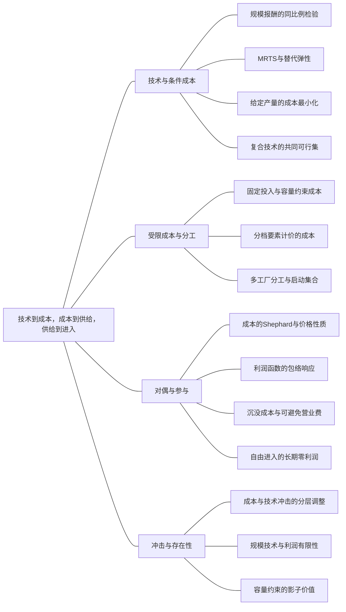

### 本专题知识联系

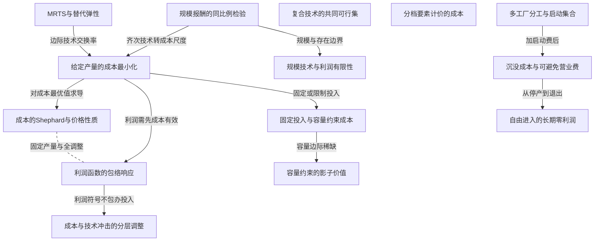

关系图中的箭头表示有方向的联系；虚线表示对照或类比。图中只画本专题主归属节点；跨专题关系在逐条命题中列明，可在练习室逐点追踪。具体成立条件以逐条说明为准。

### KMI039 规模报酬的同比例检验

身份：既有资料概括

**定义与对象**

规模报酬看全部投入同比放大时产出如何变化，单一投入边际产量看其他投入固定。

**何时调用**

齐次次数、递减边际产量与规模经济关系。

**适用条件**

分清技术与成本、单投入变化与全部投入变化；Euler分尽还需竞争支付等条件。

**核心公式与机制**

$F(tK,tL)=t^\nu F(K,L)$ 定义规模次数；各投入边际产量递减并不强制 $\nu<1$。

**推导与理由**

同时代入tK和tL收集幂次，再独立求各偏导判断边际报酬，不混合两个比较。

**边界与易错**

不能因每个二阶偏导负就宣布规模报酬递减，规模报酬也不直接保证利润最优存在。

**整理依据**

- card FM18：各自边际产量递减而$\nu$仍可能大于1。
- card MC04：规模报酬是技术属性，规模经济是成本属性

### KMI040 MRTS与替代弹性

身份：既有资料概括

**定义与对象**

MRTS是保持产量时两投入的边际技术交换率，替代弹性衡量投入比对该比率的比例响应。

**何时调用**

等产量线、CES、投入替代与价格比。

**适用条件**

正投入且相关偏导存在，明确定义投入比与MRTS方向；CES零投入负幂域另核。

**核心公式与机制**

$MRTS_{LK}=F_L/F_K$；CRS CES为 $F=A[\theta K^\rho+(1-\theta)L^\rho]^{1/\rho}$，$A>0,0<\theta<1,\rho<1,\rho\ne0$，正投入处 $\sigma=1/(1-\rho)$；rho0须另取极限。

**推导与理由**

对固定产量全微分得等产量线斜率，再对投入比与边际比取对数变化定义弹性。

**边界与易错**

MRTS是水平交换率，不等于替代弹性；rho0极限的效率归一化不可忽略。

**整理依据**

- card FM18：替代弹性是投入比相对MRTS变化的比例

### KMI041 给定产量的成本最小化

身份：既有资料概括

还用于：劳动市场：供给、需求与工资制度；生产效率、外部性与公共品的统一比较

**定义与对象**

固定目标产量后选择最低要素开支，得到条件要素需求而非利润最优产量。

**何时调用**

生产函数、要素价格、长期成本与投入比。

**适用条件**

技术约束、可调投入与正价格明确；启动费、容量和分档价格另列。

**核心公式与机制**

光滑正内点 $MRTS_{LK}=w/r_K$；CD成本随产量为 $1/(\alpha+\beta)$ 次齐次。

**推导与理由**

切线条件确定投入比，代回产量约束求投入并按价格加总；最优利润若不成本最小可被同产量更低成本击败。

**边界与易错**

条件成本最小不说明产量利润最优，尚需收益与停产比较。

**整理依据**

- card FM19：由切线求最优比率，代回产量约束，最后以投入价格加总。
- card MC15：成本最小本身不保证选了利润最优产量

### KMI042 复合技术的共同可行集

身份：既有资料概括

**定义与对象**

min、max、可替代投入与多工艺选择分别对应不同生产可行集合，成本须在真实集合上求最小。

**何时调用**

完全替代/互补生产、复合约束或多技术。

**适用条件**

区别同时满足约束、择一技术和把产量分给各技术；容量界必须保留。

**核心公式与机制**

固定配比先满足每个必要投入；替代技术比较单位有效产出成本；并行分工需再分配总量。

**推导与理由**

把每条技术约束改写成投入不等式后求共同最小，避免把互相重叠或可替代的成本重复相加。

**边界与易错**

技术符号min不等于随意取成本min，工艺使用规则比模板名称更重要。

**整理依据**

- card FM20：技术中的min/max与生产安排的“同时使用”或“择一使用”需区分。

### KMI043 固定投入与容量约束成本

身份：既有资料概括

**定义与对象**

固定某投入和最多可用某投入是两种不同约束，短期成本需反解可调投入并核容量分支。

**何时调用**

固定资本、设备上限、产能与长短期成本。

**适用条件**

固定存量是否已沉没、是否可减少及技术能否超容量生产必须按题意。

**核心公式与机制**

固定K时 $SC(q,K)=wL(q;K)+r_KK$；长期 $C(q)=\min_KSC(q,K)$，上限则只在约束绑定后固定K。

**推导与理由**

先用技术反解可调投入，若原最优资本未达上限可沿长期成本；达到后换绑定成本。

**边界与易错**

固定资本不等于资本上限，互补技术超过物理容量是不可行而非成本线延长。

**整理依据**

- card FM21：固定资本投入存量和资本最多可用到上限不同

### KMI044 分档要素计价的成本

身份：既有资料概括

还用于：税制改变哪条约束，福利由谁承担

**定义与对象**

要素价格按用量分档时，总支出函数的连续性和跳跃决定成本候选与技术切换。

**何时调用**

超额单价、整批折扣、前段优惠或门槛。

**适用条件**

准确写仅超额计价还是越阈值全量改价，检查各档有效区间。

**核心公式与机制**

超额计价 $E_K=r_1\min(K,\bar K)+r_2\max(K-\bar K,0)$；全量改价需另写分支。

**推导与理由**

每档固定价格下求投入候选，再加门槛和容量点比较总开支；常数修正影响跨档全局。

**边界与易错**

并非总把便宜档用满；另一要素替代可能比增加便宜投入更合算。

**整理依据**

- card FM22：边际分档计费通常连续但斜率变；全量改价可能产生跳跃及非凸成本。

### KMI045 多工厂分工与启动集合

身份：既有资料概括

还用于：从垄断、串联垄断到古诺与 n 厂商

**定义与对象**

给定总产量先在活跃工厂间分配，启动费和容量又要求选择实际开厂集合。

**何时调用**

多厂成本、分工、开厂阈值与总企业销售。

**适用条件**

光滑凸成本无启动费时可边际成本相等；有启动费必须枚举全局方案。

**核心公式与机制**

$C(Q)=\min_{\sum q_i=Q,q_i\ge0}\sum_iC_i(q_i)$；活跃未满产厂通常共享边际成本。

**推导与理由**

先条件于开厂集合求连续分配，再把所需总成本与其他集合比较，最后企业选择总销售量。

**边界与易错**

不令平均成本相等；边际条件不替代离散启动费用比较。

**整理依据**

- card FM23：若有可避免启动费，枚举开厂组合并比较总利润。

### KMI046 成本的Shephard与价格性质

身份：既有资料概括

还用于：从预算约束到需求与福利补偿

**定义与对象**

成本函数对要素价格的导数给固定产量的条件投入，其价格齐次与凹性约束可观测表达式。

**何时调用**

由成本恢复投入、检验成本一致性。

**适用条件**

固定产量、价格正、相关导数存在，标准成本为给定技术的最低开支。

**核心公式与机制**

$z_i^c=C_{w_i}$；成本对要素价格一次齐次且凹，投入支出应加总为成本。

**推导与理由**

每个固定投入束的费用对价格线性，最小值为下包络；包络定理给最优投入。

**边界与易错**

不把最优产量价格参数塞入条件成本，也不能拿利润的价格凸性替代成本凹性。

**整理依据**

- card FM24：**题干触发。**给利润函数求供给或要素需求；技术改变、价格改变对利润的影响。  $$ \Pi(p,w)=\max_{q,z}\{pq-w\cdot z:(q,z)\text{技术可行}\}, $$ $$ \begin{gathered} \Pi_p=q^*, \\ \Pi_{w_i}=-z_i^*, \\ z_i^c(w,q)=C_{w_i}(w,q). \end{gathered} $$ 上式最后一项对成本函数求导时固定产量$q$，不把产品价格放入成本约束；前两项的最优产量与投入则可随价格变化。  **步骤。**先辨认最优值固定的外生参数，再对原目标中的参数直接求偏导、代入最优选择。利润函数对所有价格一次齐次且凸；成本对投入价格一次齐次且凹。投入价格上升不会使最优利润增加，因为原选择仍提供一个比较基准。  **边界检查。**最优选择跳跃时，普通导数可能不存在，使用单侧或集合版本。短期已固定投入价格上涨可直接降低会计利润，但是否改变可调投入要看技术与决策可行集；不能把条件需求的导数直接当全调整劳动需求。  **原书与题源。**平新乔第7讲利润函数与供给部分；尼科尔森第11章第14题PDF184含技术变化与利润函数；范里安第20章第1、7题PDF55—56。2009计算5题PDF88询问要素涨价对利润，适用包络判断。

### KMI047 利润函数的包络响应

身份：既有资料概括

**定义与对象**

最优利润对产品价导数是供给，对投入价导数为最优投入的负值。

**何时调用**

价格变化、Hotelling、供给与要素需求。

**适用条件**

相关可行集不随该价格改变，最优存在且导数需局部光滑；跳跃时另用单侧或集合。

**核心公式与机制**

$\Pi_p=q^*$，$\Pi_{w_i}=-z_i^*$；利润对全部价格一次齐次且凸。

**推导与理由**

在最优值上只取原目标的参数偏导，选择的边际调整一阶最优项抵消。

**边界与易错**

投入价提高最优利润不升，但不能据此单独断定每项投入或产量必减。

**整理依据**

- card FM24：**题干触发。**给利润函数求供给或要素需求；技术改变、价格改变对利润的影响。  $$ \Pi(p,w)=\max_{q,z}\{pq-w\cdot z:(q,z)\text{技术可行}\}, $$ $$ \begin{gathered} \Pi_p=q^*, \\ \Pi_{w_i}=-z_i^*, \\ z_i^c(w,q)=C_{w_i}(w,q). \end{gathered} $$ 上式最后一项对成本函数求导时固定产量$q$，不把产品价格放入成本约束；前两项的最优产量与投入则可随价格变化。  **步骤。**先辨认最优值固定的外生参数，再对原目标中的参数直接求偏导、代入最优选择。利润函数对所有价格一次齐次且凸；成本对投入价格一次齐次且凹。投入价格上升不会使最优利润增加，因为原选择仍提供一个比较基准。  **边界检查。**最优选择跳跃时，普通导数可能不存在，使用单侧或集合版本。短期已固定投入价格上涨可直接降低会计利润，但是否改变可调投入要看技术与决策可行集；不能把条件需求的导数直接当全调整劳动需求。  **原书与题源。**平新乔第7讲利润函数与供给部分；尼科尔森第11章第14题PDF184含技术变化与利润函数；范里安第20章第1、7题PDF55—56。2009计算5题PDF88询问要素涨价对利润，适用包络判断。

### KMI048 沉没成本与可避免营业费

身份：既有资料概括

还用于：税制改变哪条约束，福利由谁承担；从垄断、串联垄断到古诺与 n 厂商

**定义与对象**

已不可收回费用不改变当前经营比较，只有营业才付的固定费须由经营收益覆盖。

**何时调用**

亏损生产、停产、退出、营业许可证。

**适用条件**

按决策时点分类，区分成本不随量与是否可避免两件事。

**核心公式与机制**

当前比较 $pq-VC(q)-F_a\mathbf1_{q>0}$ 与停产0，再扣沉没费报告总利润。

**推导与理由**

先求有效驻点、容量和折点，再比较经营净收入与不营业，固定费可避免时改变参与阈值。

**边界与易错**

负总利润仍可能比停产少亏；最低AVC标准不覆盖所有可避免营业费。

**整理依据**

- card FM25：固定费可避免时，最低$AVC$不再足够判断启动
- card MC04：沉没成本已经不能收回

### KMI049 自由进入的长期零利润

身份：既有资料概括

还用于：税制改变哪条约束，福利由谁承担

**定义与对象**

可复制同质企业自由进入退出时，长期价格与最小平均成本及企业规模共同确定。

**何时调用**

长期厂商数、进入退出、单位税后新长期。

**适用条件**

无许可限制、规模最小点存在、投入价格闭合明确，非整数企业数需连续近似。

**核心公式与机制**

$p=\min AC$，内点 $MC=AC$，$n=D(p)/q$。

**推导与理由**

正利润吸引进入、负利润退出，直到可复制企业的机会成本正常报酬被覆盖而经济利润为零。

**边界与易错**

零经济利润不等所有者无收入；规模递增或离散产能时标准三联式可能失效。

**整理依据**

- card FM26：同质厂商与可复制技术、无进入限制
- card MC05：零经济利润不等于企业所有者没有收入。

### KMI050 成本与技术冲击的分层调整

身份：既有资料概括

还用于：劳动市场：供给、需求与工资制度

**定义与对象**

成本或技术冲击对固定产量投入、最优产量和行业进入通过不同层次调整。

**何时调用**

工资上涨、技术进步、短长期重新出清。

**适用条件**

固定q的投入比较与允许产量或企业数改变的比较不能混同，绑定约束需保留。

**核心公式与机制**

仅在技术与需求不变、投入价上涨时，最优利润不升；技术改进或费用下降则须重算，不能沿用利润不升。投入量还取决替代、规模和容量。

**推导与理由**

在同产量下比较成本最小投入，再重求产品市场最优与行业出清，长期另许资本及企业数变化。

**边界与易错**

把利润下降直接换成必减产会漏掉固定支付与容量；个人投入替代方向也不等总使用量方向。

**整理依据**

- card MC16：某个投入的使用量可能因替代和规模效应综合而变化。

### KMI051 规模技术与利润有限性

身份：既有资料概括

还用于：私人信息到机制：谁知道什么，谁选择什么

**定义与对象**

成本形状和产品价格共同决定最优利润能否在有限产量取得。

**何时调用**

CRS、递增规模、无产能约束或最优不存在。

**适用条件**

价格接受、要素价固定、成本和容量按原模型；启动费用不改变无界大产量的单位边际比较。

**核心公式与机制**

CRS无额外约束时成本为单位成本乘q：价格高于单位成本可无界扩张，低于则停产，等价且无可避免启动费时可多解；若正产须付额外启动费，等价时可能仅停业。

**推导与理由**

若收入线性而成本增长不及收入，增加规模持续改善利润；容量或上升MC可恢复有限解。

**边界与易错**

成本最小存在不代表利润最大存在，不能报一个任意驻点作为无界问题最优。

**整理依据**

- card FM19：不能据此保证竞争厂商有有限利润最大值。

### KMI052 容量约束的影子价值

身份：既有资料概括

还用于：从垄断、串联垄断到古诺与 n 厂商

**定义与对象**

放松容量上限对最优利润的一阶增益衡量该约束的边际稀缺价值。

**何时调用**

扩厂、放松资本上限、可支付容量费。

**适用条件**

所用绑定分支在小幅变化后有效，费用与租价不能重复核算；大幅变化须重验分支。

**核心公式与机制**

可变产量利润用 $V_B$ 衡量上限价值；固定q成本问题用 $-C_B(q,B)$ 衡量节约，固定收入时二者等价。非绑定边际价值可为0。

**推导与理由**

先把容量参数放进约束与成本，重新求最优值或用包络，避免把资本存量误当产量。

**边界与易错**

影子价值是边际值，不保证对任意大扩张线性成立，也不是整个资本的平均利润。

**整理依据**

- case CMI07：把资本上限记为B。在绑定分支，企业最大化 $12q-\frac{wq^2}{B}-B$，故 $q^*(B)=\frac{6B}{w}$。代回得最优利润 $V(B)=B(\frac{36}{w}-1)$。该绑定分支成立需 $K^{u}=q\sqrt w>B$，在本题两工资均满足，因为 $\frac{6}{\sqrt w}>1$。所以 $V'_B=\frac{36}{w}-1$，工资4时为8，工资9时为3。每单位上限收费5后，净边际收益分别3与负2，故前者愿小幅扩张、后者不愿。收费是新增扩张成本，不能重复算进原资本租价1。

### 关系命题与条件

#### EMI061 规模报酬的同比例检验 → 给定产量的成本最小化

推导；编者推导

无启动与容量的CD技术规模次数决定成本对产量的幂次。

适用条件：正参数、给定要素价格、投入全可调。

理由：同倍缩放投入可达到相应规模产出，最小费用沿齐次映射变化。

依据：card FM19「成本对$q$为$\frac{1}{\nu}$次齐次」

#### EMI062 MRTS与替代弹性 → 给定产量的成本最小化

前置；编者推导

光滑正投入成本最小时，以MRTS与要素价格比相等确定投入比。

适用条件：内点可替代技术且等产量线正规。

理由：偏离该比率可在保持产量下沿较便宜方向调投入而降费用。

依据：card FM19「由切线求最优比率」

#### EMI063 给定产量的成本最小化 → 成本的Shephard与价格性质

推导；编者推导

固定产量成本最小化的包络给条件要素需求，也限制成本价格齐次与凹性。

适用条件：固定技术和目标量，成本可微。

理由：参数仅以价格乘投入进入费用，最优点的选择调整项在一阶抵消。

依据：card FM24「**题干触发。**给利润函数求供给或要素需求；技术改变、价格改变对利润的影响。  $$ \Pi(p,w)=\max_{q,z}\{pq-w\cdot z:(q,z)\text{技术可行}\}, $$ $$ \begin{gathered} \Pi_p=q^*, \\ \Pi_{w_i}=-z_i^*, \\ z_i^c(w,q)=C_{w_i}(w,q). \end{gathered} $$ 上式最后一项对成本函数求导时固定产量$q$，不把产品价格放入成本约束；前两项的最优产量与投入则可随价格变化。  **步骤。**先辨认最优值固定的外生参数，再对原目标中的参数直接求偏导、代入最优选择。利润函数对所有价格一次齐次且凸；成本对投入价格一次齐次且凹。投入价格上升不会使最优利润增加，因为原选择仍提供一个比较基准。  **边界检查。**最优选择跳跃时，普通导数可能不存在，使用单侧或集合版本。短期已固定投入价格上涨可直接降低会计利润，但是否改变可调投入要看技术与决策可行集；不能把条件需求的导数直接当全调整劳动需求。  **原书与题源。**平新乔第7讲利润函数与供给部分；尼科尔森第11章第14题PDF184含技术变化与利润函数；范里安第20章第1、7题PDF55—56。2009计算5题PDF88询问要素涨价对利润，适用包络判断。」

#### EMI064 给定产量的成本最小化 → 利润函数的包络响应

前置；编者推导

有限利润最优的投入必是其产量的成本最小投入，但成本最小不反推利润最优。

适用条件：价格给定且同量替代技术可行。

理由：若同量可更便宜，收入不变而利润更高，反证原利润最优。

依据：card MC15「收入不变、利润更高」

#### EMI065 给定产量的成本最小化 → 固定投入与容量约束成本

条件变化；编者推导

长期自由投入成本在固定资本或容量绑定后需换成相应约束成本分支。

适用条件：技术相同、投资可调范围改变。

理由：长期最优投入若不可行就不能继续使用原成本。

依据：case CMI07「正产量要求 $LK=q^2$。将 $L=\frac{q^2}{K}$ 代入费用 $\frac{4q^2}{K}+K$，FOC给 $K=2q,L=\frac{q}{2}$，二阶导为正，所以无约束成本为4q。资本约束可行要求 $2q\le9$，即 $q\le\frac92$。更高产量须用K9、$L=\frac{q^2}{9}$，因此  $$C(q)=\begin{cases}4q,&0\le q\le\frac{9}{2},\\\frac{4q^2}{9}+9,&q\ge\frac{9}{2}.\end{cases}$$  q0可选择零投入。两支在 $q=\frac{9}{2}$ 费用均18，边际成本也同为4，故连续且相切，不能把固定K9的费用公式套给低产量。」

#### EMI066 固定投入与容量约束成本 → 容量约束的影子价值

推导；编者推导

绑定容量下，固定q用最低成本的负导数衡量节约；可变产量则用最优利润导数衡量收益，须先声明口径。

适用条件：固定q或允许产量调整的目标须明确，局部分支正规，容量单位与新增费用一致。

理由：约束放松扩大可行选择集，其边际价值由最优值响应而非平均成本给出。

依据：case CMI07「把资本上限记为B。在绑定分支，企业最大化 $12q-\frac{wq^2}{B}-B$，故 $q^*(B)=\frac{6B}{w}$。代回得最优利润 $V(B)=B(\frac{36}{w}-1)$。该绑定分支成立需 $K^{u}=q\sqrt w>B$，在本题两工资均满足，因为 $\frac{6}{\sqrt w}>1$。所以 $V'_B=\frac{36}{w}-1$，工资4时为8，工资9时为3。每单位上限收费5后，净边际收益分别3与负2，故前者愿小幅扩张、后者不愿。收费是新增扩张成本，不能重复算进原资本租价1。」

#### EMI067 多工厂分工与启动集合 → 沉没成本与可避免营业费

条件变化；编者推导

多工厂边际成本相等仅在给定开工集合内有效，有可避免启动费还要比较不营业。

适用条件：启动费仅在实际开厂时发生。

理由：连续分配不计能否覆盖整笔费，故需离散参与比较。

依据：card FM23「非凸成本或固定启动费下，边际成本相等只是候选」

#### EMI068 沉没成本与可避免营业费 → 自由进入的长期零利润

条件变化；编者推导

短期沉没费可忽略于经营选择，长期可退出或进入时需覆盖全部机会成本。

适用条件：时间含义由可调整集合而非日历决定。

理由：费用可避免性改变，使平均总成本进入长期零利润条件。

依据：card MC04「短期至少有某种投入不能调整，长期所有相关投入可调整」

#### EMI071 利润函数的包络响应 → 成本与技术冲击的分层调整

推导；编者推导

投入价上升使最优利润不升，但数量比较仍须结合替代、产量及约束。

适用条件：固定技术可行集，价格冲击不另改变需求。

理由：利润包络符号是一阶价值变化，并不直接给各投入交叉响应。

依据：card MC16「某个投入的使用量可能因替代和规模效应综合而变化。」

#### EMI072 规模报酬的同比例检验 → 规模技术与利润有限性

推导；编者推导

在固定产品价的无容量技术中，规模性质经成本增长形状影响有限利润最优的存在。

适用条件：需实际求成本并比较单位成本/平均成本，不仅看MP。

理由：线性收入可超过线性单位成本或次线性成本，导致持续扩张。

依据：card FM19「不能据此保证竞争厂商有有限利润最大值。」

#### EMI073 成本的Shephard与价格性质 → 利润函数的包络响应

对照；编者推导

Shephard给固定q条件投入，Hotelling给利润优化后的投入，二者保持的外生对象不同。

适用条件：两最优值分别可微且定义明确。

理由：后者允许产量随产品价及投入价调整，不能把条件导数直接当全调整需求。

依据：card FM24「不能把条件需求的导数直接当全调整劳动需求。」

#### EMI074 沉没成本与可避免营业费 → 局部均衡出清与分支回验

机制；编者推导

企业先经停产比较给有效供给，行业将实际供给加总后再与需求出清。

适用条件：固定企业数的竞争短期，成本和价格口径一致。

理由：未覆盖可避免费用的假驻点不能作为真实供给加入市场。

依据：card FM26「逐厂求新短期供给，再与需求出清」

#### EMI075 自由进入的长期零利润 → 局部均衡出清与分支回验

机制；编者推导

长期价格和单厂规模确定后，需求与单厂量共同决定可进入企业数。

适用条件：同质可复制、无许可限制、允许连续厂商近似或另作整数检验。

理由：零利润约束不单独决定行业需求总量，出清补足数量闭合。

依据：card FM26「n^* = \frac{Q^*}{q^*}」

#### EMI090 沉没成本与可避免营业费 → 自然垄断的监管收支约束

前置；编者推导

自然垄断监管或税制必须让企业覆盖可避免营业成本或明确补贴，否则量价方案无法实施。

适用条件：固定费只营业时发生且允许停业。

理由：MC定价虽边际有效，却可能不满足营业参与。

依据：case CMI10「至少需补贴64使其弱参与营业。」

#### EMI093 容量约束的影子价值 → 跨时段共享容量收费

推导；编者推导

同一容量支持多个时段时，各期对放松共同约束的边际收益加总后与容量成本比较。

适用条件：时期收益可加、共享K只计一次且局部分支有效。

理由：一单位K同时放松每个受限期，不受限期的边际价值为零。

依据：review MI049「共享容量只付一次费用；先按容量是否约束各时段分段，再令各期容量影子收益之和等于容量成本。」；review MI049「利润为 $(18-Q_H)Q_H+(10-Q_L)Q_L-4K$，约束 $0\le Q_H,Q_L\le K$。不考虑容量时，高峰FOC给量9，低谷给量5；各期利润严格凹，所以给定K有 $Q_H=\min\{9,K\}$、$Q_L=\min\{5,K\}$。容量费用按共同K收一次，不能分别计入两期MC。」；review MI049「当 $0\le K\le5$，两期均受限，利润为 $24K-2K^2$，导数 $24-4K>0$，应继续扩容。$5\le K\le9$ 时仅高峰受限，利润为 $14K-K^2+25$，导数 $14-2K=0$ 给K为7，SOC为 $-2$。$K\ge9$ 时两期运营利润均固定，容量再增只多付费用，导数为 $-4$。因此全局K为7。」；review MI049「高峰量7、价13，低谷量5、价7。高峰扩一单位容量的运营边际收益为 $MR_H-MC=20-2\times7-2=4$；低谷未受限，影子价为0，两期之和恰等容量MC4。高峰运营利润77、低谷25，扣共同容量费28，得总利润74。」

#### EMI095 多工厂分工与启动集合 → 统一价格垄断的边际收益

机制；编者推导

企业先把可用工厂的产量成本汇总，再与市场边际收益联立选择总销售量。

适用条件：开厂集合及其可行总成本分支明确，固定费用另作经营比较。

理由：同一总销量的生产配置改变总MC，市场收入条件仍由总需求决定。

依据：card FM23「把各段最优成本加总后，整体企业才与$MR$或市场价联立。」

#### EMI130 给定产量的成本最小化 → 企业劳动边际收益产品

机制；编者推导

条件投入成本先决定固定量替代，随后最优产品产量变化再改变劳动需求。

适用条件：企业能调整资本且技术需求明确。

理由：工资同时改变劳动资本比和销售的MC，不能只看一个通道。

依据：review MI068「分离固定量替代和产量效应。」

#### EMI165 给定产量的成本最小化 → 排放许可的减排成本配置

方法类比；编者类比

给定总减排的跨厂成本最小化与给定产量要素费用最小化都均衡可替代任务的边际成本。

适用条件：分别满足各自凸性和边界。

理由：用低边际成本替代高者降低总支出，但投入与减排含义不同。

依据：review MI086「社会求两厂真实成本之和最小」

#### EMI194 规模技术与利润有限性 → 信息产品的复制与网络机制

方法类比；编者类比

信息品高初始费低复制MC可借鉴固定费生产与收费分析，但需求网络和版权须另建。

适用条件：成本结构可分且网络机制另有依据。

理由：低MC不能覆盖开发成本，资源效率与经营参与需同时考量。

依据：card MC21「低MC不等于不存在总成本」

### 对应题目分问路径

#### MI031

条件成本先于容量分支与容量价值。

**第1问**

本问任务：求不受限长期条件投入及成本，再将资本限制为最多4，写完整产量范围的成本。

技术sqrtLK下先无上限成本最小，再将资本最多4与原条件资本比较，形成全产量分支。

调用：KMI041 给定产量的成本最小化；KMI043 固定投入与容量约束成本

联系：EMI065

**第2问**

本问任务：在资本最多4时代入产量8，求投入、成本及容量影子成本。

产量8落入绑定资本分支，核投入费用后对资本上限参数求影子节约。

调用：KMI043 固定投入与容量约束成本；KMI052 容量约束的影子价值

联系：EMI066

#### MI032

复合技术先转共同可行约束。

**第1问**

本问任务：取劳动价2、资本价1，求给定产量的最低成本投入与成本。

min{L+K,2L}要求两条件同时成立，价格2/1下在共同可行集比较投入。

调用：KMI042 复合技术的共同可行集

联系：本问直接应用复合技术的共同可行集，所列任务没有另要求由一个独立结论推出另一个结论，不强加逻辑推出边。

**第2问**

本问任务：劳动价仍2，将资本价提高到3，重新求解，并说明能否把两技术约束分别最小化后相加。

资本价改3后重新比较技术可行边界，不能把两条件各自费用相加。

调用：KMI042 复合技术的共同可行集

联系：本问直接应用复合技术的共同可行集，所列任务没有另要求由一个独立结论推出另一个结论，不强加逻辑推出边。

#### MI033

多厂分工和是否开厂分两层比较。

**第1问**

本问任务：在两厂均开条件下求产量分配和成本，再求开厂阈值。

先条件两厂已开令MC相等，再将有启动费的总成本与单厂方案比较求阈值。

调用：KMI045 多工厂分工与启动集合；KMI048 沉没成本与可避免营业费

联系：EMI067

**第2问**

本问任务：分别取总产量3和12，计算最优工厂组合及产量配置并解释。

Q3和Q12各自核开厂集合有效性，再代同集合成本，而非只报连续分配。

调用：KMI045 多工厂分工与启动集合；KMI048 沉没成本与可避免营业费

联系：EMI067

#### MI034

短期供给到长期进入再到税后重新闭合。

**第1问**

本问任务：求固定企业数的短期均衡与利润。

固定10家先按沉没固定费求每厂供给，加总与行业需求出清后算利润。

调用：KMI048 沉没成本与可避免营业费；KMI132 局部均衡出清与分支回验

联系：EMI074

**第2问**

本问任务：允许企业数连续且自由进入退出，先求无税长期均衡，再征每单位税2，重求长期变化。

长期自由进入求最小AC和厂商数；单位税2后重新求税后长期价格、规模与数量。

调用：KMI049 自由进入的长期零利润；KMI132 局部均衡出清与分支回验

联系：EMI075

#### MI035

许可证阻断自由进入零利润机制。

**第1问**

本问任务：先按10张许可证全部使用求均衡和每厂利润，再与无限制自由进入比较。

先固定10张许可使用出清并算经营利润，再与无进入限制的零利润基准比较。

调用：KMI049 自由进入的长期零利润；KMI132 局部均衡出清与分支回验

联系：EMI075

**第2问**

本问任务：说明可交易许可的租金上限由何决定。

可支付许可租来自现有经营收益减维持经营的机会成本，许可证稀缺使该租不被新进入完全消去。

调用：KMI048 沉没成本与可避免营业费；KMI049 自由进入的长期零利润

联系：本问直接应用沉没成本与可避免营业费、自由进入的长期零利润，所列任务没有另要求由一个独立结论推出另一个结论，不强加逻辑推出边。

#### MI036

技术齐次与成本增长决定利润能否有限取得。

**第1问**

本问任务：分别求两种技术的规模报酬、成本与固定正价利润最优是否存在。

分别求两技术规模次数与最低成本，固定正价下再看成本增长能否约束利润。

调用：KMI039 规模报酬的同比例检验；KMI041 给定产量的成本最小化；KMI051 规模技术与利润有限性

联系：EMI061、EMI072

**第2问**

本问任务：解释单一投入边际产量递减与规模报酬的区别。

本问直接区分固定其他投入的MP变化与全部投入同比的规模变化。

调用：KMI039 规模报酬的同比例检验

联系：本问直接应用规模报酬的同比例检验，所列任务没有另要求由一个独立结论推出另一个结论，不强加逻辑推出边。

#### MI037

用对偶导数和价格性质检验观测成本。

**第1问**

本问任务：求条件投入、核支出并检验齐次性和价格凹性。

给定C2q√wr，固定q对价格求导得到条件投入并核支出加总、齐次与凹性。

调用：KMI046 成本的Shephard与价格性质

联系：本问直接应用成本的Shephard与价格性质，所列任务没有另要求由一个独立结论推出另一个结论，不强加逻辑推出边。

**第2问**

本问任务：说明另一个观测式为何不可能是标准成本函数。

另式q(w²+r²)直接违反标准成本价格性质，本问是同一性质的反例检验。

调用：KMI046 成本的Shephard与价格性质

联系：本问直接应用成本的Shephard与价格性质，所列任务没有另要求由一个独立结论推出另一个结论，不强加逻辑推出边。

#### MI038

当前生产与长期退出受不同费用范围约束。

**第1问**

本问任务：求原短期供给和长期退出阈值，在价格8时比较生产、停产和退出。

36为已沉没费用，p8先比较生产经营贡献与停产，再与长期可避免全部成本比较。

调用：KMI048 沉没成本与可避免营业费；KMI049 自由进入的长期零利润

联系：EMI068

**第2问**

本问任务：在价格8时新增每期可避免营业许可证费9，重作选择，并推导此制度的短期营业价格下限。

额外9只营业才付，须从经营贡献扣除并与0比较，新的营业门槛不只看AVC。

调用：KMI048 沉没成本与可避免营业费

联系：本问直接应用沉没成本与可避免营业费，所列任务没有另要求由一个独立结论推出另一个结论，不强加逻辑推出边。

#### MI039

技术进步在固定企业数和自由进入下分别传导。

**第1问**

本问任务：固定20家，将每家成本从 $q^2+25$ 改为 $\frac{q^2}{2}+25$，分别求旧、新短期均衡。

固定20家时用新旧边际成本求供给并出清，技术变更的利润与数量不能只靠箭头判断。

调用：KMI048 沉没成本与可避免营业费；KMI050 成本与技术冲击的分层调整；KMI132 局部均衡出清与分支回验

联系：EMI074

**第2问**

本问任务：保持新成本 $\frac{q^2}{2}+25$，允许长期自由进入，求零利润均衡并比较价格、行业量与厂商数。

新成本下允许进入，重新最小化AC求单厂规模及厂商数，区分行业量与企业数。

调用：KMI049 自由进入的长期零利润；KMI050 成本与技术冲击的分层调整；KMI132 局部均衡出清与分支回验

联系：EMI075

#### MI040

常规模技术因容量获得有限利润最优。

**第1问**

本问任务：求一般成本最小投入并计算原产能最优利润。

先求sqrtLK单位成本和条件投入，再核产品价8高于成本时产能上限10的选择。

调用：KMI041 给定产量的成本最小化；KMI051 规模技术与利润有限性

联系：本问直接应用给定产量的成本最小化、规模技术与利润有限性，所列任务没有另要求由一个独立结论推出另一个结论，不强加逻辑推出边。

**第2问**

本问任务：在原产能最多10的约束下，劳动征单位税3，重求投入、产量与利润；再取消产能上限，判断有限利润最大值的存在条件。

劳动税3改变投入价格与单位成本，重求受限最优；取消容量后按单位利润判断无界或停产。

调用：KMI041 给定产量的成本最小化；KMI050 成本与技术冲击的分层调整；KMI051 规模技术与利润有限性

联系：本问直接应用给定产量的成本最小化、成本与技术冲击的分层调整、规模技术与利润有限性，所列任务没有另要求由一个独立结论推出另一个结论，不强加逻辑推出边。

#### CMI07

厂房上限、工资与扩张价值使用同一技术。

**第1问**

本问任务：给定产量q，先求无资本上限的条件投入和成本，再求资本上限9时的全产量范围成本，说明两分支衔接。

无约束条件资本与上限9比较，写成本门槛及两支衔接，不能全程把K固定9。

调用：KMI041 给定产量的成本最小化；KMI043 固定投入与容量约束成本

联系：EMI065

**第2问**

本问任务：在基准产品价格下求最优产量、投入和利润，说明如何比较产量分支与停产。

产品价12下逐成本支求利润并与停产比较，回验选中产量绑定容量。

调用：KMI043 固定投入与容量约束成本；KMI048 沉没成本与可避免营业费

联系：本问直接应用固定投入与容量约束成本、沉没成本与可避免营业费，所列任务没有另要求由一个独立结论推出另一个结论，不强加逻辑推出边。

**第3问**

本问任务：仅将工资提高为9，产品价和资本上限不变。求新最优与利润。再在原最优产量固定的假想比较中，判断实际可行投入会怎样改变，区分投入替代与产量效应。

工资9后重算门槛和最优；固定旧产量时两环境都绑定K，实际投入变化与产量效应分开。

调用：KMI041 给定产量的成本最小化；KMI043 固定投入与容量约束成本；KMI050 成本与技术冲击的分层调整

联系：EMI065

**第4问**

本问任务：分别在工资4与9时，允许资本上限由9略增，求最优利润对上限的边际变化。若扩张上限每单位另收费用5，两个工资环境下是否愿意小幅扩张？

上限B参数进入约束和最优值，对B的边际收益与新增费5同单位比较。

调用：KMI043 固定投入与容量约束成本；KMI052 容量约束的影子价值

联系：EMI066

**第5问**

本问任务：若完全取消资本上限，在两种工资下分别判断有限利润最大值是否存在。并概括产品价格一般等于、低于或高于单位成本时的产量选择。

撤去资本上限后成本线性，比较产品价和两种工资下单位成本来判断有限最大值。

调用：KMI039 规模报酬的同比例检验；KMI041 给定产量的成本最小化；KMI051 规模技术与利润有限性

联系：EMI061、EMI072

#### CMI08

给定订单成本包络再接企业销售与启动费。

**第1问**

本问任务：给定正总产量，条件于两厂均运行，求成本最小产量分配和总成本。说明一阶条件为何足够。

固定总Q时条件两厂运行，以共同边际成本分工并核非负。

调用：KMI045 多工厂分工与启动集合

联系：本问直接应用多工厂分工与启动集合，所列任务没有另要求由一个独立结论推出另一个结论，不强加逻辑推出边。

**第2问**

本问任务：在基准F下，比较只开厂1、只开厂2和两厂均开，给出给定Q时的最低成本安排及无差异边界。

将启动费18与节约可变成本比较，枚举单厂、双厂和零量。

调用：KMI045 多工厂分工与启动集合；KMI048 沉没成本与可避免营业费

联系：EMI067

**第3问**

本问任务：若企业被限定只能使用厂1，求利润最大销售量、价格和利润，并检查需求域。

限制厂1时按需求收入减厂1成本求销售量，与给定订单分工问题区分。

调用：KMI045 多工厂分工与启动集合；KMI053 统一价格垄断的边际收益

联系：EMI095

**第4问**

本问任务：在基准F下允许自行选择工厂，求全局最优工厂安排、各厂产量、总量、价格和利润，解释为什么订单阈值不能独立决定销售最优。

双厂条件利润最大后核启动一致性，并与单厂及停业最大利润全局比较。

调用：KMI045 多工厂分工与启动集合；KMI048 沉没成本与可避免营业费；KMI053 统一价格垄断的边际收益

联系：EMI067、EMI095

**第5问**

本问任务：保持需求与可变成本不变，把F当作可变参数。求企业采用两厂方案的F范围及临界费率下的可能总量。若政府补贴启动费，说明私人利润改善和社会净收益为何不能直接等同。

F作为参数改变开厂利润差；补贴降低私人支付但真实启动资源与财政转移分开核算。

调用：KMI021 财政转移与真实福利核算；KMI045 多工厂分工与启动集合；KMI048 沉没成本与可避免营业费

联系：EMI067

## 从垄断、串联垄断到古诺与 n 厂商

市场势力如何经定价权、参与和产品选择改变利润、效率与分配？

按实际41—50题组织垄断与收费，不因旧标题提古诺便误归寡头；每种制度都核可行服务集合、收入边际与经营参与。

### 分支导图

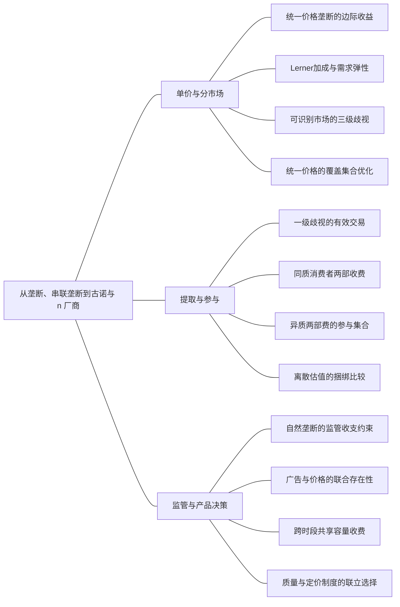

### 本专题知识联系

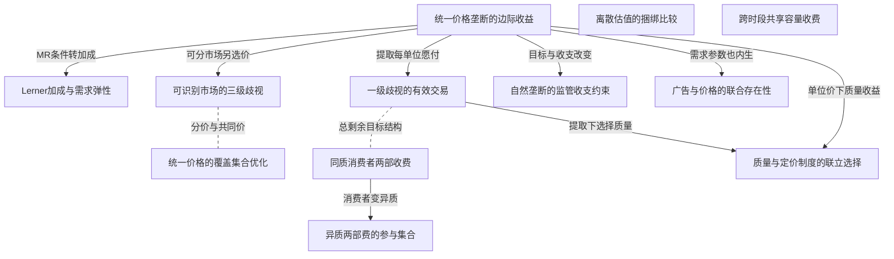

关系图中的箭头表示有方向的联系；虚线表示对照或类比。图中只画本专题主归属节点；跨专题关系在逐条命题中列明，可在练习室逐点追踪。具体成立条件以逐条说明为准。

### KMI053 统一价格垄断的边际收益

身份：既有资料概括

还用于：税制改变哪条约束，福利由谁承担；技术到成本，成本到供给，供给到进入；博弈模型：策略、时序、信息与执行；劳动市场：供给、需求与工资制度；私人信息到机制：谁知道什么，谁选择什么

**定义与对象**

垄断者扩大销量会降低所有销售单位的价格，因此用边际收益而非售价决定产量。

**何时调用**

逆需求、利润最优、税收或质量容量改变。

**适用条件**

明确有效需求段、成本和可行数量，驻点还需与边界/退出比较。

**核心公式与机制**

$MR=P(Q)+QP_Q$，光滑内点 $MR=MC$。

**推导与理由**

对收入P乘Q求导包含新增单位收入与旧销量降价损失，再扣边际资源费用。

**边界与易错**

垄断没有独立于需求的竞争供给曲线；固定税虽不改内点也可能导致退出。

**整理依据**

- card FM28：**题干触发。**给逆需求与成本，求价格、产量、加成、无谓损失、从量税或利润税。  $$ \begin{gathered} \max_{Q\ge0}\{P(Q)Q-C(Q)\}, \\ MR=P+QP'=MC, \end{gathered} $$ $$ \begin{gathered} \frac{P-MC}{P}=\frac1{|\varepsilon|} \\ \text{光滑内点}. \end{gathered} $$ 线性$P=a-bQ,b>0$、常数$MC=c<a$时： $$ \begin{gathered} Q_M = \frac{a - c}{2 b} , \\ P_M = \frac{a + c}{2} , \\ Q_C = \frac{a - c}{b} , \\ D W L = \frac{(a - c)^2}{8 b} . \end{gathered} $$  **步骤。**求可行正量候选并与退出比较；税$t$进入边际成本$c+t$，固定一次性税不改变未退出企业的内点量；比例利润税$0\le\tau<1$在完整税基及无其他约束时只缩放目标。常弹性需求$Q=AP^{-E}$、$E>1$时$P = \frac{E c}{E - 1}$。  **边界检查。**固定成本影响经营与否但不改已开工内点FOC。若常弹性模型$c=0$，或$E\le1$，常规有限内点公式可能失效，需检查价格/数量边界。福利积分的收敛性也须检验。  **原书与题源。**尼科尔森第14章PDF227页起、第1题PDF232；范里安第25章PDF68—71；2023第五题PDF19、2014第八题PDF65，后者比较从量税、利润税与最优补贴。

### KMI054 Lerner加成与需求弹性

身份：既有资料概括

还用于：税制改变哪条约束，福利由谁承担；博弈模型：策略、时序、信息与执行

**定义与对象**

正价正量垄断内点的相对价格加成由面对的需求弹性决定。

**何时调用**

求垄断加成或判断需求富有弹性区间。

**适用条件**

下降需求P的导数为负、可微单一定价、无额外数量约束，p和Q为正；MC正才能直接推出需求富弹性。

**核心公式与机制**

内点 $(P-MC)/P=1/|\varepsilon|$，MC为正时加成小于1。

**推导与理由**

把MR写成售价乘一加弹性倒数，再用MR等于MC移项。

**边界与易错**

Lerner不是任意行业因果定律，零成本或弹性不满足常规域时需重查有限最优。

**整理依据**

- card FM28：**题干触发。**给逆需求与成本，求价格、产量、加成、无谓损失、从量税或利润税。  $$ \begin{gathered} \max_{Q\ge0}\{P(Q)Q-C(Q)\}, \\ MR=P+QP'=MC, \end{gathered} $$ $$ \begin{gathered} \frac{P-MC}{P}=\frac1{|\varepsilon|} \\ \text{光滑内点}. \end{gathered} $$ 线性$P=a-bQ,b>0$、常数$MC=c<a$时： $$ \begin{gathered} Q_M = \frac{a - c}{2 b} , \\ P_M = \frac{a + c}{2} , \\ Q_C = \frac{a - c}{b} , \\ D W L = \frac{(a - c)^2}{8 b} . \end{gathered} $$  **步骤。**求可行正量候选并与退出比较；税$t$进入边际成本$c+t$，固定一次性税不改变未退出企业的内点量；比例利润税$0\le\tau<1$在完整税基及无其他约束时只缩放目标。常弹性需求$Q=AP^{-E}$、$E>1$时$P = \frac{E c}{E - 1}$。  **边界检查。**固定成本影响经营与否但不改已开工内点FOC。若常弹性模型$c=0$，或$E\le1$，常规有限内点公式可能失效，需检查价格/数量边界。福利积分的收敛性也须检验。  **原书与题源。**尼科尔森第14章PDF227页起、第1题PDF232；范里安第25章PDF68—71；2023第五题PDF19、2014第八题PDF65，后者比较从量税、利润税与最优补贴。
- card MC06：垄断者选择产量并由需求决定售价，边际收益通常低于价格。因此利润最大化用MR等于MC，不能套竞争的价格等于MC。标准正边际成本单一定价垄断的光滑内点位于需求富有弹性的区段：若需求缺乏弹性，减产可同时提高收入并节约成本。垄断没有独立于需求的单一供给曲线。  价格歧视需要一定市场势力、区分消费者或购买数量的机制以及限制转售。一级歧视识别每单位支付意愿，在理想条件下扩大产出至有效水平并提取剩余；三级歧视按可识别群体分别定价；二级歧视通过数量或质量菜单诱导自我选择。后者必须满足参与和激励相容，不能把完全信息下各类型最优合同直接当作筛选解。  两部收费由固定入场费和单位价组成。同质消费者时，可把单位价定在MC并用入场费提取消费者剩余；消费者异质时，固定费会影响谁参加，最优单位价可能高于MC。福利最优与利润最优是两种目标，固定费、补贴和税额的转移还需与真实成本分开。

### KMI055 可识别市场的三级歧视

身份：既有资料概括

**定义与对象**

市场可分隔且限制转售时，企业按每个群体边际收益配置销量，共同总成本决定同一边际成本。

**何时调用**

隔离地区、群体价格与歧视利润。

**适用条件**

市场可识别且不能套利转售；活跃集合与非负需求需核。

**核心公式与机制**

各活跃市场 $MR_i=MC(\sum_jq_j)$。

**推导与理由**

每增某市场一单位都引起同一总成本增量，而各市场收入响应不同，最优等其边际收益。

**边界与易错**

不能在共同总成本下为各市场任意设不同MC，也不保证歧视提高每人福利。

**整理依据**

- card FM29：共同总成本意味着各市场边际成本是同一个$MC(Q)$

### KMI056 统一价格的覆盖集合优化

身份：既有资料概括

还用于：税制改变哪条约束，福利由谁承担；私人信息到机制：谁知道什么，谁选择什么

**定义与对象**

统一价下群体退出使利润分段，必须比较各服务集合候选与截断点。

**何时调用**

同时服务几类、只服务高型、共同价全局最优。

**适用条件**

同一价格面对全部群体，不能假装低型在其愿付价以内退出。

**核心公式与机制**

按保留价分段加总需求，每段求利润驻点并回验该段的实际购买者，再全局比较。

**推导与理由**

相同价格同时决定单位利润和谁购买，区间之外的“只服务高型”驻点可能事实上吸引低型。

**边界与易错**

给定服务集合的候选不是全局解，不得保留错误活跃集合。

**整理依据**

- card FM29：不同区间的驻点要回验是否真的覆盖相应群体。

### KMI057 一级歧视的有效交易

身份：既有资料概括

还用于：私人信息到机制：谁知道什么，谁选择什么

**定义与对象**

能对每单位提取支付意愿时，企业最大化交易总愿付减真实成本。

**何时调用**

完全歧视、可识别每单位估值、剩余提取。

**适用条件**

市场势力、信息与不可转售允许提取，参与和固定费用另核。

**核心公式与机制**

$\Pi(Q)=\int_0^QP(q)dq-C(Q)$，内点 $P(Q)=MC(Q)$。

**推导与理由**

新增单位可取得该单位完整愿付，不再因统一降价损失原单位收入，因此有效扩量。

**边界与易错**

有效总量不等消费者更好或分配公平，消费者净剩余可能被全部提取。

**整理依据**

- card FM30：**题干触发。**逐单位支付意愿、完美歧视、会员费、入场费与单位使用价。  **变量与前提。**需求可逆、无转售、可识别支付意愿或同质消费者。一级歧视利润写为 $$ \begin{gathered} \Pi(Q)=\int_0^QP(q)\,dq-C(Q), \\ P(Q)=MC(Q)\ \text{内点}. \end{gathered} $$ 同质消费者两部收费$(F,p)$且每位按$q(p)$购买： $$ \begin{gathered} F\le CS(p), \\ \Pi=N[F+(p-c)q(p)]-F_0. \end{gathered} $$  **步骤。**同质、全参与且无其他约束时取$F=CS(p)$，把目标化为每人总剩余，得到$p=c$、固定费提取相应剩余。异质消费者则分别计算各类型参加约束，按参与集合比较利润，不能只把全部人的CS加进同一个固定费。  **边界检查。**一级歧视的有效产出不等于公平分配。固定成本、参加门槛、外部选择或高需求群体信息租金会改变能提取的数额。边际成本依总量变化时，需联立所有消费者的用量。  **原书与题源。**平新乔第8讲网球俱乐部第17题PDF172；范里安第26章PDF73—74；2023第六题人大合订PDF19以投保人类型比较一级、三级歧视和不能识别类型的定价。

### KMI058 同质消费者两部收费

身份：既有资料概括

**定义与对象**

固定入场费受参与剩余上界约束，单位价决定使用量；同质全参与可把目标化为总剩余。

**何时调用**

会员费、固定费与单位价格联合选择。

**适用条件**

消费者同质、外部选择已给、允许固定费且能限制转售；经营固定费与参与都需核。

**核心公式与机制**

$F\le CS(p)$；满足条件时p等MC，F提取相应CS。

**推导与理由**

将绑定参与费代入利润，单位价的作用变成决定每人交易总剩余，因而按有效量选择。

**边界与易错**

若消费者异质不能把全部人的CS塞进同一个共同固定费。

**整理依据**

- card FM30：同质、全参与且无其他约束时取$F=CS(p)$

### KMI059 异质两部费的参与集合

身份：既有资料概括

还用于：税制改变哪条约束，福利由谁承担；私人信息到机制：谁知道什么，谁选择什么

**定义与对象**

共同固定费需满足所有实际入场者参与，排除低需求者可能比全覆盖更有利。

**何时调用**

异质会员、同时服务或只服务某类。

**适用条件**

同一F和p适用于所有可选者，必须核高型和低型是否各自愿入场。

**核心公式与机制**

分别求每个可实施参与集合的利润，核被排除者不会选择共同合同，再全局比较。

**推导与理由**

共同固定费通常受低剩余者约束；为提取高型可能提高费并放弃低型交易。

**边界与易错**

高型剩余更高时不能用同一合同只让低型入场而高型拒绝；利润增不保证效率增。

**整理依据**

- card FM30：异质消费者则分别计算各类型参加约束，按参与集合比较利润

### KMI060 离散估值的捆绑比较

身份：既有资料概括

**定义与对象**

把商品合成套装会改变消费者总估值的分散程度，从而影响统一价格可提取收入。

**何时调用**

各最多买一件、估值矩阵、纯捆绑与单卖。

**适用条件**

明确套装是否可拆、边际成本、购买无差异约定和真实购买人数。

**核心公式与机制**

枚举每件或套装的保留价端点，用实际销售人数乘价格比较；相关性不同需重算。

**推导与理由**

负相关估值可能在套装中互相抵消，使总估值集中；正相关未必有同样提取收益。

**边界与易错**

捆绑不一定严格增利润，离散需求不能套连续FOC。

**整理依据**

- review MI046：估值离散、各最多买一件，分别枚举单品与套装保留价

### KMI061 自然垄断的监管收支约束

身份：既有资料概括

还用于：技术到成本，成本到供给，供给到进入

**定义与对象**

固定经营成本使MC定价可能亏损，收支平衡价格与福利最优价不必相同。

**何时调用**

自然垄断、补贴、平均成本监管及多个收支平衡根。

**适用条件**

先核是否营业；财政补贴真实筹资成本是否计入要明确。

**核心公式与机制**

MC定价按边际资源效率选量，再求固定成本缺口；无补贴则解收入等成本并比较各可行根福利。

**推导与理由**

边际条件不覆盖固定经营成本，AC约束又可能产生高低量两支，选福利较高支需看真实剩余。

**边界与易错**

不能只报一个AC根；补贴是转移，不在同一总剩余中重复扣。

**整理依据**

- case CMI10：一家企业提供公共服务，需求为 $p=26-Q$，$0\le Q\le26$。正产量的资源成本为 $C(Q)=64+2Q$，固定经营费64在营业时发生，停业不发生。企业原来不受价格监管。政府可分别采取边际成本定价补贴、要求营业收支平衡，或征税；各制度独立比较。
- case CMI10：营业利润为 $(26-Q)Q-64-2Q=24Q-Q^2-64$，FOC为 $24-2Q=0$，故Q12、p14、利润80。目标严格凹、数量域满足且利润高于停业0，故选择营业。消费者剩余为 $\frac12(26-14)\cdot12=72$，总剩余为152，也可由总愿付 $26Q-\frac12Q^2$ 减成本，在Q12得到152。
- case CMI10：政府规定单位价等于边际成本，求服务量、企业所需补贴及总剩余。说明补贴的核算与政策边界。
- case CMI10：边际成本2，规定p2时需求Q24。收入48，成本 $64+48=112$，企业亏损64，至少需补贴64使其弱参与营业。总愿付减真实成本为 $26\cdot24-\frac12\cdot24^2-112=224$。补贴是政府向企业的转移，若无额外筹资成本不能再从224扣一次；但现实税收扭曲或执行成本须另计。Q24处边际愿付等于边际成本，且224高于停业0，故给定资源成本下有效。
- case CMI10：政府不允许补贴，要求正产量时收入恰等成本。求所有可行价格与数量，并选择总剩余较高的一支，说明选择依据。
- case CMI10：营业收支平衡为 $(26-Q)Q=64+2Q$，即 $Q^2-24Q+64=0$，解得 $Q_\pm=12\pm4\sqrt5$，两者均在正需求域。对应价格为 $p_\pm=14\mp4\sqrt5$，都高于边际成本2。营业总剩余 $W(Q)=24Q-\frac12Q^2-64$，在 $0<Q<24$ 上导数 $24-Q>0$。两根都低于24，所以选较大产量 $12+4\sqrt5$、较低价格 $14-4\sqrt5$。利用根关系可得两支福利 $W_\pm=112\pm48\sqrt5$；高量支福利约219.33，接近但仍低于MC方案224。
- case CMI10：恢复无价格监管、无补贴，改对企业每单位服务征税4。求量价、企业利润、税收和总剩余，与第一问比较。
- case CMI10：税后利润 $\Pi=(26-Q)Q-64-2Q-4Q=20Q-Q^2-64$，FOC得Q10、p16。利润 $100-64=36>0$，故仍营业，税收40。总剩余计真实资源而不把税款另当资源成本，得 $W=24\cdot10-\frac12\cdot10^2-64=126$；亦可由CS50、利润36、税收40加总。相对第一问量减2、价升2、总剩余下降26。生产者法定缴税不意味着其独自承担全部经济负担。
- case CMI10：取消单位税，改收固定经营税，税额等于第四问实际收入，仍无价格监管。求企业行为与总剩余。说明为什么不能不加条件地把本题结果推广到任意固定税。
- case CMI10：固定税为40。营业利润 $24Q-Q^2-64-40$ 的边际条件与无税相同，故Q12、p14。税后利润 $80-40=40>0$，企业仍营业；CS72、税收40，加总总剩余 $72+40+40=152$，恢复无税配置，比单位税下126高26。固定税没有边际数量楔，但会影响营业参与：若税额超过无税最大经营利润80，企业会退出，等于80时需弱参与约定。故“固定税不改数量”只在企业仍营业的分支成立，不能忽略可避免费和进入退出。
- case CMI10：平均成本方程有两根，不能只报一根；补贴和税收为转移，固定税超过营业利润会引发退出。
- case CMI10：不引用原题图：本综合题的参数、条件变化及问次与原图未逐项完全一致。解答以方程、可行域与关键数量给出可核验关系；本题没有另设必须作图的小问。

### KMI062 广告与价格的联合存在性

身份：既有资料概括

**定义与对象**

广告改变需求后，条件最优定价还须代回广告费用检查全局利润是否有界。

**何时调用**

广告强度、sqrt广告效应、改变广告费用曲率。

**适用条件**

广告非负、实际正需求域和成本规则明确，不能仅联立FOC假定有限解。

**核心公式与机制**

先给定广告优化价格/数量，再比较约化利润的增长与费用曲率及零广告边界。

**推导与理由**

若需求扩张带来的最优经营利润增长快于广告成本，规模会持续扩张而无有限最优。

**边界与易错**

没有驻点时也可能是无界而非零边界最优；修改成本后须重算。

**整理依据**

- review MI048：费用曲率是否足够约束广告收益，是有限最优存在的关键。

### KMI063 跨时段共享容量收费

身份：既有资料概括

还用于：技术到成本，成本到供给，供给到进入

**定义与对象**

多个时段使用同一容量，新增容量的运营边际收益只在受限时段出现并加总。

**何时调用**

高峰低谷、共享设备、容量成本与价格。

**适用条件**

容量只付一次，时段数量分别不超共同K，运营MC与容量成本分开。

**核心公式与机制**

给定K逐期选量；最优容量使各受限期影子收益之和与容量边际成本比较。

**推导与理由**

低谷未受限时再增K不提高该期利润，高峰影子价可单独承担容量成本。

**边界与易错**

不能对每时段重复收费同一容量，也不能在未受限低谷强加正影子价。

**整理依据**

- review MI049：先按容量是否约束各时段分段，再令各期容量影子收益之和等于容量成本。

### KMI064 质量与定价制度的联立选择

身份：既有资料概括

**定义与对象**

质量改变各购买单位愿付，数量与质量须随可提取收入方式共同优化。

**何时调用**

厂商选质量和数量、一级歧视与单位定价比较。

**适用条件**

质量成本、需求及是否完全提取明确；非负域和联合二阶条件须核。

**核心公式与机制**

完全提取按总愿付减成本；统一单位价按边际愿付乘销量计收入，两者质量激励不同。

**推导与理由**

质量提高对所有购买单位有收益，企业是否能收回全部收益取决于定价制度与销量。

**边界与易错**

质量更高不自动使消费者净剩余更高，也不能只比较最后单位估值。

**整理依据**

- review MI050：能提取全部愿付价时最大化总剩余；只能统一单位定价时用逆需求计收入

### 关系命题与条件

#### EMI081 统一价格垄断的边际收益 → Lerner加成与需求弹性

推导；编者推导

正价格、正销量的统一垄断内点可把MR等MC改写为Lerner与需求弹性关系。

适用条件：可微逆需求且无额外绑定量约束。

理由：收入导数包含价格变动项，用需求弹性倒数替换即可移项。

依据：card FM28「**题干触发。**给逆需求与成本，求价格、产量、加成、无谓损失、从量税或利润税。  $$ \begin{gathered} \max_{Q\ge0}\{P(Q)Q-C(Q)\}, \\ MR=P+QP'=MC, \end{gathered} $$ $$ \begin{gathered} \frac{P-MC}{P}=\frac1{|\varepsilon|} \\ \text{光滑内点}. \end{gathered} $$ 线性$P=a-bQ,b>0$、常数$MC=c<a$时： $$ \begin{gathered} Q_M = \frac{a - c}{2 b} , \\ P_M = \frac{a + c}{2} , \\ Q_C = \frac{a - c}{b} , \\ D W L = \frac{(a - c)^2}{8 b} . \end{gathered} $$  **步骤。**求可行正量候选并与退出比较；税$t$进入边际成本$c+t$，固定一次性税不改变未退出企业的内点量；比例利润税$0\le\tau<1$在完整税基及无其他约束时只缩放目标。常弹性需求$Q=AP^{-E}$、$E>1$时$P = \frac{E c}{E - 1}$。  **边界检查。**固定成本影响经营与否但不改已开工内点FOC。若常弹性模型$c=0$，或$E\le1$，常规有限内点公式可能失效，需检查价格/数量边界。福利积分的收敛性也须检验。  **原书与题源。**尼科尔森第14章PDF227页起、第1题PDF232；范里安第25章PDF68—71；2023第五题PDF19、2014第八题PDF65，后者比较从量税、利润税与最优补贴。」

#### EMI083 统一价格垄断的边际收益 → 可识别市场的三级歧视

条件变化；编者推导

从统一价改为可识别隔离市场价格后，收入边际条件按每个市场分别写，但总MC仍共同。

适用条件：不能转售且群体可识别。

理由：各市场收入变化独立，总成本却随合计销量变。

依据：card FM29「共同总成本意味着各市场边际成本是同一个$MC(Q)$」

#### EMI084 可识别市场的三级歧视 → 统一价格的覆盖集合优化

对照；编者推导

三级歧视允许逐市场量价，统一价使覆盖集合和总需求随共同p同时改变。

适用条件：两制度用同一需求、成本与群体，分别核退出。

理由：共同价格约束减少可选菜单，不能在统一价中保留各自歧视价格。

依据：card FM29「**题干触发。**不同国家、品牌或群体需求，能否分别定价，统一价格覆盖几个市场。  $$ \begin{gathered} \max_{q_i\ge0}\sum_iP_i(q_i)q_i-C\left(\sum_iq_i\right), \\ MR_i=MC(Q)\ \text{活跃内点}. \end{gathered} $$ 若$P_i=a_i-b_iq_i$、$b_i>0$且$MC=c$，则$q_i = \frac{(a_i - c)_+}{2 b_i}$，正量市场价格$\frac{a_i + c}{2}$。  **统一价格步骤。**写$Q (p) = \sum_i [\frac{a_i - p}{b_i}]_+$，按截断价$a_i$分区间；在每区最大化$pQ(p)-C(Q(p))$，加上各截断点，再比较全局利润。不同区间的驻点要回验是否真的覆盖相应群体。  **边界检查。**共同总成本意味着各市场边际成本是同一个$MC(Q)$，不是给每市场随意设一个成本。弹性较小群体的加价率通常较高，但需求零点、退出和约束会破坏简单比较。价格歧视能提高利润，不保证总福利或每类消费者福利提高。  **原书与题源。**平新乔第8讲、尼科尔森第14章第6题PDF236及第11章第2题PDF172；2007计算5题人大合订PDF96，成本是总量二次函数。五一作业PDF14计算8题P01-039给两线性市场，适合统一价格覆盖分段。」

#### EMI086 统一价格垄断的边际收益 → 一级歧视的有效交易

条件变化；编者推导

允许一级歧视后，新增交易收入变为该单位愿付而不损失原销量售价。

适用条件：完整识别与提取、无转售、参与可实施。

理由：统一价的侵蚀原收入项消失，使数量条件从MR等MC变为P等MC。

依据：card FM30「**题干触发。**逐单位支付意愿、完美歧视、会员费、入场费与单位使用价。  **变量与前提。**需求可逆、无转售、可识别支付意愿或同质消费者。一级歧视利润写为 $$ \begin{gathered} \Pi(Q)=\int_0^QP(q)\,dq-C(Q), \\ P(Q)=MC(Q)\ \text{内点}. \end{gathered} $$ 同质消费者两部收费$(F,p)$且每位按$q(p)$购买： $$ \begin{gathered} F\le CS(p), \\ \Pi=N[F+(p-c)q(p)]-F_0. \end{gathered} $$  **步骤。**同质、全参与且无其他约束时取$F=CS(p)$，把目标化为每人总剩余，得到$p=c$、固定费提取相应剩余。异质消费者则分别计算各类型参加约束，按参与集合比较利润，不能只把全部人的CS加进同一个固定费。  **边界检查。**一级歧视的有效产出不等于公平分配。固定成本、参加门槛、外部选择或高需求群体信息租金会改变能提取的数额。边际成本依总量变化时，需联立所有消费者的用量。  **原书与题源。**平新乔第8讲网球俱乐部第17题PDF172；范里安第26章PDF73—74；2023第六题人大合订PDF19以投保人类型比较一级、三级歧视和不能识别类型的定价。」

#### EMI087 一级歧视的有效交易 → 同质消费者两部收费

方法类比；编者类比

一级歧视和同质全参与两部费都可把可提取利润化为交易总剩余再选有效数量。

适用条件：仅在能提取相关剩余及参与条件满足时作目标结构类比，收费形式并不相同。

理由：前者逐单位定价，后者由单位价加固定费实施，共有目标不表示支付路径相同。

依据：card FM30「把目标化为每人总剩余」

#### EMI088 同质消费者两部收费 → 异质两部费的参与集合

条件变化；编者推导

消费者异质且仍要求共同固定费时，低型参与可能限制收费，原同质MC价格结论需重求。

适用条件：同一公开合同可被各类型选择。

理由：能够提取一人的CS不代表所有人都愿付同一费。

依据：card FM30「不能只把全部人的CS加进同一个固定费。」

#### EMI089 异质两部费的参与集合 → 财政转移与真实福利核算

机制；编者推导

共同费提高利润可通过转移和排除两条渠道，只有后者直接改变有效交易总收益。

适用条件：与相同技术和需求的真实资源基准比较。

理由：收取固定费是主体间转移，但拒绝入场会取消交易。

依据：case CMI09「改会员方案使利润增加22，消费者剩余减少29，总剩余减少7。」

#### EMI091 统一价格垄断的边际收益 → 自然垄断的监管收支约束

条件变化；编者推导

无监管垄断追求利润，MC或AC监管分别加入效率价格或收支约束，需重求可行配置。

适用条件：同一需求成本，制度独立比较。

理由：需求和技术不变不代表企业可自由选择的价格条件不变。

依据：case CMI10「要求正产量时收入恰等成本」

#### EMI092 统一价格垄断的边际收益 → 广告与价格的联合存在性

机制；编者推导

广告改变需求后，先给定广告的垄断最优只是联合问题的一层，还须优化约化利润。

适用条件：价格与广告可同时选。

理由：条件最优不能保证广告维度上的有限全局解。

依据：review MI048「先给定广告解定价，再检查约化利润是否有界与凹性。」

#### EMI094 一级歧视的有效交易 → 质量与定价制度的联立选择

推导；编者推导

一级歧视能取得所有购买单位的质量增益，因此质量与数量共同按总愿付减真实成本优化。

适用条件：质量成本及愿付函数题给，全部提取和参与可实施。

理由：质量提高所有购买单位愿付，这些收益在完全提取制度下全部进入利润。

依据：review MI050「能提取全部愿付价时最大化总剩余；只能统一单位定价时用逆需求计收入，质量与数量须联立最优。」；review MI050「能提取全部愿付价时，厂商收款等于V，净利润即总剩余：  $$\Pi_D(q,s)=(8+s)q-\frac{q^2}{2}-s^2.$$  对q、s的一阶条件分别为 $8+s-q=0$、$q-2s=0$，联立得 $s=8,q=16$。Hessian为 $\begin{pmatrix}-1&1\\1&-2\end{pmatrix}$，首主子式负、行列式正，所以负定；所得非负内点为唯一全局最优。代入利润及总剩余均64，消费者净剩余为0。」；review MI050「消费者边际愿付价为 $\frac{\partial V}{\partial q}=10+s-q$，故统一价格为该逆需求。厂商利润变为  $$\Pi_U=(10+s-q)q-(2q+s^2)=(8+s)q-q^2-s^2.$$  FOC为 $8+s-2q=0$、$q-2s=0$，故 $s=\frac83,q=\frac{16}{3}$，价 $\frac{22}{3}$，利润 $\frac{64}{3}$。Hessian为 $\begin{pmatrix}-2&1\\1&-2\end{pmatrix}$，负定，确认全局最优。」；review MI050「质量提高使每个购买单位的愿付价都上升；完全提取能取得全部这一收益，故选择社会有效质量8。统一价必须按边际买者定价、销量较低，厂商能收回的质量收益较少，最优质量降至 $\frac83$。不能只比较最后一单位的支付意愿，也不能从质量更高直接推出消费者净剩余更高。」

#### EMI096 统一价格垄断的边际收益 → 质量与定价制度的联立选择

推导；编者推导

统一单位价时质量与数量应对售价乘量减成本联合优化，不能把所有单位愿付都当收入。

适用条件：消费者按边际愿付决定购买，企业只收共同单位价。

理由：提高质量还改变最优销量，企业可收回的质量收益由这一实际收入函数决定。

依据：review MI050「只能统一单位定价时用逆需求计收入」

#### EMI111 Lerner加成与需求弹性 → 古诺份额与HHI加成

方法类比；编者类比

独家垄断加成为弹性倒数，古诺内点还乘本厂份额。

适用条件：市场需求弹性同一口径，标准行为假设分别满足。

理由：n为1的数量竞争退化为独家垄断，但多厂市场弹性条件不能照搬。

依据：review MI053「独家垄断n为1时才推出市场需求弹性大于1」

#### EMI116 统一价格垄断的边际收益 → 合并的决策主体与利润基准

方法类比；编者类比

单产品利润定价与合并多产品联合定价均从实际收入减成本优化，但后者必须计交叉销售效应。

适用条件：需求与域明确，仅作优化方法类比。

理由：增加一种产品的价格会同时改变几类销量。

依据：case CMI12「联合价格FOC要包含另一产品利润」

#### EMI186 异质两部费的参与集合 → 筛选菜单的IC与IR

方法类比；编者类比

异质共同两部费与筛选菜单均核真实参与，菜单还要逐型核对其他合同的选择。

适用条件：两类制度各自支付和可选集合明确。

理由：愿参与某合同不表示其不更愿选另一份。

依据：card FM31「**题干触发。**高低需求、数量折扣、质量套餐、不能观察类型的垄断菜单。  **变量与前提。**类型$\theta_H>\theta_L>0$，效用$\theta v(q)-T$，成本$C(q)$，两类型概率$\lambda_H,\lambda_L$；外部选择归零仅是便于记忆的归一化。  $$ \begin{gathered} \theta_i v(q_i)-T_i\ge0 \\ (IR_i), \end{gathered} $$ $$ \begin{gathered} \theta_i v(q_i)-T_i\ge\theta_i v(q_j)-T_j \\ (IC_i). \end{gathered} $$  **步骤。**写期望利润$\sum_i\lambda_i[T_i-C(q_i)]$和四项约束。标准单交叉、内点且完全覆盖解常由低类型IR、高类型IC绑定，给$T_L=\theta_Lv(q_L)$、$T_H=\theta_Hv(q_H)-(\theta_H-\theta_L)v(q_L)$。代回利润后高类型数量可无扭曲，低类型数量向下扭曲；再回验另两约束与$q_H\ge q_L$。  **边界检查。**绑定模式必须验证，不能把“低类型必扭曲、高类型无扭曲”用于所有筛选模型。可排除低类型、零质量、有限责任或不同外部选择时要重新比较。套餐支付$T$与单位价格不能混写。  **原书与题源。**平新乔第8讲差别收费、第14讲筛选；范里安第26章PDF73—74；项目“名校综合本”PDF90武汉818经济学2015第5题NC4-武汉818-2015-5作为菜单相关补练。此处使用一般符号，不把该题具体数据虚构为本模板条件。」

### 对应题目分问路径

#### MI041

隔离价格与统一价分别优化实际服务市场。

**第1问**

本问任务：求两隔离市场分别定价的量价利润。

两隔离市场分别写MR并与共同MC4相等，核各量非负。

调用：KMI053 统一价格垄断的边际收益；KMI055 可识别市场的三级歧视

联系：EMI083

**第2问**

本问任务：分段求统一定价全局最优并比较服务范围。

统一价时需求按退出价分段，相同价格不能沿用两套独立最优，比较截断点与停业。

调用：KMI015 市场需求的分段加总；KMI053 统一价格垄断的边际收益；KMI056 统一价格的覆盖集合优化

联系：EMI085

#### MI042

成本参数改变是否覆盖低需求者。

**第1问**

本问任务：求同时服务两类与只服务高型的候选。

先给同时覆盖和只服务高型的有效价格域，在各域优化统一价利润。

调用：KMI015 市场需求的分段加总；KMI053 统一价格垄断的边际收益；KMI056 统一价格的覆盖集合优化

联系：EMI085

**第2问**

本问任务：在整个 $0\le c\le8$ 区间比较服务集合候选，检验各价格分支的有效性。

c在0至8全区间比较候选，不能在低型仍购买的价格下假设其退出。

调用：KMI053 统一价格垄断的边际收益；KMI056 统一价格的覆盖集合优化

联系：本问直接应用统一价格垄断的边际收益、统一价格的覆盖集合优化，所列任务没有另要求由一个独立结论推出另一个结论，不强加逻辑推出边。

#### MI043

定价权变化改变收入边际条件与剩余归属。

**第1问**

本问任务：求统一垄断和一级歧视的量价或总收费、利润及剩余。

分别用统一MR与完全提取的愿付条件选量，核利润、消费者剩余和真实总剩余。

调用：KMI021 财政转移与真实福利核算；KMI053 统一价格垄断的边际收益；KMI057 一级歧视的有效交易

联系：EMI086

**第2问**

本问任务：解释效率和消费者福利为何可反向变化。

一级歧视扩大有效交易却提取消费者剩余，效率与分配是本问分别解释的两件事。

调用：KMI021 财政转移与真实福利核算；KMI057 一级歧视的有效交易

联系：本问直接应用财政转移与真实福利核算、一级歧视的有效交易，所列任务没有另要求由一个独立结论推出另一个结论，不强加逻辑推出边。

#### MI044

同质会员由参与费把单位价目标转总剩余。

**第1问**

本问任务：写需求与参与约束并求最优两部合同及利润。

10同质消费者参与费不得超各CS，扣固定经营成本后求全参与合同并核营业。

调用：KMI048 沉没成本与可避免营业费；KMI058 同质消费者两部收费

联系：本问直接应用沉没成本与可避免营业费、同质消费者两部收费，所列任务没有另要求由一个独立结论推出另一个结论，不强加逻辑推出边。

**第2问**

本问任务：与仅统一单位定价比较。

只收单位价恢复MR条件，两部费则用固定费提取交易收益，按同一需求成本比较利润。

调用：KMI053 统一价格垄断的边际收益；KMI058 同质消费者两部收费

联系：本问直接应用统一价格垄断的边际收益、同质消费者两部收费，所列任务没有另要求由一个独立结论推出另一个结论，不强加逻辑推出边。

#### MI045

异质参与集合决定共同会员费。

**第1问**

本问任务：求同时服务两人时的最优统一合同。

同时服务要求低剩余者愿参加，给共同固定费上界后联合优化单位价。

调用：KMI058 同质消费者两部收费；KMI059 异质两部费的参与集合

联系：EMI088

**第2问**

本问任务：求只服务高型的最优合同并选择全局方案。

只高型合同还需低型不参加，再与全覆盖比较；固定费提取和真实排除分开。

调用：KMI059 异质两部费的参与集合

联系：本问直接应用异质两部费的参与集合，所列任务没有另要求由一个独立结论推出另一个结论，不强加逻辑推出边。

#### MI046

离散保留价枚举而非连续求导。

**第1问**

本问任务：在原估值下分别求单卖与纯捆绑最优。

原两人估值负相关，分别枚举单卖与套装端点，以真实人数算利润。

调用：KMI060 离散估值的捆绑比较

联系：本问直接应用离散估值的捆绑比较，所列任务没有另要求由一个独立结论推出另一个结论，不强加逻辑推出边。

**第2问**

本问任务：将两人的(A,B)估值改为(10,10)与(4,4)，重新比较分别销售与纯捆绑，并解释相关性的影响。

估值变正相关后重新加总套装估值再枚举，不从原结果推广必增利润。

调用：KMI060 离散估值的捆绑比较

联系：本问直接应用离散估值的捆绑比较，所列任务没有另要求由一个独立结论推出另一个结论，不强加逻辑推出边。

#### MI047

自然垄断在利润、MC效率和无补贴之间切换。

**第1问**

本问任务：求垄断与边际成本定价的量价利润和补贴。

先无监管MR最优，再MC定价核固定费缺口，税款/补贴转移与真实成本分开。

调用：KMI021 财政转移与真实福利核算；KMI048 沉没成本与可避免营业费；KMI053 统一价格垄断的边际收益；KMI061 自然垄断的监管收支约束

联系：EMI090、EMI091

**第2问**

本问任务：求收支平衡的平均成本价格各支并选择福利较高者。

无补贴收入等成本可能两根，均需核域并按真实总剩余选支，而非任取一根。

调用：KMI061 自然垄断的监管收支约束

联系：本问直接应用自然垄断的监管收支约束，所列任务没有另要求由一个独立结论推出另一个结论，不强加逻辑推出边。

#### MI048

定价候选后还要检查广告方向存在性。

**第1问**

本问任务：求原费用下的候选并判断有限最大值是否存在。

先固定sqrtA求价格量，再代回原广告费A，检查约化目标是否无界。

调用：KMI053 统一价格垄断的边际收益；KMI062 广告与价格的联合存在性

联系：EMI092

**第2问**

本问任务：仅将广告费用由A改为2A，其余需求和生产成本不变，求有限全局最优。

费用改2A改变曲率，重新核非负广告驻点与零边界，不能沿用无界结论。

调用：KMI053 统一价格垄断的边际收益；KMI062 广告与价格的联合存在性

联系：EMI092

#### MI049

共同容量的有效时段和边际价值分别计算。

**第1问**

本问任务：给定容量求两期产量，再全局选择容量。

给K下两时段各受约束，再分段求总利润，容量只收费一次。

调用：KMI052 容量约束的影子价值；KMI053 统一价格垄断的边际收益；KMI063 跨时段共享容量收费

联系：EMI093

**第2问**

本问任务：核两期价格、利润及容量影子价分担。

已求K处高峰受限、低谷不受限，分别核影子价并使合计等于容量成本。

调用：KMI052 容量约束的影子价值；KMI063 跨时段共享容量收费

联系：EMI093

#### MI050

完全提取与单位定价的质量收益口径不同。

**第1问**

本问任务：求一级歧视的质量、数量与最优性。

一级歧视收总愿付，质量和数量联合FOC加Hessian检验，得到总剩余最优。

调用：KMI057 一级歧视的有效交易；KMI064 质量与定价制度的联立选择

联系：EMI094

**第2问**

本问任务：取消一级歧视，改为只允许单位定价，重新求质量与数量，并与原制度比较。

单位价按边际愿付乘量计收入，质量成本仍真实扣除，重求两变量并比较质量。

调用：KMI053 统一价格垄断的边际收益；KMI064 质量与定价制度的联立选择

联系：EMI096

#### CMI09

同一会员市场先覆盖、再排除、再区分类型。

**第1问**

本问任务：求原制度的全局利润最大价格、各人数量及企业利润，检查不同服务集合。

统一单位价先按低型退出价分段，核单高型候选与真实购买者一致。

调用：KMI015 市场需求的分段加总；KMI053 统一价格垄断的边际收益；KMI056 统一价格的覆盖集合优化

联系：EMI085

**第2问**

本问任务：条件于两人均入场，求最优统一两部收费、数量与利润，核两人的参与约束。

共同费两人入场由低型CS约束，优化后逐人验参与。

调用：KMI058 同质消费者两部收费；KMI059 异质两部费的参与集合

联系：EMI088

**第3问**

本问任务：求只服务H的最优两部收费，检查L是否愿模仿入场。

仅H方案必须让L拒绝，共同合同下不允许伪造只L集合。

调用：KMI059 异质两部费的参与集合

联系：本问直接应用异质两部费的参与集合，所列任务没有另要求由一个独立结论推出另一个结论，不强加逻辑推出边。

**第4问**

本问任务：允许企业自由选择服务集合，确定全局会员方案。比较其与第一问的消费者净剩余、总剩余，说明利润变化与效率变化是否同向。

全局利润和净消费者剩余、总剩余分别核算，排除导致的交易损失不等于固定费支付。

调用：KMI021 财政转移与真实福利核算；KMI059 异质两部费的参与集合

联系：EMI089

**第5问**

本问任务：若消费者类型可被可靠识别，允许两人支付不同入场费，但单位价仍可设定，求可提取的最高总利润及数量。与统一会员费比较，说明制度改变了哪项约束。

类型可核实且允许不同费后可分别提取每人剩余，不再受共同F约束；同质目标结构只作总剩余类比。

调用：KMI057 一级歧视的有效交易；KMI058 同质消费者两部收费

联系：EMI087

#### CMI10

同一成本企业在监管和税制下均核经营参与。

**第1问**

本问任务：求无监管的利润最大量价和利润，并比较停业。计算消费者剩余与社会总剩余。

自主MR最优需优于停业，固定64是真实营业成本；CS按需求下方减支出，总剩余用CS加利润核算。

调用：KMI020 消费者剩余与福利面积；KMI021 财政转移与真实福利核算；KMI048 沉没成本与可避免营业费；KMI053 统一价格垄断的边际收益

联系：EMI029

**第2问**

本问任务：政府规定单位价等于边际成本，求服务量、企业所需补贴及总剩余。说明补贴的核算与政策边界。

MC定价先求需求再补偿营业亏损，财政转移不重复计入社会资源损失。

调用：KMI021 财政转移与真实福利核算；KMI048 沉没成本与可避免营业费；KMI061 自然垄断的监管收支约束

联系：EMI090

**第3问**

本问任务：政府不允许补贴，要求正产量时收入恰等成本。求所有可行价格与数量，并选择总剩余较高的一支，说明选择依据。

收支平衡方程两根都可行，沿有效量以下的剩余函数选高量支。

调用：KMI061 自然垄断的监管收支约束

联系：本问直接应用自然垄断的监管收支约束，所列任务没有另要求由一个独立结论推出另一个结论，不强加逻辑推出边。

**第4问**

本问任务：恢复无价格监管、无补贴，改对企业每单位服务征税4。求量价、企业利润、税收和总剩余，与第一问比较。

单位税进入企业MC，重求垄断量价并与停业比较，再把税收加回社会剩余。

调用：KMI017 单位税楔与经济归宿；KMI021 财政转移与真实福利核算；KMI048 沉没成本与可避免营业费；KMI053 统一价格垄断的边际收益

联系：EMI028、EMI097

**第5问**

本问任务：取消单位税，改收固定经营税，税额等于第四问实际收入，仍无价格监管。求企业行为与总剩余。说明为什么不能不加条件地把本题结果推广到任意固定税。

固定税恢复原边际条件但扣经营利润，须核未退出，才能比较税收与资源福利。

调用：KMI017 单位税楔与经济归宿；KMI021 财政转移与真实福利核算；KMI048 沉没成本与可避免营业费；KMI053 统一价格垄断的边际收益

联系：EMI097

## 博弈模型：策略、时序、信息与执行

谁在何时根据什么信息选择何种策略，为什么均衡不同？

从单边偏离出发，区分数量、价格、联合所有权、可信承诺与类型信息；重复激励和空间进入均保留具体实施条件。

### 分支导图

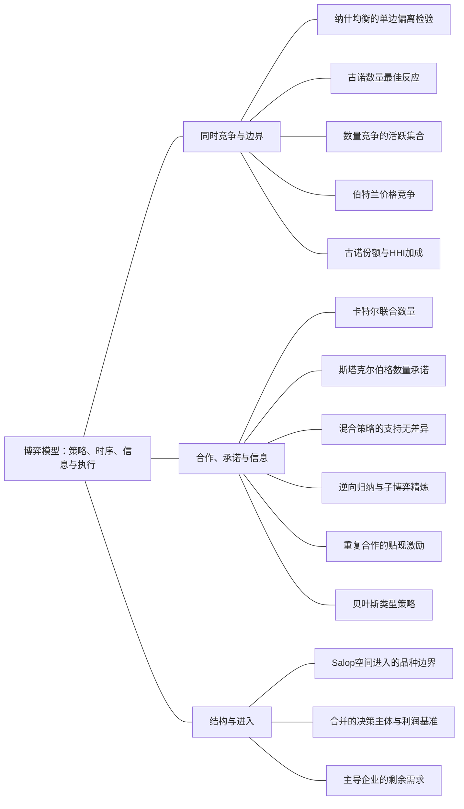

### 本专题知识联系

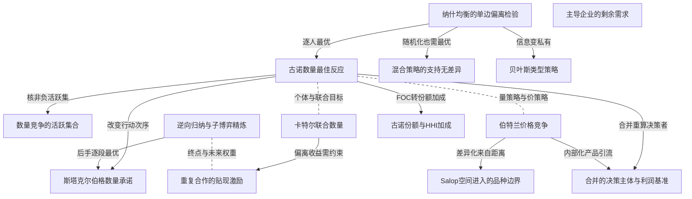

关系图中的箭头表示有方向的联系；虚线表示对照或类比。图中只画本专题主归属节点；跨专题关系在逐条命题中列明，可在练习室逐点追踪。具体成立条件以逐条说明为准。

### KMI065 纳什均衡的单边偏离检验

身份：既有资料概括

还用于：生产效率、外部性与公共品的统一比较；私人信息到机制：谁知道什么，谁选择什么

**定义与对象**

给定他人完整策略，每人自己的策略都是可行最优反应。

**何时调用**

支付矩阵、产量或价格互动的均衡验证。

**适用条件**

明确策略、信息与收益；均衡可多重，也未必联合最优。

**核心公式与机制**

逐人固定他人策略比较所有可行偏离；混合策略还核支持外收益。

**推导与理由**

只有任何一人独自改变均不能改进，才能排除可获利偏离。

**边界与易错**

共同利润高不代表均衡；占优均衡是纳什的特殊情形。

**整理依据**

- card MC07：纳什均衡是每个人的策略都对别人的策略构成最优反应；占优策略不依赖他人的具体策略，占优策略均衡是纳什均衡的特殊情形。收益更高的共同结果未必是均衡，因为一方可能从单独偏离获益。混合策略均衡要求支持中的纯策略无差异，同时支持外的策略不能带来更高收益。  古诺同时选择数量，伯川德同时选择价格，斯塔克尔伯格依次选择数量。改变策略变量或行动顺序会改变最佳反应和均衡，不能仅凭“都是两家企业”互套公式。领导者优势来自可承诺的先行动及对跟随反应的预见；如果动作可无成本撤销，原结论不一定成立。  动态博弈的策略要说明每个可能到达节点怎么做，不能只报均衡路径。子博弈精炼均衡要求在每一子博弈内仍是纳什均衡，排除到达节点后不愿执行的威胁。重复博弈的合作来自当前偏离收益与未来惩罚损失的权衡，惩罚必须可信、偏离可识别，且未来有足够权重。

### KMI066 古诺数量最佳反应

身份：既有资料概括

**定义与对象**

同时选量的企业将其他企业的数量固定，对本厂量优化。

**何时调用**

同质品数量竞争、对称或异质成本。

**适用条件**

逆需求P=a-bQ、b>0，常数MC为c_i；实际非负数量域与需求有效段，求导后才施对称。

**核心公式与机制**

$BR_i=\max\{(a-c_i-bQ_{-i})/(2b),0\}$。

**推导与理由**

本厂增量同时增加销售并压低本厂原销量售价；对手量在本次偏离中不响应。

**边界与易错**

不能把对手反应代入再求导，那会变成顺序决策。

**整理依据**

- card FM32：**题干触发。**同时产量决策、厂商份额、行业加成、非对称成本。  $$ \begin{gathered} \Pi_i = [a - b \sum_j q_j - c_i] q_i , \\ B R_i = \max \{ \frac{a - c_i - b Q_{- i}}{2 b} , 0 \} . \end{gathered} $$ 若$n$家都活跃，$C_\Sigma=\sum_ic_i$： $$ \begin{gathered} Q=\frac{na-C_\Sigma}{b(n+1)}, \\ P=\frac{a+C_\Sigma}{n+1}, \\ q_i=\frac{P-c_i}{b}. \end{gathered} $$ 同成本$c$时$q_i = \frac{a - c}{b (n + 1)}$。一般可微需求的标准古诺内点给 $$ \begin{gathered} \frac{P-MC_i}{P}=\frac{s_i}{|\varepsilon|}, \\ \sum_is_i\frac{P-MC_i}{P}=\frac{HHI}{|\varepsilon|}, \\ HHI=\sum_is_i^2. \end{gathered} $$  **步骤。**先各自FOC，再求活跃集合；若某$q_i\le0$，将其退出后重算，不能保留负产量再取正而不改总量。容量厂商固定边界，其余再解。  **边界检查。**HHI用小数份额，百分比份额算得指数大一万倍。该加成关系是古诺行为条件，不是任意行业“高集中必高价”的证明。  **原书与题源。**平新乔第9讲、尼科尔森第15章第2题PDF249、范里安第28章第1题PDF77；2016第七题PDF54、2021第五题PDF28。

### KMI067 数量竞争的活跃集合

身份：既有资料概括

**定义与对象**

内点产量非正时需改变活跃企业集合并重新求其余企业最优。

**何时调用**

成本差异、退出阈值、负产量候选。

**适用条件**

零产者在实际其他量下不得有正进入边际收益。

**核心公式与机制**

求正产企业均衡，核其量正，再核所有退出者零量最佳。

**推导与理由**

一家退出改变总量及其他人的残余需求，因此全体内点不能简单逐项截零。

**边界与易错**

把负量改零但不重算另一家，通常不满足互为反应。

**整理依据**

- card FM32：不能保留负产量再取正而不改总量

### KMI068 卡特尔联合数量

身份：既有资料概括

**定义与对象**

合作主体共同最大化行业总利润，产量分配另外满足成本与执行约束。

**何时调用**

联合经营、卡特尔和非合作比较。

**适用条件**

能够执行联合数量；异质成本需先作最低成本配置。

**核心公式与机制**

同成本时按行业MR等MC求总量，再按题定分配规则分量。

**推导与理由**

合作内部化增加本厂产量对其他成员收入的损害，故目标有别于古诺。

**边界与易错**

联合最优仍可能有单期偏离诱因，利润最大不等社会最优。

**整理依据**

- card FM33：卡特尔先解联合垄断产量

### KMI069 斯塔克尔伯格数量承诺

身份：既有资料概括

**定义与对象**

先手把观察后行动的后手完整反应纳入自身选择。

**何时调用**

可承诺先行产量、领导优势。

**适用条件**

可观察且不可撤回的承诺，后手各分支均最优。

**核心公式与机制**

先求后手包含零量的反应，再分段代入先手利润比较全域。

**推导与理由**

先手预见其数量会改变后手实际选择，导数包含这一反应。

**边界与易错**

先说话不自动构成承诺；不能把后手量当常数求先手。

**整理依据**

- card FM34：先解跟随者每个可能$q_L$下的最优反应

### KMI070 伯特兰价格竞争

身份：既有资料概括

**定义与对象**

同时价格选择的最佳反应依赖消费者如何在产品之间替代。

**何时调用**

同质微小降价或差异品价格反应。

**适用条件**

同质p等c需同成本、无容量限制和适用分配规则；差异品核正需求。

**核心公式与机制**

差异品给定对手价对自身价格求导；同质品用抢占需求的偏离检验。

**推导与理由**

差异化可保留顾客，使企业提价不至丢失全部需求，价格可高于MC。

**边界与易错**

异质成本的精确纯均衡取决于平价及报价最小单位规则。

**整理依据**

- card FM35：同质模型结论不能套差异产品

### KMI071 混合策略的支持无差异

身份：既有资料概括

**定义与对象**

正概率使用的行动必须给玩家相同期望收益，支持外行动不能更好。

**何时调用**

两行动矩阵、完全混合概率。

**适用条件**

混合概率在0与1之间，纯均衡另查。

**核心公式与机制**

用某人的收益无差异条件求对手的混合概率。

**推导与理由**

若支持内某行动更好，玩家会把全部概率转到该行动。

**边界与易错**

不能用自己的无差异条件直接求自己的概率，也不能漏纯策略解。

**整理依据**

- card FM36：**题干触发。**支付矩阵、无纯策略、概率、进入威胁、先后行动树。  **步骤。**矩阵中逐列标玩家1的最佳反应、逐行标玩家2的最佳反应，交点是纯策略NE。对两行两列，若玩家2选左概率$q$，令 $$ q u_1(U,L)+(1-q)u_1(U,R)=q u_1(D,L)+(1-q)u_1(D,R). $$ 由此求的是玩家2的混合概率$q$；另用玩家2无差异求玩家1概率$p$。  **动态步骤。**每个末端决策节点先选最佳行动，向前回推；最终写出所有节点的完整策略。若存在信息集，不能跨同一信息集分别选不一致行动，逆向归纳适用范围须与信息结构相符。  **边界检查。**混合概率必须在$[0,1]$，支持外策略不得更优；使双方无差异只是候选，不能遗漏已有纯策略。弱占优删除可能影响均衡集合，严格占优删除更稳妥。  **原书与题源。**尼科尔森第8章、平新乔第10—12讲；五一作业PDF19计算19题P01-050为反协调矩阵，纯策略两项，内部混合各$\frac{1}{2}$；T-PING-11-01（PDF228）练开发进入树。

### KMI072 逆向归纳与子博弈精炼

身份：既有资料概括

**定义与对象**

在每个可到达或不可到达的后续子博弈都最优的完整策略排除不可信威胁。

**何时调用**

顺序行动、有限已知重复、路径外威胁。

**适用条件**

完善信息有限博弈可逐节点逆推；信息集不能任意拆开。

**核心公式与机制**

由末端逐步求最优行动，写明每个节点的策略。

**推导与理由**

后续选择必须到时愿意执行，先前威胁才可用来约束当期行为。

**边界与易错**

只写均衡路径的结果不是完整策略；有限重复逆推依赖唯一阶段均衡等条件。

**整理依据**

- card MC07：排除到达节点后不愿执行的威胁

### KMI073 重复合作的贴现激励

身份：既有资料概括

**定义与对象**

当前偏离收益与未来可信惩罚损失的现值比较决定合作能否维持。

**何时调用**

无限重复、触发策略、最低贴现率。

**适用条件**

偏离可识别、惩罚可执行，贴现因子在0至1之间且小于1；需实际求最佳偏离。

**核心公式与机制**

$\Pi_C/(1-\delta)\ge\Pi_D+\delta\Pi_N/(1-\delta)$。

**推导与理由**

偏离只改变本期自身行动；后续损失按从下一期开始的贴现计算。

**边界与易错**

有限已知终点和唯一阶段均衡下不能直接沿用无限期门槛。

**整理依据**

- card FM37：先各自求合作、单期最佳偏离和惩罚均衡的利润

### KMI074 贝叶斯类型策略

身份：既有资料概括

还用于：私人信息到机制：谁知道什么，谁选择什么

**定义与对象**

私有类型玩家的策略为每一可能类型指定行动，其余人按条件分布形成期望。

**何时调用**

私人成本、先验概率与贝叶斯纳什。

**适用条件**

类型和信息集明确；每类行动分别最优，信念与共同先验一致。

**核心公式与机制**

逐类型写知情者最优反应，不知情者将其他类型策略固定并对分布取期望。

**推导与理由**

真实类型改变自己的利益，而不知情者不能事后按未见类型分别行动。

**边界与易错**

期望产量不是每类实际产量；不能先把私人类型平均再抹去策略信息。

**整理依据**

- card FM52：策略是完整函数$a_i(\theta_i)$

### KMI075 Salop空间进入的品种边界

身份：既有资料概括

**定义与对象**

环形空间差异化中店数同时改变局部竞争、距离成本和进入固定成本。

**何时调用**

环形商店、交通费用、自由进入与社会最优。

**适用条件**

单位圆周、单位人口均匀且每人单位需求，线性距离运输成本t>0，每店固定费K>0；充分高估值全覆盖，相邻市场内部边界，整数店数另比。

**核心公式与机制**

对称 $p=c+t/n$，$\Pi=t/n^2-K$；连续近似 $n_E=\sqrt{t/K}$，$n_S=\frac12\sqrt{t/K}$。

**推导与理由**

企业进入从邻店分流顾客，却未内部化抢客影响和重复固定成本，社会另最小化真实交通及设店成本。

**边界与易错**

过多进入是本模型条件结论；不能忽略全覆盖、不足两店或整数限制。

**整理依据**

- card FM53：**题干触发。**消费者沿圆周分布、相邻商店竞争、运输成本、产品种类与自由进入。下式专属于原题线性运输的Salop模型。  **变量与前提。**圆周长1，消费者总量1且均匀，每人单位需求，估值$v$足够高以完全覆盖；$n\ge2$家等距厂，运输成本$t d,t>0$，厂商成本$K+cq,K>0$。企业暂定价时$n$给定，价格变化保持只与最近邻竞争、边界不越相邻厂位置的内部区间。  **需求起式。**本厂价$p_i$、两侧邻居价$p^*$，距本厂$x$的临界消费者满足 $$ \begin{gathered} p_i + t x = p^* + t (\frac{1}{n} - x) , \\ x = \frac{1}{2 n} + \frac{p^* - p_i}{2 t} . \end{gathered} $$ 本厂两侧市场合计$q_i = 2 x = \frac{1}{n} + \frac{p^* - p_i}{t}$，利润$\Pi_i=(p_i-c)q_i-K$。FOC给$p_i = \frac{p^* + c + \frac{t}{n}}{2}$，对称均衡为 $$ \begin{gathered} p^* = c + \frac{t}{n} , \\ q_i^* = \frac{1}{n} , \\ \Pi_i^* = \frac{t}{n^2} - K . \end{gathered} $$  **进入与社会比较。**可连续近似厂商数时，自由进入零利润给$n_E = \sqrt{\frac{t}{K}}$。社会真实成本为 $$ \begin{gathered} T C_S (n) = n K + c + \frac{t}{4 n} , \\ n_S = \frac{1}{2} \sqrt{\frac{t}{K}} . \end{gathered} $$ 所以该特定模型自由进入的品种数为社会最优的两倍，来源于企业未计入抢走邻居顾客的影响和进入固定成本。价格支付是转移，不计为社会真实成本。  **边界检查。**对称完全覆盖可核查$v \ge p^* + \frac{t}{2 n}$；否则需加入不购买和非覆盖段。$n$要求整数时，分别比较相邻整数进入收益与社会成本，不能把根号当精确家数；若连续解小于可用厂商数范围，也要重算。线性运输、单位圆周和单位人口不能换成二次运输或任意市场长度仍用同一系数。  **原书与题源。**尼科尔森第15章第11题原PDF261—263，261页给模型，262页给定价、利润、进入及社会最优问题与推导；本模板与该原页参数化一致。它补充M35的差异产品价格竞争，不能仅用同质伯川德$p=c$概括。

### KMI076 古诺份额与HHI加成

身份：既有资料概括

还用于：从垄断、串联垄断到古诺与 n 厂商

**定义与对象**

标准数量竞争内点的各厂加成与自身份额、市场需求弹性相联系。

**何时调用**

n厂、行业加成与集中度。

**适用条件**

同质品、标准古诺行为、可微需求，下降需求P的导数为负，正价正量并核弹性口径。

**核心公式与机制**

$(P-MC_i)/P=s_i/|\varepsilon|$；份额加权加成为 $HHI/|\varepsilon|$。

**推导与理由**

企业FOC的价格斜率项乘本厂量，除以P并以总量转写弹性。

**边界与易错**

不是集中度导致高价的一般因果证明；多厂不要求市场弹性恒大于1。

**整理依据**

- card FM32：**题干触发。**同时产量决策、厂商份额、行业加成、非对称成本。  $$ \begin{gathered} \Pi_i = [a - b \sum_j q_j - c_i] q_i , \\ B R_i = \max \{ \frac{a - c_i - b Q_{- i}}{2 b} , 0 \} . \end{gathered} $$ 若$n$家都活跃，$C_\Sigma=\sum_ic_i$： $$ \begin{gathered} Q=\frac{na-C_\Sigma}{b(n+1)}, \\ P=\frac{a+C_\Sigma}{n+1}, \\ q_i=\frac{P-c_i}{b}. \end{gathered} $$ 同成本$c$时$q_i = \frac{a - c}{b (n + 1)}$。一般可微需求的标准古诺内点给 $$ \begin{gathered} \frac{P-MC_i}{P}=\frac{s_i}{|\varepsilon|}, \\ \sum_is_i\frac{P-MC_i}{P}=\frac{HHI}{|\varepsilon|}, \\ HHI=\sum_is_i^2. \end{gathered} $$  **步骤。**先各自FOC，再求活跃集合；若某$q_i\le0$，将其退出后重算，不能保留负产量再取正而不改总量。容量厂商固定边界，其余再解。  **边界检查。**HHI用小数份额，百分比份额算得指数大一万倍。该加成关系是古诺行为条件，不是任意行业“高集中必高价”的证明。  **原书与题源。**平新乔第9讲、尼科尔森第15章第2题PDF249、范里安第28章第1题PDF77；2016第七题PDF54、2021第五题PDF28。

### KMI133 合并的决策主体与利润基准

身份：既有资料概括

还用于：从垄断、串联垄断到古诺与 n 厂商

**定义与对象**

企业合并改变独立决策者数量或多产品内部化，获益应与原成员合计利润比较。

**何时调用**

部分古诺合并或替代产品共同所有权。

**适用条件**

原成员、外部企业调整、成本协同与允许营业域必须明确。

**核心公式与机制**

重求合并后全部决策者均衡；替代产品联合定价包含对另一产品利润影响。

**推导与理由**

合并者不只改变自己的决策，还诱发外部最优回应；联合定价会内部化产品间引流。

**边界与易错**

不得只与原一家利润比较，也不能把所有合并简单当卡特尔。

**整理依据**

- card FM33：比较合并体利润与原成员合计利润
- case CMI12：企业内部化提价引流到另一产品的利润

### KMI134 主导企业的剩余需求

身份：既有资料概括

还用于：从垄断、串联垄断到古诺与 n 厂商

**定义与对象**

主导企业可销售量是全市场需求扣随价格变化的竞争边缘供给。

**何时调用**

主导企业和竞争边缘、残余需求弹性。

**适用条件**

同一市场价，边缘供给分支和正剩余需求域明确。

**核心公式与机制**

先构造D(p)减S_f(p)，在有效域反求主导逆需求并以该MR等主导MC。

**推导与理由**

主导提价既减少消费者需求又吸引边缘扩产，两种效应都压缩其销量。

**边界与易错**

不能固定边缘量，也不能以全市场需求直接求主导MR。

**整理依据**

- review MI054：主导企业选择的销量不是全市场需求，因为竞争边缘随价格供货。在 $p\ge10$ 时，  $$Q_d=(100-p)-(p-10)=110-2p.$$  正剩余需求要求p不超过55，逆剩余需求为 $p=55-\frac{Q_d}{2}$。这比直接使用全市场逆需求更平坦，反映提高价格还会吸引边缘扩产。
- review MI054：主导利润为 $(55-\frac{Q_d}{2}-10)Q_d=45Q_d-\frac{Q_d^2}{2}$。FOC为 $45-Q_d=0$，SOC为 $-1$，故主导量45、价32.5，满足10至55的价格范围。边缘供给为22.5，总产量67.5，恰等于市场需求 $100-32.5$。主导利润为 $22.5\times45=1012.5$。
- review MI054：若主导企业提高价格，既会失去部分消费者需求，又会因边缘企业增供而失去额外销量。直接把 $100-p$ 当其需求只计第一种损失，夸大市场势力，产生错误最优价格。竞争边缘应作为随价格调整的供给扣除，不能在主导定价时固定不变。

### 关系命题与条件

#### EMI101 纳什均衡的单边偏离检验 → 古诺数量最佳反应

前置；编者推导

古诺联立的是每厂给定其他数量的最佳反应，而非行业联合最优。

适用条件：同时数量选择。

理由：这正是纳什单边偏离的数量形式。

依据：review MI051「这是非合作纳什均衡，不是双方联合利润最大化。」

#### EMI102 古诺数量最佳反应 → 数量竞争的活跃集合

条件变化；编者推导

内点跨到零量边界后需重新联立活跃企业反应。

适用条件：成本参数使一厂内点非正。

理由：退出改变另一家的残余需求。

依据：review MI052「不能把负产量直接截零却保留原来另一厂商的产量。」

#### EMI103 古诺数量最佳反应 → 卡特尔联合数量

对照；编者推导

古诺固定对手量，卡特尔优化行业总利润，通常产生不同总量。

适用条件：相同需求成本、联合可执行。

理由：合作内部化竞争成员之间的收入影响。

依据：review MI051「合谋提高厂商利润却减少社会总剩余」

#### EMI104 古诺数量最佳反应 → 斯塔克尔伯格数量承诺

条件变化；编者推导

给后手观察与回应机会后，先手将完整反应纳入选择。

适用条件：先行量可承诺。

理由：顺序选择中的后手实际反应有别于同时偏离中固定他人策略。

依据：card FM34「再将反应代入领导者利润」

#### EMI105 逆向归纳与子博弈精炼 → 斯塔克尔伯格数量承诺

前置；编者推导

斯塔克尔伯格策略须在每个可能先手量后都给出最优后手行动。

适用条件：完整可观察顺序博弈。

理由：逆向归纳排除路径外不愿执行的反应。

依据：review MI056「观察后选择的后手要有完整反应策略，先手把该反应代入优化；可信产量承诺是时序模型的关键。」；review MI056「给定先手 $q_1$，后手最大化 $(48-q_1-q_2)q_2$。FOC给 $q_2=\frac{48-q_1}{2}$，SOC为 $-2$。纳入非负量，其在每个子博弈的策略为  $$q_2(q_1)=\max\left\{\frac{48-q_1}{2},0\right\}.$$」；review MI056「当 $0\le q_1\le48$，代后手反应得先手利润  $$\pi_1(q_1)=\left(24-\frac{q_1}{2}\right)q_1.$$  导数 $24-q_1=0$，二阶导为 $-1$，故该段最优q1为24。若 $q_1\ge48$，后手为0，先手利润 $(48-q_1)q_1\le0$，不可能优于内段正利润。由此全局先手量24，后手量12，价格14，先手利润288、后手144。」；review MI056「同时古诺各自产16、价18、利润256。先手承诺多产使后手沿反应函数减产，先手获利上升而后手下降。上述策略在每个后续子博弈都最优，构成子博弈精炼均衡。若公告可任意撤回，后手无法把公告量视为固定约束，先手也可能事后改变行动，原逆向归纳问题已被改变；仅仅先说话不足以取得本模型领导优势。」

#### EMI106 卡特尔联合数量 → 重复合作的贴现激励

机制；编者推导

卡特尔量给定时单期可获利偏离须由足够未来损失制约。

适用条件：重复且偏离可观察。

理由：联合最优本身不能保证成员守约。

依据：review MI057「以给定对手合谋量求一次最佳偏离，再比较无限贴现收益；有限已知期数须从唯一末期均衡倒推。」；review MI057「合谋各产12，总量24、价26，每家利润288。若对手仍产12，一家单独偏离时最大化 $(36-q_i)q_i$，一阶条件给产18、价20，偏离利润324，而不是任意假设独占市场。惩罚阶段回到同时古诺，各产16、每家利润256。」；review MI057「取贴现因子 $0\le\delta<1$。守约现值为 $\frac{288}{1-\delta}$；本期偏离后永远受惩罚的现值为 $324+\frac{256\delta}{1-\delta}$。不偏离要求  $$288\ge324(1-\delta)+256\delta,\qquad 68\delta\ge36,\qquad \delta\ge\frac9{17}.$$  惩罚采用阶段纳什均衡，因此惩罚本身可信；该阈值还依赖观察到偏离后能执行所述永久惩罚。」；review MI057「若重复总期数已知、完全信息且每阶段唯一均衡，最后一期没有未来奖励或惩罚，必须选古诺。倒数第二期的未来已固定，也不能用合谋改善自身最优；依次逆推，每期均为古诺。因此不能仅因有限轮数很多就套无限重复的贴现阈值。」

#### EMI107 纳什均衡的单边偏离检验 → 混合策略的支持无差异

推导；编者推导

纳什检验要求混合支持内无差异且支持外不优。

适用条件：期望收益线性加权。

理由：否则可以将概率转给更优纯行动。

依据：card MC07「同时支持外的策略不能带来更高收益」

#### EMI108 逆向归纳与子博弈精炼 → 重复合作的贴现激励

对照；编者推导

无限重复的未来惩罚可支撑合作，已知有限终点且唯一阶段均衡则从末期逆推。

适用条件：完全信息及相应期限条件。

理由：末期没有后续奖惩，未来固定收益逐期取消激励作用。

依据：review MI057「依次逆推，每期均为古诺。」

#### EMI109 纳什均衡的单边偏离检验 → 贝叶斯类型策略

条件变化；编者推导

私有类型把一个玩家的策略扩展为类型行动映射，最优性需逐类型检验。

适用条件：类型分布与信息为共同知识。

理由：他人无法按未观察类型即时选择，只能对其策略分布取期望。

依据：card FM52「每一类型对他人类型取条件期望」

#### EMI110 古诺数量最佳反应 → 古诺份额与HHI加成

推导；编者推导

古诺本厂FOC可用份额和市场需求弹性转写加成。

适用条件：标准可微正价内点。

理由：本厂量等份额乘总量，价格斜率与总量可换为弹性。

依据：review MI053「分别对本厂数量求导后才施加对称条件；将本厂加成写为市场份额除以市场需求弹性，避免把行业联合最优当古诺。」；review MI053「令 $Q_{-i}=\sum_{j\ne i}q_j$。厂商i在给定其他产量时最大化 $\pi_i=[a-b(q_i+Q_{-i})-c]q_i$，FOC与SOC为  $$a-c-2bq_i-bQ_{-i}=0,\qquad \frac{\partial^2\pi_i}{\partial q_i^2}=-2b<0.$$  先完成各自求导后，才施加 $q_i=q$、$Q_{-i}=(n-1)q$，得 $a-c=b(n+1)q$。由于 $a>c,b>0$，产量为正，故  $$q=\frac{a-c}{b(n+1)},\quad Q=\frac{n(a-c)}{b(n+1)},\quad p=a-bQ=\frac{a+nc}{n+1}.$$」；review MI053「以下加成率和常用价格弹性在均衡价 $p>0$，即 $a+nc>0$ 的经济定义域内讨论；题设 $a>c$ 本身未排除足够负的c，不能单凭它省略这一条件。单厂FOC也可写成 $p-c=bq$，所以  $$L=\frac{p-c}{p}=\frac{bq}{p}=\frac{a-c}{a+nc}.$$  市场需求 $Q=\frac{a-p}{b}$，因此均衡市场价格弹性绝对值为 $|\varepsilon|=\frac{p}{bQ}$。利用对称份额 $q=\frac Qn$，  $$\frac1{n|\varepsilon|}=\frac{bQ}{np}=\frac{bq}{p}=L.$$  这是给定数量竞争行为下的关系，不是对所有市场结构通用的定义。」；review MI053「若c为正，p也为正且 $0<L<1$，由前式得到 $|\varepsilon|>\frac1n$。独家垄断n为1时才推出市场需求弹性大于1；多家古诺不能要求市场需求弹性一律大于1。单厂面对的剩余需求与全市场需求不同，不能混淆二者弹性。」

#### EMI112 古诺数量最佳反应 → 伯特兰价格竞争

对照；编者推导

同样的厂商数并不决定均衡，策略变量和需求替代结构不同需重建最佳反应。

适用条件：比较同时数量与同时价格制度。

理由：单边偏离怎样改变实际销量由制度决定。

依据：card MC07「不能仅凭“都是两家企业”互套公式」

#### EMI113 伯特兰价格竞争 → Salop空间进入的品种边界

条件变化；编者推导

Salop的局部相邻需求提供一种明确的差异化价格竞争机制。

适用条件：全覆盖相邻边界有效且店数固定时定价。

理由：提价将两侧边界顾客转给邻店，需求对本价响应由交通成本决定。

依据：card FM53「价格变化保持只与最近邻竞争」

#### EMI114 古诺数量最佳反应 → 合并的决策主体与利润基准

条件变化；编者推导

同成本无协同的部分古诺合并减少独立决策者，外部人同时调整。

适用条件：原n家中k家合并成一个主体。

理由：企业数量改变全体最佳反应交点，合并者利润须与原成员总和比较。

依据：card FM33「合并后独立决策主体数$n'=n-k+1$」

#### EMI115 伯特兰价格竞争 → 合并的决策主体与利润基准

条件变化；编者推导

替代品共同所有者的价格FOC包含另一产品利润对本价的反应。

适用条件：共同营业可行域与相同需求成本。

理由：独立企业忽略流向对手的利润，共同所有者将其计入。

依据：case CMI12「总利润为两产品利润之和」

#### EMI117 主导企业的剩余需求 → 统一价格垄断的边际收益

前置；编者推导

主导企业需先扣竞争边缘供给才能在自身真实需求上作垄断收入优化。

适用条件：边缘供给随共同价格调整且剩余量正。

理由：企业实际出售的增量才进入收入函数。

依据：review MI054「主导企业选择的销量不是全市场需求，因为竞争边缘随价格供货。在 $p\ge10$ 时，  $$Q_d=(100-p)-(p-10)=110-2p.$$  正剩余需求要求p不超过55，逆剩余需求为 $p=55-\frac{Q_d}{2}$。这比直接使用全市场逆需求更平坦，反映提高价格还会吸引边缘扩产。」；review MI054「主导利润为 $(55-\frac{Q_d}{2}-10)Q_d=45Q_d-\frac{Q_d^2}{2}$。FOC为 $45-Q_d=0$，SOC为 $-1$，故主导量45、价32.5，满足10至55的价格范围。边缘供给为22.5，总产量67.5，恰等于市场需求 $100-32.5$。主导利润为 $22.5\times45=1012.5$。」；review MI054「若主导企业提高价格，既会失去部分消费者需求，又会因边缘企业增供而失去额外销量。直接把 $100-p$ 当其需求只计第一种损失，夸大市场势力，产生错误最优价格。竞争边缘应作为随价格调整的供给扣除，不能在主导定价时固定不变。」

#### EMI193 贝叶斯类型策略 → 一价的类型报价均衡

前置；编者推导

一价私有估值均衡要指定所有可能v的报价函数并逐类型排除偏离。

适用条件：共同先验和他人策略已定。

理由：平均估值的一次报价不能替代完整类型映射。

依据：review MI060「二价以对手最高价分情形证明弱优势，再算次高估值期望；一价通过模仿对手类型的最优偏离验证报价函数。」；review MI060「设自己的估值为v、对手最高报价为b。若 $b<v$，真实报价中标且支付b，得正剩余；压价到b以下可能错失该收益，抬价不降低支付。若 $b>v$，真实报价不买得0；高报到b以上会以超过估值的价格中标而亏损，低报无益。若相等则中标与否净收益均0。因此无论对手报价如何，报v都不差，是弱优势策略。」；review MI060「真实报价下卖方收入为两个估值的较小值Z。对 $0\le z\le1$，$\Pr(Z>z)=(1-z)^2$，故  $$ER_2=E[Z]=\int_0^1(1-z)^2\,dz=\frac13.$$」；review MI060「假定对手按 $b(v)=\frac v2$ 报价。自己类型v若模仿类型z、报价 $\frac z2$，在 $0\le z\le1$ 时赢标概率为z，期望收益 $(v-\frac z2)z$。对z求导得 $v-z=0$，二阶导为 $-1$，故最优z为v，证实支持区间内的对称最优。若报价高于 $\frac12$，则必胜、收益至多 $v-\frac12$；均衡期望收益为 $\frac{v^2}{2}$，二者之差为 $\frac{(v-1)^2}{2}\ge0$，因此支持区间外的更高报价也不能改进。非正报价只能给不超过零的收益，亦不优于均衡。因此一价报价函数的偏离检验完整。一价期望收入为最高估值的一半，而 $E[\max(v_1,v_2)]=\int_0^1 2v^2\,dv=\frac23$，所以收入亦为 $\frac13$。  等收入以独立私人估值、风险中性、相同有效分配及最低类型零期望租等为条件；它是期望比较，不是每次拍卖成交价相同。一价中真实报估值不具二价的弱优势性质。」

### 对应题目分问路径

#### MI051

单厂、联合和社会分别有不同最优条件。

**第1问**

本问任务：从最佳反应求古诺均衡量价利润。

给定对手量求截断反应，联立各16并核任何单边偏离。

调用：KMI065 纳什均衡的单边偏离检验；KMI066 古诺数量最佳反应；KMI067 数量竞争的活跃集合

联系：EMI101、EMI102

**第2问**

本问任务：求联合最优与竞争有效配置，完整比较总剩余。

联合按行业MR定总量24，社会按愿付等真实MC定48，按同一福利式比较。

调用：KMI021 财政转移与真实福利核算；KMI053 统一价格垄断的边际收益；KMI066 古诺数量最佳反应；KMI068 卡特尔联合数量

联系：EMI103

#### MI052

成本改变活跃集合。

**第1问**

本问任务：求双方正产候选及成立范围。

解内点后同时核两量正，数学负成本域与通常非负成本域分开。

调用：KMI066 古诺数量最佳反应；KMI067 数量竞争的活跃集合

联系：EMI102

**第2问**

本问任务：取企业2边际成本c为30，重新求非负实际均衡，解释负产量候选为何不可用。

c30使高成本者退出，重求另一家18并核退出者进入边际收益非正。

调用：KMI066 古诺数量最佳反应；KMI067 数量竞争的活跃集合

联系：EMI102

#### MI053

古诺内点推份额加成。

**第1问**

本问任务：推导对称产量、价格和Lerner指数。

先各自求导再施对称，以q等Q/n改写加成。

调用：KMI066 古诺数量最佳反应；KMI076 古诺份额与HHI加成

联系：EMI110

**第2问**

本问任务：用需求弹性验证加成关系，并说明正成本限制与正价格域。

c正且p正时加成小于1，推市场弹性大于1/n，不能把独家结论移给全行业。

调用：KMI016 弹性与收入边际变化；KMI054 Lerner加成与需求弹性；KMI076 古诺份额与HHI加成

联系：EMI082、EMI111

#### MI054

竞争边缘随价格增供。

**第1问**

本问任务：推导主导企业剩余需求并求市场均衡。

从市场需求扣随价供给得到主导剩余需求，再按该需求MR等MC。

调用：KMI053 统一价格垄断的边际收益；KMI134 主导企业的剩余需求

联系：EMI117

**第2问**

本问任务：说明把全市场需求直接代入利润会错在哪。

边缘扩产加大主导提价销量损失，解释剩余需求更有弹性，不能固定边缘量。

调用：KMI016 弹性与收入边际变化；KMI053 统一价格垄断的边际收益；KMI134 主导企业的剩余需求

联系：EMI117

#### MI055

差异品与同质品分别检验价格偏离。

**第1问**

本问任务：求差异品定价最佳反应、均衡及利润。

给定对手价求自身价格反应并联立，核正需求、利润和零销量边界。

调用：KMI065 纳什均衡的单边偏离检验；KMI070 伯特兰价格竞争

联系：本问直接应用纳什均衡的单边偏离检验、伯特兰价格竞争，所列任务没有另要求由一个独立结论推出另一个结论，不强加逻辑推出边。

**第2问**

本问任务：改为完全同质品、无容量限制，以价格偏离解释均衡，判断原差异品数值是否仍适用。

改完全同质无容量限制后，微小降价抢市场验证共同MC价。

调用：KMI065 纳什均衡的单边偏离检验；KMI070 伯特兰价格竞争

联系：本问直接应用纳什均衡的单边偏离检验、伯特兰价格竞争，所列任务没有另要求由一个独立结论推出另一个结论，不强加逻辑推出边。

#### MI056

后手完整反应后求先手全域。

**第1问**

本问任务：逆向求完整后手策略和先手最优，核各分支。

后手非负反应逐段有效；先手代入后比较内段及高产使对手退出段。

调用：KMI067 数量竞争的活跃集合；KMI069 斯塔克尔伯格数量承诺；KMI072 逆向归纳与子博弈精炼

联系：EMI105

**第2问**

本问任务：与相同市场的同时古诺比较；若企业1产量公告可随意撤回，说明先行结论的适用性。

与同时古诺比较量与利润，并指出撤回公告会破坏承诺前提。

调用：KMI066 古诺数量最佳反应；KMI069 斯塔克尔伯格数量承诺

联系：EMI104

#### MI057

恢复同时阶段博弈后讨论重复合作。

**第1问**

本问任务：计算合谋、最佳偏离与惩罚利润，求最低贴现因子。

对手保持合谋12时本厂最优偏离18，按324、288、256写现值和阈值。

调用：KMI066 古诺数量最佳反应；KMI068 卡特尔联合数量；KMI073 重复合作的贴现激励

联系：EMI103、EMI106

**第2问**

本问任务：把无限重复改为共同知道的有限次数，并给定末期唯一阶段均衡，解释各期结果。

已知有限期且唯一阶段均衡，从末期逐层逆推每期古诺。

调用：KMI072 逆向归纳与子博弈精炼；KMI073 重复合作的贴现激励

联系：EMI108

#### MI058

纯和完全混合均不可漏。

**第1问**

本问任务：求纯策略均衡并列完全混合无差异条件。

逐格检验双方最佳反应得两个协调纯均衡，并列完全混合的支持无差异条件。

调用：KMI065 纳什均衡的单边偏离检验；KMI071 混合策略的支持无差异

联系：EMI107

**第2问**

本问任务：计算混合概率和收益，解释双方概率为何不同。

行收益无差异求列概率1/4，列无差异求行3/4，再核支持与概率域。

调用：KMI065 纳什均衡的单边偏离检验；KMI071 混合策略的支持无差异

联系：EMI107

#### MI059

类型策略不是平均类型行动。

**第1问**

本问任务：写两类型企业1与不知情企业2的最优条件。

企业1每真实成本写各自正量反应，企业2对两类概率取期望。

调用：KMI066 古诺数量最佳反应；KMI074 贝叶斯类型策略

联系：本问直接应用古诺数量最佳反应、贝叶斯类型策略，所列任务没有另要求由一个独立结论推出另一个结论，不强加逻辑推出边。

**第2问**

本问任务：求贝叶斯均衡并核全部类型非负。

联立一致性得11、5与8，逐类检验，期望8不代表两类都产8。

调用：KMI065 纳什均衡的单边偏离检验；KMI074 贝叶斯类型策略

联系：EMI109

#### MI060

拍卖的优势策略与贝叶斯均衡分别论证。

**第1问**

本问任务：证明二价真实报价弱占优并求卖方期望收入。

按对手最高报价与自身估值比较，证明二价真实报价弱优势，再算次高估值期望。

调用：KMI065 纳什均衡的单边偏离检验；KMI122 私人价值二价的弱优势

联系：本问直接应用纳什均衡的单边偏离检验、私人价值二价的弱优势，所列任务没有另要求由一个独立结论推出另一个结论，不强加逻辑推出边。

**第2问**

本问任务：给出并核验一价对称报价，比较收入及等收入条件。

一价对手类型报价策略给定，模仿z检验v/2，并补支持外偏离；相同期望收入有专门条件。

调用：KMI074 贝叶斯类型策略；KMI123 一价的类型报价均衡

联系：EMI193

#### CMI11

同一市场按同时、合作、序贯与重复分开。

**第1问**

本问任务：求完整最佳反应与同时古诺均衡的数量、价格和每家利润，核退出边界。

完整截断反应联立各12，检验零量候选不稳。

调用：KMI065 纳什均衡的单边偏离检验；KMI066 古诺数量最佳反应；KMI067 数量竞争的活跃集合

联系：EMI101、EMI102

**第2问**

本问任务：若联合最大化利润且产量均分，求结果。再求边际成本定价的有效总量，比较三种制度的总剩余。

联合Q18、效率Q36，同一TS积分比较各制度，均分不改给定总量福利。

调用：KMI021 财政转移与真实福利核算；KMI053 统一价格垄断的边际收益；KMI068 卡特尔联合数量

联系：本问直接应用财政转移与真实福利核算、统一价格垄断的边际收益、卡特尔联合数量，所列任务没有另要求由一个独立结论推出另一个结论，不强加逻辑推出边。

**第3问**

本问任务：取消联合经营，改为企业1先承诺产量、企业2观察后选择。求子博弈精炼均衡，比较第一问产量与利润；说明承诺可撤回时的限制。

后手每段最优后代先手，比较范围外收益，承诺撤回则模型改变。

调用：KMI067 数量竞争的活跃集合；KMI069 斯塔克尔伯格数量承诺；KMI072 逆向归纳与子博弈精炼

联系：EMI105

**第4问**

本问任务：恢复第一问的同时决策阶段博弈，设每期重复、贴现因子δ相同且 $0\le\delta<1$。计划按第二问联合方案分配产量；任何偏离后从下一期起永久回到第一问均衡。求单期最优偏离利润与维持合作的最低δ，说明惩罚可信性。

恢复同时阶段，以对手9求偏离27/2，惩罚回阶段纳什144，写从次期开始现值。

调用：KMI066 古诺数量最佳反应；KMI068 卡特尔联合数量；KMI073 重复合作的贴现激励

联系：EMI103、EMI106

**第5问**

本问任务：若阶段博弈仅重复已知的有限次数，末期没有后续惩罚且阶段均衡唯一，判断上述合作是否仍能成为子博弈精炼均衡，给出推理。

有限已知终点及唯一阶段均衡逐期逆推，明确结论条件。

调用：KMI072 逆向归纳与子博弈精炼；KMI073 重复合作的贴现激励

联系：EMI108

#### CMI12

所有权与税基改变价格互动。

**第1问**

本问任务：推导两家价格最佳反应，求同时定价均衡的价格、销量和利润，核需求分支。

独立价格反应联立p8，核截断需求正和边界利润。

调用：KMI065 纳什均衡的单边偏离检验；KMI070 伯特兰价格竞争

联系：本问直接应用纳什均衡的单边偏离检验、伯特兰价格竞争，所列任务没有另要求由一个独立结论推出另一个结论，不强加逻辑推出边。

**第2问**

本问任务：若两产品归同一企业、其同时选择两价格，求共同营业域内的联合最优价格、数量和总利润，与第一问比较。

联合优化两个产品利润，计交叉效应并核Hessian及共同营业域。

调用：KMI070 伯特兰价格竞争；KMI133 合并的决策主体与利润基准

联系：EMI115

**第3问**

本问任务：恢复独立定价，政府对两家每售一单位都征税2。求新均衡量价、税后利润、财政收入和消费者价的税收转嫁率。

单位税提升两家有效MC，重联立并核税后利润和财政收入，价转嫁为2/3。

调用：KMI017 单位税楔与经济归宿；KMI070 伯特兰价格竞争

联系：本问直接应用单位税楔与经济归宿、伯特兰价格竞争，所列任务没有另要求由一个独立结论推出另一个结论，不强加逻辑推出边。

**第4问**

本问任务：用题给总愿付函数，比较第一问、第二问和第三问的社会总剩余；分别求消费者净剩余，说明税收与企业利润怎样计入。

统一总愿付减真实成本求W，按CS加税后利润加税收核账，不再扣一次税。

调用：KMI021 财政转移与真实福利核算

联系：本问直接应用财政转移与真实福利核算，所列任务没有另要求由一个独立结论推出另一个结论，不强加逻辑推出边。

**第5问**

本问任务：取消第三问的普遍税，改为只对企业1每单位征税2，企业2不征税。恢复独立定价，求两家价格和销量，说明未被征税企业的价格是否必定不变。

仅一厂有效成本变，重求非对称价格反应；正交叉项使未税企业也提价。

调用：KMI017 单位税楔与经济归宿；KMI070 伯特兰价格竞争

联系：本问直接应用单位税楔与经济归宿、伯特兰价格竞争，所列任务没有另要求由一个独立结论推出另一个结论，不强加逻辑推出边。

## 劳动市场：供给、需求与工资制度

工资怎样同时改变家庭选择、企业雇佣与真实剩余？

先分清时间禀赋、MRP与MFC，再分析工资下限、税、租、投资及跨期配置；群体均薪比较保留识别边界。

### 分支导图

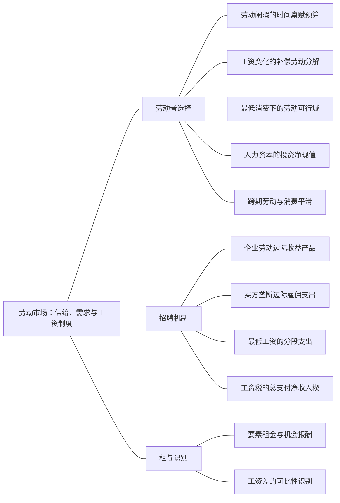

### 本专题知识联系

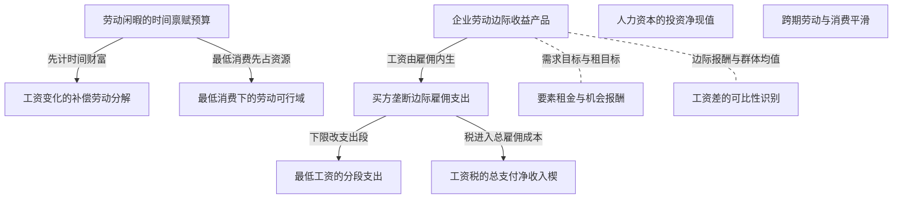

关系图中的箭头表示有方向的联系；虚线表示对照或类比。图中只画本专题主归属节点；跨专题关系在逐条命题中列明，可在练习室逐点追踪。具体成立条件以逐条说明为准。

### KMI077 劳动闲暇的时间禀赋预算

身份：既有资料概括

**定义与对象**

工资既是闲暇的机会成本，也重估全部时间禀赋。

**何时调用**

消费、闲暇、工资及非劳动收入。

**适用条件**

工作和闲暇各在0与总时间之间；补贴退出规则另列。

**核心公式与机制**

$c+wh=m_0+w\bar T$，劳动 $L=\bar T-h$。

**推导与理由**

把未工作的每小时按工资作机会成本，完整收入包括全部时间的市场价值。

**边界与易错**

工资上涨不等同外生现金增加，不能漏时间财富项。

**整理依据**

- card FM38：把总时间写成闲暇禀赋
- card FM12：求价格效应时同时计入商品机会成本和禀赋收入变动。

### KMI078 工资变化的补偿劳动分解

身份：既有资料概括

还用于：从预算约束到需求与福利补偿

**定义与对象**

固定旧福利后变工资的劳动变化是替代效应，再恢复实际财富得到收入效应。

**何时调用**

Hicks补偿、后弯机制和零总变化。

**适用条件**

同一效用基准；有限变化用实际补偿点，导数式需可微。

**核心公式与机制**

可微时 $dL/dw=-h_w^H-Lh_m$；有限变化按原点、补偿点、新实际点作差。

**推导与理由**

工资提高闲暇价格诱发少闲暇，又提高时间财富；两者方向可相反。

**边界与易错**

总变化为零不代表两效应各为零；有限差不可直接用导数替代。

**整理依据**

- card FM38：替代项$-h_w^H\ge0$
- card MC08：收入效应超过替代效应时，个人劳动供给可以后弯

### KMI079 最低消费下的劳动可行域

身份：既有资料概括

**定义与对象**

消费效用域的最低支出决定是否存在可行工作选择，并改变收入效应。

**何时调用**

对数最低消费、工资可行下界、非劳动现金。

**适用条件**

正超最低消费、正闲暇及非负劳动分别核验。

**核心公式与机制**

先检验最大劳动收入加现金能否超过最低消费，再在移位预算求解并核劳动零角点。

**推导与理由**

最低消费先占一部分财富；现金相对该支出的差额能改变工资供给斜率。

**边界与易错**

不可把不可行工资或负劳动的内点公式继续外推。

**整理依据**

- review MI062：最低消费形成非平移全收入预算，先检验正消费定义域，再求劳动闲暇选择；工资同时改闲暇价格和财富。
- review MI062：对数要求 $c>20,l>0$，又有 $h+l=16$、$c=wh$。即使工作接近16小时也须有 $16w>20$，所以可行工资必须 $w>\frac54$；等号时无法同时留正闲暇。用劳动收入替换后，全收入预算为  $$c+wl=16w,\qquad (c-20)+wl=16w-20.$$
- review MI062：令 $C=c-20>0$，最大化 $\ln C+\ln l$，约束 $C+wl=16w-20$。FOC为 $\frac1C=\lambda$、$\frac1l=\lambda w$，故 $C=wl$。联立预算得  $$l=8-\frac{10}{w},\qquad h=8+\frac{10}{w},\qquad c=8w+10.$$  目标严格凹，且可行工资域下闲暇正、劳动小于16、消费大于20，所以该内点唯一最优。
- review MI062：w为2时，劳动13、闲暇3、消费26；w为4时，劳动10.5、闲暇5.5、消费42。由 $\frac{dh}{dw}=-\frac{10}{w^2}<0$，在本区间，工资提高时劳动供给下降。工资提高既提高闲暇机会成本，又增加时间禀赋财富；本偏好下收入效应超过替代效应，使劳动减少。该结果不意味着偏好非凸，也不能在工资不可满足最低消费时外推公式。

### KMI080 企业劳动边际收益产品

身份：既有资料概括

还用于：技术到成本，成本到供给，供给到进入

**定义与对象**

企业增加劳动的收益等于产品边际收益乘劳动边际产品，竞争招聘内点令其等工资。

**何时调用**

劳动需求、产品垄断、工会工资选择。

**适用条件**

实际产品市场MR明确；生产组合和可变投入范围明确。

**核心公式与机制**

$MRPL=MR\cdot MPL$，竞争劳动市场内点 $MRPL=w$。

**推导与理由**

一单位劳动产生MPL产品，每单位带来的企业收入是MR而非必然产品价。

**边界与易错**

只有产品市场也竞争才可把MR换成p；工会目标与社会效率另写。

**整理依据**

- card MC08：劳动者在消费与闲暇之间选择，工资是闲暇的机会成本。工资上升的替代效应使闲暇更贵、倾向增加工作；若闲暇正常，收入效应则倾向增加闲暇、减少工作。收入效应超过替代效应时，个人劳动供给可以后弯，但市场供给还取决于其他人的参与、迁移和人口，不能由个人曲线直接推出。  竞争要素市场下，企业把工资视为给定，劳动边际收益产品等于工资；产品市场也竞争时，MR等于产品价，条件化为$pMPL=w$。劳动买方垄断面对向上倾斜供给，提高雇佣可能需要提高所有工人的工资，因此边际雇佣支出超过工资。它按MRPL等于边际支出选雇佣量，再从供给曲线读工资。  经济租金是要素报酬超过使它留在当前用途所需最低报酬的部分，取决于要素在其他用途的机会成本。固定供给的某要素可能获得租金，但租金的存在本身不等同于产品垄断利润。最低工资在竞争市场与买方垄断市场的机制不同，方向须由新边际支出和劳动需求共同决定。

### KMI081 买方垄断边际雇佣支出

身份：既有资料概括

**定义与对象**

同工资招聘面对上升供给时，新增劳动还抬高原工人工资。

**何时调用**

唯一雇主、工资供给上升。

**适用条件**

对所有雇员支付同一工资，供给可按总就业反推。

**核心公式与机制**

$MFC=w(L)+Lw\prime(L)$，内点 $MRPL=MFC$。

**推导与理由**

对总工资支出w乘L求导得到新工工资加老员工涨薪。

**边界与易错**

MFC不是工资；先选就业再沿供给读实付工资，差别支付须重算。

**整理依据**

- card FM39：**题干触发。**唯一雇主、向上劳动供给、最低工资改变雇佣、工资与边际支出区别。  $$ \begin{gathered} MFC=w(L)+Lw'(L), \\ MRPL=MFC. \end{gathered} $$ 对$w(L)=a+bL$、$MRPL=A-BL$，$A>a\ge0,b,B>0$： $$ \begin{gathered} L_M=\frac{A-a}{B+2b}, \\ w_M=a+bL_M; \\ L_C=\frac{A-a}{B+b}, \\ w_C=a+bL_C. \end{gathered} $$  **最低工资全段。**法定$W\ge0$、同工资支付、劳动供给无限延伸的标准模型： $$ L (W) = \begin{cases} L_M , & W \le w_M , \\ \frac{W - a}{b} , & w_M < W \le w_C , \\ \max \{ \frac{A - W}{B} , 0 \} , & W > w_C . \end{cases} $$  **步骤。**工资下限$W$下，至供给量$L_s = \frac{W - a}{b}$前企业可按常数$W$雇人，超过后恢复原总支出曲线；在折点比较左右边际净收益。若$w=L,MRPL=30-L$，无下限$(L,w)=(10,10)$，下限12、15、25对应雇佣12、15、5。  **租金与边界。**给定雇佣量和工资，租金为$WL-\int_0^Lw_s(\ell)d\ell$；无下限工资恰为$w_s(L)$时线性供给租金$\frac{b L^2}{2}$。不同工人可差别支付时MFC结构改变；容量、工人搜寻或产品需求变化亦需重算。  **原书与题源。**平新乔第15讲第1、4题PDF306—307；尼科尔森第16章第5题PDF272；2022第五题人大合订PDF23、五一作业PDF11计算3题P01-034。

### KMI082 最低工资的分段支出

身份：既有资料概括

**定义与对象**

工资下限把可供人数以内的工资支出改成线性段，以上恢复原供给总支出。

**何时调用**

最低工资、单一雇主与竞争对照。

**适用条件**

同工资、可供人数与劳动需求明确，需逐段全局比较。

**核心公式与机制**

到供给折点之前MFC为法定工资，超过折点重回原MFC；比驻点、折点和零雇佣。

**推导与理由**

适度下限可能降低单雇主的边际支出，提高雇佣；过高下限使劳动需求成短边。

**边界与易错**

不能把适度下限的就业上升外推到任意高工资，也不能混同竞争市场。

**整理依据**

- card FM39：在折点比较左右边际净收益

### KMI083 要素租金与机会报酬

身份：既有资料概括

**定义与对象**

经济租是实际报酬超出使要素留在该用途所需机会报酬的部分。

**何时调用**

劳动租、工会租目标、岗位许可。

**适用条件**

机会成本曲线和产权规则明确；同质机会工资可作常数。

**核心公式与机制**

$R=wL-\int_0^Lw_s(z)dz$；许可影子价为需求愿付减边际供给机会价。

**推导与理由**

劳动者报酬中的一部分补偿离开其他用途的成本，只有超出部分是租。

**边界与易错**

许可影子价不等现金工资，岗位总数未说明产权便不能唯一确定现金支付。

**整理依据**

- card FM39：租金为$WL-\int_0^Lw_s(\ell)d\ell$
- card MC08：经济租金是要素报酬超过使它留在当前用途所需最低报酬的部分

### KMI084 工资税的总支付净收入楔

身份：既有资料概括

还用于：税制改变哪条约束，福利由谁承担

**定义与对象**

雇主总支付与工人净收入之间的差进入招聘支出与劳动供给的不同口径。

**何时调用**

工资税归宿、法定缴税方变化。

**适用条件**

同一税额、执行和交易约束；竞争或买方势力要分别求。

**核心公式与机制**

$w_g-w_n=t$；供给按净工资，企业成本按总支付。

**推导与理由**

劳动者供给响应可支配收入，雇主响应实际费用；两端由同一税楔相连。

**边界与易错**

法定缴税方不代替经济归宿，财政税收也不等全部额外资源损失。

**整理依据**

- review MI066：法定归属不代替经济归宿

### KMI085 人力资本的投资净现值

身份：既有资料概括

还用于：风险、信息与跨期：先列状态，再作选择

**定义与对象**

培训投入包含学费和放弃工资，未来新增收入按时点和风险折现比较。

**何时调用**

教育培训、成功概率、最高学费。

**适用条件**

明确风险中性或状态效用、融资限制和收益时点。

**核心公式与机制**

求未来增收现值减学费及当期机会工资；风险中性可再按成功率加权。

**推导与理由**

参加决定比较增量收益和全部真实机会成本，最高学费使参与净值为零。

**边界与易错**

风险厌恶不能仅凭期望净现值选；不可漏放弃工资或重复计原工资。

**整理依据**

- review MI064：教育投资成本包括学费和放弃工资

### KMI086 工资差的可比性识别

身份：既有资料概括

**定义与对象**

总平均工资差同时包含岗位构成、可观察生产率及可能歧视，不能直接作同工因果结论。

**何时调用**

两群体均薪、岗位权重、歧视判断。

**适用条件**

比较岗位、能力、工时等可比条件并说明选择和未观测因素。

**核心公式与机制**

先按岗位权重算无岗内差的反事实均薪，再识别哪些数据仍缺。

**推导与理由**

组成不同本身足以改变均值；同岗工资相同也未排除进入岗位的差异待遇。

**边界与易错**

构成能解释某差例不证明不存在歧视，回归剩余也需因果假设。

**整理依据**

- review MI070：总均值差无法单独识别同工工资歧视。

### KMI087 跨期劳动与消费平滑

身份：既有资料概括

还用于：风险、信息与跨期：先列状态，再作选择

**定义与对象**

可借贷时消费依据终生资源平滑，而劳动依据各期工资和共同财富边际效用选择。

**何时调用**

两期工资不同、借款、劳动负效用。

**适用条件**

利率与贴现、借贷约束和劳动可行域明确。

**核心公式与机制**

合并跨期预算，先求消费条件，再将各期劳动收益与劳动边际负效用比较并核现金流。

**推导与理由**

金融市场允许高收入期资源支持低收入期消费，同时高工资期劳动相对有吸引力。

**边界与易错**

无借款能力时原平滑消费劳动组合可能不可实施，须另加约束。

**整理依据**

- review MI069：高工资期多工作而消费保持平滑

### 关系命题与条件

#### EMI121 劳动闲暇的时间禀赋预算 → 工资变化的补偿劳动分解

前置；编者推导

工资效应分解必须先写同时含闲暇价格和时间财富的预算。

适用条件：固定非劳动收入。

理由：工资改变价格与禀赋估值两项。

依据：card FM38「同时计入完整收入$w\bar T$」

#### EMI123 劳动闲暇的时间禀赋预算 → 最低消费下的劳动可行域

条件变化；编者推导

引入最低消费改变超最低消费财富并可能形成工资可行下界。

适用条件：消费效用域要求严格超过最低支出。

理由：正闲暇下劳动收入有上界，可行性须先于FOC。

依据：review MI062「最低消费形成非平移全收入预算，先检验正消费定义域，再求劳动闲暇选择；工资同时改闲暇价格和财富。」；review MI062「对数要求 $c>20,l>0$，又有 $h+l=16$、$c=wh$。即使工作接近16小时也须有 $16w>20$，所以可行工资必须 $w>\frac54$；等号时无法同时留正闲暇。用劳动收入替换后，全收入预算为  $$c+wl=16w,\qquad (c-20)+wl=16w-20.$$」；review MI062「令 $C=c-20>0$，最大化 $\ln C+\ln l$，约束 $C+wl=16w-20$。FOC为 $\frac1C=\lambda$、$\frac1l=\lambda w$，故 $C=wl$。联立预算得  $$l=8-\frac{10}{w},\qquad h=8+\frac{10}{w},\qquad c=8w+10.$$  目标严格凹，且可行工资域下闲暇正、劳动小于16、消费大于20，所以该内点唯一最优。」；review MI062「w为2时，劳动13、闲暇3、消费26；w为4时，劳动10.5、闲暇5.5、消费42。由 $\frac{dh}{dw}=-\frac{10}{w^2}<0$，在本区间，工资提高时劳动供给下降。工资提高既提高闲暇机会成本，又增加时间禀赋财富；本偏好下收入效应超过替代效应，使劳动减少。该结果不意味着偏好非凸，也不能在工资不可满足最低消费时外推公式。」

#### EMI124 企业劳动边际收益产品 → 买方垄断边际雇佣支出

条件变化；编者推导

招聘者有买方势力时以MFC替代给定工资与MRPL比较。

适用条件：上升供给且全员同工资。

理由：增加雇员同时提高原工人的支付。

依据：card MC08「因此边际雇佣支出超过工资」

#### EMI125 买方垄断边际雇佣支出 → 最低工资的分段支出

条件变化；编者推导

最低工资下可供人数以内MFC变为水平工资，其上回原支出导数。

适用条件：雇主同工资且供给足够。

理由：原本新增雇佣抬全员工资的机制在水平段被移除。

依据：card FM39「超过后恢复原总支出曲线」

#### EMI126 企业劳动边际收益产品 → 要素租金与机会报酬

对照；编者推导

企业劳动需求来自收益产品，工会租最大化则在该需求上选工资，目标与效率不同。

适用条件：企业保留就业选择权。

理由：工资改变企业需求量，工会优化工资溢价乘就业。

依据：review MI065「租最大化、平均工资最大化、就业最大化是不同目标」

#### EMI128 买方垄断边际雇佣支出 → 工资税的总支付净收入楔

机制；编者推导

买方垄断下工资税还需对包含税的总雇佣支出求导。

适用条件：供给以净工资表示、每劳动单位税固定。

理由：税楔在每一新增劳动单位增加t支出，原供给诱发工资效应仍在。

依据：case CMI13「一个地方行业的劳动边际收益产品为 $MRP=24-L$，劳动逆供给为 $w=L$，所有单位按同一工资支付。劳动非负，无其他成本，雇主总收益为边际收益产品积分。分别比较竞争招聘和单一雇主。最低工资与工资税制度在各问独立改变，未说明时不存在。」；case CMI13「竞争招聘使每家按给定工资用工，行业需求由 $MRP=w$ 确定。与供给w等于L联立，$24-L=L$，得 $L_C=12,w_C=12$。劳动者机会成本总额 $\int_0^{12}z\,dz=72$，工资总额144，所以劳动经济租72。竞争配置使边际收益产品与边际机会成本相等，不是在比较总工资与总收益。」；case CMI13「雇用L必须向全部工人付工资w等于L，总支出 $E(L)=L^2$，边际雇佣支出2L。利润为 $24L-\frac12L^2-L^2=24L-\frac32L^2$，FOC给 $24-3L=0$，故L8、w8、利润96，二阶导负3。工人租为 $8\cdot8-\frac12\cdot8^2=32$，总剩余128；竞争总剩余 $\int_0^{12}(24-2z)\,dz=144$，单雇主损失16。不能用边际收益产品等于实际工资求单雇主内点，因为增加雇用还抬高原工人的工资。」；case CMI13「保留单一雇主，分别设置最低工资10和12，求各情形就业、实付工资和雇主利润。必须比较劳动供给折点两侧。」；case CMI13「最低工资m下，$L\le m$ 时可按工资m雇用，总支出mL；$L>m$ 时仍须付w等于L，总支出 $L^2$。m10时，低量支利润导数为 $24-L-10=14-L$，在 $[0,10]$ 上正，最好到L10；高量支无约束驻点8不在 $L\ge10$，在该段利润下降，故全局L10、w10，利润 $240-50-100=90$。  m12时，低量支最优满足 $24-L=12$，恰在折点L12，高量支在该域下降，故全局L12、w12、利润72。适度工资下限把边际雇佣支出降低到水平工资段，可提高单雇主就业；其作用不能直接套成竞争市场的失业结论。」；case CMI13「仍保留单一雇主，将最低工资独立设为16。求就业、愿供劳动、失业差额与利润，并与第三问较低下限的作用比较。」；case CMI13「工资16下愿供劳动16。低量分支利润为 $(24-16)L-\frac12L^2$，唯一最优L8，在可供16内，利润32。高量分支 $L\ge16$ 中原利润 $24L-\frac32L^2$ 已递减，其最大在16为0，故不会跳到高量支。实际就业8、供给16、失业差额8。下限继续提高后，水平工资已超过有效工资，劳动需求约束代替了先前的供给折点，适度下限提高就业的结果不再可继续外推。」；case CMI13「取消全部最低工资，恢复单雇主。政府按每单位劳动收税4，工人收到净工资，原逆供给写成净工资等于L。求净工资、雇主总单价、就业、利润、税收，并说明改由工人法定缴税是否改变这些结果。」；case CMI13「工人净工资 $w_n=L$，雇主总支付单价 $w_g=L+4$，总成本 $L^2+4L$，边际支出 $2L+4$。最优满足 $24-L=2L+4$，得 $L=\frac{20}{3}$、$w_n=\frac{20}{3}$、$w_g=\frac{32}{3}$。利润 $20L-\frac32L^2$ 在该点为 $\frac{200}{3}$，税收 $4L=\frac{80}{3}$。严格凹性保证最优且量价非负。若改工人缴税但劳动供给按净工资、需求按总成本不变，同一楔 $w_g-w_n=4$ 和总雇佣支出关系仍成立，结果不变；法定主体不决定经济归宿。」；case CMI13「统一工资供给下先写总雇佣支出，再分别在最低工资各段或税楔下求最优；每个制度独立恢复条件。」；case CMI13「单雇主使用边际雇佣支出而非工资；最低工资并不必然单调增减就业；税供给需明确是净工资。」；case CMI13「不引用原题图：本综合题的参数、条件变化及问次与原图未逐项完全一致。解答以方程、可行域与关键数量给出可核验关系；本题没有另设必须作图的小问。」

#### EMI132 企业劳动边际收益产品 → 工资差的可比性识别

对照；编者推导

按生产率付酬的单岗机制不意味着不同岗位组合的群体平均工资相同。

适用条件：同岗MRP可比、各群体岗位权重已给。

理由：均薪是各岗位工资的加权平均。

依据：review MI070「仅岗位构成就可形成4.2的均薪差。」

### 对应题目分问路径

#### MI061

制度先决定MRP与何种支出比较。

**第1问**

本问任务：先求竞争和单雇主基准，再在单雇主环境施最低工资10，重求并解释。

竞争联立工资与MRP，单雇主先求工资总支出的导数2L；最低10在供给折点内MFC变10，逐段求全局最优。

调用：KMI080 企业劳动边际收益产品；KMI081 买方垄断边际雇佣支出；KMI082 最低工资的分段支出

联系：EMI124、EMI125

**第2问**

本问任务：改看竞争行业最低工资12，求失业并说明其机制与上一问是否相同。

竞争下限12时就业由需求8决定，不能沿用单雇主适度下限增雇机制。

调用：KMI080 企业劳动边际收益产品；KMI082 最低工资的分段支出

联系：本问直接应用企业劳动边际收益产品、最低工资的分段支出，所列任务没有另要求由一个独立结论推出另一个结论，不强加逻辑推出边。

#### MI062

最低消费决定工资域及供给斜率。

**第1问**

本问任务：确定可行工资域并推导内点闲暇、劳动、消费。

先核16w大于20的可行域，再移位消费求FOC与内点。

调用：KMI077 劳动闲暇的时间禀赋预算；KMI079 最低消费下的劳动可行域

联系：EMI123

**第2问**

本问任务：将工资分别取2和4，计算劳动、闲暇、消费并解释劳动供给方向。

两工资劳动下降源于财富效应超过替代，不能外推不可行工资或称偏好非凸。

调用：KMI077 劳动闲暇的时间禀赋预算；KMI078 工资变化的补偿劳动分解；KMI079 最低消费下的劳动可行域

联系：EMI121、EMI123

#### MI063

工资总效应零仍有两相反效应。

**第1问**

本问任务：工资从2升到4，求两次实际劳动消费；在工资4下征一次性税保持旧效用，求补偿劳动。

普通全收入预算求闲暇8劳动8，算旧效用；新工资下固定旧乘积效用求最低全支出，再从实际财富扣税。

调用：KMI077 劳动闲暇的时间禀赋预算；KMI009 普通需求与支出对偶；KMI078 工资变化的补偿劳动分解

联系：EMI121、EMI122

**第2问**

本问任务：分解实际劳动变化的替代与收入效应。

补偿点减原点和新实际点减补偿点分别作差，验证相消。

调用：KMI078 工资变化的补偿劳动分解

联系：本问直接应用工资变化的补偿劳动分解，所列任务没有另要求由一个独立结论推出另一个结论，不强加逻辑推出边。

#### MI064

教育增量投入收益按完整机会成本折现。

**第1问**

本问任务：先按确定性未来每年增薪30计算净现值，再把成功概率设为3/4、失败不增薪，判断风险中性者是否参加。

确定未来增收折现与学费20加放弃工资30比较；成功率3/4下再算风险中性期望净值决定不参加。

调用：KMI026 期望效用与确定性等价；KMI034 跨期现值预算与Euler；KMI085 人力资本的投资净现值

联系：EMI129

**第2问**

本问任务：求风险中性者刚好参加的最高学费。

在成功概率3/4的环境，以学费加放弃工资等于期望增收现值求最高学费；非风险中性须状态效用。

调用：KMI026 期望效用与确定性等价；KMI085 人力资本的投资净现值

联系：本问直接应用期望效用与确定性等价、人力资本的投资净现值，所列任务没有另要求由一个独立结论推出另一个结论，不强加逻辑推出边。

#### MI065

工会目标和效率有不同配置。

**第1问**

本问任务：求工资租最大化的工资、就业与总租。

将企业需求L20减w代入工会租目标，核工资区间及端点。

调用：KMI080 企业劳动边际收益产品；KMI083 要素租金与机会报酬

联系：EMI126

**第2问**

本问任务：求可转移效用有效就业，并说明就业优先目标为何不同。

按外部工资2求有效就业18，积分净收益与租目标就业9比较，分租另定；改就业最大化目标后选工资2，不可保留原租最优11。

调用：KMI021 财政转移与真实福利核算；KMI080 企业劳动边际收益产品；KMI083 要素租金与机会报酬

联系：EMI126

#### MI066

总支付和净工资用同一税楔连接。

**第1问**

本问任务：求无税基准，再每单位劳动征税4，求雇主总支付、工人净工资、就业与税收。

无税先联立，税后按雇主总价与工人净价分别出清。

调用：KMI080 企业劳动边际收益产品；KMI084 工资税的总支付净收入楔

联系：本问直接应用企业劳动边际收益产品、工资税的总支付净收入楔，所列任务没有另要求由一个独立结论推出另一个结论，不强加逻辑推出边。

**第2问**

本问任务：计算该税造成的额外损失；若仅把法定缴纳人改为工人，分析结果是否改变。

仅减少的就业产生额外损失，税收32是转移；法律缴税方变而同一楔条件不变。

调用：KMI017 单位税楔与经济归宿；KMI021 财政转移与真实福利核算；KMI084 工资税的总支付净收入楔

联系：EMI028、EMI127

#### MI067

报酬、机会成本和许可影子价分开。

**第1问**

本问任务：求竞争工资就业及劳动经济租。

工资报酬扣供给积分得经济租，不能把总工资当租。

调用：KMI083 要素租金与机会报酬

联系：本问直接应用要素租金与机会报酬，所列任务没有另要求由一个独立结论推出另一个结论，不强加逻辑推出边。

**第2问**

本问任务：最多允许8个岗位且分配给最低机会成本者，求两侧边际工资，解释实际工资与岗位租的归属。

岗位8的两侧边际价为10与12，差2是许可价；未定产权不能唯一断言现金工资。

调用：KMI083 要素租金与机会报酬

联系：本问直接应用要素租金与机会报酬，所列任务没有另要求由一个独立结论推出另一个结论，不强加逻辑推出边。

#### MI068

工资经替代和规模共同改劳动资本。

**第1问**

本问任务：在资本价1下，将劳动价分别取4和9，求长期成本及垄断最优量、投入。

固定q先成本最小化求L、K和单位成本；再联立产品垄断MR与单位MC得两工资最优量及投入。

调用：KMI041 给定产量的成本最小化；KMI053 统一价格垄断的边际收益；KMI080 企业劳动边际收益产品

联系：EMI130

**第2问**

本问任务：分辨固定产量替代效应与产品销量变化效应。

固定量劳动系数变化是替代，销售减少是规模；资本替代可超过规模下降。

调用：KMI041 给定产量的成本最小化；KMI050 成本与技术冲击的分层调整；KMI080 企业劳动边际收益产品

联系：EMI130

#### MI069

消费跨期平滑而劳动随相对工资配置。

**第1问**

本问任务：联立求两期消费与劳动。

借贷合并预算，消费等化后回代劳动目标求两期量。

调用：KMI034 跨期现值预算与Euler；KMI087 跨期劳动与消费平滑

联系：EMI131

**第2问**

本问任务：核跨期现金流和净借贷，并解释劳动跨期替代。

逐期收入消费差核借款及偿还；借贷受限时原组合不直接可行。

调用：KMI034 跨期现值预算与Euler；KMI087 跨期劳动与消费平滑

联系：EMI131

#### MI070

组成反事实不能作歧视因果证明。

**第1问**

本问任务：计算按岗位边际收益产品付酬的两组均薪，并与观测均值比较。

按岗位工资与权重算13.6、9.4，仅组成即有均值差。

调用：KMI086 工资差的可比性识别

联系：本问直接应用工资差的可比性识别，所列任务没有另要求由一个独立结论推出另一个结论，不强加逻辑推出边。

**第2问**

本问任务：说明能否单独认定同工歧视并列所需补充证据。

实际均值未给同岗报酬，提出可比因素与岗位机会及选择偏差要求。

调用：KMI086 工资差的可比性识别

联系：本问直接应用工资差的可比性识别，所列任务没有另要求由一个独立结论推出另一个结论，不强加逻辑推出边。

#### CMI13

供给、买方势力、下限和税分别改变雇佣条件。

**第1问**

本问任务：求竞争工资、就业与劳动经济租，说明市场出清的条件。

竞争按MRP等供给工资得12，以工资总额扣机会积分得劳动租。

调用：KMI080 企业劳动边际收益产品；KMI083 要素租金与机会报酬

联系：本问直接应用企业劳动边际收益产品、要素租金与机会报酬，所列任务没有另要求由一个独立结论推出另一个结论，不强加逻辑推出边。

**第2问**

本问任务：改为一个雇主决定就业且沿原供给招聘，求就业、工资、利润及总剩余，与竞争比较。

全员同工资总支出L平方，按MFC选8再读工资，以真实收益及机会成本算福利。

调用：KMI021 财政转移与真实福利核算；KMI080 企业劳动边际收益产品；KMI081 买方垄断边际雇佣支出；KMI083 要素租金与机会报酬

联系：EMI124

**第3问**

本问任务：保留单一雇主，分别设置最低工资10和12，求各情形就业、实付工资和雇主利润。必须比较劳动供给折点两侧。

下限10及12分别比较水平支和原支出支，取折点及实际利润。

调用：KMI081 买方垄断边际雇佣支出；KMI082 最低工资的分段支出

联系：EMI125

**第4问**

本问任务：仍保留单一雇主，将最低工资独立设为16。求就业、愿供劳动、失业差额与利润，并与第三问较低下限的作用比较。

下限16时需求量8在可供16以内，比较高量分支，不能继续外推增雇。

调用：KMI081 买方垄断边际雇佣支出；KMI082 最低工资的分段支出

联系：EMI125

**第5问**

本问任务：取消全部最低工资，恢复单雇主。政府按每单位劳动收税4，工人收到净工资，原逆供给写成净工资等于L。求净工资、雇主总单价、就业、利润、税收，并说明改由工人法定缴税是否改变这些结果。

净供给L，总支付L加4，总支出导数2L加4；法定主体改变不改同一楔。

调用：KMI081 买方垄断边际雇佣支出；KMI084 工资税的总支付净收入楔

联系：EMI128

#### CMI14

最低消费和现金改变时间财富效应。

**第1问**

本问任务：求原环境中存在满足效用定义域的可行消费的工资范围，并推导最优闲暇、劳动和消费，核内点。

先可行工资大于1，再超最低消费预算均分，回验闲暇和消费域。

调用：KMI077 劳动闲暇的时间禀赋预算；KMI079 最低消费下的劳动可行域

联系：EMI123

**第2问**

本问任务：工资从2升到4，不给转移。求两工资下的选择与效用变化，判断本区间劳动供给的方向。

两工资下劳动下降2且效用提高，负斜率不否认正替代作用。

调用：KMI077 劳动闲暇的时间禀赋预算；KMI078 工资变化的补偿劳动分解；KMI079 最低消费下的劳动可行域

联系：EMI121、EMI123

**第3问**

本问任务：在工资4下征一次性税T，税不返还，使劳动者恰保持工资2时的效用。求T、补偿闲暇、劳动与消费，并检查可行性。

新工资保持旧超最低消费乘闲暇的乘积，最低支出求T并核预算。

调用：KMI009 普通需求与支出对偶；KMI077 劳动闲暇的时间禀赋预算；KMI078 工资变化的补偿劳动分解；KMI079 最低消费下的劳动可行域

联系：EMI121、EMI122、EMI123

**第4问**

本问任务：按上一问补偿口径，把第二问的实际劳动变化分为替代效应与收入效应，并说明两者为何可能相反。

按原点、补偿点、新实际点分解，加总负2，财富效应更大。

调用：KMI078 工资变化的补偿劳动分解

联系：本问直接应用工资变化的补偿劳动分解，所列任务没有另要求由一个独立结论推出另一个结论，不强加逻辑推出边。

**第5问**

本问任务：取消一次性税，改为每天无条件获得现金24，工资仍分别考察2和4。求两情形选择，并判断是否还能直接沿用第二问的劳动供给斜率。

现金24改变超最低消费财富，重求内点及斜率；高现金可能劳动零角点。

调用：KMI077 劳动闲暇的时间禀赋预算；KMI079 最低消费下的劳动可行域

联系：EMI123

## 从个人最优到交换均衡，再到分配实施

个人最优、市场出清、有效分配与可实施政策怎样彼此连接？

以闭合预算为轴，区分效率集合、原禀赋均衡、社会目标与财富实施；生产股权、外部效用与非出清价格给出不同边界。

### 分支导图

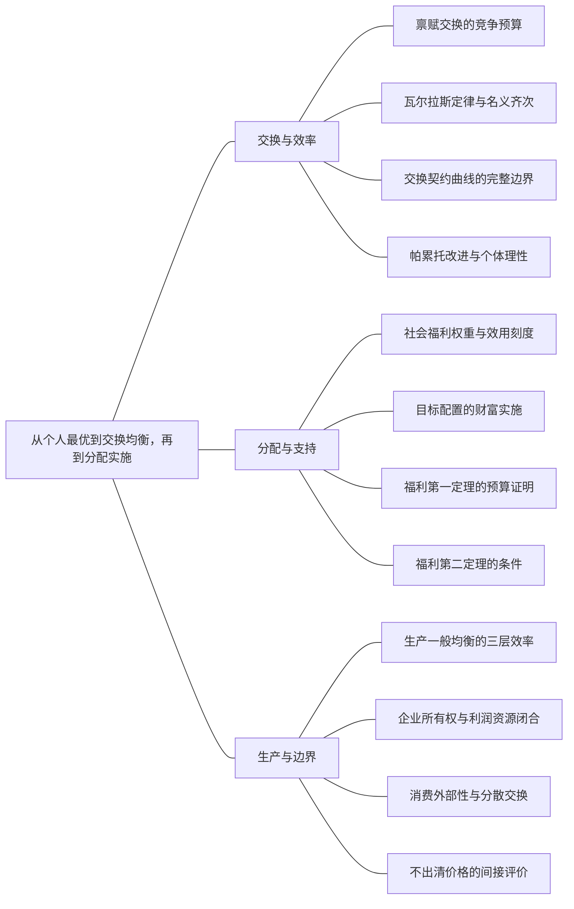

### 本专题知识联系

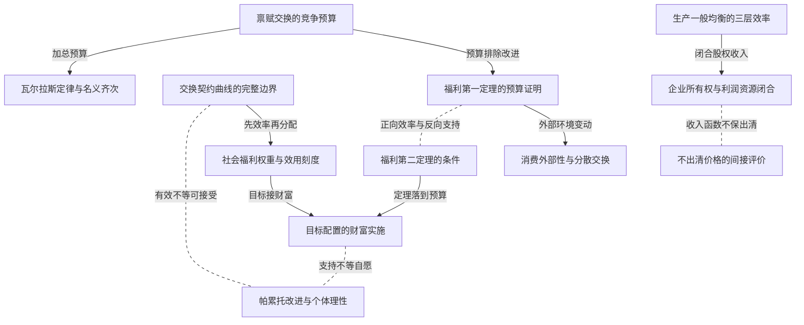

关系图中的箭头表示有方向的联系；虚线表示对照或类比。图中只画本专题主归属节点；跨专题关系在逐条命题中列明，可在练习室逐点追踪。具体成立条件以逐条说明为准。

### KMI088 禀赋交换的竞争预算

身份：既有资料概括

还用于：从预算约束到需求与福利补偿

**定义与对象**

每人按候选价格给禀赋估值并在收入预算内最优，市场以总需求等资源闭合。

**何时调用**

两人两商品交换、转移、角点。

**适用条件**

正相对价与非负消费；转移收支相抵，个人分支有效。

**核心公式与机制**

$m_i=p\cdot\omega_i+T_i$；个人最优加全部市场出清。

**推导与理由**

价格同时改变商品成本与初始财富，所以先估禀赋再求消费，不能直接按持有物分配最终消费。

**边界与易错**

一个市场代数出清不保证价格、角点、第二市场及个人预算有效。

**整理依据**

- card FM40：先将禀赋按候选价格估值，再求含角点的个人需求。

### KMI089 瓦尔拉斯定律与名义齐次

身份：既有资料概括

**定义与对象**

闭合全部主体预算后超额需求总价值为零；所有价格与禀赋收入同比放大不改变预算集。

**何时调用**

第二市场为何可回验、价格归一、政府税收。

**适用条件**

完整预算系统、预算用尽，推另一市场出清需其价格正；名义转移亦按相同口径处理。

**核心公式与机制**

$\sum_jp_jz_j=0$；同比名义缩放不改相对选择。

**推导与理由**

加总个体预算使内部转移抵消；同乘价格可从预算两边约去。

**边界与易错**

漏政府资金或利润就不能用家庭局部零恒等式；零价格市场另论。

**整理依据**

- review MI080：加总所有主体预算得瓦尔拉斯定律，再解释价格齐次性；政府遗漏会破坏家庭部门单独的闭合恒等式。
- review MI080：令商品j的超额需求为 $z_j=\sum_i x_{ij}-\sum_i\omega_{ij}$。严格单调、价格正且可行预算下，各人用尽财富，故 $p_xx_{ix}+p_yx_{iy}=p_x\omega_{ix}+p_y\omega_{iy}$。对两人加总，得到  $$p_xz_x+p_yz_y=0.$$  若已验证x出清，即 $z_x=0$，由于 $p_y>0$，便有 $z_y=0$。因此两商品预算闭合系统只有一个独立的市场出清方程；正价格前提不能省略。
- review MI080：两价乘5后，个人禀赋财富也乘5，预算不等式两边同除5即回到原预算集。偏好和可行选择完全相同，故配置不变，只有相对价格有意义。这不是在价格变5倍却保持名义收入不变。
- review MI080：若家庭另缴总税T而政府不消费、不返还，家庭总购买价值比禀赋价值少T，家庭部门单独加总不再给上述零恒等式。必须把政府持有、消费、储蓄或相应金融市场纳入，使所有主体资源和资金流闭合后再应用瓦尔拉斯定律。遗漏政府预算时，不能只验证一个商品出清便宣布另一个自动出清。

### KMI090 交换契约曲线的完整边界

身份：既有资料概括

**定义与对象**

契约曲线是资源可行的帕累托有效配置集合，正规内点常表现为两人MRS相等。

**何时调用**

效率集合、盒图、互补或线性角点。

**适用条件**

内点MRS条件需正规；零消费和不可微点用无共同改进或KKT。

**核心公式与机制**

先解内点候选，再查资源边界，必要用总效用上界或直接改进证充分性。

**推导与理由**

MRS不同通常容许互利小交换，但相等只在相应条件下给候选，边界不能漏。

**边界与易错**

有效集合不等原禀赋竞争结果，更不等自愿改进集合。

**整理依据**

- card FM41：仅是正规内点效率候选，另加资源、非负及边界有效配置。

### KMI091 帕累托改进与个体理性

身份：既有资料概括

还用于：生产效率、外部性与公共品的统一比较

**定义与对象**

改进要求无人更差且至少一人更好，有效表示不存在这样的可行改进。

**何时调用**

起点效率、自愿可接受范围。

**适用条件**

效用比较保留起点和所有人，包括外部效应。

**核心公式与机制**

先给可行改进或证明不存在，再用起点效用下界筛有效集合。

**推导与理由**

一种配置可以有效却使某人相对原产权起点损失。

**边界与易错**

效率不确定公平排序，不能把全体有效点都说成自愿可达。

**整理依据**

- card MC09：帕累托改进是在不使任何人变差的前提下使至少一人变好

### KMI092 社会福利权重与效用刻度

身份：既有资料概括

还用于：生产效率、外部性与公共品的统一比较

**定义与对象**

加权和、对数加权与最大最小使用不同社会目标，对个人效用重新刻度可改变社会选择。

**何时调用**

公平目标、福利权重、maxmin。

**适用条件**

给定效用数值与权重；对数目标需正效用。

**核心公式与机制**

先求可行效率边界，再代入指定目标作全局优化，核端点与定义域。

**推导与理由**

个人单调变换不改其排序，但会改变固定加总权重下的社会边际评价。

**边界与易错**

不能把个人序数等价误作社会目标不变；maxmin不可擅自换效用刻度。

**整理依据**

- card FM41：效用加总依赖题设刻度
- review MI078：把它再按固定权重加总却改变了社会边际福利权重

### KMI093 目标配置的财富实施

身份：既有资料概括

还用于：生产效率、外部性与公共品的统一比较

**定义与对象**

价格支持还需要每人有恰好能买其目标束的财富，一次性转移须守恒并满足可实施商品限制。

**何时调用**

支持价、现金或指定商品禀赋转移。

**适用条件**

个体最优、正价、转移授权与产权可行；自愿性另验。

**核心公式与机制**

$T_i=p\cdot x_i^*-p\cdot\omega_i$，$\sum_iT_i=0$。

**推导与理由**

目标MRS给相对价，目标支出与原禀赋价值的差给财富转移，再回验全部需求与资源。

**边界与易错**

价格支持不代表原禀赋已支持，更不代表强制再分配是自愿赠与；现金换实物要除支持价格。

**整理依据**

- card FM41：令所需收入$m_i^*=p\cdot x_i^*$
- card MC17：预算和激励回答所给税补贴能否做到

### KMI094 福利第一定理的预算证明

身份：既有资料概括

**定义与对象**

适当竞争条件下个人最优与可行资源共同排除可行帕累托改进。

**何时调用**

竞争效率证明、污染使哪一步失效。

**适用条件**

价格接受、市场完备、局部非饱和、无未定价外部性及适当可行条件。

**核心公式与机制**

改进束按最优性与局部非饱和需总支出严格超财富；总可行性与厂商利润最优又使其不超过财富，矛盾。

**推导与理由**

价格将分散预算和资源价值连接，生产利润须计入财富。

**边界与易错**

不一般要求凸性，不保证公平；外部效用改变使私人束支出比较失效。

**整理依据**

- review MI076：以每人最优性推出改进篮子的支出不等式，再以总体可行性得到相反不等式；外部性破坏的是同一环境下的私人篮子比较。
- review MI076：设竞争均衡价格为p、个人财富为 $m_i$、消费为 $x_i^*$。若可行替代配置 $x_i'$ 使每人弱改善、至少一人严格改善，则严格改善者必有 $p\cdot x_i'>m_i$，否则它可负担却比最优束更好，矛盾。  弱改善者也须有 $p\cdot x_i'\ge m_i$：若严格低于财富，就有预算松弛；由局部非饱和可在足够近邻找到严格优于该束且仍可负担的束，从而严格优于原最优，仍矛盾。故  $$\sum_i p\cdot x_i'>\sum_i m_i.$$
- review MI076：纯交换中，可行性给 $\sum_i x_i'\le\sum_i\omega_i$，均衡收入总和为 $p\cdot\sum_i\omega_i$，与上式矛盾。若含生产，财富还包括利润分配。任何替代生产净产出 $y_f'$ 都有 $p\cdot y_f'\le\pi_f^*$，故可行消费总价值仍不超过禀赋价值加均衡利润，仍不可能严格大于全部财富。因此竞争均衡帕累托有效。
- review MI076：有污染时，一个人的效用不仅取决于自己的私人商品束，也取决于他人排放。即使替代配置整体使他更好，把其私人篮子单独放回原排放环境未必更好，所以不能再仅由该私人篮子的价格与原个人最优推出上述支出不等式。第一福利定理的无外部性前提因此失效；证明不依赖偏好凸性，不能与通常需要凸性的第二福利定理混淆。

### KMI095 福利第二定理的条件

身份：既有资料概括

**定义与对象**

在凸性及其他正规条件下，适当有效配置可经先再分配财富再由竞争价格支持。

**何时调用**

效率分配分离、非凸技术和支持失败。

**适用条件**

偏好及生产集合凸性、适当非饱和及价格支持正规性；弱均衡还需升级为均衡条件。

**核心公式与机制**

先指定有效目标，再以支持超平面找相对价格并安排相应财富。

**推导与理由**

凸性允许有效边界有合适支持价格，财富决定该价格上谁能选择哪束。

**边界与易错**

不说明原禀赋任意有效点都可达到；一次性转移与边际税不是同工具。

**整理依据**

- card MC09：第二定理在偏好和生产集合凸性及其他正规条件下

### KMI096 生产一般均衡的三层效率

身份：既有资料概括

还用于：生产效率、外部性与公共品的统一比较

**定义与对象**

要素配置、消费者交换及最终产品结构须同时与真实技术和偏好一致。

**何时调用**

PPF、部门要素、鲁滨逊经济。

**适用条件**

光滑内点才用边际比率；厂商利润、家庭预算和市场出清也需闭合。

**核心公式与机制**

内点部门MRTS相等、消费者MRS相等且 $MRS=MRT$。

**推导与理由**

先把既定要素变成有效产出边界，再选最符合消费意愿的产出组合，最后检验竞争支持。

**边界与易错**

只验消费者MRS相等不能保证生产或产品结构有效；非凸性可能妨碍价格支持。

**整理依据**

- card FM42：竞争实现还要求消费者预算、厂商利润最大化和所有市场出清。
- card MC09：生产经济有三层效率

### KMI097 企业所有权与利润资源闭合

身份：既有资料概括

还用于：税制改变哪条约束，福利由谁承担；生产效率、外部性与公共品的统一比较

**定义与对象**

家庭拥有的企业利润进入财富，实物资源则仍是禀赋加净生产，不因分红增加。

**何时调用**

代表家庭、生产税返还、利润分配。

**适用条件**

股权和财政归属明确，个人选择把给定利润和一次性返还视为外生。

**核心公式与机制**

先求企业利润再并入家庭预算，需求供给出清后单独核实际投入资源。

**推导与理由**

利润是企业销售剩余分给家庭的收入，和生产投入支付一起闭合交易。

**边界与易错**

漏利润会丢财富，重复加为实物禀赋又会造资源；消费者不能对均衡利润作个人控制求导。

**整理依据**

- case CMI16：利润收入并未创造额外实物资源。

### KMI098 消费外部性与分散交换

身份：既有资料概括

还用于：生产效率、外部性与公共品的统一比较

**定义与对象**

他人消费直接影响效用时，私人消费决策不含对他人造成的边际影响。

**何时调用**

外部偏好、私人均衡与规划比较。

**适用条件**

明确谁的哪项消费影响谁，比较要用每人含外部项的完整效用。

**核心公式与机制**

先按私人可控消费优化，再在同一资源约束下计入外部收益或损害，核逐人福利。

**推导与理由**

私人把他人消费视为给定，规划者却可改变该环境，故两者目标边际不同。

**边界与易错**

固定部分商品的子问题最优不能当完整社会全局解；不能忽略外部项便称受损。

**整理依据**

- review MI075：分散者把对方消费视为给定，私人需求不含外部边际收益；社会目标须纳入该收益，并逐人比较含外部项的总效用。
- review MI075：A在选择自己的消费时，把B的x视为给定，外部项不进入对自己x、y的边际导数。A收入2p，其私人乘积项给 $x_A=1,y_A=p$。B收入2、乘积效用给 $x_B=\frac1p,y_B=1$。x出清 $1+\frac1p=2$，故p为1，两人各消费 $(1,1)$，y亦出清。此时A总效用为 $1+1=2$，B效用1，总效用3。
- review MI075：固定 $y_A=y_B=1$ 时，资源约束为 $x_A+x_B=2$。因此  $$U_A=x_A+x_B=2,\qquad U_B=x_B,\qquad U_A+U_B=2+x_B.$$  加总效用随xB严格增加，在 $0\le x_B\le2$ 上最优为 $x_B=2,x_A=0$，总效用4。这里A直接消费项减少，恰由其从B持有x获得的外部收益补足，不能只看直接消费项。
- review MI075：新配置A总效用仍2，B从1提高到2，所以该固定y子问题的改进确为帕累托改进。分散选择只计个人持有x和y的直接边际效用，B不计自己持有x还给A带来1单位额外收益，社会目标却必须计入。这解释了分散配置的效率缺口。本题只优化固定y的子问题；若同时选择y或改变福利权重，应另列完整规划，不能将此结果直接外推。
- review MI075：本题既有勘误已采纳：固定y时A总效用恒为2，B严格改善，故确为帕累托改进；一般加总福利增加不必使每个人改善。子问题不能替代同时选择x、y的完整社会规划。

### KMI099 不出清价格的间接评价

身份：既有资料概括

**定义与对象**

把每个候选价格下的需求评价与企业利润代入函数，通常不构成资源可行配置序列。

**何时调用**

均衡价是价格函数极小为何不矛盾。

**适用条件**

先明确间接效用收入含利润；一般效用与货币不能直接相加。

**核心公式与机制**

可对题给F求导，但另核每个价格是否使需求等供给；只有闭合点对应市场配置。

**推导与理由**

离开均衡价的消费者计划和企业产量可不同，函数极值无需等规划福利最大值。

**边界与易错**

拟线性利润可加到效用是已核计价边际效用1和内点的特例。

**整理依据**

- review MI077：非均衡p下消费者计划和企业供给一般不出清

### 关系命题与条件

#### EMI141 禀赋交换的竞争预算 → 瓦尔拉斯定律与名义齐次

推导；编者推导

完整交换预算加总给超额需求总价值为零。

适用条件：预算用尽、转移和所有主体闭合。

理由：内部收入转移相抵，消费总价值等资源价值。

依据：review MI080「加总所有主体预算得瓦尔拉斯定律，再解释价格齐次性；政府遗漏会破坏家庭部门单独的闭合恒等式。」；review MI080「令商品j的超额需求为 $z_j=\sum_i x_{ij}-\sum_i\omega_{ij}$。严格单调、价格正且可行预算下，各人用尽财富，故 $p_xx_{ix}+p_yx_{iy}=p_x\omega_{ix}+p_y\omega_{iy}$。对两人加总，得到  $$p_xz_x+p_yz_y=0.$$  若已验证x出清，即 $z_x=0$，由于 $p_y>0$，便有 $z_y=0$。因此两商品预算闭合系统只有一个独立的市场出清方程；正价格前提不能省略。」；review MI080「两价乘5后，个人禀赋财富也乘5，预算不等式两边同除5即回到原预算集。偏好和可行选择完全相同，故配置不变，只有相对价格有意义。这不是在价格变5倍却保持名义收入不变。」；review MI080「若家庭另缴总税T而政府不消费、不返还，家庭总购买价值比禀赋价值少T，家庭部门单独加总不再给上述零恒等式。必须把政府持有、消费、储蓄或相应金融市场纳入，使所有主体资源和资金流闭合后再应用瓦尔拉斯定律。遗漏政府预算时，不能只验证一个商品出清便宣布另一个自动出清。」

#### EMI142 交换契约曲线的完整边界 → 帕累托改进与个体理性

对照；编者推导

完整有效集合须另以原点效用约束筛出自愿弱改进部分。

适用条件：给定起点产权和每人参与。

理由：契约曲线只说明无进一步共同改进，不约束相对起点谁损失。

依据：review MI074「契约曲线其他点虽有效，却会使某方低于起点」

#### EMI143 交换契约曲线的完整边界 → 社会福利权重与效用刻度

前置；编者推导

单调福利目标可先在完整有效集合上选择最优分配。

适用条件：目标对两人效用均递增。

理由：无效点可共同改善而提高目标，故不可能最优。

依据：case CMI15「福利单调提高两人效用，最优必有效」

#### EMI144 社会福利权重与效用刻度 → 目标配置的财富实施

机制；编者推导

社会选定目标后用支持价和目标支出安排一次性转移才能竞争实施。

适用条件：目标可价格支持且转移制度可用。

理由：社会评价选择点，预算与个体激励决定能否达到。

依据：review MI079「因此还须配置正确财富，而不只是满足MRS。」

#### EMI145 福利第二定理的条件 → 目标配置的财富实施

机制；编者推导

第二定理的去中心化需将支持价格与相应财富再分配具体核账。

适用条件：满足凸性正规条件、转移可行。

理由：相同价格下不同财富支持不同有效分配。

依据：card MC09「适当有效配置可由再分配后的竞争价格支持」

#### EMI146 禀赋交换的竞争预算 → 福利第一定理的预算证明

推导；编者推导

满足第一定理条件的竞争个人最优和出清使可行共同改进不可能。

适用条件：局部非饱和及无外部性等。

理由：改进束需严格更多总价值，而资源不能提供。

依据：review MI076「以每人最优性推出改进篮子的支出不等式，再以总体可行性得到相反不等式；外部性破坏的是同一环境下的私人篮子比较。」；review MI076「设竞争均衡价格为p、个人财富为 $m_i$、消费为 $x_i^*$。若可行替代配置 $x_i'$ 使每人弱改善、至少一人严格改善，则严格改善者必有 $p\cdot x_i'>m_i$，否则它可负担却比最优束更好，矛盾。  弱改善者也须有 $p\cdot x_i'\ge m_i$：若严格低于财富，就有预算松弛；由局部非饱和可在足够近邻找到严格优于该束且仍可负担的束，从而严格优于原最优，仍矛盾。故  $$\sum_i p\cdot x_i'>\sum_i m_i.$$」；review MI076「纯交换中，可行性给 $\sum_i x_i'\le\sum_i\omega_i$，均衡收入总和为 $p\cdot\sum_i\omega_i$，与上式矛盾。若含生产，财富还包括利润分配。任何替代生产净产出 $y_f'$ 都有 $p\cdot y_f'\le\pi_f^*$，故可行消费总价值仍不超过禀赋价值加均衡利润，仍不可能严格大于全部财富。因此竞争均衡帕累托有效。」；review MI076「有污染时，一个人的效用不仅取决于自己的私人商品束，也取决于他人排放。即使替代配置整体使他更好，把其私人篮子单独放回原排放环境未必更好，所以不能再仅由该私人篮子的价格与原个人最优推出上述支出不等式。第一福利定理的无外部性前提因此失效；证明不依赖偏好凸性，不能与通常需要凸性的第二福利定理混淆。」

#### EMI147 福利第一定理的预算证明 → 福利第二定理的条件

对照；编者推导

第一定理从既有均衡推效率，第二定理从有效目标出发在更强条件下安排支持。

适用条件：各自条件分别核验。

理由：正向预算矛盾不一般需要凸性，反向支持通常依赖凸性。

依据：card MC09「帕累托改进是在不使任何人变差的前提下使至少一人变好；帕累托有效是不再存在可行帕累托改进。效率不比较所有不同有效分配谁更公平。契约曲线是交换经济的有效配置集合，竞争均衡是给定禀赋下由个人最优和市场出清决定的配置，两者不能直接等同。  福利第一定理在价格接受、相关市场完备、无未定价外部性、消费者局部非饱和等适当条件下，说明竞争均衡配置有效；它不一般要求凸性，也不保证公平。第二定理在偏好和生产集合凸性及其他正规条件下，使适当有效配置可由再分配后的竞争价格支持，展示效率与分配可以在特定条件下分开处理。一次性转移与改变边际激励的税不是同一种工具。  生产经济有三层效率：生产要素在部门间配置有效、消费品在人之间分配有效、最终产品结构符合消费意愿。光滑内点要求部门MRTS相等、消费者MRS相等，且共同MRS等于MRT；只有再加竞争支持条件，才能把这些边际比率等同观察到的商品价格比。规模报酬递增带来的非凸性可能妨碍均衡存在或价格支持，不能由此断言任意已存在竞争配置都无效率。」

#### EMI148 生产一般均衡的三层效率 → 企业所有权与利润资源闭合

前置；编者推导

生产竞争均衡须把利润按所有权并入家庭收入再出清。

适用条件：家庭拥有企业股权。

理由：生产选择和财富需求由销售收入与成本分配相连。

依据：card FM42「生产利润若归家庭须进入收入」

#### EMI149 福利第一定理的预算证明 → 消费外部性与分散交换

条件变化；编者推导

未定价消费外部性使第一定理私人篮子支出比较前提失效。

适用条件：效用依赖他人消费或排放。

理由：替代整体使人改善不表示其私人束放在原环境也改善。

依据：review MI076「把其私人篮子单独放回原排放环境未必更好」

#### EMI150 企业所有权与利润资源闭合 → 不出清价格的间接评价

对照；编者推导

虽将每个价下利润并入收入，候选价的消费供给仍未必一致。

适用条件：F按价格参数评价而非约束q等x。

理由：正确收入核算只是均衡条件之一。

依据：case CMI16「除p1外x供求不一致，这些点不是可行配置。」

#### EMI152 目标配置的财富实施 → 帕累托改进与个体理性

对照；编者推导

现金或商品转移能实施目标并不保证原产权人愿意接受。

适用条件：以给定起点效用作参与下界。

理由：转移可以强制改变财富并使某人变差。

依据：case CMI15「不能跳过既定产权下的参与约束。」

#### EMI161 生产一般均衡的三层效率 → 世界生产边界与要素流动

条件变化；编者推导

全球生产效率还要在允许的国别要素流动范围内合成技术。

适用条件：明确劳动能否跨国。

理由：约束集合不同导致不同世界PPF。

依据：card FM42「先求各国PPF，再按总产量分配求全球边界」

#### EMI167 消费外部性与分散交换 → 正外部补贴的预算角点与税基

机制；编者推导

消费外部收益须通过实际补贴税基和融资预算才可能进入个人选择。

适用条件：指定全部消费补贴而非净交易，α分支正确。

理由：改变目标条件不等已经构造能负担和愿选择的配置。

依据：card MC10「按总消费还是净交易支付、由谁融资」

#### EMI168 目标配置的财富实施 → 正外部补贴的预算角点与税基

前置；编者推导

正外部补贴实施需同时核受补贴者与融资者目标支出、转移守恒和非负消费。

适用条件：给定工具集合，所有人转移视为给定。

理由：规划目标不能替代私人预算和角点条件。

依据：card FM46「但市场支持预算限制其分配。」

#### EMI171 目标配置的财富实施 → Lindahl个性价格的财富实施

方法类比；编者类比

Lindahl与私人交换目标实施都要同时安排边际价格和可购买目标的财富。

适用条件：分别按私人消费或共同G的真实预算。

理由：只有边际切点没有预算，目标束未必可行。

依据：case CMI18「个人最优与预算均须满足。」

#### EMI173 社会福利权重与效用刻度 → 多数循环与投票议程

对照；编者推导

社会福利目标选择和多数投票胜者是不同问题，循环议程不能当效用最大化。

适用条件：给定相同个人偏好但程序与规范目标不同。

理由：多数规则只聚合成对选择，不自动给可传递社会目标。

依据：card MC22「福利目标、集体决策程序和市场竞争均衡是三个不同问题。」

#### EMI175 帕累托改进与个体理性 → Lindahl个性价格的财富实施

对照；编者推导

价格财富可实施规划点仍需逐人比原制度效用才判参与。

适用条件：给定原自愿均衡为外部选择。

理由：总效用上升可能伴随一人下降。

依据：case CMI18「但人1更差。因此等权规划最大化不等于相对原自愿均衡的帕累托改进」

### 对应题目分问路径

#### MI071

竞争、公平和可实施转移分别求解。

**第1问**

本问任务：求竞争均衡，再求maxmin配置。

先禀赋估价，乘积与互补需求分别求，x出清后回验y；固定B比例化约t后maxmin，两效用交点与区间边界核验，不换刻度。

调用：KMI088 禀赋交换的竞争预算；KMI089 瓦尔拉斯定律与名义齐次；KMI090 交换契约曲线的完整边界；KMI092 社会福利权重与效用刻度

联系：EMI141

**第2问**

本问任务：对最大化两人最小效用的配置求支持价，并分别检验只转x、只转y的实施。

A的MRS给支持价，目标支出减原财富给转移，若限制只能给原有y则不可实施。

调用：KMI088 禀赋交换的竞争预算；KMI093 目标配置的财富实施

联系：本问直接应用禀赋交换的竞争预算、目标配置的财富实施，所列任务没有另要求由一个独立结论推出另一个结论，不强加逻辑推出边。

#### MI072

相同偏好不等任意原禀赋同一结果。

**第1问**

本问任务：求契约曲线、原禀赋竞争均衡及效用。

解MRS相等并补资源全给一人端点得有效对角线；原禀赋价值求各半支出需求并出清。

调用：KMI090 交换契约曲线的完整边界；KMI088 禀赋交换的竞争预算；KMI089 瓦尔拉斯定律与名义齐次

联系：EMI141

**第2问**

本问任务：将2单位x从A转给B，其余不变，重求竞争价、配置与福利，解释效率与分配。

转实物改变财富，重出清；两点均有效却使一人受损，不能从效率判公平。

调用：KMI088 禀赋交换的竞争预算；KMI091 帕累托改进与个体理性；KMI093 目标配置的财富实施

联系：EMI152

#### MI073

计价商品耗尽迫使角点。

**第1问**

本问任务：求原禀赋的均衡并检查预算内点。

先用正y拟线性需求出清，再核两人y正及资源。

调用：KMI007 拟线性需求的收入边界；KMI088 禀赋交换的竞争预算

联系：EMI151

**第2问**

本问任务：将两人y禀赋均改为0、各人x禀赋仍1，检验旧内点价格并给一个均衡，说明所报价格的支持条件。

总y0需全部y0，按预算上界x1的单边导数条件得价格区间，而非延用内点p。

调用：KMI002 消费者约束最优与KKT；KMI007 拟线性需求的收入边界；KMI088 禀赋交换的竞争预算

联系：EMI005、EMI151

#### MI074

起点改进与效率集合分开。

**第1问**

本问任务：判断起点有效性并构造双方严格改进。

起点MRS异并给各3、3的实际共同改进。

调用：KMI090 交换契约曲线的完整边界；KMI091 帕累托改进与个体理性

联系：EMI142

**第2问**

本问任务：描述全部有效配置及其中可由起点自愿达到者。

正规内点推对角线，补两端点后给完整有效集；用起点效用5筛契约曲线范围，端点恰一人不变。

调用：KMI090 交换契约曲线的完整边界；KMI091 帕累托改进与个体理性

联系：EMI142

#### MI075

外部偏好比较要保留总效用。

**第1问**

本问任务：取外部性参数1，先求各自视对方消费给定的分散均衡；再固定两人y消费均为1，求加总效用最大的x分配。

分散者固定他人持有量求私人需求，出清后含外部项算效用；固定y子问题把外部边际收益计入社会总目标，按区间选xB2。

调用：KMI088 禀赋交换的竞争预算；KMI098 消费外部性与分散交换；KMI092 社会福利权重与效用刻度

联系：本问直接应用禀赋交换的竞争预算、消费外部性与分散交换、社会福利权重与效用刻度，所列任务没有另要求由一个独立结论推出另一个结论，不强加逻辑推出边。

**第2问**

本问任务：逐人比较并解释分散决策遗漏的影响。

A直接损失由外部收益抵消、B改善，确为该子问题帕累托改进，不能外推完整规划。

调用：KMI091 帕累托改进与个体理性；KMI098 消费外部性与分散交换

联系：本问直接应用帕累托改进与个体理性、消费外部性与分散交换，所列任务没有另要求由一个独立结论推出另一个结论，不强加逻辑推出边。

#### MI076

第一定理来自支出与可行性矛盾。

**第1问**

本问任务：用预算和可行性不等式证明竞争均衡有效。

对弱改进用局部非饱和证支出弱不等，严格改进给严格；生产还用利润最优闭合。

调用：KMI088 禀赋交换的竞争预算；KMI094 福利第一定理的预算证明；KMI097 企业所有权与利润资源闭合

联系：EMI146

**第2问**

本问任务：说明污染外部性使哪一步不能直接使用。

污染改变私人束环境，使支出推理失败；第一定理无需通常第二定理凸性。

调用：KMI094 福利第一定理的预算证明；KMI095 福利第二定理的条件；KMI098 消费外部性与分散交换

联系：EMI147、EMI149

#### MI077

利润闭合市场而候选价格函数不保可行。

**第1问**

本问任务：求企业供给、消费者需求并闭合竞争均衡。

企业供给及利润先入家庭财富，家庭视其给定再求需求，出清和真实资源核对。

调用：KMI088 禀赋交换的竞争预算；KMI096 生产一般均衡的三层效率；KMI097 企业所有权与利润资源闭合

联系：EMI148

**第2问**

本问任务：检验题给F函数在均衡价的极值，说明不能任意相加间接效用和利润。

代间接效用与利润构造F求极小，离均衡需求不等供给不属资源福利规划。

调用：KMI010 支出价格凹性与补偿需求斜率；KMI097 企业所有权与利润资源闭合；KMI099 不出清价格的间接评价

联系：EMI150

#### MI078

不同社会刻度选择不同效率点。

**第1问**

本问任务：求有效配置与线性加权最优集合。

资源与MRS或Cauchy上界给完整对角效率段；线性加权沿效率段为线性目标，按权重大小选端点或全部。

调用：KMI090 交换契约曲线的完整边界；KMI092 社会福利权重与效用刻度

联系：EMI143

**第2问**

本问任务：将福利目标改为 $\alpha\ln u_A+(1-\alpha)\ln u_B$，求唯一内点并解释这一福利刻度变换的意义。

对数福利目标重新求唯一内点；个人单调变换不保固定权重社会最优。

调用：KMI092 社会福利权重与效用刻度

联系：本问直接应用社会福利权重与效用刻度，所列任务没有另要求由一个独立结论推出另一个结论，不强加逻辑推出边。

#### MI079

价格、财富和资源共同支持目标。

**第1问**

本问任务：求支持价格及现金转移，并核两人预算。

目标MRS给价1，目标支出差给A转4，回验双方个人需求。

调用：KMI088 禀赋交换的竞争预算；KMI093 目标配置的财富实施

联系：本问直接应用禀赋交换的竞争预算、目标配置的财富实施，所列任务没有另要求由一个独立结论推出另一个结论，不强加逻辑推出边。

**第2问**

本问任务：若仅允许A转出x而不能作现金转移，求实施A(3,3)、B(7,7)的转移量并核商品和预算。

仅实物x转移须按支持价换量，核可行禀赋和市场总资源。

调用：KMI088 禀赋交换的竞争预算；KMI093 目标配置的财富实施

联系：本问直接应用禀赋交换的竞争预算、目标配置的财富实施，所列任务没有另要求由一个独立结论推出另一个结论，不强加逻辑推出边。

#### MI080

预算完整才可少解市场。

**第1问**

本问任务：用加总预算解释为何只需核一个商品市场，并分析两商品价格同乘5时配置变化。

加总家庭用尽预算得Walras，另一市场正价才推其出清；所有价格连禀赋财富同乘5，预算集原样，不能固定原名义收入。

调用：KMI088 禀赋交换的竞争预算；KMI089 瓦尔拉斯定律与名义齐次

联系：EMI141

**第2问**

本问任务：若税收被收取但没有分给家庭，重新检查加总预算闭合，判断市场出清推论。

漏政府税收去向则家庭单独预算不再零闭合，需补全政府或金融资产部门。

调用：KMI089 瓦尔拉斯定律与名义齐次

联系：本问直接应用瓦尔拉斯定律与名义齐次，所列任务没有另要求由一个独立结论推出另一个结论，不强加逻辑推出边。

#### CMI15

效率集合、福利目标与实施各有条件。

**第1问**

本问任务：求竞争均衡价格、配置和效用，并核两商品市场。

禀赋估值后各半份额需求，求p1并回验两市场和个人预算。

调用：KMI088 禀赋交换的竞争预算；KMI089 瓦尔拉斯定律与名义齐次

联系：EMI141

**第2问**

本问任务：描述本经济的全部帕累托有效配置。另看可行配置A $(6,2)$、B $(2,6)$，判断其效率并给双方严格改进的可行例子。

完整对角效率段含端点，交叉配置给实际共同改善证无效。

调用：KMI090 交换契约曲线的完整边界；KMI091 帕累托改进与个体理性

联系：EMI142

**第3问**

本问任务：规划者采用 $\alpha\ln u_A+(1-\alpha)\ln u_B$，$0<\alpha<1$。求最优配置，并给 $\alpha=\frac{1}{4}$ 时的结果；解释其与第一问市场分配的关系。

对数权重社会目标沿效率边界求s8α，再与原财富市场点比较。

调用：KMI090 交换契约曲线的完整边界；KMI092 社会福利权重与效用刻度

联系：EMI143

**第4问**

本问任务：仅针对第三问给定权重下的目标，求支持相对价格及从A向B的一次性现金转移。若只允许转移x禀赋，应转多少？分别核财富与商品守恒。

支持价1下目标财富4、12，现金或4单位x转移均回验需求和商品守恒。

调用：KMI088 禀赋交换的竞争预算；KMI093 目标配置的财富实施；KMI095 福利第二定理的条件

联系：EMI145

**第5问**

本问任务：若交易从第二问的交叉配置开始，且无人可被强制降低效用，求其中能够自愿到达的有效配置范围。第三问指定权重的目标能否仅靠自愿交易实现？

按交叉配置效用筛自愿有效区间，目标s2使A受损，支持可行不代表自愿。

调用：KMI090 交换契约曲线的完整边界；KMI091 帕累托改进与个体理性；KMI093 目标配置的财富实施

联系：EMI142、EMI152

#### CMI16

生产资源、股权和政府收入同时闭合。

**第1问**

本问任务：分别求企业供给和利润、消费者需求，再闭合市场求无税均衡与效用，核真实资源约束。

利润入家庭预算求需求与供给出清，单独核生产耗用y而非把利润当资源。

调用：KMI088 禀赋交换的竞争预算；KMI096 生产一般均衡的三层效率；KMI097 企业所有权与利润资源闭合

联系：EMI148

**第2问**

本问任务：规划者直接选择生产和消费，求最大可行效用并与市场配置比较；说明企业所有权为何不能从消费者预算中漏掉。

规划资源内最大化效用得同一q1，说明所有权收入不能漏或重加。

调用：KMI094 福利第一定理的预算证明；KMI096 生产一般均衡的三层效率；KMI097 企业所有权与利润资源闭合

联系：EMI148

**第3问**

本问任务：政府对企业每生产一单位x征税1，税收全部一次性返给消费者且被其视为给定。求税后均衡价格、产量、消费、利润与返还，判断是否仍有效。

税后供给净价、家庭收入含返还，重出清后真实资源不变但边际税楔仍使低产无效率。

调用：KMI017 单位税楔与经济归宿；KMI088 禀赋交换的竞争预算；KMI097 企业所有权与利润资源闭合

联系：EMI153

**第4问**

本问任务：取消税收，恢复无税企业。令 $F(p)=v(p,12+\pi(p))$，其中v为该消费者的间接效用。判断无税均衡价是否是F的极值，并解释它与第二问资源最优的关系。

价格函数最小与资源规划最大不矛盾，非均衡需求供给不同，拟线性可加利润特例另核。

调用：KMI010 支出价格凹性与补偿需求斜率；KMI097 企业所有权与利润资源闭合；KMI099 不出清价格的间接评价

联系：EMI150

## 生产效率、外部性与公共品的统一比较

生产边界、未定价影响和公共决策如何决定社会与私人结果？

贸易先核可行资源和价格分支；外部性区分目标条件与工具实施；公共品、拥挤资源和投票程序不以“共同”二字混并。

### 分支导图

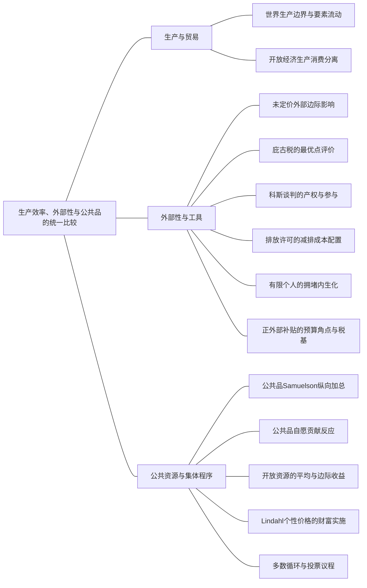

### 本专题知识联系

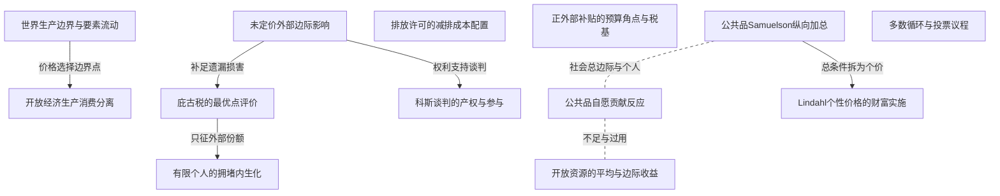

关系图中的箭头表示有方向的联系；虚线表示对照或类比。图中只画本专题主归属节点；跨专题关系在逐条命题中列明，可在练习室逐点追踪。具体成立条件以逐条说明为准。

### KMI100 世界生产边界与要素流动

身份：既有资料概括

还用于：从个人最优到交换均衡，再到分配实施

**定义与对象**

世界PPF取决于各国技术和要素是否能跨国重配，不能任意合并劳动池。

**何时调用**

多国生产、比较优势、凹或线性技术。

**适用条件**

国别资源约束和国际要素流动制度明确。

**核心公式与机制**

不流动时合成各国可行产出；可流动时先最小化世界目标产出的总要素需求；线性技术按机会成本分段。

**推导与理由**

全球有效配置在可调范围内均衡边际机会成本，制度改变可行集合而改变边界。

**边界与易错**

绝对优势不保证凹技术下全部要素集中一国；世界两截距连线可能漏比较优势折点。

**整理依据**

- review MI081：劳动不可跨国时合成相同方向的两国边界；允许流动时先最小化给定世界产出的劳动需求，凹技术下保留两国生产。
- review MI081：南国劳动约束为 $x_S^2+y_S^2\le100$，边界半径10；北国为 $4x_N^2+4y_N^2\le100$，半径5。给定世界生产方向，使两国在相同方向的边界上生产，可使合成产出半径达到10加5。反之由向量三角不等式，世界产出半径不可能超过15。因此非负象限世界PPF为  $$X^2+Y^2=225.$$  边界上南国承担世界两商品各 $\frac23$，北国各 $\frac13$，恰分别使用本国100劳动。
- review MI081：给定总量X、Y，劳动需求为 $x_S^2+y_S^2+4x_N^2+4y_N^2$，约束两国产出分别加总。对x配置最小化 $x_S^2+4(X-x_S)^2$，FOC给 $x_S=4x_N$；y同理。严格凸目标保证最小，故南国产各总量的 $\frac45$、北国 $\frac15$，最低总劳动为  $$L_{\min}=\frac45(X^2+Y^2).$$  总劳动200对应新PPF $X^2+Y^2=250$。边界上南国劳动为 $\frac{16}{25}\times250=160$，北国为 $\frac4{25}\times250=40$。
- review MI081：若要求X等于Y，原每种产量为 $\frac{15}{\sqrt2}$，新为 $\sqrt{125}=5\sqrt5$，比例增长为 $\frac{\sqrt{10}}3-1\approx5.409\%$。南国绝对效率较高，但凹技术使其扩张的边际劳动成本上升，最优仍在北国保留劳动，不能将全部200劳动都集中南国。

### KMI101 开放经济生产消费分离

身份：既有资料概括

还用于：税制改变哪条约束，福利由谁承担

**定义与对象**

生产按世界或国内相关价格最大化收入，消费按财富和偏好选择，两点以贸易价值相连。

**何时调用**

封闭开放、出口进口、返还关税。

**适用条件**

世界价格、国内税价、贸易方向及国际收支约束明确。

**核心公式与机制**

先生产后消费；世界价下出口价值等进口价值，国内税收一次性返还另入财富。

**推导与理由**

贸易允许消费脱离本国产出组合，但不能脱离可融资的世界资源价值。

**边界与易错**

进口税价等式只在实际进口分支成立，禁止性税后可能是价格不等式和零税收。

**整理依据**

- review MI083：开放后按世界价格分别优化生产和消费，以价值预算连接两点。
- case CMI17：进口平价应作为上界而非必须等式

### KMI102 未定价外部边际影响

身份：既有资料概括

**定义与对象**

行为通过未被价格或合约充分计入的渠道改变他人收益成本，私人和社会边际因此不同。

**何时调用**

污染、消费外溢、联合利润与分散。

**适用条件**

明确行为者、受影响者和真正未内部化部分；其他扭曲另核。

**核心公式与机制**

私人按自身目标求导；社会加总相关真实收益成本再求导。

**推导与理由**

一个人的最优未计他人受益或损害，可产生配置缺口。

**边界与易错**

纯价格变动的财富重分配不自动是技术外部性；垄断和已有税可改变纠正方向。

**整理依据**

- card MC10：外部性是一个主体的行为经未被相关市场价格或合约充分计入的渠道影响他人收益或成本。负外部性使社会边际成本高于私人边际成本，正外部性使社会边际收益高于私人边际收益。单纯价格变化造成的收入再分配不自动是技术外部性。标准负外部性使活动过多的结论还以没有其他扭曲为前提；若原市场同时垄断或已有税，不能只照搬一个庇古税数值。  庇古税使决策者面对社会最优处的边际外部损害；消费补贴使其计入边际外部收益。社会规划条件与政策实施条件是不同层次：税补贴进入谁的预算、按总消费还是净交易支付、由谁融资，都会影响可实施配置和最小税负。  科斯定理强调在权利清晰、交易成本足够低、可有效谈判等条件下，双方可通过补偿实现有效配置。产权初始归属改变收益分配；存在财富效应、信息、执行和参与约束时，活动水平也可能受产权分配影响。企业合并把外部影响纳入联合利润，不保证任意赔偿规则都产生同一社会最优，因为赔偿会同时改变受害方行为。  纯公共品具有非竞争和非排他，大家享用同一个数量，所以边际支付意愿纵向加总；私人品数量横向加总。公共品非竞争不代表新增一单位公共品没有成本，也不代表私人自愿供给一定为零。公共资源通常非排他但有竞争或拥挤，开放使用容易过度，而公共品供给常不足，两种失灵方向不同。

### KMI103 庇古税的最优点评价

身份：既有资料概括

**定义与对象**

单位纠正税取社会最优处未内部化的边际损害，使私人边际条件对齐社会条件。

**何时调用**

排污税、真实损害与福利积分。

**适用条件**

无其他额外扭曲，税基和实际边际选择一致，经营参与也可行。

**核心公式与机制**

$B^{\prime}(q_S)=C^{\prime}(q_S)+D^{\prime}(q_S)$，$t^*=D^{\prime}(q_S)$。

**推导与理由**

固定税率改变私人新增单位代价；在目标点恰补漏掉的损害。

**边界与易错**

不能在原私优评价MD，税收不是额外真实损害，零污染未必最优。

**整理依据**

- card FM45：**题干触发。**污染、拥堵、噪声、排污税、合并、损害赔偿。  **一般原式。**私人收益$B(q)$、成本$C(q)$、外部损害$D(q)$： $$ \begin{gathered} B'(q_P)=C'(q_P), \\ B'(q_S)=C'(q_S)+D'(q_S), \\ t^*=D'(q_S). \end{gathered} $$ 税率在社会最优量评价，且以其他市场无额外扭曲、政策能按该边际量实施为前提。  

### KMI104 科斯谈判的产权与参与

身份：既有资料概括

**定义与对象**

清晰可执行权利下，双方可在相对默认行动的可分净收益范围内达成有效补偿。

**何时调用**

排污权、洁净权、过滤与交易成本。

**适用条件**

低交易成本、可谈判执行、外部选择与财富效应明确。

**核心公式与机制**

先比真实资源损害与防治费用，再按产权默认行动写双方可接受支付区间。

**推导与理由**

产权决定无协议时的收益和转移方向；净社会收益为正才可能分配共同改善。

**边界与易错**

财富效应或真实交易成本可使行动也随产权变，任意赔偿机制不保证社优。

**整理依据**

- review MI090：先比较过滤成本与真实损害判断有效行动，再按产权所给外部选择写双方可接受转移；真实协商成本需另扣。
- review MI090：安装过滤器耗资源25，避免渔民损失40，因此净社会收益为15，在零其他成本下应安装。产权并不改变这两个真实数值，但决定不达成协议时谁有权做什么以及转移方向。
- review MI090：若工厂有排污权，默认不装。渔民支付P诱导安装时，工厂需 $P\ge25$ 才覆盖成本，渔民需 $P\le40$ 才不比受污染更差，故 $25\le P\le40$ 的补偿可实现安装。  若渔民有可执行洁净权，工厂默认须装过滤器，或购买排污许可。要使渔民放弃权利须付至少40，但工厂为省安装成本最多愿付25，因此同时 $P\ge40$、$P\le25$ 无解。工厂应安装，不发生许可交易。
- review MI090：若为了达成安装协议还需耗资源20，原可分净收益15变为 $15-20=-5$。在工厂有排污权的情形，自愿双方无法分配一个负净收益来同时改善，协商未必发生，可能继续污染。洁净权可执行下依法安装的默认行动未必需要同一协商过程；若执法或标准也有成本，应另核。故零交易成本时产权主要影响分配，有真实交易成本时行动本身也可能受权利安排影响。

### KMI105 排放许可的减排成本配置

身份：既有资料概括

还用于：技术到成本，成本到供给，供给到进入

**定义与对象**

给定总排放目标，在各厂可行减排区间内均衡边际减排成本以最低真实成本完成目标。

**何时调用**

MAC、初始许可证与交易方向。

**适用条件**

总减排正确换算，减排量上下限、无摩擦竞争交易。

**核心公式与机制**

把MAC积分为成本，令内点MAC相等并核边界；许可需求等实际排放减初始持有。

**推导与理由**

一单位减排从高MAC转给低MAC可节成本，直到内点等化。

**边界与易错**

许可支付是转移、许可价非平均成本；初始分配影响租而非本无摩擦配置。

**整理依据**

- review MI086：总排放降至8等价于减排12；成本最小化令活跃厂商MAC相等，再以实际排放与初始许可差求交易。
- review MI086：原排放各10、总20，目标排放8要求 $a_1+a_2=12$，且每厂减排在0至10之间。由MAC积分，取零减排成本为零，得 $C_1=a_1^2$、$C_2=\frac{a_2^2}{2}$。社会求两厂真实成本之和最小，不包括许可支付这类转移。
- review MI086：用 $a_2=12-a_1$ 代入，目标为 $a_1^2+\frac{(12-a_1)^2}{2}$。FOC为 $2a_1-(12-a_1)=0$，SOC为3，故  $$a_1=4,\qquad a_2=8,\qquad MAC_1=MAC_2=8.$$  两减排均在0至10内，所以无需另取角点；许可均衡价为8。
- review MI086：实际排放为6与2。初始许可各4，厂1需买2，厂2可卖2，许可支出收入均为 $2\times8=16$，在两厂间相抵。真实减排成本为 $4^2+\frac{8^2}{2}=48$。若命令各减6，成本为 $6^2+\frac{6^2}{2}=54$，比有效交易方案多6。许可价等于边际而非平均减排成本；初始许可归属改变财富分配，在本无摩擦内点下不改变最低成本配置。

### KMI106 有限个人的拥堵内生化

身份：既有资料概括

**定义与对象**

有限玩家改变共同拥堵时已承担自身损害，纠正税只补对其他人的影响。

**何时调用**

三人拥堵、原子近似与返还。

**适用条件**

效用具体依赖总活动；税返还是否被视为给定必须明确。

**核心公式与机制**

私人求导含总量随本人行动变化，社会再累计所有受害者损失，两者差为外部税。

**推导与理由**

个人已内化自身份额，若把总量完全固定会重复或漏算应纠正部分。

**边界与易错**

不可把严格有限与原子近似混成一套；内生返还会改变有效税楔。

**整理依据**

- card FM45：两口径不能混在同一推导。
- review MI089：个人已计自己一份损害T，漏掉对其他两人的损害2T

### KMI107 正外部补贴的预算角点与税基

身份：既有资料概括

还用于：从个人最优到交换均衡，再到分配实施

**定义与对象**

社会边际收益条件还需由真实消费补贴预算和指定融资主体实施，角点可能使最低补贴为零。

**何时调用**

消费外溢、α全域、最小税负、总消费与净购买。

**适用条件**

非负消费、补贴非负、融资者预算和个人将转移给定均需核。

**核心公式与机制**

先求全部无政策与社会分支，再写全部消费补贴预算及融资，检查支持价格和每人的角点。

**推导与理由**

边际激励由税基决定；净买入补贴对不净买入者支付为零，未必能实现目标。

**边界与易错**

不能外推内点成负消费；α≥1原配置已社优，不能仍称严格不足；最低税负需在完整支持集合证明。

**整理依据**

- card FM46：**明确政策工具。**本模板补贴全部消费量：$s\ge0$，消费者2总量税$T=sx_1$，无其他转移，家庭将$p,s,T$视为给定。 $$ \begin{gathered} (p-s)x_1+y_1=2p, \\ px_2+y_2=2-T. \end{gathered} $$ 财政为计价商品转移，私人资源仍$x_1+x_2=2,y_1+y_2=2$。  **最小税负完整分支。**  当$0 < \alpha < \frac{1}{2}$， $$ \begin{gathered} p=1, \\ s=\alpha, \\ T_{\min}=\frac\alpha{1-\alpha}, \\ x_1=\frac1{1-\alpha},\ x_2=\frac{1-2\alpha}{1-\alpha},\ y_1=y_2=1. \end{gathered} $$ 当$\frac{1}{2} \le \alpha < 1$， $$ \begin{gathered} p_{\min}=\frac1{2\alpha}, \\ s_{\min}=\frac{1-\alpha}{2\alpha}, \\ T_{\min}=\frac{1-\alpha}{\alpha}, \end{gathered} $$ $$ \begin{gathered} x_1 = 2 , x_2 = 0 , \\ y_1 = \frac{1}{\alpha} - 1 , \\ y_2 = 3 - \frac{1}{\alpha} . \end{gathered} $$ 当$\alpha\ge1$，$s=T_{\min}=0$即已最优，可用无政策支持价区间。三段在$\alpha = \frac{1}{2}$和1衔接，非负约束均满足。  **最小性的证明骨架。**社会内点若$y_1=0$，消费者2内点给$p=1$，预算反推$s=2\alpha-1<0$不准；若$y_2=0$，个人1条件和预算给$p = \frac{3}{2}$，个人2可沿预算略减$x_2$增$y_2$改善，仍不成立。因此两人$y>0$，唯一支持政策就是$p=1,s=\alpha$，不只是局部最小。  社会角点$\frac{1}{2} \le \alpha < 1$，预算给$y_1=2s,y_2=2-2s$，故$s\le1$；零补贴会要求相互冲突的$p \le \frac{1}{2}$与$p \ge \frac{1}{2 \alpha}$。正补贴时个人1要求$p - s = \frac{1}{2}$；个人2不购买给$p \ge \frac{1}{2 \alpha}$。完整支持集合为 $$ \begin{gathered} \frac{1 - \alpha}{2 \alpha} \le s \le 1 , \\ p = \frac{1}{2} + s , \\ T = 2 s . \end{gathered} $$ 税负随$s$升高，故下端点全局最小；$s=1$使个人2收入为零，仍可行。$\alpha\ge1$时$T\ge0$而零政策有效，零是下界。  **净购买补贴的失效分支。**若只按净买入补贴，预算必须改为 $$ px_1+y_1=2p+s\max(x_1-2,0). $$ 可行均衡$x_1\le2$使支付恒零。$0 < \alpha < \frac{1}{2}$目标内点没有边际激励改变；$\frac{1}{2} \le \alpha < 1$目标角点仍要求上述冲突的价格条件，不能实现；只有$\alpha\ge1$本来已最优。若$s\ge p$还可能诱发非有限需求，也不会凭空创造可行社会资源。  

### KMI108 公共品Samuelson纵向加总

身份：既有资料概括

**定义与对象**

大家共同享用同一数量的纯公共品，社会内点需加总各人对私人计价品的边际支付意愿。

**何时调用**

公共设施规划、社会效率。

**适用条件**

公共数量共同、真实MC同计价单位；正规内点，分配目标与预算另核。

**核心公式与机制**

$\sum_iMRS_{G,c_i}=MC_G$。

**推导与理由**

多一单位G同时给所有人收益，资源只需增加一份生产成本。

**边界与易错**

非竞争不表示生产无成本，也不能像私人物数量一样横向加总不同人的G。

**整理依据**

- card FM47：**社会效率。**私人计价消费$c_i$、共同公共品$G$，正规内点Samuelson条件 $$ \begin{gathered} \sum_i\frac{MU_{G,i}}{MU_{c,i}}=MC_G \\ \text{以计价商品计成本}. \end{gathered} $$ 若$u_i=c_i+a_i\ln G$、单位成本$k$且收入足以支持内点，则$G_S = \frac{\sum_i a_i}{k}$。  

### KMI109 公共品自愿贡献反应

身份：既有资料概括

**定义与对象**

每人付自己的贡献成本却享受总G，最佳反应仅计自己受益并受不负贡献和财富限制。

**何时调用**

捐资纳什、搭便车与收入效应。

**适用条件**

共同G为各贡献和，个人预算与效用实际指定。

**核心公式与机制**

固定其他贡献求自身全域反应，联立并核零贡献者及财富上限。

**推导与理由**

贡献产生他人收益未被私人计入，常使供给不足但不一定为零。

**边界与易错**

对数私人消费模型不能套拟线性最大偏好权重公式，须按实际效用重求。

**整理依据**

- review MI087：个人只计自身公共收益，纳什各自最优；社会有效条件纵向加总边际替代率，不能横向加数量。
- review MI087：给定对方贡献 $g_j$，个人最大化 $\ln(10-g_i)+\ln(g_i+g_j)$。导数为 $-\frac1{10-g_i}+\frac1G$，二阶导严格负。内点要求 $10-g_i=g_i+g_j$，故完整反应为 $g_i=\max\{\frac{10-g_j}{2},0\}$。  联立两反应的正贡献分支，得两人各贡献 $\frac{10}{3}$，G为 $\frac{20}{3}$，私人消费各 $\frac{20}{3}$。零贡献候选不能同时满足对手反应，因此没有遗漏可行角点均衡。
- review MI087：对称筹资下 $x=10-\frac G2$，社会加总效用为 $2\ln(10-\frac G2)+2\ln G$。FOC为 $-\frac1x+\frac2G=0$，等价于纵向加总边际替代率 $\frac{2x}{G}=1$。联立资源约束得G为10、私人消费各5、贡献各5，内点目标严格凹。
- review MI087：个人增加一单位贡献也提高对方享受的同一个G，却只计入自己的边际收益；社会规划计入两人的收益，所以自愿G低于有效G。公共品每人享用同一数量，边际愿付价应纵向加总，不能像私人商品那样横向加总各人消费数量。供给不足也不意味着本例自愿供给为零。

### KMI110 开放资源的平均与边际收益

身份：既有资料概括

**定义与对象**

开放进入按每人平均收益覆盖机会成本，社会新增使用者则按总收益边际增量比较。

**何时调用**

公共牧场、湖泊、自由进入。

**适用条件**

共享总收益、拥挤及外部机会成本明确，有限战略参与另解。

**核心公式与机制**

开放进入常为 $F(n)/n=w$，规划内点 $F^{\prime}(n)=w$。

**推导与理由**

新增进入者分到平均收益同时稀释他人份额，未必计其拥挤损失。

**边界与易错**

公共资源过度使用与纯公共品不足是不同机制；有限玩家可能内化自身拥挤。

**整理依据**

- card FM47：**开放资源对照。**若$n$名使用者分享总收益$F(n)$、每人外部机会成本$w$，自由进入常用平均收益$\frac{F (n)}{n} = w$；规划者条件$F'(n)=w$。递减平均收益下自由进入可能过度，和纯公共品供给不足方向相反。有限使用者战略内生化的自身拥挤需按具体效用重新求导。  

### KMI111 Lindahl个性价格的财富实施

身份：既有资料概括

还用于：从个人最优到交换均衡，再到分配实施

**定义与对象**

个人按不同单位价为同一公共数量付费，价格份额须覆盖MC且财富须让每人实际愿选目标。

**何时调用**

个性化公共品收费、一次性转移。

**适用条件**

同一G，各自预算可行和最优，价格份额和等资源MC。

**核心公式与机制**

由目标MRS求t_i，再由目标私人消费加t_iG求财富，以转移守恒核融资。

**推导与理由**

价格使私人边际收益与本人边际负担对齐，财富则决定实际能购的公共和私人组合。

**边界与易错**

只报价格份额不安排预算并不能实施；强制共同筹资也不等原自愿均衡。

**整理依据**

- case CMI18：单报价格份额而不安排财富，会使第二人无法购买所报消费

### KMI112 多数循环与投票议程

身份：既有资料概括

还用于：从个人最优到交换均衡，再到分配实施

**定义与对象**

个人传递排序经简单多数两两比较可能形成社会循环，议程因此影响最终胜者。

**何时调用**

Condorcet、计分投票、投票交易。

**适用条件**

偏好、投票规则和可选集合具体已给。

**核心公式与机制**

逐对数多数，再按淘汰顺序计算胜者；有交易需重算联盟激励。

**推导与理由**

不同多数联盟支持不同成对比较，无法由个人传递性推出社会传递性。

**边界与易错**

投票胜者不是自动社会福利最大值，计分也不能无条件恢复唯一福利函数。

**整理依据**

- card MC22：范里安第34章第5题原PDF90讨论投票议程；尼科尔森第19章第10题原PDF321给投票交易与非传递。三人偏好分别为$C\succ A\succ B$、$A\succ B\succ C$、$B\succ C\succ A$，则多数决定$A\succ B,B\succ C,C\succ A$，形成Condorcet循环，虽每个人自己的排序传递。两两投票先淘汰哪一项会影响最后结果，故不能把某次投票胜出者直接叫社会效用最大点。  计分投票可写$S(a)=\sum_i s_i(a)$，但分数规则、可选集合和策略投票会影响结论；它不是从个人序数偏好无条件恢复唯一社会福利函数的办法。若题目允许投票交易，必须重新计算联盟与支付后的激励，不能保持原来的无交易投票结果。该类题可与M41的规范性社会目标并读：福利目标、集体决策程序和市场竞争均衡是三个不同问题。

### 关系命题与条件

#### EMI162 世界生产边界与要素流动 → 开放经济生产消费分离

机制；编者推导

给定世界边界与贸易价后，生产选价值最大点，消费另受国际价值预算约束。

适用条件：贸易可行且世界价给定。

理由：贸易把技术边界变成可交换的收入边界。

依据：review MI083「封闭时生产消费相同，MRT=MRS；开放后按世界价格分别优化生产和消费，以价值预算连接两点。」；review MI083「劳动约束给 $x^2+y^2=100$。边界斜率绝对值为 $\frac xy$，消费者乘积效用的MRS为 $\frac yx$。封闭竞争下生产与消费同点且均等相对价格，故 $\frac xy=\frac yx$，正产解为 $x=y=5\sqrt2$，相对价格1，效用50。」；review MI083「开放价为 $(2,1)$，生产最大化 $2x+y$。切点要求 $\frac xy=2$，联立PPF得生产 $(4\sqrt5,2\sqrt5)$，收入为 $10\sqrt5$。生产集合严格凸的边界支持点唯一。  消费者内点要求 $\frac yx=\frac{p_x}{p_y}=2$，因此 $y=2x$；预算为 $2x+y=10\sqrt5$，所以消费为 $(\frac{5\sqrt5}{2},5\sqrt5)$。其效用为 $\frac{125}{2}$，高于封闭时50。」；review MI083「x出口量为 $4\sqrt5-\frac{5\sqrt5}{2}=\frac{3\sqrt5}{2}$，y进口量为 $5\sqrt5-2\sqrt5=3\sqrt5$。出口收入为 $2\times\frac{3\sqrt5}{2}=3\sqrt5$，等于进口支出，贸易预算平衡。福利增加来自按世界相对价格调整生产和消费，不要求两种商品的国内产量都提高；开放时不能再强求各商品国内产等于国内消费。」

#### EMI163 未定价外部边际影响 → 庇古税的最优点评价

推导；编者推导

无其他扭曲时私人MC加目标点边际损害可对齐社会FOC。

适用条件：可按该行为量收单位税。

理由：两条件之差恰是未内部化边际损失。

依据：card FM45「**题干触发。**污染、拥堵、噪声、排污税、合并、损害赔偿。  **一般原式。**私人收益$B(q)$、成本$C(q)$、外部损害$D(q)$： $$ \begin{gathered} B'(q_P)=C'(q_P), \\ B'(q_S)=C'(q_S)+D'(q_S), \\ t^*=D'(q_S). \end{gathered} $$ 税率在社会最优量评价，且以其他市场无额外扭曲、政策能按该边际量实施为前提。  」

#### EMI164 未定价外部边际影响 → 科斯谈判的产权与参与

机制；编者推导

可合约化损害和防治行动可通过满足双方参与的转移内化。

适用条件：权利可执行、足够低交易成本。

理由：补偿在双方外部选择之间分割可得净收益。

依据：review MI090「先比较过滤成本与真实损害判断有效行动，再按产权所给外部选择写双方可接受转移；真实协商成本需另扣。」；review MI090「安装过滤器耗资源25，避免渔民损失40，因此净社会收益为15，在零其他成本下应安装。产权并不改变这两个真实数值，但决定不达成协议时谁有权做什么以及转移方向。」；review MI090「若工厂有排污权，默认不装。渔民支付P诱导安装时，工厂需 $P\ge25$ 才覆盖成本，渔民需 $P\le40$ 才不比受污染更差，故 $25\le P\le40$ 的补偿可实现安装。  若渔民有可执行洁净权，工厂默认须装过滤器，或购买排污许可。要使渔民放弃权利须付至少40，但工厂为省安装成本最多愿付25，因此同时 $P\ge40$、$P\le25$ 无解。工厂应安装，不发生许可交易。」；review MI090「若为了达成安装协议还需耗资源20，原可分净收益15变为 $15-20=-5$。在工厂有排污权的情形，自愿双方无法分配一个负净收益来同时改善，协商未必发生，可能继续污染。洁净权可执行下依法安装的默认行动未必需要同一协商过程；若执法或标准也有成本，应另核。故零交易成本时产权主要影响分配，有真实交易成本时行动本身也可能受权利安排影响。」

#### EMI166 庇古税的最优点评价 → 有限个人的拥堵内生化

条件变化；编者推导

有限拥堵者已计自身损害，庇古税不能重复计该份。

适用条件：本人可影响总量且私人导数已含自身影响。

理由：税只填私人和社会导数之间的差。

依据：review MI089「税只纠正对其他两人的外部损害」

#### EMI169 公共品Samuelson纵向加总 → 公共品自愿贡献反应

对照；编者推导

公共品规划加总全体边际收益，个人贡献只计本人收益。

适用条件：相同资源与偏好，但制度不同。

理由：一份贡献增加共同G，也改善对方福利。

依据：review MI087「个人增加一单位贡献也提高对方享受的同一个G」

#### EMI170 公共品Samuelson纵向加总 → Lindahl个性价格的财富实施

机制；编者推导

Samuelson总边际支付可分成个人单位价，但还需相应财富支持同一G。

适用条件：价格份额和等MC，预算可转移。

理由：各人的私人FOC分别对齐其单位负担，总筹资覆盖成本。

依据：case CMI18「两人收入各12，私人物x与公共设施G的单位资源成本均1。效用 $u_1=\ln x_1+\ln G$、$u_2=\ln x_2+2\ln G$。原制度为自愿贡献 $g_i\in[0,12)$，$x_i=12-g_i$、$G=g_1+g_2$。规划者可转移私人物；各方案以同一总资源24为限。」；case CMI18「个体i公共品权重分别 $a_1=1,a_2=2$，在总G正时导数为 $-\frac{1}{12-g_i}+\frac{a_i}{g_i+g_j}$，二阶导负。正贡献FOC为 $a_i(12-g_i)=g_i+g_j$，所以 $BR_1=\max\{\frac{12-g_2}{2},0\}$、$BR_2=\max\{\frac{24-g_1}{3},0\}$。联立正支得 $g_1=\frac{12}{5},g_2=\frac{36}{5},G=\frac{48}{5}$，消费 $x_1=\frac{48}{5},x_2=\frac{24}{5}$。均正且贡献小于12；单人贡献的候选会使另一人愿进入，故此为一致均衡。」；case CMI18「加总目标为 $\ln x_1+\ln x_2+3\ln G$，约束 $x_1+x_2+G=24$。FOC为 $\frac{1}{x_1}=\frac{1}{x_2}=\frac{3}{G}=\lambda$，故 $x_1=x_2=\frac{G}{3}$。代资源得 $G^*=\frac{72}{5},x_1^*=x_2^*=\frac{24}{5}$。对数目标严格凹，所得正内点为唯一全局最优。规划G比自愿 $\frac{48}{5}$ 高 $\frac{24}{5}$；社会边际收益累加两人的受益，而私人贡献仅计自己的一份。」；case CMI18「写本经济的Samuelson条件并在规划配置检验。若按原收入各自支付相同公共品份额来实现规划资源配置，每人须贡献多少？说明这是否已证明它是自愿贡献均衡。」；case CMI18「公共品对私人物的边际替代率为 $MRS_1=\frac{x_1}{G}$、$MRS_2=\frac{2x_2}{G}$。资源最优要求两者相加等于公共品边际资源成本1，即 $\frac{x_1+2x_2}{G}=1$。规划点给 $\frac{[(\frac{24}{5})+2(\frac{24}{5})]}{\frac{72}{5}}=1$，满足条件。  若保持每人原收入12且最后私人消费各 $\frac{24}{5}$，各自承担贡献 $12-\frac{24}{5}=\frac{36}{5}$，总和 $\frac{72}{5}$。这只是资源筹资安排；给定对方贡献 $\frac{36}{5}$，人1的最佳反应为 $\frac{12}{5}$ 而非 $\frac{36}{5}$，所以它不是原自愿制度纳什。强制分摊或其他激励仍须明确。」；case CMI18「设可对每人按公共品总量收个性化价格 $t_iG$，各人可选择所需G，且 $t_1+t_2=1$。求支持第二问配置的价格、所需个人预算财富以及从原收入出发的一次性转移，核筹资。」；case CMI18「个人最优公共品条件为 $t_i=\frac{a_ix_i}{G}$，规划点给 $t_1=\frac{1}{3},t_2=\frac{2}{3}$，和为1。支持同一G及私人消费所需财富分别为 $m_1=x_1+t_1G=\frac{48}{5}$、$m_2=x_2+t_2G=\frac{72}{5}$。原来各12，因此人1向人2转 $\frac{12}{5}$；两财富总和24不变。公共品支付分别 $\frac{24}{5}$、$\frac{48}{5}$，合计 $\frac{72}{5}$，正好覆盖设施成本。  给定这些价格和财富，个人对数问题严格凹，各自需求都为规划G；单报价格份额而不安排财富，会使第二人无法购买所报消费，不能称已实现该规划点。」；case CMI18「比较第二问规划点和第一问自愿均衡的每人效用变化，判断等权加总效用提高是否足以证明双方都愿自愿接受这一变动。」；case CMI18「人1效用变化为 $\ln[(\frac{24}{5})(\frac{72}{5})]-\ln[(\frac{48}{5})^2]=\ln(\frac{3}{4})<0$。人2私人消费相同，公共品从 $\frac{48}{5}$ 增到 $\frac{72}{5}$，效用变化为 $2\ln(\frac{3}{2})>0$。效用和变化为 $\ln(\frac{3}{4})+2\ln(\frac{3}{2})=\ln(\frac{27}{16})>0$，但人1更差。因此等权规划最大化不等于相对原自愿均衡的帕累托改进，也不保证每人自愿同意转移与制度。若要求双方参与，需要把原效用下界另纳规划，而不能隐去输家。」；case CMI18「自愿反应、等权资源最优、筹资激励和个体参与逐层核对，不能用公共品更多替代私人预算和福利判断。」；case CMI18「不引用原题图：本综合题的参数、条件变化及问次与原图未逐项完全一致。解答以方程、可行域与关键数量给出可核验关系；本题没有另设必须作图的小问。」

#### EMI172 公共品自愿贡献反应 → 开放资源的平均与边际收益

对照；编者推导

纯公共品未内化他人受益常不足，开放拥挤资源未内化他人损失常过用。

适用条件：分别满足各自共享和竞争性条件。

理由：非排他本身不决定失灵方向，要看是否存在拥挤和受益外溢。

依据：card MC10「外部性是一个主体的行为经未被相关市场价格或合约充分计入的渠道影响他人收益或成本。负外部性使社会边际成本高于私人边际成本，正外部性使社会边际收益高于私人边际收益。单纯价格变化造成的收入再分配不自动是技术外部性。标准负外部性使活动过多的结论还以没有其他扭曲为前提；若原市场同时垄断或已有税，不能只照搬一个庇古税数值。  庇古税使决策者面对社会最优处的边际外部损害；消费补贴使其计入边际外部收益。社会规划条件与政策实施条件是不同层次：税补贴进入谁的预算、按总消费还是净交易支付、由谁融资，都会影响可实施配置和最小税负。  科斯定理强调在权利清晰、交易成本足够低、可有效谈判等条件下，双方可通过补偿实现有效配置。产权初始归属改变收益分配；存在财富效应、信息、执行和参与约束时，活动水平也可能受产权分配影响。企业合并把外部影响纳入联合利润，不保证任意赔偿规则都产生同一社会最优，因为赔偿会同时改变受害方行为。  纯公共品具有非竞争和非排他，大家享用同一个数量，所以边际支付意愿纵向加总；私人品数量横向加总。公共品非竞争不代表新增一单位公共品没有成本，也不代表私人自愿供给一定为零。公共资源通常非排他但有竞争或拥挤，开放使用容易过度，而公共品供给常不足，两种失灵方向不同。」

### 对应题目分问路径

#### MI081

流动制度改变全球要素分配。

**第1问**

本问任务：求劳动不能流动时的世界PPF。

分别国别劳动约束的圆形边界同向合成，三角不等式证半径15。

调用：KMI096 生产一般均衡的三层效率；KMI100 世界生产边界与要素流动

联系：EMI161

**第2问**

本问任务：将原每国100劳动的不可流动制度改为总劳动200可自由跨国，求新PPF和两国劳动配置，并按X=Y比较产量增长。

允许劳动流动后给世界产出最小化总劳动，边际相等给4比1分产；同量生产沿新旧圆半径比较增长；凹技术下保留北国，不因绝对效率全部集中。

调用：KMI041 给定产量的成本最小化；KMI100 世界生产边界与要素流动

联系：本问直接应用给定产量的成本最小化、世界生产边界与要素流动，所列任务没有另要求由一个独立结论推出另一个结论，不强加逻辑推出边。

#### MI082

线性机会成本排序给折点。

**第1问**

本问任务：按机会成本求世界PPF折点和分段式。

先低机会成本国转产，逐段合成PPF，不连总截距偷换可行边界。

调用：KMI100 世界生产边界与要素流动

联系：本问直接应用世界生产边界与要素流动，所列任务没有另要求由一个独立结论推出另一个结论，不强加逻辑推出边。

**第2问**

本问任务：先按X=Y求最大共同量，再令世界价格比为1，说明各国的生产分工。

先按X等Y核最大共同量在折点20；世界相对价1在两机会成本之间，分别比每劳动产值，仅用生产侧而不强加本问未设消费预算。

调用：KMI100 世界生产边界与要素流动；KMI101 开放经济生产消费分离

联系：本问直接应用世界生产边界与要素流动、开放经济生产消费分离，所列任务没有另要求由一个独立结论推出另一个结论，不强加逻辑推出边。

#### MI083

开放后生产和消费是两个点。

**第1问**

本问任务：先求封闭竞争的生产消费与相对价格，再开放为世界价(2,1)，求生产消费。

先封闭同点按MRS等MRT求等产和价；再开放按世界价分别选生产和消费，不能强令两点相等。

调用：KMI096 生产一般均衡的三层效率；KMI101 开放经济生产消费分离

联系：本问直接应用生产一般均衡的三层效率、开放经济生产消费分离，所列任务没有另要求由一个独立结论推出另一个结论，不强加逻辑推出边。

**第2问**

本问任务：在世界价(2,1)下计算进出口、效用并核贸易价值平衡。

沿第一问开放生产消费点作差求出口进口，核世界价值收支和效用高于封闭。

调用：KMI101 开放经济生产消费分离

联系：本问直接应用开放经济生产消费分离，所列任务没有另要求由一个独立结论推出另一个结论，不强加逻辑推出边。

#### MI084

未内部化损害使钢量过高。

**第1问**

本问任务：求分散和联合产量利润，核总增益。

钢与渔各自给定另一活动优化，损害对渔量是加性所以其FOC不变；联合加总真实利润将损害进入钢边际，Hessian核负定。

调用：KMI102 未定价外部边际影响

联系：本问直接应用未定价外部边际影响，所列任务没有另要求由一个独立结论推出另一个结论，不强加逻辑推出边。

**第2问**

本问任务：对每单位钢产量征纠正税以实施联合最优，求税率并说明税款的社会核算。

单位税2使钢最优18，按税后利润加渔利加财政核真实总收益。

调用：KMI021 财政转移与真实福利核算；KMI102 未定价外部边际影响；KMI103 庇古税的最优点评价

联系：EMI163

#### MI085

外部损害先进入社会边际再设税。

**第1问**

本问任务：求竞争与社会有效量、实施税和财政收入。

私人只含MC，社会加MD，唯一社会量由边际净收益下降证；税取社优点MD而非原竞争点，重联立消费者价和净价。

调用：KMI102 未定价外部边际影响；KMI103 庇古税的最优点评价；KMI017 单位税楔与经济归宿

联系：EMI163

**第2问**

本问任务：核各方案社会总剩余并判断零排放是否最优。

收益扣生产成本与真实损害积分，税转移不重复扣，零排放不必优于正量。

调用：KMI021 财政转移与真实福利核算；KMI103 庇古税的最优点评价

联系：本问直接应用财政转移与真实福利核算、庇古税的最优点评价，所列任务没有另要求由一个独立结论推出另一个结论，不强加逻辑推出边。

#### MI086

总减排约束下交易节约真实成本。

**第1问**

本问任务：求成本最低减排组合及许可价格。

排放目标8换减排12，MAC积分并联立相等，回验每厂0至10。

调用：KMI105 排放许可的减排成本配置

联系：本问直接应用排放许可的减排成本配置，所列任务没有另要求由一个独立结论推出另一个结论，不强加逻辑推出边。

**第2问**

本问任务：初始许可每厂4，求交易方向和数量；再与各减排6的命令控制比较总成本。

实际排放减初始许可定交易，许可支付抵消，比较真实成本48与均摊54。

调用：KMI021 财政转移与真实福利核算；KMI105 排放许可的减排成本配置

联系：本问直接应用财政转移与真实福利核算、排放许可的减排成本配置，所列任务没有另要求由一个独立结论推出另一个结论，不强加逻辑推出边。

#### MI087

自愿和社会各自有最优条件。

**第1问**

本问任务：求个人最佳反应及纳什贡献。

私人对自身贡献求导，完整截断反应联立并核零贡献。

调用：KMI065 纳什均衡的单边偏离检验；KMI109 公共品自愿贡献反应

联系：本问直接应用纳什均衡的单边偏离检验、公共品自愿贡献反应，所列任务没有另要求由一个独立结论推出另一个结论，不强加逻辑推出边。

**第2问**

本问任务：求对称有效供给，写Samuelson条件并解释搭便车。

规划对共同G加总MRS，同时资源核对称筹资，解释自愿不足不等零。

调用：KMI108 公共品Samuelson纵向加总；KMI109 公共品自愿贡献反应

联系：EMI169

#### MI088

异质公共偏好不等社会私人消费须异。

**第1问**

本问任务：求纳什贡献并核正贡献条件。

各人的公共权重不同，逐人FOC及预算联立并回验正贡献。

调用：KMI109 公共品自愿贡献反应

联系：本问直接应用公共品自愿贡献反应，所列任务没有另要求由一个独立结论推出另一个结论，不强加逻辑推出边。

**第2问**

本问任务：改由可转移私人物、等权加总效用的规划者选择，求配置，并说明与原收入下自愿筹资的区别。

等权目标可重分私物，社会G12；个价若要实施还须财富预算，不能仅报份额。

调用：KMI092 社会福利权重与效用刻度；KMI108 公共品Samuelson纵向加总；KMI111 Lindahl个性价格的财富实施

联系：EMI170

#### MI089

有限三人个人导数含本人拥堵。

**第1问**

本问任务：求对称纳什和加总效用最优，说明个人对总量的影响。

每人改变T，私人FOC为12减ti减T，联立对称而非当T完全外生；社会累计三份损害，严格凹目标求ti6/5和总18/5。

调用：KMI065 纳什均衡的单边偏离检验；KMI106 有限个人的拥堵内生化；KMI102 未定价外部边际影响

联系：本问直接应用纳什均衡的单边偏离检验、有限个人的拥堵内生化、未定价外部边际影响，所列任务没有另要求由一个独立结论推出另一个结论，不强加逻辑推出边。

**第2问**

本问任务：征线性出行税、总额均分返还且个体视返还给定，求实施最优的税，并说明该行为假设。

私人已计T只补其余2T，目标税36/5；返还视给定是必要行为条件。

调用：KMI103 庇古税的最优点评价；KMI106 有限个人的拥堵内生化

联系：EMI166

#### MI090

产权改变默认行动和可接受支付。

**第1问**

本问任务：比较有效行动并分别写两种产权下可接受转移区间。

过滤费25避损40，净收益15；排污权时补偿区间25至40；洁净权默认过滤，买排污许可需同时超过40又低于25不可能，所以不交易而过滤。

调用：KMI102 未定价外部边际影响；KMI104 科斯谈判的产权与参与

联系：EMI164

**第2问**

本问任务：将达成协商所需真实资源成本设为20，按不同产权重新评价协商的可行性与效率。

协商耗20使净可分收益为负，排污权下谈判可能失败；默认洁净行动另核执法成本。

调用：KMI104 科斯谈判的产权与参与

联系：本问直接应用科斯谈判的产权与参与，所列任务没有另要求由一个独立结论推出另一个结论，不强加逻辑推出边。

#### CMI17

贸易与关税均核价格分支和预算。

**第1问**

本问任务：求生产可能边界、封闭竞争量和相对价格，计算效用。

国内144劳动给圆形PPF，封闭MRS=MRT求等量和效用。

调用：KMI096 生产一般均衡的三层效率

联系：本问直接应用生产一般均衡的三层效率，所列任务没有另要求由一个独立结论推出另一个结论，不强加逻辑推出边。

**第2问**

本问任务：开放且无税，求最优生产量与国民生产收入，说明生产与消费决策应如何分开。

开放按世界价最大化生产值，核劳动配置和总收入，不能先强制消费比例。

调用：KMI096 生产一般均衡的三层效率；KMI101 开放经济生产消费分离

联系：本问直接应用生产一般均衡的三层效率、开放经济生产消费分离，所列任务没有另要求由一个独立结论推出另一个结论，不强加逻辑推出边。

**第3问**

本问任务：求无税开放后的消费、进出口和效用，与封闭基准比较，并核国际收支。

收入下消费各半支出，出口价值等进口，比较效用但不要求每品消费都增。

调用：KMI101 开放经济生产消费分离

联系：本问直接应用开放经济生产消费分离，所列任务没有另要求由一个独立结论推出另一个结论，不强加逻辑推出边。

**第4问**

本问任务：只对进口y征单位税1/2，x自由交易。求国内价格、生产、消费、贸易与返还税收，核进口分支和预算；比较无税效用。

进口y税1/2给国内价，生产和消费分别优化，国际预算和税返还闭合，核进口正。

调用：KMI017 单位税楔与经济归宿；KMI097 企业所有权与利润资源闭合；KMI101 开放经济生产消费分离

联系：EMI153、EMI174

**第5问**

本问任务：独立将y进口税改为1，求可维持的均衡生产、消费、贸易和税收；说明为什么不能在更高税率下不检查贸易方向而机械令国内y价等于世界价加税。

税1到零贸易、零财政边界；更高税进口平价为不等式，不把反向贸易套进口税。

调用：KMI101 开放经济生产消费分离

联系：本问直接应用开放经济生产消费分离，所列任务没有另要求由一个独立结论推出另一个结论，不强加逻辑推出边。

#### CMI18

公共品筹资、个价支持和自愿参与分开。

**第1问**

本问任务：求两人的完整最佳反应及纳什贡献、私人物消费和公共设施数量，核双方参与内点。

原收入预算下逐人求完整反应，核正贡献与单人角点。

调用：KMI065 纳什均衡的单边偏离检验；KMI109 公共品自愿贡献反应

联系：本问直接应用纳什均衡的单边偏离检验、公共品自愿贡献反应，所列任务没有另要求由一个独立结论推出另一个结论，不强加逻辑推出边。

**第2问**

本问任务：规划者最大化两人效用之和，求资源最优配置并证明最优性，与自愿G比较。

总资源24，等权规划私人品和共同G联立，凹性核唯一。

调用：KMI092 社会福利权重与效用刻度；KMI108 公共品Samuelson纵向加总

联系：本问直接应用社会福利权重与效用刻度、公共品Samuelson纵向加总，所列任务没有另要求由一个独立结论推出另一个结论，不强加逻辑推出边。

**第3问**

本问任务：写本经济的Samuelson条件并在规划配置检验。若按原收入各自支付相同公共品份额来实现规划资源配置，每人须贡献多少？说明这是否已证明它是自愿贡献均衡。

在规划点检Samuelson，再算等额筹资；给对方筹资后最佳反应不同说明不自愿纳什。

调用：KMI108 公共品Samuelson纵向加总；KMI109 公共品自愿贡献反应

联系：EMI169

**第4问**

本问任务：设可对每人按公共品总量收个性化价格 $t_iG$，各人可选择所需G，且 $t_1+t_2=1$。求支持第二问配置的价格、所需个人预算财富以及从原收入出发的一次性转移，核筹资。

MRS给个价1/3与2/3，再按目标束求财富并转12/5，核融资和个人需求同G。

调用：KMI093 目标配置的财富实施；KMI108 公共品Samuelson纵向加总；KMI111 Lindahl个性价格的财富实施

联系：EMI170、EMI171

**第5问**

本问任务：比较第二问规划点和第一问自愿均衡的每人效用变化，判断等权加总效用提高是否足以证明双方都愿自愿接受这一变动。

逐人比效用：人1下降、人2上升，总和升不等帕累托改进或双方同意。

调用：KMI091 帕累托改进与个体理性；KMI092 社会福利权重与效用刻度；KMI111 Lindahl个性价格的财富实施

联系：EMI175

## 私人信息到机制：谁知道什么，谁选择什么

私人信息、可观察性和行为假设怎样改变可实施的交易与合同？

类型参与、信号、菜单、努力合同与拍卖分别保留其IC/IR、预算和概率条件；网络与行为材料拆成可独立检验的知识点。

### 分支导图

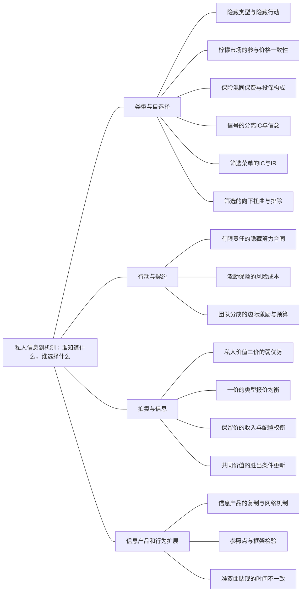

### 本专题知识联系

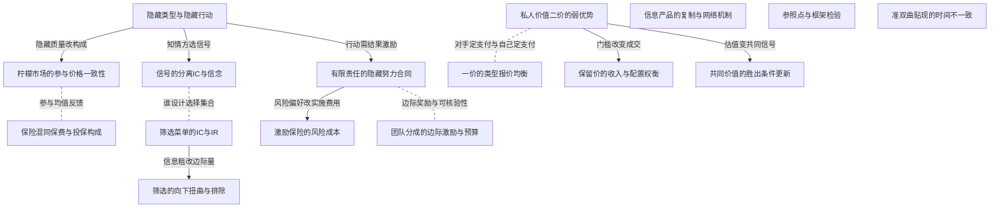

关系图中的箭头表示有方向的联系；虚线表示对照或类比。图中只画本专题主归属节点；跨专题关系在逐条命题中列明，可在练习室逐点追踪。具体成立条件以逐条说明为准。

### KMI113 隐藏类型与隐藏行动

身份：既有资料概括

**定义与对象**

逆向选择涉及无法观察的交易类型，道德风险涉及签约后不可观察的行动。

**何时调用**

信息不对称识别、保险或努力。

**适用条件**

指出具体信息、谁知道及何时能合约化，不能仅贴时间标签。

**核心公式与机制**

类型主要改变参与构成，隐藏行动主要改变契约后的选择与结果分布。

**推导与理由**

最优合同必须针对实际不可观察变量设计可实施激励。

**边界与易错**

看到风险不等道德风险；要说明不可见行为如何改变结果。

**整理依据**

- card MC11：逆向选择是交易前的隐藏类型问题，低质量、高风险或高成本的类型可能更愿意接受某种合约，从而改变交易者构成。道德风险是签约后难观察行动影响结果的问题，保险可能削弱防范，固定工资可能削弱努力。两者不能仅靠“事前事后”口号识别，还要指出哪项私人信息不可观察、它如何改变参与或行动。  

### KMI114 柠檬市场的参与价格一致性

身份：既有资料概括

**定义与对象**

统一价格影响愿出售类型，买方按实际出售集合估值，二者须同时一致。

**何时调用**

质量未知、认证与交易崩溃。

**适用条件**

风险中性竞争买方、已知质量分布和各型保留价。

**核心公式与机制**

$S(P)=\{q:r(q)\le P\}$，$P=E[v(q)\mid q\in S(P)]$。

**推导与理由**

价格不足以留住高质者时均值下降，须重新定价和回验所有类型参与。

**边界与易错**

不一定全市场无交易；认证真实成本与不可伪造性可改变参与。

**整理依据**

- card FM48：**题干触发。**二手车、质量无法观察、不同事故率投保人、平均质量随价格改变。  **变量与前提。**卖方类型$q$，保留价$r(q)$，买方价值$v(q)$，价格$P$；风险中性竞争买方、质量分布已知。供给集合与竞争定价必须同时满足 $$ \begin{gathered} S(P)=\{q:r(q)\le P\}, \\ P=E[v(q)\mid q\in S(P)] \end{gathered} $$ 或在有零利润不等式、需求限制时改用对应条件，不能先用全体平均质量固定价格不再更新。  **步骤。**猜一个参与类型集合；计算条件质量均值和买方愿付；用卖方参与条件回验。二类型可先尝试混同价$P=\lambda V_H+(1-\lambda)V_L$；若此价低于高质卖方保留价，高质退出，再用只剩低质的预期重算。若低质也不愿卖，可能无交易。  **边界检查。**逆向选择不必导致所有市场完全崩溃；部分交易或分离也可能存在。保险的混同保费需与投保类型构成相容，不能无条件用全人口事故率。认证、质保和重复声誉的成本及可信度须进入机制，不能只写“提高透明度”。  **原书与题源。**平新乔第14讲正文PDF260页起、第1题PDF278；尼科尔森第18章第7题PDF304；范里安第38章第1题PDF96；2007简答3题人大合订PDF95。小黑屋六PDF1简答1题P21-001可练逆向选择与道德风险辨析。

### KMI115 保险混同保费与投保构成

身份：既有资料概括

**定义与对象**

竞争保险保费由实际投保人平均赔付决定，低风险退出会改变该平均成本。

**何时调用**

全保险统一价、风险类型隐藏。

**适用条件**

最高愿付与实际保障规则明确，参与集合和零利润相容。

**核心公式与机制**

先算猜定混同集合的成本价，再逐类核愿付，退出后重算风险构成。

**推导与理由**

高风险更愿接受统一全保险价格可使低风险难获适合合同。

**边界与易错**

分离保障须另有风险偏好和IC/IR，单凭最高愿付不足求完整分离菜单。

**整理依据**

- review MI092：先计算混同成本，再以各类型最高愿付保费检验购买者集合；退出后重新定价，不能仍用原平均风险。
- review MI092：全保险使保险人每次事故赔100。在两类各半且全体购买的假设下，每份合同期望赔付为 $\bar c=\frac12(0.4\cdot100)+\frac12(0.1\cdot100)=25$。竞争且无其他成本时零期望利润要求保费25。这一结果以两类都买为前提，须再检验实际参与。
- review MI092：低风险最高愿付15，因 $25>15$ 退出；高风险最高愿付45，愿接受25。因此25不能维持原先各半的混同集合。低风险退出后投保人全为高风险，期望赔付变成 $0.4\cdot100=40$，新竞争保费为40。此时 $40\le45$，高风险继续购买；$40>15$，低风险仍不购买，故购买集合与保费相互一致。
- review MI092：若类型可被识别，低风险公平成本为 $0.1\cdot100=10$，低于愿付15，存在最多5的支付意愿与资源成本差额。私人类型导致全保险统一报价无法同时覆盖两类。若想用保障比例或免赔额分离类型，必须另列两类参与及自选择约束，并掌握其风险偏好；仅凭本题最高愿付数值不能求出完整分离合同。

### KMI116 信号的分离IC与信念

身份：既有资料概括

**定义与对象**

知情者选可观察信号，不同成本使某些信号可区分类型，但工资必须与后验信念相容。

**何时调用**

教育文凭、真假认证。

**适用条件**

给定工资信念、教育是否生产性、各类型成本与离轨行动明确。

**核心公式与机制**

纯成本信号给 $(w_H-w_L)/c_L\le e\le(w_H-w_L)/c_H$。

**推导与理由**

高型愿发信号给上界，低型不模仿给下界；完整均衡还需所有其他信号偏离与工资一致。

**边界与易错**

两条IC只刻画候选区间，不自动是所有PBE；边界需无差异约定。

**整理依据**

- card FM49：**题干触发。**教育成本不同、雇主看不到能力、文凭工资、不同套餐自我选择。  **变量与前提。**高低类型被识别后的工资$w_H>w_L$，教育$e\ge0$、单位教育成本$c_H<c_L$。若低类型选0、高类型选$e$，二项不模仿约束是 $$ \begin{gathered} w_H-c_He\ge w_L, \\ w_L\ge w_H-c_Le, \end{gathered} $$ $$ \frac{w_H-w_L}{c_L}\le e\le\frac{w_H-w_L}{c_H}. $$  **步骤。**先明确雇主在不同信号下支付的工资及信念，再写两类在各信号的净收益；用IC得到教育区间，核查参与与其他教育水平的偏离。端点为无差异，若要求严格分离需说明选行动的约定。若两类成本相同，严格分离通常不能靠同一纯成本信号实现。  **筛选对应。**把“工人选信号”换成“企业提供菜单”，对每个类型写自身套餐优于其他套餐，形式见M31。信号与筛选的区别在谁设计可选集合、谁先有信息；不能看到两个工资就称为价格歧视，也不能只凭工资差证明信号有效。  **边界检查。**以上区间只是给定工资规则下的IC，不自动等于所有完美贝叶斯均衡；工资须与各教育水平的后验生产率相容。若教育提高生产率，$w_H,w_L$可能依$e$变化，须重写。  **原书与题源。**平新乔第14讲文凭信号部分及第10题PDF279；五一作业PDF28论述7题P01-068讨论招聘信号真实性；尼科尔森第18章信息模型。校验数值$w_H=20,w_L=10,c_H=1,c_L=2$给$5\le e\le10$，为通式演示，不声称这组数就是原题。

### KMI117 筛选菜单的IC与IR

身份：既有资料概括

还用于：从垄断、串联垄断到古诺与 n 厂商

**定义与对象**

不知情卖者设计可选菜单，所有类型须愿参与且偏好自己被分配的合同。

**何时调用**

隐藏估值、数量总支付、非线性收费。

**适用条件**

单交叉和外部选项等模型假设明确，实际数量非负。

**核心公式与机制**

写全部参与与自选择，利用约束推数量单调，再在合法条件下用低型IR和高型IC消支付。

**推导与理由**

提高低型数量也提高高型冒充的收益，信息租由菜单可比性形成。

**边界与易错**

IC不是可忽略的价格标签；标准绑定模式须回验，不是任意模型通则。

**整理依据**

- card FM31：**题干触发。**高低需求、数量折扣、质量套餐、不能观察类型的垄断菜单。  **变量与前提。**类型$\theta_H>\theta_L>0$，效用$\theta v(q)-T$，成本$C(q)$，两类型概率$\lambda_H,\lambda_L$；外部选择归零仅是便于记忆的归一化。  $$ \begin{gathered} \theta_i v(q_i)-T_i\ge0 \\ (IR_i), \end{gathered} $$ $$ \begin{gathered} \theta_i v(q_i)-T_i\ge\theta_i v(q_j)-T_j \\ (IC_i). \end{gathered} $$  **步骤。**写期望利润$\sum_i\lambda_i[T_i-C(q_i)]$和四项约束。标准单交叉、内点且完全覆盖解常由低类型IR、高类型IC绑定，给$T_L=\theta_Lv(q_L)$、$T_H=\theta_Hv(q_H)-(\theta_H-\theta_L)v(q_L)$。代回利润后高类型数量可无扭曲，低类型数量向下扭曲；再回验另两约束与$q_H\ge q_L$。  **边界检查。**绑定模式必须验证，不能把“低类型必扭曲、高类型无扭曲”用于所有筛选模型。可排除低类型、零质量、有限责任或不同外部选择时要重新比较。套餐支付$T$与单位价格不能混写。  **原书与题源。**平新乔第8讲差别收费、第14讲筛选；范里安第26章PDF73—74；项目“名校综合本”PDF90武汉818经济学2015第5题NC4-武汉818-2015-5作为菜单相关补练。此处使用一般符号，不把该题具体数据虚构为本模板条件。

### KMI118 筛选的向下扭曲与排除

身份：既有资料概括

还用于：税制改变哪条约束，福利由谁承担

**定义与对象**

降低低型数量可节约给高型的信息租，权衡后低型可内点减少或被完全排除。

**何时调用**

类型比例变化、无顶端扭曲和筛选福利。

**适用条件**

标准两型单交叉、卖者有提取支付权，本题零MC与二次价值；数量单调、弱参与约定。

**核心公式与机制**

本题 $q_H=8$，$q_L=\max\{4(1-2\mu)/(1-\mu),0\}$。

**推导与理由**

低型边际交易收益以其概率计，高型信息租的增加以高型概率计，比例改变最佳低型量。

**边界与易错**

高型租是分配不等真实损失；向下扭曲/无顶端扭曲不对所有筛选模型无条件成立。

**整理依据**

- case CMI19：客户价值 $V_\theta(q)=\theta q-\frac{q^2}{2}$，类型为低型4、高型8；高型概率 $\mu\in(0,1)$、低型概率 $1-\mu$。卖者边际成本0，提供非负数量及支付菜单 $(q_L,T_L),(q_H,T_H)$，客户可拒绝而得0。类型私人信息，无差异时约定选择被分配且满足弱参与的合同。
- case CMI19：可观察类型时可把每型效用压至外部选项0，取支付等于其价值。分别最大化 $\theta q-\frac{q^2}{2}$，FOC为q等于θ，二阶导负1，故数量4和8、支付8和32，两型效用0。期望利润为 $(1-\mu)8+32\mu=8+24\mu$，同时也是该信息条件下的有效期望总剩余。支付提取全部剩余需要弱参与接受约定。
- case CMI19：写两型IR和IC，证明可实施数量须单调，并在给定单调数量时推导最低信息租及利润最大的支付表示。
- case CMI19：令 $U_i=\theta_iq_i-\frac{q_i^2}{2}-T_i$。IR为 $U_L,U_H\ge0$；高型IC为 $U_H\ge U_L+4q_L$，低型IC为 $U_L\ge U_H-4q_H$。后两式合并得 $4q_L\le U_H-U_L\le4q_H$，所以 $q_H\ge q_L$。给定非负单调数量，最大支付取 $U_L=0,U_H=4q_L$，满足全部IR与IC。故 $T_L=4q_L-\frac{q_L^2}{2}$、$T_H=8q_H-\frac{q_H^2}{2}-4q_L$。高型租是避免其购买低型合同必须留下的机会收益，不是生产成本。
- case CMI19：求任意 $\mu\in(0,1)$ 下最优数量的完整分支，并解释低型是否可能被排除以及高型数量的性质。
- case CMI19：消去支付后期望利润为  $$\Pi=(1-\mu)(4q_L-\frac{q_L^2}{2})+\mu(8q_H-\frac{q_H^2}{2}-4q_L).$$  对高型条件为 $\mu(8-q_H)=0$，所以 $q_H^*=8$。对低型导数 $(1-\mu)(4-q_L)-4\mu$，非负域最优为 $q_L^*=\max\{\frac{4(1-2\mu)}{1-\mu},0\}$。当 $0<\mu<\frac{1}{2}$ 为正内点；$\mu\ge\frac{1}{2}$ 时低型数量为0。目标对两数量严格凹，且所报低型数量不超过4、小于高型8，故单调约束满足，全局最优。高型始终无顶端扭曲，低型下降或被排除以节约高型信息租。
- case CMI19：取 $\mu=\frac{1}{4}$，求数量、支付、高型信息租和期望利润，并逐型检验合同选择。
- case CMI19：代入得 $q_L=\frac{8}{3},q_H=8$。低型支付 $T_L=4(\frac{8}{3})-\frac{(\frac{8}{3})^2}{2}=\frac{64}{9}$，高型租 $4q_L=\frac{32}{3}$，所以 $T_H=32-\frac{32}{3}=\frac{64}{3}$。期望利润 $(\frac{3}{4})(\frac{64}{9})+(\frac{1}{4})(\frac{64}{3})=\frac{32}{3}$。低型自身效用0，选高型合同得 $4\cdot8-32-\frac{64}{3}=-\frac{64}{3}<0$；高型自身效用 $\frac{32}{3}$，买低型合同也得 $4q_L=\frac{32}{3}$，按约定选择高合同。两型IR均满足。
- case CMI19：仍取上一问比例，求筛选下的期望总剩余与完全信息相比的损失，区分它与卖方利润损失及信息租。
- case CMI19：低型价值为64/9，高型价值为32，故期望总剩余 $W=(\frac{3}{4})(\frac{64}{9})+(\frac{1}{4})32=\frac{40}{3}$。完全信息为 $8+\frac{24}{4}=14$，效率损失 $14-\frac{40}{3}=\frac{2}{3}$。筛选利润32/3比完全信息14少10/3，其中高型期望信息租为 $(\frac{1}{4})(\frac{32}{3})=\frac{8}{3}$，与效率损失2/3加总为10/3。信息租是客户与卖方间分配，只有低型数量扭曲的净交易损失是本题真实效率代价。
- case CMI19：仍取同一比例，撤去菜单，仅允许统一非负单位价p。求全局最优及利润，与菜单比较，并核不同服务集合。
- case CMI19：若 $0\le p\le4$，客户需求分别4减p、8减p，期望量为 $5-p$，利润 $p(5-p)$ 在 $p=\frac{5}{2}$ 最大，为25/4。若 $4\le p\le8$，仅高型购买，利润 $(\frac{1}{4})p(8-p)$ 在该区间以p4为最大，值4；更高价格无销售。因此统一价全局利润25/4，低于菜单32/3。非线性菜单利用不同数量的激励约束调整总支付，而统一价无法按类型分别提取剩余；不能用完全信息支付直接替代私人信息菜单。
- case CMI19：先由可实施性得到数量单调与租区间，再消去支付优化；信息、比例与定价工具变化各自保持可行约束。
- case CMI19：利润损失含信息租转移，不能全部当DWL；低型正内点公式必须投影到非负域；高型无差异要交代。
- case CMI19：不引用原题图：本综合题的参数、条件变化及问次与原图未逐项完全一致。解答以方程、可行域与关键数量给出可核验关系；本题没有另设必须作图的小问。

### KMI119 有限责任的隐藏努力合同

身份：既有资料概括

**定义与对象**

隐藏行动要求成功失败工资差提供努力激励，有限责任限制负工资并可能留下代理租。

**何时调用**

二状态工资、努力概率差、最低实施成本。

**适用条件**

风险中性代理；高低努力概率3/4和1/4、成本6和0、外部效用0；原工资非负；弱IC无差异时按指定高努力、弱参与时接受。

**核心公式与机制**

IC要求成功工资减失败工资至少12；高努力期望工资至少9由失败工资0、成功12达到。

**推导与理由**

工资差奖励成功的边际概率提高，负失败工资禁令阻止再提取租。

**边界与易错**

IR不必绑定；去有限责任可用失败负3成功9实现成本6，不能放回原环境。

**整理依据**

- review MI096：高低努力的成功概率差决定奖金差，有限责任限制失败工资；在IC与IR下最小化高努力期望工资后比较委托人利润。
- review MI096：记成功工资为 $w_S$、失败工资为 $w_F$。高努力效用 $U_H=\frac34w_S+\frac14w_F-6$，低努力效用 $U_L=\frac14w_S+\frac34w_F$。实施高努力需 $U_H\ge U_L$，即 $\frac12(w_S-w_F)\ge6$，所以 $w_S-w_F\ge12$；还需 $U_H\ge0$ 及 $w_S,w_F\ge0$。
- review MI096：令差额 $d=w_S-w_F$。高努力期望工资为 $C_H=w_F+\frac34d$。由 $d\ge12,w_F\ge0$，有 $C_H\ge9$，且 $w_F=0,d=12$ 达到下界。故最便宜合同为 $w_S=12,w_F=0$。此时高努力净效用 $9-6=3>0$，IR松弛；低努力效用3，两努力IC绑定，采用无差异时选高努力的约定。委托人期望收入为 $\frac34\cdot40=30$，利润为 $30-9=21$。
- review MI096：若实施低努力，可用两状态工资均0，低努力效用0满足弱参与，高努力效用为负6，故代理选低努力。其期望收入和利润均为 $\frac14\cdot40=10$。由于 $21>10$，委托人选择实施高努力。有限责任阻止用负失败工资进一步提取代理收益，故高努力保留效用虽为0，最优合同仍留3的租；严格激励可略提高成功奖金，利润趋近21。

### KMI120 激励保险的风险成本

身份：既有资料概括

**定义与对象**

与随机结果挂钩能激励努力，也会把风险转给风险厌恶代理，信息可核验性决定可用合同。

**何时调用**

底薪提成、平方根工资、监督。

**适用条件**

线性CARA正态闭式仅适用货币等价努力成本、风险中性委托人且无有限责任；其他效用另解。

**核心公式与机制**

标准模型 $CE=a+be-e^2/(2k)-\rho b^2\sigma^2/2$，$b^*=k/(k+\rho\sigma^2)$。

**推导与理由**

代理先给合同选努力，委托人用参与约束回收底薪，再比较增激励的产出收益与风险补偿成本。

**边界与易错**

不能将平方根独立变式成本差全归风险厌恶，因为成本单位和保留效用也变了。

**整理依据**

- card FM50：**题干触发。**努力不可观察、产出含随机项、底薪加提成、租佃分成、企业边界。  **变量与前提。**产出$q=e+\epsilon$、$E\epsilon=0,\operatorname{Var}\epsilon=\sigma^2$，委托人单位产出价值归一为1，努力的货币等价成本$\frac{e^2}{2 k} , k > 0$，线性工资$a+bq$，$e\ge0$。风险中性代理人的选择为$e=\max\{kb,0\}$，所以常用$b\ge0$区间给$e=kb$。  **CARA—正态的标准可解情形。**代理人对扣除上述货币等价努力成本后的净财富采用CARA效用，绝对风险厌恶$\rho\ge0$、噪声正态、委托人风险中性，无有限责任等额外约束；代理人确定性等价为 $$ CE=a+be-\frac{e^2}{2k}-\frac\rho2b^2\sigma^2. $$ 参与约束$CE\ge\bar u$绑定后，代入$e=kb$得到 $$ a=\bar u-\frac{k b^2}2+\frac{\rho b^2\sigma^2}2, $$ $$ \begin{gathered} \Pi=kb-\frac{kb^2}2-\frac{\rho b^2\sigma^2}2-\bar u, \\ b^*=\frac{k}{k+\rho\sigma^2}, \\ e^*=kb^*. \end{gathered} $$  **步骤。**代理人先在给定合约下优化努力，得到IC；委托人再用参与约束消去底薪，选择激励强度。更多可观察信号若能区分运气和努力，可能降低实现同一努力的风险成本。若努力可观察，则直接选联合剩余最优$e=k$，再安排保险与转移，作为信息成本基准。  **边界检查。**非正态、非CARA、非线性合约不能直接用该确定性等价；禁止负底薪或有限责任时，参与约束和$b^*$可能改变。风险中性$\rho=0$给$b=1$是本模型结果，不是任意代理合同都应完全按产出付酬。租佃固定租、分成和工资租赋予不同边际剩余索取权，还要计入风险、监督和执行成本。  **原书与题源。**平新乔第13讲PDF244页起、第6题PDF259；尼科尔森第18章PDF291页起；平新乔第18讲第1题PDF410讨论三类土地租佃合约。企业边界题回读第18讲产权、资产专用性和内部管理成本，不能只靠一个努力FOC回答。

### KMI121 团队分成的边际激励与预算

身份：既有资料概括

**定义与对象**

平均分配团队产出使每人只得到部分边际产出，可观察个人努力时有不同合同可实施。

**何时调用**

团队努力、搭便车、产出与净损失。

**适用条件**

明确个人努力能否核验、产出可见范围与工资预算。

**核心公式与机制**

分别写个人和联合努力目标；可核验时按个人边际产出支付还要逐状态核总工资。

**推导与理由**

平分使私人的边际收益低于社会边际收益，努力不足；不可验证时不能直接按真实个人努力付款。

**边界与易错**

产出差不等净剩余差，各人按团队总产出拿完整奖励可能破坏预算平衡。

**整理依据**

- review MI098：个人平分产出仅获取一半边际收益，分别写私人和社会目标；能观察努力时可直接给完整边际产出奖励并核预算。
- review MI098：给定他人努力 $e_j$，个人平分产出，净收益为 $u_i=\frac12\cdot4(e_i+e_j)-\frac12e_i^2=2(e_i+e_j)-\frac12e_i^2$。导数为 $2-e_i$，二阶导为负1，所以非负域唯一最优为 $e_i=2$，与他人努力无关。故纳什为 $(2,2)$，产出 $Y=4(2+2)=16$，总成本 $\frac12(2^2+2^2)=4$，总剩余12，各人净收益6。
- review MI098：社会总剩余为 $S=4(e_1+e_2)-\frac12(e_1^2+e_2^2)$。对每人的条件均为 $4-e_i=0$，故效率努力为 $(4,4)$；目标严格凹且解非负，因此全局最优。此时产出32、总成本16、净剩余16。平分使个人只得到边际产出4中的2，努力低于效率值；效率损失为 $16-12=4$，不能把产出差16全部当作净损失。
- review MI098：努力可观察并可作为合同依据时，取 $w_i=4e_i$。个人最大化 $4e_i-\frac12e_i^2$，唯一选择4；两人工资总额为 $4(e_1+e_2)=Y$，所以逐一状态预算平衡，无需补贴或额外固定收费。有效点每人净收益 $16-8=8$，高于原平分均衡的6，亦满足零外部选项。  若努力不可验证，不能直接执行按真实 $e_i$ 支付的规则；仅观察团队总产出通常不能区分每个人的贡献。按总产出各付完整边际奖励又可能超出预算，故需另设计兼顾可观测性、激励、参与和预算的机制，不能直接把可观察努力合同照搬。

### KMI122 私人价值二价的弱优势

身份：既有资料概括

还用于：博弈模型：策略、时序、信息与执行

**定义与对象**

单件二价支付由对手最高价决定，真实报估值可避免错失正剩余或赢取负剩余。

**何时调用**

二价、是否真实报价。

**适用条件**

私人估值、准线性、无预算约束、无串通，固定分配平价规则；有保留价按实际支付规则。

**核心公式与机制**

按对手最高价小于、等于、大于本人估值分别比较高报低报。

**推导与理由**

赢后多报不改变支付；真实价恰把应赢和不应赢的情况分开。

**边界与易错**

是弱而非严格优势；不需要独立性才能作该点对点证明，共同价值不能照搬。

**整理依据**

- card FM51：**变量与前提。**先区分私人价值和共同价值。单件、非负私人价值$v$、准线性收益、无预算约束的二价拍卖中，记对手最高报价$m$，自己可作非负报价$b$： $$ U(b)=\begin{cases}v-m,&b>m,\\0,&b<m,\end{cases} $$ 平价按事先规则处理。若$v>m$应争取赢且赢后的支付不由自己的更高报价改变；若$v<m$应退出以免负收益。因此$b=v$弱占优。真实报价是弱而非严格占优，因为许多偏离在某些对手报价下不改变分配或支付。  

### KMI123 一价的类型报价均衡

身份：既有资料概括

还用于：博弈模型：策略、时序、信息与执行

**定义与对象**

一价按自己报价支付，报价通过胜率与获胜净剩余权衡。

**何时调用**

对称独立私人估值、一价收入。

**适用条件**

风险中性、单件、对称独立估值、分布与保留价规则已定，支持外偏离也需检。

**核心公式与机制**

$\max_b(v-b)\Pr(\text{胜出}\mid b)$；无保留价U[0,1]的n人均衡 $b(v)=(n-1)v/n$。

**推导与理由**

固定对手报价策略，用模仿类型求最优偏离再施对称一致性。

**边界与易错**

真实报价无二价弱优势性质；收益等价需分配、参与、风险与分布等条件。

**整理依据**

- card FM51：**一价起式。**一价赢时支付自己的$b$，风险中性私人价值投标人选择 $$ \max_b\ (v-b)\Pr\{\text{所有对手报价}<b\}. $$ 若有$n$名独立同分布私人估值、公共CDF$F$、对手采用严格递增报价函数$\beta$，无保留价的内部区间可写$(v-b)F(\beta^{-1}(b))^{n-1}$；求解必须带入实际分布和规则，不能把二价真实报价直接用于一价。  **原题均匀闭式。**尼科尔森第18章第11题原PDF307明确给$n\ge2$名风险中性买家、估值独立均匀$U[0,1]$、单件、无保留价。对称一价均衡及卖家期望收入为 $$ \begin{gathered} b(v)=\frac{n-1}{n}v, \\ E[R_1]=\frac{n-1}{n}E[v_{(n)}]=\frac{n-1}{n+1}. \end{gathered} $$ 其中$v_{(n)}$为最高估值，均值$\frac{n}{n + 1}$。二价真实报价，卖家收第二高估值，其期望同为$\frac{n - 1}{n + 1}$。证明一价时可假设对手报价$kv$，把目标写$(v - b) (\frac{b}{k})^{n - 1}$求FOC，再用对称性得到$k = \frac{n - 1}{n}$；还要检验端点和单调最佳反应。若原题估值改为$U[0,V]$，同样条件下收入才相应乘$V$；相关价值、风险厌恶、保留价、参与成本或不对称分布均须重推，不能只按人数套式。  

### KMI124 保留价的收入与配置权衡

身份：既有资料概括

**定义与对象**

提高保留价可增合格者支付，却排除部分正价值交易，卖方收入和真实福利需分别算。

**何时调用**

最优保留价、成交概率、二人均匀估值。

**适用条件**

本题两名风险中性独立U[0,1]私人估值、单件二价、卖方保留价值0。

**核心公式与机制**

$R(r)=1/3+r^2-4r^3/3$；本题最优 $r=1/2$。

**推导与理由**

按一人达标与两人达标分事件算支付，福利另按最高真实估值积分。

**边界与易错**

支付是转移不是社会产出，最大收入不自动最大总剩余。

**整理依据**

- review MI099：卖方收入分仅一人合格和两人合格两事件积分，福利则以最高估值为变量另积分；优化保留价同时比较端点。
- review MI099：取 $0\le r\le1$，二价规则下真实报价是弱占优策略，故可按真实估值计算。仅一人达到保留价的概率为 $2r(1-r)$，该事件支付r，收入贡献 $2r^2(1-r)$。两人均达标时支付次低值 $Z=\min(v_1,v_2)$。由 $\Pr(Z>z)=(1-z)^2$ 得密度 $f_Z(z)=2(1-z)$，故该事件收入贡献为 $\int_r^1 2z(1-z)\,dz$。  两者相加得  $$R(r)=2r^2(1-r)+\left[z^2-\frac23z^3\right]_r^1=\frac13+r^2-\frac43r^3.$$
- review MI099：导数为 $R'(r)=2r-4r^2=2r(1-2r)$，在 $0<r<\frac12$ 为正，在 $\frac12<r<1$ 为负。且 $R(0)=\frac13,R(1)=0$，故全局最大点为 $r^*=\frac12$，最大期望收入 $R(\frac12)=\frac{5}{12}$。至少一人达标才成交，故成交概率 $1-\Pr(v_1<r,v_2<r)=1-r^2$，最优时为 $\frac34$。
- review MI099：总剩余应计赢家真实价值，支付是买卖双方间转移。最高估值 $M=\max(v_1,v_2)$ 的分布为 $F_M(v)=v^2$、密度为 $2v$。无保留价总剩余为 $\int_0^1v\cdot2v\,dv=\frac23$，收入为 $R(0)=\frac13$。最优保留价下总剩余为 $\int_{1/2}^1 2v^2\,dv=\frac{7}{12}$。所以收入增加 $\frac1{12}$，总剩余减少 $\frac1{12}$，成交概率从1降到 $\frac34$；最高估值仍为正但低于保留价的交易被排除，导致效率损失。

### KMI125 共同价值的胜出条件更新

身份：既有资料概括

**定义与对象**

共同价值取决于众人信号，胜出本身给出对手信号信息，应在评估支付时条件化。

**何时调用**

赢家诅咒、私人或共同价值。

**适用条件**

信号相关结构和实际竞标规则已知；胜出是信息事件。

**核心公式与机制**

比较 $E[V\mid s_i,\text{胜出}]$，不能仅用 $E[V\mid s_i]$。

**推导与理由**

高信号者更易胜出，而对手较低信号可能降低共同价值后验。

**边界与易错**

理性更新可缓解诅咒，不是任何高价中标必亏；二价私人价值优势证明不自动适用。

**整理依据**

- card FM51：**共同价值检查。**真实价值未知且与大家信号有关时，胜出本身提供关于对手信号的信息；须用$E[V\mid s_i,\text{胜出事件}]$评估付款，而非只用$E[V\mid s_i]$。忽略该更新可能造成赢家诅咒，二价私人价值的占优证明不能无条件照搬。  

### KMI126 信息产品的复制与网络机制

身份：既有资料概括

还用于：技术到成本，成本到供给，供给到进入

**定义与对象**

初始开发、低复制边际成本与用户网络、转换成本共同塑造信息产品定价和市场结构。

**何时调用**

网络效应、版权、兼容和锁定。

**适用条件**

区分技术费用、使用外部效应与制度排他；不把低MC当零总成本。

**核心公式与机制**

先核固定投入与复制成本，再问用户规模、兼容及转换如何改变需求和可替代性。

**推导与理由**

用户价值可能随其他使用者及兼容网络增加，切换费用还可使老用户难迁移。

**边界与易错**

低MC不证明任意收费有效率，网络效应不等同普通生产规模报酬。

**整理依据**

- card MC21：信息产品往往有高初始成本、低复制边际成本及网络效应，但低MC不等于不存在总成本，也不等于任意定价都有效率；转换成本可能支持锁定，版权和兼容性改变市场结构。回读范里安第36章PDF94，作为垄断、两部收费与企业边界的扩展。  

### KMI127 参照点与框架检验

身份：既有资料概括

还用于：风险、信息与跨期：先列状态，再作选择

**定义与对象**

相同最终财富分布若仅因呈现得失框架而改变排序，稳定最终财富效用模型可能不足。

**何时调用**

收益损失故事、框架和损失厌恶。

**适用条件**

先逐项列最终财富概率，保持分布可比；参照点和评价函数须明确。

**核心公式与机制**

比较同一最终财富分布下的排序，再以相对参照点的得失机制解释。

**推导与理由**

参照点改变感知的收益与损失区域，可能改变风险态度和同额损失敏感度。

**边界与易错**

风险厌恶不等损失厌恶，未给概率不可自行补1/2并用Jensen断言。

**整理依据**

- card MC21：**前景与参照点。**尼科尔森第7章第11题原PDF106比较先给1000再赌收益、先给2000再赌损失的框架。标准期望效用按最终财富加权，相同最终分布不因叙述改变；参照点模型评价的是相对基准的得失，收益区可能凹、损失区可能凸，损失敏感度也可高于同额收益。解释时先列两故事的最终财富和概率，再指出哪一项实际排序不能由同一个稳定财富效用解释。不能把故事中未确定的“某个概率”擅自补成1/2，再用Jensen断定所有参数的选择。  

### KMI128 准双曲贴现的时间不一致

身份：既有资料概括

还用于：风险、信息与跨期：先列状态，再作选择

**定义与对象**

未来效用整体被当前偏重参数再折扣，日期推进后“未来变当前”会改变跨期选择比率。

**何时调用**

Laibson、储蓄计划与承诺。

**适用条件**

明确当前评价时点，0<β,δ<1；β不是资产定价风险暴露。

**核心公式与机制**

$U_t=u(c_t)+\beta\sum_{j\ge1}\delta^ju(c_{t+j})$。

**推导与理由**

在t比较两个未来时点共同β抵消，到t+1比较当前与未来时只后者带β，计划可能反转。

**边界与易错**

不能继续不加说明套同一个指数Euler式；要区分承诺与到时再选择。

**整理依据**

- card MC21：**准双曲贴现。**尼科尔森第17章第12题原PDF289给Laibson形式 $$ U_t=u(c_t)+\beta\sum_{j\ge1}\delta^j u(c_{t+j}),\qquad0<\beta,\delta<1. $$ 在时点$t$比较未来$c_{t+1}$和$c_{t+2}$，MRS为$\frac{u' (c_{t + 1})}{\delta u' (c_{t + 2})}$；到$t+1$把前者变成当前消费，MRS变为$\frac{u' (c_{t + 1})}{\beta \delta u' (c_{t + 2})}$。额外的$\beta$造成计划与到时选择不一致；不能继续使用同一个纯指数Euler式而不说明当前偏好与承诺。这里$\beta$是当前偏重参数，不是CAPM的风险暴露$\beta_i$。

### 关系命题与条件

#### EMI181 隐藏类型与隐藏行动 → 柠檬市场的参与价格一致性

机制；编者推导

不可见质量通过卖方保留价改变进入集合与买方平均愿付。

适用条件：统一价竞争买方。

理由：参与集合随价格变化反过来改变价格。

依据：card FM48「**题干触发。**二手车、质量无法观察、不同事故率投保人、平均质量随价格改变。  **变量与前提。**卖方类型$q$，保留价$r(q)$，买方价值$v(q)$，价格$P$；风险中性竞争买方、质量分布已知。供给集合与竞争定价必须同时满足 $$ \begin{gathered} S(P)=\{q:r(q)\le P\}, \\ P=E[v(q)\mid q\in S(P)] \end{gathered} $$ 或在有零利润不等式、需求限制时改用对应条件，不能先用全体平均质量固定价格不再更新。  **步骤。**猜一个参与类型集合；计算条件质量均值和买方愿付；用卖方参与条件回验。二类型可先尝试混同价$P=\lambda V_H+(1-\lambda)V_L$；若此价低于高质卖方保留价，高质退出，再用只剩低质的预期重算。若低质也不愿卖，可能无交易。  **边界检查。**逆向选择不必导致所有市场完全崩溃；部分交易或分离也可能存在。保险的混同保费需与投保类型构成相容，不能无条件用全人口事故率。认证、质保和重复声誉的成本及可信度须进入机制，不能只写“提高透明度”。  **原书与题源。**平新乔第14讲正文PDF260页起、第1题PDF278；尼科尔森第18章第7题PDF304；范里安第38章第1题PDF96；2007简答3题人大合订PDF95。小黑屋六PDF1简答1题P21-001可练逆向选择与道德风险辨析。」

#### EMI182 柠檬市场的参与价格一致性 → 保险混同保费与投保构成

方法类比；编者类比

二手质量均值与保险投保平均风险都需与实际参与类型集合同时一致。

适用条件：各自估值或赔付规则分别给定。

理由：先验平均不足，因为退出内生改变交易者构成。

依据：card FM48「**题干触发。**二手车、质量无法观察、不同事故率投保人、平均质量随价格改变。  **变量与前提。**卖方类型$q$，保留价$r(q)$，买方价值$v(q)$，价格$P$；风险中性竞争买方、质量分布已知。供给集合与竞争定价必须同时满足 $$ \begin{gathered} S(P)=\{q:r(q)\le P\}, \\ P=E[v(q)\mid q\in S(P)] \end{gathered} $$ 或在有零利润不等式、需求限制时改用对应条件，不能先用全体平均质量固定价格不再更新。  **步骤。**猜一个参与类型集合；计算条件质量均值和买方愿付；用卖方参与条件回验。二类型可先尝试混同价$P=\lambda V_H+(1-\lambda)V_L$；若此价低于高质卖方保留价，高质退出，再用只剩低质的预期重算。若低质也不愿卖，可能无交易。  **边界检查。**逆向选择不必导致所有市场完全崩溃；部分交易或分离也可能存在。保险的混同保费需与投保类型构成相容，不能无条件用全人口事故率。认证、质保和重复声誉的成本及可信度须进入机制，不能只写“提高透明度”。  **原书与题源。**平新乔第14讲正文PDF260页起、第1题PDF278；尼科尔森第18章第7题PDF304；范里安第38章第1题PDF96；2007简答3题人大合订PDF95。小黑屋六PDF1简答1题P21-001可练逆向选择与道德风险辨析。」；review MI092「先计算混同成本，再以各类型最高愿付保费检验购买者集合；退出后重新定价，不能仍用原平均风险。」；review MI092「全保险使保险人每次事故赔100。在两类各半且全体购买的假设下，每份合同期望赔付为 $\bar c=\frac12(0.4\cdot100)+\frac12(0.1\cdot100)=25$。竞争且无其他成本时零期望利润要求保费25。这一结果以两类都买为前提，须再检验实际参与。」；review MI092「低风险最高愿付15，因 $25>15$ 退出；高风险最高愿付45，愿接受25。因此25不能维持原先各半的混同集合。低风险退出后投保人全为高风险，期望赔付变成 $0.4\cdot100=40$，新竞争保费为40。此时 $40\le45$，高风险继续购买；$40>15$，低风险仍不购买，故购买集合与保费相互一致。」；review MI092「若类型可被识别，低风险公平成本为 $0.1\cdot100=10$，低于愿付15，存在最多5的支付意愿与资源成本差额。私人类型导致全保险统一报价无法同时覆盖两类。若想用保障比例或免赔额分离类型，必须另列两类参与及自选择约束，并掌握其风险偏好；仅凭本题最高愿付数值不能求出完整分离合同。」

#### EMI183 隐藏类型与隐藏行动 → 信号的分离IC与信念

机制；编者推导

隐藏类型可由成本不同的知情者主动选择信号传达，但须信念与不模仿相容。

适用条件：信号可观察且工资规则可支持。

理由：高型低成本可能让存在低型不愿复制的区间。

依据：card FM49「**题干触发。**教育成本不同、雇主看不到能力、文凭工资、不同套餐自我选择。  **变量与前提。**高低类型被识别后的工资$w_H>w_L$，教育$e\ge0$、单位教育成本$c_H<c_L$。若低类型选0、高类型选$e$，二项不模仿约束是 $$ \begin{gathered} w_H-c_He\ge w_L, \\ w_L\ge w_H-c_Le, \end{gathered} $$ $$ \frac{w_H-w_L}{c_L}\le e\le\frac{w_H-w_L}{c_H}. $$  **步骤。**先明确雇主在不同信号下支付的工资及信念，再写两类在各信号的净收益；用IC得到教育区间，核查参与与其他教育水平的偏离。端点为无差异，若要求严格分离需说明选行动的约定。若两类成本相同，严格分离通常不能靠同一纯成本信号实现。  **筛选对应。**把“工人选信号”换成“企业提供菜单”，对每个类型写自身套餐优于其他套餐，形式见M31。信号与筛选的区别在谁设计可选集合、谁先有信息；不能看到两个工资就称为价格歧视，也不能只凭工资差证明信号有效。  **边界检查。**以上区间只是给定工资规则下的IC，不自动等于所有完美贝叶斯均衡；工资须与各教育水平的后验生产率相容。若教育提高生产率，$w_H,w_L$可能依$e$变化，须重写。  **原书与题源。**平新乔第14讲文凭信号部分及第10题PDF279；五一作业PDF28论述7题P01-068讨论招聘信号真实性；尼科尔森第18章信息模型。校验数值$w_H=20,w_L=10,c_H=1,c_L=2$给$5\le e\le10$，为通式演示，不声称这组数就是原题。」

#### EMI184 信号的分离IC与信念 → 筛选菜单的IC与IR

对照；编者推导

信号由知情方主动选行动，筛选由不知情方提供菜单诱发自选。

适用条件：隐藏类型但时序设计者不同。

理由：都有跨类型偏离约束，均衡信息机制却不同。

依据：card FM49「**题干触发。**教育成本不同、雇主看不到能力、文凭工资、不同套餐自我选择。  **变量与前提。**高低类型被识别后的工资$w_H>w_L$，教育$e\ge0$、单位教育成本$c_H<c_L$。若低类型选0、高类型选$e$，二项不模仿约束是 $$ \begin{gathered} w_H-c_He\ge w_L, \\ w_L\ge w_H-c_Le, \end{gathered} $$ $$ \frac{w_H-w_L}{c_L}\le e\le\frac{w_H-w_L}{c_H}. $$  **步骤。**先明确雇主在不同信号下支付的工资及信念，再写两类在各信号的净收益；用IC得到教育区间，核查参与与其他教育水平的偏离。端点为无差异，若要求严格分离需说明选行动的约定。若两类成本相同，严格分离通常不能靠同一纯成本信号实现。  **筛选对应。**把“工人选信号”换成“企业提供菜单”，对每个类型写自身套餐优于其他套餐，形式见M31。信号与筛选的区别在谁设计可选集合、谁先有信息；不能看到两个工资就称为价格歧视，也不能只凭工资差证明信号有效。  **边界检查。**以上区间只是给定工资规则下的IC，不自动等于所有完美贝叶斯均衡；工资须与各教育水平的后验生产率相容。若教育提高生产率，$w_H,w_L$可能依$e$变化，须重写。  **原书与题源。**平新乔第14讲文凭信号部分及第10题PDF279；五一作业PDF28论述7题P01-068讨论招聘信号真实性；尼科尔森第18章信息模型。校验数值$w_H=20,w_L=10,c_H=1,c_L=2$给$5\le e\le10$，为通式演示，不声称这组数就是原题。」

#### EMI185 筛选菜单的IC与IR → 筛选的向下扭曲与排除

推导；编者推导

标准两型菜单用低IR高IC消元后，低型数量提高会增加给高型的租，导致下调或排除。

适用条件：单交叉、单调可实施，题定价值成本概率。

理由：低型新增真实交易收益需扣对高型信息租的期望增加。

依据：case CMI19「客户价值 $V_\theta(q)=\theta q-\frac{q^2}{2}$，类型为低型4、高型8；高型概率 $\mu\in(0,1)$、低型概率 $1-\mu$。卖者边际成本0，提供非负数量及支付菜单 $(q_L,T_L),(q_H,T_H)$，客户可拒绝而得0。类型私人信息，无差异时约定选择被分配且满足弱参与的合同。」；case CMI19「可观察类型时可把每型效用压至外部选项0，取支付等于其价值。分别最大化 $\theta q-\frac{q^2}{2}$，FOC为q等于θ，二阶导负1，故数量4和8、支付8和32，两型效用0。期望利润为 $(1-\mu)8+32\mu=8+24\mu$，同时也是该信息条件下的有效期望总剩余。支付提取全部剩余需要弱参与接受约定。」；case CMI19「写两型IR和IC，证明可实施数量须单调，并在给定单调数量时推导最低信息租及利润最大的支付表示。」；case CMI19「令 $U_i=\theta_iq_i-\frac{q_i^2}{2}-T_i$。IR为 $U_L,U_H\ge0$；高型IC为 $U_H\ge U_L+4q_L$，低型IC为 $U_L\ge U_H-4q_H$。后两式合并得 $4q_L\le U_H-U_L\le4q_H$，所以 $q_H\ge q_L$。给定非负单调数量，最大支付取 $U_L=0,U_H=4q_L$，满足全部IR与IC。故 $T_L=4q_L-\frac{q_L^2}{2}$、$T_H=8q_H-\frac{q_H^2}{2}-4q_L$。高型租是避免其购买低型合同必须留下的机会收益，不是生产成本。」；case CMI19「求任意 $\mu\in(0,1)$ 下最优数量的完整分支，并解释低型是否可能被排除以及高型数量的性质。」；case CMI19「消去支付后期望利润为  $$\Pi=(1-\mu)(4q_L-\frac{q_L^2}{2})+\mu(8q_H-\frac{q_H^2}{2}-4q_L).$$  对高型条件为 $\mu(8-q_H)=0$，所以 $q_H^*=8$。对低型导数 $(1-\mu)(4-q_L)-4\mu$，非负域最优为 $q_L^*=\max\{\frac{4(1-2\mu)}{1-\mu},0\}$。当 $0<\mu<\frac{1}{2}$ 为正内点；$\mu\ge\frac{1}{2}$ 时低型数量为0。目标对两数量严格凹，且所报低型数量不超过4、小于高型8，故单调约束满足，全局最优。高型始终无顶端扭曲，低型下降或被排除以节约高型信息租。」；case CMI19「取 $\mu=\frac{1}{4}$，求数量、支付、高型信息租和期望利润，并逐型检验合同选择。」；case CMI19「代入得 $q_L=\frac{8}{3},q_H=8$。低型支付 $T_L=4(\frac{8}{3})-\frac{(\frac{8}{3})^2}{2}=\frac{64}{9}$，高型租 $4q_L=\frac{32}{3}$，所以 $T_H=32-\frac{32}{3}=\frac{64}{3}$。期望利润 $(\frac{3}{4})(\frac{64}{9})+(\frac{1}{4})(\frac{64}{3})=\frac{32}{3}$。低型自身效用0，选高型合同得 $4\cdot8-32-\frac{64}{3}=-\frac{64}{3}<0$；高型自身效用 $\frac{32}{3}$，买低型合同也得 $4q_L=\frac{32}{3}$，按约定选择高合同。两型IR均满足。」；case CMI19「仍取上一问比例，求筛选下的期望总剩余与完全信息相比的损失，区分它与卖方利润损失及信息租。」；case CMI19「低型价值为64/9，高型价值为32，故期望总剩余 $W=(\frac{3}{4})(\frac{64}{9})+(\frac{1}{4})32=\frac{40}{3}$。完全信息为 $8+\frac{24}{4}=14$，效率损失 $14-\frac{40}{3}=\frac{2}{3}$。筛选利润32/3比完全信息14少10/3，其中高型期望信息租为 $(\frac{1}{4})(\frac{32}{3})=\frac{8}{3}$，与效率损失2/3加总为10/3。信息租是客户与卖方间分配，只有低型数量扭曲的净交易损失是本题真实效率代价。」；case CMI19「仍取同一比例，撤去菜单，仅允许统一非负单位价p。求全局最优及利润，与菜单比较，并核不同服务集合。」；case CMI19「若 $0\le p\le4$，客户需求分别4减p、8减p，期望量为 $5-p$，利润 $p(5-p)$ 在 $p=\frac{5}{2}$ 最大，为25/4。若 $4\le p\le8$，仅高型购买，利润 $(\frac{1}{4})p(8-p)$ 在该区间以p4为最大，值4；更高价格无销售。因此统一价全局利润25/4，低于菜单32/3。非线性菜单利用不同数量的激励约束调整总支付，而统一价无法按类型分别提取剩余；不能用完全信息支付直接替代私人信息菜单。」；case CMI19「先由可实施性得到数量单调与租区间，再消去支付优化；信息、比例与定价工具变化各自保持可行约束。」；case CMI19「利润损失含信息租转移，不能全部当DWL；低型正内点公式必须投影到非负域；高型无差异要交代。」；case CMI19「不引用原题图：本综合题的参数、条件变化及问次与原图未逐项完全一致。解答以方程、可行域与关键数量给出可核验关系；本题没有另设必须作图的小问。」

#### EMI187 隐藏类型与隐藏行动 → 有限责任的隐藏努力合同

机制；编者推导

隐藏努力不能直接作为支付依据时，状态工资差可提供行动激励。

适用条件：努力不可核实但成功失败可观察。

理由：两行动成功概率不同，工资差改变选择高努力的收益。

依据：review MI096「高低努力的成功概率差决定奖金差，有限责任限制失败工资；在IC与IR下最小化高努力期望工资后比较委托人利润。」；review MI096「记成功工资为 $w_S$、失败工资为 $w_F$。高努力效用 $U_H=\frac34w_S+\frac14w_F-6$，低努力效用 $U_L=\frac14w_S+\frac34w_F$。实施高努力需 $U_H\ge U_L$，即 $\frac12(w_S-w_F)\ge6$，所以 $w_S-w_F\ge12$；还需 $U_H\ge0$ 及 $w_S,w_F\ge0$。」；review MI096「令差额 $d=w_S-w_F$。高努力期望工资为 $C_H=w_F+\frac34d$。由 $d\ge12,w_F\ge0$，有 $C_H\ge9$，且 $w_F=0,d=12$ 达到下界。故最便宜合同为 $w_S=12,w_F=0$。此时高努力净效用 $9-6=3>0$，IR松弛；低努力效用3，两努力IC绑定，采用无差异时选高努力的约定。委托人期望收入为 $\frac34\cdot40=30$，利润为 $30-9=21$。」；review MI096「若实施低努力，可用两状态工资均0，低努力效用0满足弱参与，高努力效用为负6，故代理选低努力。其期望收入和利润均为 $\frac14\cdot40=10$。由于 $21>10$，委托人选择实施高努力。有限责任阻止用负失败工资进一步提取代理收益，故高努力保留效用虽为0，最优合同仍留3的租；严格激励可略提高成功奖金，利润趋近21。」

#### EMI188 有限责任的隐藏努力合同 → 激励保险的风险成本

条件变化；编者推导

风险厌恶下相同状态支付需按效用与努力成本重新写IC/IR，不能照搬风险中性最低工资。

适用条件：实际效用单位、保留效用和有限责任均明确。

理由：工资不确定性有额外风险代价，期望工资不是期望效用。

依据：review MI097「以状态工资平方根作为变量，激励参与约束变线性而成本严格凸；先找满足IC、IR和非负性的最低成本点。」；review MI097「令 $a=\sqrt{w_S}\ge0,b=\sqrt{w_F}\ge0$，努力成本已按效用单位计。高努力效用为 $\frac34a+\frac14b-2$，低努力效用为 $\frac14a+\frac34b$。高努力IC化为 $\frac12(a-b)\ge2$，即 $a-b\ge4$；IR化为 $\frac34a+\frac14b-2\ge1$，即 $3a+b\ge12$。委托人要最小化的货币成本为 $C=\frac34a^2+\frac14b^2$。」；review MI097「由于 $a\ge b+4$，任意可行点均有 $C\ge\frac34(b+4)^2+\frac14b^2=b^2+6b+12$。右式在 $b\ge0$ 上严格增加，故下界为12，仅 $b=0,a=4$ 达到。该点又满足 $3a+b=12$，所以确为原问题全局最优，而非未经检验地假设两约束绑定。  最便宜工资为 $w_S=16,w_F=0$，期望工资12。代理高努力效用为 $\frac34\cdot4-2=1$，低努力效用为 $\frac14\cdot4=1$，故IR、IC及失败工资非负边界同时绑定，按无差异时选高努力实施；严格IC需轻微提高奖金。」；review MI097「若两状态都付固定工资w，两种努力的工资效用相同，高努力只多耗效用成本2，因而必选低努力，工资水平再高也不能修复其IC。让成功工资高于失败工资提供努力回报，但使风险厌恶代理承担收入波动；若努力可观察，固定工资9即可使 $\sqrt9-2=1$ 并按努力条件支付，隐藏行动下则需上述状态差工资，最低期望支付增加到12。」

#### EMI189 有限责任的隐藏努力合同 → 团队分成的边际激励与预算

方法类比；编者类比

单代理和团队努力都需让可执行报酬提供足够个人边际收益，团队另受贡献识别及总预算约束。

适用条件：只作合同实施方法比较。

理由：按不可验证真实行动支付不能自动执行，多人奖励又可能超总产出。

依据：review MI098「个人平分产出仅获取一半边际收益，分别写私人和社会目标；能观察努力时可直接给完整边际产出奖励并核预算。」；review MI098「给定他人努力 $e_j$，个人平分产出，净收益为 $u_i=\frac12\cdot4(e_i+e_j)-\frac12e_i^2=2(e_i+e_j)-\frac12e_i^2$。导数为 $2-e_i$，二阶导为负1，所以非负域唯一最优为 $e_i=2$，与他人努力无关。故纳什为 $(2,2)$，产出 $Y=4(2+2)=16$，总成本 $\frac12(2^2+2^2)=4$，总剩余12，各人净收益6。」；review MI098「社会总剩余为 $S=4(e_1+e_2)-\frac12(e_1^2+e_2^2)$。对每人的条件均为 $4-e_i=0$，故效率努力为 $(4,4)$；目标严格凹且解非负，因此全局最优。此时产出32、总成本16、净剩余16。平分使个人只得到边际产出4中的2，努力低于效率值；效率损失为 $16-12=4$，不能把产出差16全部当作净损失。」；review MI098「努力可观察并可作为合同依据时，取 $w_i=4e_i$。个人最大化 $4e_i-\frac12e_i^2$，唯一选择4；两人工资总额为 $4(e_1+e_2)=Y$，所以逐一状态预算平衡，无需补贴或额外固定收费。有效点每人净收益 $16-8=8$，高于原平分均衡的6，亦满足零外部选项。  若努力不可验证，不能直接执行按真实 $e_i$ 支付的规则；仅观察团队总产出通常不能区分每个人的贡献。按总产出各付完整边际奖励又可能超出预算，故需另设计兼顾可观测性、激励、参与和预算的机制，不能直接把可观察努力合同照搬。」；review MI096「高低努力的成功概率差决定奖金差，有限责任限制失败工资；在IC与IR下最小化高努力期望工资后比较委托人利润。」；review MI096「记成功工资为 $w_S$、失败工资为 $w_F$。高努力效用 $U_H=\frac34w_S+\frac14w_F-6$，低努力效用 $U_L=\frac14w_S+\frac34w_F$。实施高努力需 $U_H\ge U_L$，即 $\frac12(w_S-w_F)\ge6$，所以 $w_S-w_F\ge12$；还需 $U_H\ge0$ 及 $w_S,w_F\ge0$。」；review MI096「令差额 $d=w_S-w_F$。高努力期望工资为 $C_H=w_F+\frac34d$。由 $d\ge12,w_F\ge0$，有 $C_H\ge9$，且 $w_F=0,d=12$ 达到下界。故最便宜合同为 $w_S=12,w_F=0$。此时高努力净效用 $9-6=3>0$，IR松弛；低努力效用3，两努力IC绑定，采用无差异时选高努力的约定。委托人期望收入为 $\frac34\cdot40=30$，利润为 $30-9=21$。」；review MI096「若实施低努力，可用两状态工资均0，低努力效用0满足弱参与，高努力效用为负6，故代理选低努力。其期望收入和利润均为 $\frac14\cdot40=10$。由于 $21>10$，委托人选择实施高努力。有限责任阻止用负失败工资进一步提取代理收益，故高努力保留效用虽为0，最优合同仍留3的租；严格激励可略提高成功奖金，利润趋近21。」

#### EMI190 私人价值二价的弱优势 → 一价的类型报价均衡

对照；编者推导

二价真实报价可弱占优，一价自己的报价直接决定赢标后的费用，须权衡胜率。

适用条件：标准单件私人价值规则。

理由：二价改变自己赢后的更高报价不改费用，一价会改。

依据：card FM51「**变量与前提。**先区分私人价值和共同价值。单件、非负私人价值$v$、准线性收益、无预算约束的二价拍卖中，记对手最高报价$m$，自己可作非负报价$b$： $$ U(b)=\begin{cases}v-m,&b>m,\\0,&b<m,\end{cases} $$ 平价按事先规则处理。若$v>m$应争取赢且赢后的支付不由自己的更高报价改变；若$v<m$应退出以免负收益。因此$b=v$弱占优。真实报价是弱而非严格占优，因为许多偏离在某些对手报价下不改变分配或支付。  **一价起式。**一价赢时支付自己的$b$，风险中性私人价值投标人选择 $$ \max_b\ (v-b)\Pr\{\text{所有对手报价}<b\}. $$ 若有$n$名独立同分布私人估值、公共CDF$F$、对手采用严格递增报价函数$\beta$，无保留价的内部区间可写$(v-b)F(\beta^{-1}(b))^{n-1}$；求解必须带入实际分布和规则，不能把二价真实报价直接用于一价。  」

#### EMI191 私人价值二价的弱优势 → 保留价的收入与配置权衡

条件变化；编者推导

二价加入保留价仍按私人估值偏离检验，但收入须包括仅一人合格支付门槛事件。

适用条件：本题两人独立均匀，卖方价值0。

理由：原无保留价次高值积分遗漏只有一个合格者的收入。

依据：review MI099「卖方收入分仅一人合格和两人合格两事件积分，福利则以最高估值为变量另积分；优化保留价同时比较端点。」；review MI099「取 $0\le r\le1$，二价规则下真实报价是弱占优策略，故可按真实估值计算。仅一人达到保留价的概率为 $2r(1-r)$，该事件支付r，收入贡献 $2r^2(1-r)$。两人均达标时支付次低值 $Z=\min(v_1,v_2)$。由 $\Pr(Z>z)=(1-z)^2$ 得密度 $f_Z(z)=2(1-z)$，故该事件收入贡献为 $\int_r^1 2z(1-z)\,dz$。  两者相加得  $$R(r)=2r^2(1-r)+\left[z^2-\frac23z^3\right]_r^1=\frac13+r^2-\frac43r^3.$$」；review MI099「导数为 $R'(r)=2r-4r^2=2r(1-2r)$，在 $0<r<\frac12$ 为正，在 $\frac12<r<1$ 为负。且 $R(0)=\frac13,R(1)=0$，故全局最大点为 $r^*=\frac12$，最大期望收入 $R(\frac12)=\frac{5}{12}$。至少一人达标才成交，故成交概率 $1-\Pr(v_1<r,v_2<r)=1-r^2$，最优时为 $\frac34$。」；review MI099「总剩余应计赢家真实价值，支付是买卖双方间转移。最高估值 $M=\max(v_1,v_2)$ 的分布为 $F_M(v)=v^2$、密度为 $2v$。无保留价总剩余为 $\int_0^1v\cdot2v\,dv=\frac23$，收入为 $R(0)=\frac13$。最优保留价下总剩余为 $\int_{1/2}^1 2v^2\,dv=\frac{7}{12}$。所以收入增加 $\frac1{12}$，总剩余减少 $\frac1{12}$，成交概率从1降到 $\frac34$；最高估值仍为正但低于保留价的交易被排除，导致效率损失。」

#### EMI192 私人价值二价的弱优势 → 共同价值的胜出条件更新

条件变化；编者推导

价值受他人信号影响时，胜出改变价值后验，私人固定v的弱优势证明前提不再直接成立。

适用条件：共同价值及信息胜出事件。

理由：不能把付款条件下价值视为只由本人知道的固定常数。

依据：card FM51「**共同价值检查。**真实价值未知且与大家信号有关时，胜出本身提供关于对手信号的信息；须用$E[V\mid s_i,\text{胜出事件}]$评估付款，而非只用$E[V\mid s_i]$。忽略该更新可能造成赢家诅咒，二价私人价值的占优证明不能无条件照搬。  」

### 对应题目分问路径

#### MI091

价格与实际质量参与同时一致。

**第1问**

本问任务：检验全体出售候选，并求可存续的质量和价格。

试全体混同70不满足高质保留80，改低质40并逐型核参与。

调用：KMI114 柠檬市场的参与价格一致性

联系：本问直接应用柠檬市场的参与价格一致性，所列任务没有另要求由一个独立结论推出另一个结论，不强加逻辑推出边。

**第2问**

本问任务：若增加可信免费认证，求各质量交易及价格并比较效率。

免费可信认证分别按真实估值，恢复高质正剩余交易，不称原市场全崩溃。

调用：KMI114 柠檬市场的参与价格一致性

联系：本问直接应用柠檬市场的参与价格一致性，所列任务没有另要求由一个独立结论推出另一个结论，不强加逻辑推出边。

#### MI092

保费按实际投保集合而非全人口。

**第1问**

本问任务：先按高低两类都愿投保计算零利润混同保费，再用低型最多愿付15、高型45检验参与。

两型均投保才有成本25，需核各类型最高愿付。

调用：KMI115 保险混同保费与投保构成

联系：本问直接应用保险混同保费与投保构成，所列任务没有另要求由一个独立结论推出另一个结论，不强加逻辑推出边。

**第2问**

本问任务：求退出后保费，说明潜在低型交易及筛选结论的边界。

低风险退出后重定高型成本40，并逐型核购买一致性；若想按保障分离须写IC/IR且补风险偏好信息，最高愿付不足求完整合同。

调用：KMI115 保险混同保费与投保构成；KMI117 筛选菜单的IC与IR

联系：本问直接应用保险混同保费与投保构成、筛选菜单的IC与IR，所列任务没有另要求由一个独立结论推出另一个结论，不强加逻辑推出边。

#### MI093

给定工资信念下IC只是候选区间。

**第1问**

本问任务：在低型教育0、高型教育 $e^*$、工资6与12的候选下，列自选择约束并求可行教育区间和最低成本水平。

分别写高型教育净收益与低型不模仿，得2至6区间及最低成本候选2，低型边界无差异。

调用：KMI116 信号的分离IC与信念

联系：本问直接应用信号的分离IC与信念，所列任务没有另要求由一个独立结论推出另一个结论，不强加逻辑推出边。

**第2问**

本问任务：解释社会成本以及无差异和离轨信念条件。

最低e2边界低型无差异需约定；纯信号耗费不加生产，补离轨工资信念才是完整均衡。

调用：KMI116 信号的分离IC与信念

联系：本问直接应用信号的分离IC与信念，所列任务没有另要求由一个独立结论推出另一个结论，不强加逻辑推出边。

#### MI094

等比例下低型在排除角点。

**第1问**

本问任务：列完整可行约束并求最优数量、转移和高型租。

全部IR/IC推出单调，用最低信息租消支付后非负数量优化。

调用：KMI117 筛选菜单的IC与IR；KMI118 筛选的向下扭曲与排除

联系：EMI185

**第2问**

本问任务：回验两型选择、参与及无差异实施条件。

回验零低型合同、高型零租及所有偏离，弱参与按约定实施。

调用：KMI117 筛选菜单的IC与IR；KMI118 筛选的向下扭曲与排除

联系：EMI185

#### MI095

类型概率改变信息租权衡。

**第1问**

本问任务：取低型概率3/4、高型1/4，列筛选约束并求最优数量、转移和信息租。

先重新写IC/IR消元，按低型3/4高型1/4利润优化得q为8/3、8，再回代支付64/9、64/3和高型租32/3。

调用：KMI117 筛选菜单的IC与IR；KMI118 筛选的向下扭曲与排除

联系：EMI185

**第2问**

本问任务：回验自选择并与完全信息配置比较。

算两支付、高型租和利润并逐型验IC/IR，和完全信息4、8比较扭曲。

调用：KMI117 筛选菜单的IC与IR；KMI118 筛选的向下扭曲与排除

联系：EMI185

#### MI096

有限责任可以使参与约束松弛。

**第1问**

本问任务：求实施高努力的最低工资合同、期望工资和利润。

高低努力差给奖金差至少12，非负失败工资证明最低期望工资9。

调用：KMI113 隐藏类型与隐藏行动；KMI119 有限责任的隐藏努力合同

联系：EMI187

**第2问**

本问任务：在原非负工资、风险中性环境中求实施低努力的合同和委托人利润，与高努力比较，并说明有限责任与无差异条件。

高合同代理租3且IC绑定，与低努力零工资利润10比较选高，严格IC需轻增奖金。

调用：KMI119 有限责任的隐藏努力合同

联系：本问直接应用有限责任的隐藏努力合同，所列任务没有另要求由一个独立结论推出另一个结论，不强加逻辑推出边。

#### MI097

用工资效用变量作全局成本下界。

**第1问**

本问任务：求最低期望工资实施高努力的合同并核绑定约束。

sqrt工资变量使IC/IR线性，非负边界给成本至少12，回验a4b0。

调用：KMI119 有限责任的隐藏努力合同；KMI120 激励保险的风险成本

联系：EMI188

**第2问**

本问任务：解释固定工资为何无法激励以及保险与激励的取舍。

固定工资不改两努力工资效用差故无高努力激励；可核验努力才能按履约固定支付9。

调用：KMI120 激励保险的风险成本

联系：本问直接应用激励保险的风险成本，所列任务没有另要求由一个独立结论推出另一个结论，不强加逻辑推出边。

#### MI098

平分少努力，真实净损失要扣成本。

**第1问**

本问任务：求纳什努力与总剩余最优。

私人只取一半边际产出，分别最优努力2而非社会4；总产出减真实努力成本比较净剩余12与16，产出差不是损失。

调用：KMI065 纳什均衡的单边偏离检验；KMI121 团队分成的边际激励与预算；KMI021 财政转移与真实福利核算

联系：本问直接应用纳什均衡的单边偏离检验、团队分成的边际激励与预算、财政转移与真实福利核算，所列任务没有另要求由一个独立结论推出另一个结论，不强加逻辑推出边。

**第2问**

本问任务：若各人努力可观察并可据以付酬，给边际产出支付合同、核预算；再说明努力隐藏时为何不能照搬。

努力可核验时按4ei支付，逐状态工资和等产出；不可核验时这份合同不可直接执行。

调用：KMI121 团队分成的边际激励与预算

联系：本问直接应用团队分成的边际激励与预算，所列任务没有另要求由一个独立结论推出另一个结论，不强加逻辑推出边。

#### MI099

保留价提高收入可降低真实福利。

**第1问**

本问任务：求收入函数、最优保留价和成交概率。

按一人和两人合格收入事件积分，检r区间导数及端点。

调用：KMI122 私人价值二价的弱优势；KMI124 保留价的收入与配置权衡

联系：EMI191

**第2问**

本问任务：取消保留价作为反事实，与所求最优保留价制度比较期望收入和总剩余。

福利按最高真实价值积分，支付抵消，比较收益增加和被排除正交易损失。

调用：KMI021 财政转移与真实福利核算；KMI124 保留价的收入与配置权衡

联系：本问直接应用财政转移与真实福利核算、保留价的收入与配置权衡，所列任务没有另要求由一个独立结论推出另一个结论，不强加逻辑推出边。

#### MI100

认证费和可核验性决定是否恢复交易。

**第1问**

本问任务：求自愿高质量认证的可持续费用条件，分别取认证费5和25比较两类参与与交易。

高型净认证价100减费与保留80比较，边界20需参与约定；费用5高型认证低型不认证一致；费用25高型仍不售，不能仅凭有认证称恢复。

调用：KMI114 柠檬市场的参与价格一致性；KMI116 信号的分离IC与信念

联系：本问直接应用柠檬市场的参与价格一致性、信号的分离IC与信念，所列任务没有另要求由一个独立结论推出另一个结论，不强加逻辑推出边。

**第2问**

本问任务：保留不可伪造条件，讨论低型激励、强制认证的成本和消费者教育的验证边界。

强制两类认证时逐型净价回验，费25都退；可伪造证书须重核可信性。

调用：KMI114 柠檬市场的参与价格一致性

联系：本问直接应用柠檬市场的参与价格一致性，所列任务没有另要求由一个独立结论推出另一个结论，不强加逻辑推出边。

#### CMI19

同一市场从完全信息到私人菜单与统一价。

**第1问**

本问任务：若类型可观察，求两型的利润最大数量、支付、效用和期望利润，作为后续比较基准。

可观察型按各价值最优数量提取全剩余，弱参与约定实现。

调用：KMI057 一级歧视的有效交易

联系：本问直接应用一级歧视的有效交易，所列任务没有另要求由一个独立结论推出另一个结论，不强加逻辑推出边。

**第2问**

本问任务：写两型IR和IC，证明可实施数量须单调，并在给定单调数量时推导最低信息租及利润最大的支付表示。

四约束相加推单调，给定数量用低IR高IC绑定取得最小高型租。

调用：KMI117 筛选菜单的IC与IR

联系：本问直接应用筛选菜单的IC与IR，所列任务没有另要求由一个独立结论推出另一个结论，不强加逻辑推出边。

**第3问**

本问任务：求任意 $\mu\in(0,1)$ 下最优数量的完整分支，并解释低型是否可能被排除以及高型数量的性质。

类型比例全域约化利润优化，非负低型量带排除分支，高型无顶端扭曲。

调用：KMI117 筛选菜单的IC与IR；KMI118 筛选的向下扭曲与排除

联系：EMI185

**第4问**

本问任务：取 $\mu=\frac{1}{4}$，求数量、支付、高型信息租和期望利润，并逐型检验合同选择。

μ1/4逐型代数算支付租和期望利润，再核冒充和参与。

调用：KMI117 筛选菜单的IC与IR；KMI118 筛选的向下扭曲与排除

联系：EMI185

**第5问**

本问任务：仍取上一问比例，求筛选下的期望总剩余与完全信息相比的损失，区分它与卖方利润损失及信息租。

总剩余与完全信息差仅2/3，利润差还包含高型期望租8/3，不能把租全算资源损失。

调用：KMI021 财政转移与真实福利核算；KMI118 筛选的向下扭曲与排除

联系：EMI197

**第6问**

本问任务：仍取同一比例，撤去菜单，仅允许统一非负单位价p。求全局最优及利润，与菜单比较，并核不同服务集合。

撤菜单后按低型退出价格分段求统一价全局利润，和可自选菜单比较。

调用：KMI015 市场需求的分段加总；KMI053 统一价格垄断的边际收益；KMI056 统一价格的覆盖集合优化；KMI117 筛选菜单的IC与IR

联系：EMI085

#### CMI20

隐藏努力、有限责任和监督分别改变约束。

**第1问**

本问任务：写实施高努力的IC、IR与有限责任条件，说明固定的两状态工资能否在隐藏行动下实施高努力。

高努力IC、IR和非负工资都列，固定工资奖金差0不能实施。

调用：KMI113 隐藏类型与隐藏行动；KMI119 有限责任的隐藏努力合同

联系：EMI187

**第2问**

本问任务：求在原约束下实施高努力的最低期望工资与合同，核所有约束和代理租；取 $R=48$ 时求委托人利润。

用失败工资加3/4差额给高努力最低成本9，算租及R48利润27。

调用：KMI119 有限责任的隐藏努力合同

联系：本问直接应用有限责任的隐藏努力合同，所列任务没有另要求由一个独立结论推出另一个结论，不强加逻辑推出边。

**第3问**

本问任务：求实施低努力的最低工资，再把R当参数，确定委托人选择高努力、低努力及无差异的收益范围，比较停业。

低努力零工资成本0，按R分支比较两努力及停业，无差异端点明确。

调用：KMI119 有限责任的隐藏努力合同

联系：本问直接应用有限责任的隐藏努力合同，所列任务没有另要求由一个独立结论推出另一个结论，不强加逻辑推出边。

**第4问**

本问任务：恢复R为48及原风险中性代理，单独取消工资非负限制，其他约束不变。求高努力最低期望工资与一份最优合同，比较代理租与委托人利润。

只取消非负限制，IR成本下界6由失败负3成功9达到，不能在原有限责任中用。

调用：KMI119 有限责任的隐藏努力合同

联系：本问直接应用有限责任的隐藏努力合同，所列任务没有另要求由一个独立结论推出另一个结论，不强加逻辑推出边。

**第5问**

本问任务：恢复工资非负与原风险中性代理。现可支付监督成本M，使努力可核验并据此签约，监督成本由委托人承担、$M\ge0$。在R48时求可核验高努力的最低报酬，判断何时值得采用监督而非原隐藏行动方案。

努力可核验后按履约固定6，利润30减监督M，与原27比较而非只看成功收入。

调用：KMI119 有限责任的隐藏努力合同；KMI120 激励保险的风险成本

联系：本问直接应用有限责任的隐藏努力合同、激励保险的风险成本，所列任务没有另要求由一个独立结论推出另一个结论，不强加逻辑推出边。

**第6问**

本问任务：仍取R48、隐藏努力和非负工资，独立改设代理工资效用为平方根；高低努力成本改为效用单位2、0，保留效用改为1。求最低成本的高努力合同，比较最低成本低努力及委托人选择，说明与原问题比较的限制。

独立sqrt变式重写全部效用成本和外部选项，高成本12低成本1分别证下界；差异不能全归风险厌恶。

调用：KMI119 有限责任的隐藏努力合同；KMI120 激励保险的风险成本

联系：EMI188

